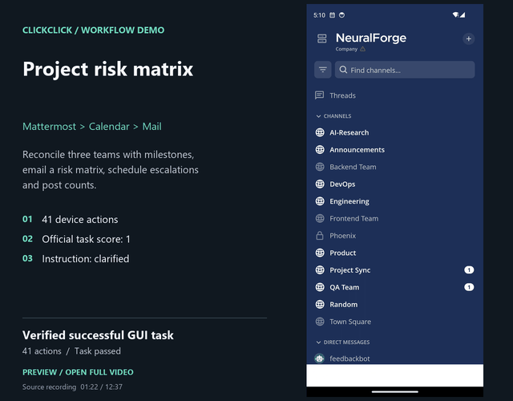
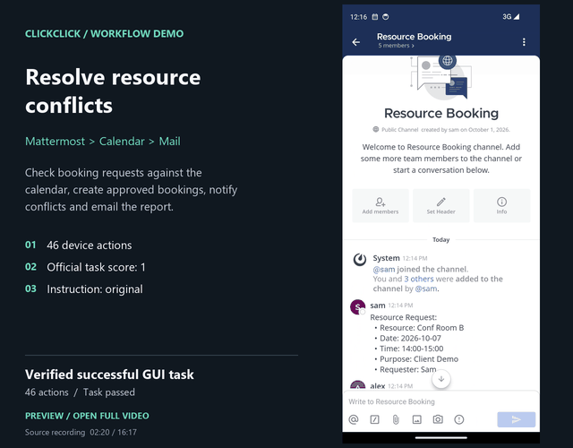
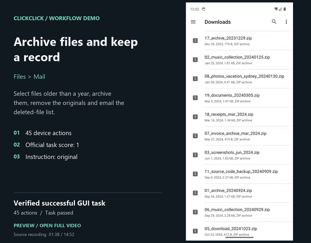

# ClickClick

**Let your AI assistant get work done across Android apps.**

Open source · Live task control · GUI script replay · Verified Skill improvements

[Download ClickClick](https://github.com/LordRosenberg/ClickClick/releases) · [Quick start](#quick-start) · [Demos](#see-it-in-action) · [中文](README.zh-CN.md)

> Check three teams' chat updates against the calendar milestones and email a risk report to the project manager. Schedule follow-ups for blocked items and post the status counts in the project channel.

## See it in action

| Assess project risk | Resolve booking conflicts | Archive old files |
| --- | --- | --- |
|  |  |  |
| Classify items as on track, at risk or blocked. | Book free slots, message requesters about conflicts and email a summary. | Select files older than a year, zip them, remove the originals and email the list. |

Click a preview to watch the complete task. [More recordings and task instructions](docs/demos.md)

## What you can do

- **Delegate from your chat.** Connect an MCP-compatible assistant to send Android tasks from your PC, or start them directly in Console.
- **See what is happening and steer the task.** Follow the screen and execution steps, answer questions, or change the instructions while a task runs. You can also pause, resume, and cancel. [Task controls](docs/hitl.md)
- **Replay a workflow you already ran.** Turn on **Record script** before a single-app task. From a successful run, ClickClick can draft a script with UI-tree and screenshot steps. Replay checks what is on screen and can hand a supported interruption to the agent before continuing. [GUI script design](docs/gui-script-design.md)
- **Keep what works for next time.** Run **Skills self-learning** from task details to test and save useful improvements for future tasks. [Skills self-learning](docs/skill-evolution.md)

## Quick start

1. [Download the Windows or macOS installer](https://github.com/LordRosenberg/ClickClick/releases), or follow the [source setup](docs/deployment.md). You can also [ask a local assistant to install it](docs/local-mcp.md#let-a-local-assistant-install-it).
2. Use Console to configure a model and connect an Android phone or emulator. [Installation and phone connection](docs/local-mcp.md#desktop-setup)
3. Start a task in Console or [connect your PC assistant through MCP](docs/local-mcp.md#register-mcp). [Example tasks](docs/task-examples.md)

## Documentation

| Topic | Guides |
| --- | --- |
| System design | [Architecture and design index](docs/architecture.md) · [Technical overview](docs/reliability-design.md) · [Design decisions](docs/design-decisions.md) |
| Skills self-learning | [Learning, regression and publication](docs/skill-evolution.md) |
| GUI script replay | [Recording, replay and recovery](docs/gui-script-design.md) |
| Setup and troubleshooting | [Setup and MCP](docs/local-mcp.md) · [Observability](docs/observability.md) |
| Evaluation | [Evaluation design](docs/evaluation-design.md) · [Benchmark reproduction](docs/evaluation.md) |
| Skill authoring | [Skill authoring guide](skills/README.md) |

[Apache 2.0](LICENSE) · [Third-party notices](THIRD_PARTY_NOTICES.md)

Project trends

<a href="https://www.star-history.com/?repos=LordRosenberg%2FClickClick&amp;type=date&amp;legend=top-left">
  <picture>
    <source media="(prefers-color-scheme: dark)" srcset="https://api.star-history.com/chart?repos=LordRosenberg/ClickClick&amp;type=date&amp;theme=dark&amp;legend=top-left" />
    <source media="(prefers-color-scheme: light)" srcset="https://api.star-history.com/chart?repos=LordRosenberg/ClickClick&amp;type=date&amp;legend=top-left" />
    
  </picture>
</a>

<a href="https://github.com/LordRosenberg/ClickClick/releases">
  <picture>
    <source media="(prefers-color-scheme: dark)" srcset="https://raw.githubusercontent.com/LordRosenberg/ClickClick/codex/androidworld-gallery/stats/installer-downloads-dark.svg" />
    <source media="(prefers-color-scheme: light)" srcset="https://raw.githubusercontent.com/LordRosenberg/ClickClick/codex/androidworld-gallery/stats/installer-downloads.svg" />
    
  </picture>
</a>

