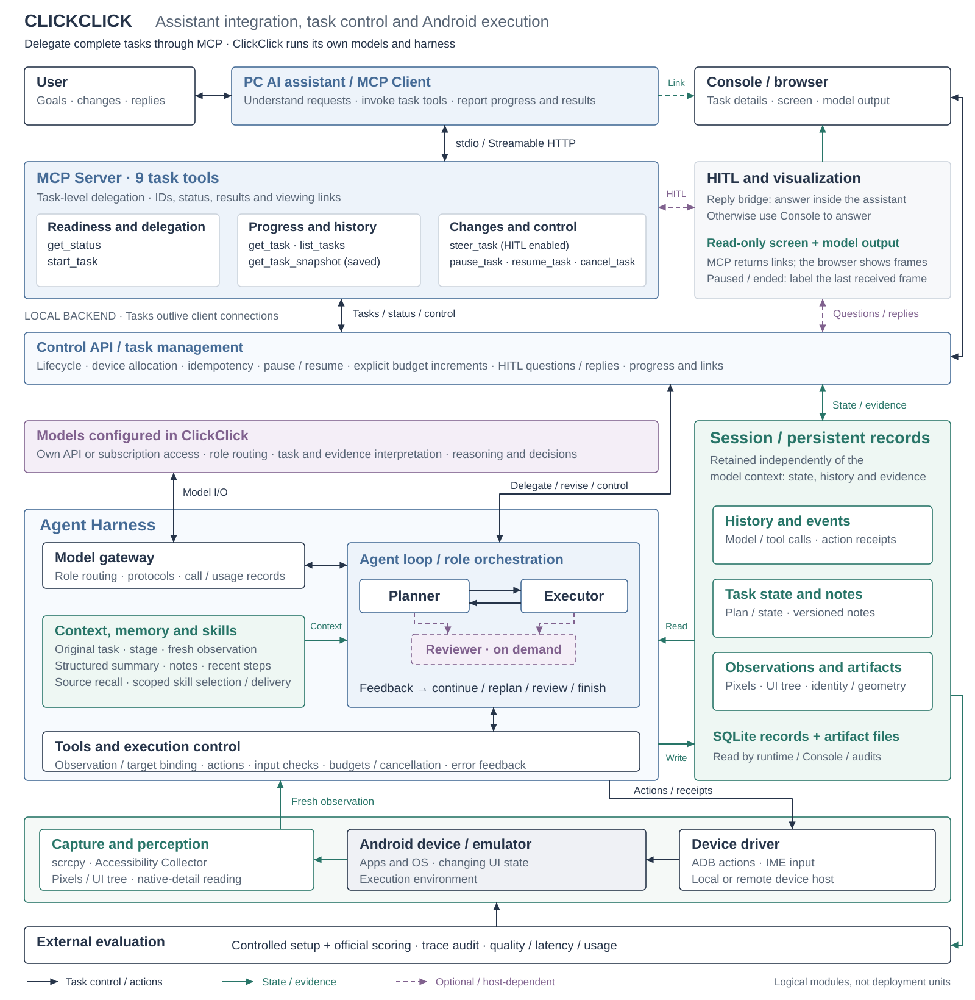

# ClickClick

**Give your AI the ability to get things done on Android.**

Cross-app tasks · PC assistant integration · Follow every step

[中文](README.zh-CN.md) · [Benchmark results](https://lordrosenberg.github.io/ClickClick/) · [Demos](#see-it-in-action) · [Quick Start](#connect-your-pc-ai-assistant-with-mcp) · [Source setup](#deployment) · [Docs](#documentation)

ClickClick is an open-source Android agent platform. Give it a goal in natural language: transfer information between apps, fill complex forms, manage collections or configure a schedule. It plans the work, operates the device and checks the result, with a web Console that lets you follow every step.

Through **MCP**, you can delegate Android tasks from your PC assistant, revise requirements during execution, check progress, and pause, resume or cancel. Assistants with an in-app browser can open a task preview showing the phone screen alongside model output.

## Benchmark results

| Benchmark | Score | Published leaderboard comparison | Details |
| --- | --- | --- | --- |
| MobileWorld GUI-only | Original **90.60% (106/117)**; clarified comparison **95.73% (112/117)** | #1 (checked 2026-10-07) | [Task traces](https://lordrosenberg.github.io/ClickClick/mobileworld/) · [Methodology](docs/mobileworld-results-20261007.md) |
| MobileWorld User-Int. | **77.27% (34/44)** | #1 (checked 2026-10-16) | [Tasks and conversations](https://lordrosenberg.github.io/ClickClick/mobileworld/?category=hitl#explore) · [Methodology](docs/mobileworld-hitl-results-20261015.md) |
| AndroidWorld | **99.14% (115/116)** | Tied #2 (checked 2026-10-02) | [Task traces](https://lordrosenberg.github.io/ClickClick/androidworld/) · [Methodology](docs/androidworld-results-20260921.md) |

## See it in action

### MobileWorld demos

Six successful cross-app tasks. Click a preview to watch the **complete video at 3× speed**.

| Project risk matrix | Resource conflicts | Research to shopping plan |
| --- | --- | --- |
|  |  |  |

| Lectures to calendar | Archive files and email record | Photos by travel location |
| --- | --- | --- |
|  |  |  |

[Video details](docs/demos.md#mobileworld-recordings--mobileworld-录屏) · [Latest screenshots and execution traces](https://lordrosenberg.github.io/ClickClick/mobileworld/)

### AndroidWorld demos

Real recordings of successful tasks. Click a preview to open the complete video at **3× speed**.

| Notes → recipes | Image → expense records | Recurring calendar event |
| --- | --- | --- |
|  |  |  |

| Deduplicate expenses | Create an ordered playlist | Summarize weekly activity |
| --- | --- | --- |
|  |  |  |

[Task instructions and recording details](docs/demos.md)

## Core capabilities

- **Plan, act and adapt:** revise plans from the current screen, operate through screenshots and accessibility structure, and call Reviewer when needed.
- **Memory and skills:** retain information across apps, recall source records and reuse app knowledge. Optimize my workflow produces skill candidates for review and per-file approval. [Skill self-improvement](docs/skill-evolution.md)
- **Visible execution:** inspect screenshots, model inputs and outputs, tool calls and usage in Console, or open a read-only phone preview alongside your assistant. [Observability guide](docs/observability.md)
- **Interaction during execution:** with HITL enabled, the agent can ask questions and wait for answers; you can also revise requirements and plans. Completed external actions are not automatically undone. [HITL guide](docs/hitl.md)
- **Model and device choice:** configure planning and execution models, and connect local phones, emulators or a remote Driver.

## Architecture

**Planner → Executor → observation → continue or replan**, with Reviewer on demand. The harness manages context, skills and execution; a persistent Session retains task evidence; Console exposes the run.

[Architecture](docs/architecture.md) · [Technical overview](docs/reliability-design.md) · [Design decisions](docs/design-decisions.md)

## Connect your PC AI assistant with MCP

**Recommended: let your AI assistant install and connect ClickClick.** Expand and copy the complete instructions below to an MCP-compatible assistant that can run commands on your PC:

Complete installation instructions (expand to copy)

> First read the complete official installation guide at https://github.com/LordRosenberg/ClickClick/blob/main/docs/local-mcp.md#let-a-local-assistant-install-it. Then install and connect ClickClick on this PC (https://github.com/LordRosenberg/ClickClick). Follow the installation guide, detect Windows/macOS and CPU architecture, download the matching official Release installer and verify its published SHA-256. If unavailable, follow source deployment; do not treat a source ZIP as an installer. For assistant-led first installation, explicitly use --origin assistant when the installer supports it; for source or older installations without that option, enable and save HITL during first setup while preserving any existing user choice. Check the installation exit status and backend identity. Open local settings so I can choose subscription login or an API; guide official authorization and let me enter API keys in the page, keeping them out of chat. Ask whether I want Wi-Fi, USB or an existing emulator, handle PC-side connection and guide phone debugging and permission prompts. Obtain the generated assistant connection prompt from Settings, read the local stdio configuration at its complete path, and register clickclick through your own official MCP command or configuration entry, preserving existing settings. If exporting with the installed ClickClick CLI, explicitly specify --client generic --transport stdio --output with a complete local file path, then read that file; do not use ClickClick register instead of your own registration mechanism. If this session can load MCP, call get_status to check model configuration and device initialization, and share the Console URL. If I must restart the client or open a new session, report "registered, verification pending", give exact steps, and provide this standalone instruction for the new session: "Call ClickClick get_status, check the connection, model configuration and phone initialization, and report readiness and unfinished steps." After verification, briefly introduce ClickClick and basic usage, explain the current HITL switch and its Console configuration location with new-task-only scope, and prefer your in-app browser for future supported task screen previews, falling back to task details when unsupported. Registration and ADB connectivity alone are not successful verification. get_status makes no model requests or phone test tasks; run an actual phone test only when I explicitly request it.

For manual setup, see the [installation and phone connection guide](docs/local-mcp.md#desktop-setup).

Once connected, describe a task in your assistant's chat:

> Use ClickClick to copy the three recipes in this note into my recipe app. Preserve ingredients and directions, check the saved records, and tell me whether the task is complete.

Ask for progress, revise requirements, pause, resume or cancel, and follow the Console link to inspect execution. Keep the PC and phone online. `get_status` checks readiness; an actual task is needed to verify results.

[Installation and phone connection](docs/local-mcp.md#desktop-setup) · [MCP setup guide](docs/local-mcp.md) · [More task examples](docs/task-examples.md)

## Deployment

Source installation requires Python 3.12, Node.js/npm, Android SDK Platform-Tools and a model service supporting images and tool calls. Follow the [deployment guide](docs/deployment.md) for environment setup, model configuration, device connection and startup. Desktop installer users can start from Settings.

## Evaluation and reproduction

- **MobileWorld:** [Latest results and configuration](docs/mobileworld-results-20261007.md) · [Fixed-configuration reproduction guide (117 original tasks + 9 variants)](docs/mobileworld-reproduction.md).
- **User-Int.:** [Methodology and limits](docs/mobileworld-hitl-results-20261015.md).
- **AndroidWorld:** [Setup, execution and resume guide](evaluation/androidworld/README.md) · [Evaluation report](docs/androidworld-results-20260921.md).

## Documentation

| Guide | What you will learn | 中文 |
| --- | --- | --- |
| [PC assistant MCP integration](docs/local-mcp.md) | Setup, nine task tools, progress and pause/resume. | [中文](docs/local-mcp.zh-CN.md) |
| [Desktop setup quickstart](docs/local-mcp.md#desktop-setup) | Installers, subscription/API configuration, Wi-Fi/USB and registration. | [中文](docs/desktop-setup.zh-CN.md) |
| [Technical overview](docs/reliability-design.md) | Design goals and the reasoning behind the core mechanisms. | [中文](docs/reliability-design.zh-CN.md) |
| [Architecture](docs/architecture.md) | Modules, interfaces, execution flow and detailed subsystem designs. | [中文](docs/architecture.zh-CN.md) |
| [Design decisions](docs/design-decisions.md) | Trade-offs in review, context, capture and input. | [中文](docs/design-decisions.zh-CN.md) |
| [Deployment](docs/deployment.md) | Models, devices, installation and remote operation. | [中文](docs/deployment.zh-CN.md) |
| [Observability](docs/observability.md) | Console navigation, traces and performance analysis. | [中文](docs/observability.zh-CN.md) |
| [Task examples](docs/task-examples.md) | Natural-language task examples and result verification. | [中文](docs/task-examples.zh-CN.md) |
| [Evaluation](docs/evaluation.md) | Benchmark setup, scoring and reproduction. | [中文](docs/evaluation.zh-CN.md) |
| [Skills](skills/README.md) | App knowledge, operating guidance and skill authoring. | [中文](skills/README.zh-CN.md) |
| [Human-in-the-loop](docs/hitl.md) | Questions, confirmations and reply routing. | [中文](docs/hitl.zh-CN.md) |

Licensed under [Apache 2.0](LICENSE).

See [third-party notices](THIRD_PARTY_NOTICES.md) for bundled components.

## Project trends

<a href="https://www.star-history.com/?repos=LordRosenberg%2FClickClick&amp;type=date&amp;legend=top-left">
  <picture>
    <source media="(prefers-color-scheme: dark)" srcset="https://api.star-history.com/chart?repos=LordRosenberg/ClickClick&amp;type=date&amp;theme=dark&amp;legend=top-left" />
    <source media="(prefers-color-scheme: light)" srcset="https://api.star-history.com/chart?repos=LordRosenberg/ClickClick&amp;type=date&amp;legend=top-left" />
    
  </picture>
</a>

<a href="https://github.com/LordRosenberg/ClickClick/releases">
  <picture>
    <source media="(prefers-color-scheme: dark)" srcset="https://raw.githubusercontent.com/LordRosenberg/ClickClick/codex/androidworld-gallery/stats/installer-downloads-dark.svg" />
    <source media="(prefers-color-scheme: light)" srcset="https://raw.githubusercontent.com/LordRosenberg/ClickClick/codex/androidworld-gallery/stats/installer-downloads.svg" />
    
  </picture>
</a>
