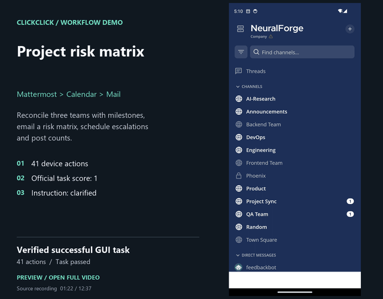
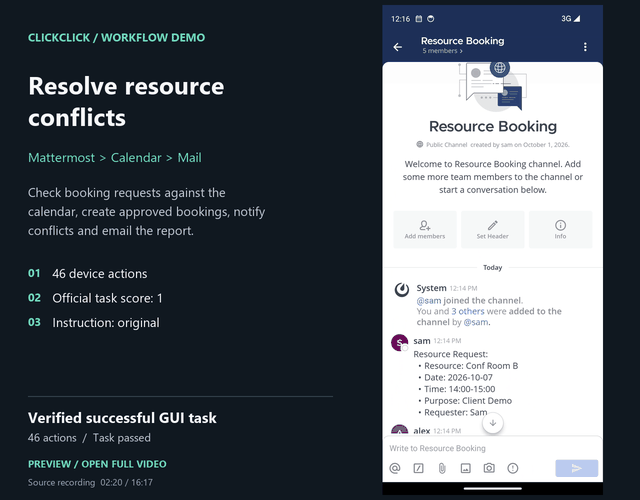
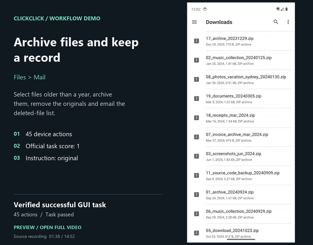

# ClickClick

**让 AI 助手替你完成 Android 跨应用任务。**

开源 Android Agent · 实时查看与调整 · 脚本录制回放 · Skills 自学习

[下载安装](https://github.com/LordRosenberg/ClickClick/releases) · [快速开始](#快速开始) · [看看演示](#效果演示) · [English](README.md)

> 对照三个团队的群聊和日历里程碑，给项目经理发风险报告，为卡住的事项安排跟进，并在项目群汇总。

## 效果演示

| 核对团队进度 汇报项目风险 | 对照日历 处理预订冲突 | 归档旧文件 邮件发送清单 |
| --- | --- | --- |
|  |  |  |
| 区分正常、有风险和已卡住的事项。 | 无冲突就创建预订，有冲突就私信申请人，再邮件汇总。 | 筛出一年以上的文件，压缩归档后删除原件。 |

点击动图观看完整任务。 [更多录屏和任务指令](docs/demos.md)

## 你可以用它做什么

- **在对话里交办跨 App 任务。** 通过 MCP 接入电脑上的 AI 助手，也可以直接在 Console 发起任务。
- **边看边调整。** 随时查看手机画面和执行步骤，回答 Agent 的问题，或在任务跑到一半时补充要求。也可以暂停、恢复或取消。 [任务控制](docs/hitl.zh-CN.md)
- **把跑过的流程留作下次回放。** 发起单 App 任务前勾选「录制脚本」，可从成功轨迹生成控件树和截图混用的脚本。回放会检查目标和结果，遇到支持的异常可由 Agent 接管。 [GUI 脚本详设](docs/gui-script-design.zh-CN.md)
- **把有效经验留给下次。** 在任务详情发起「Skills 自学习」，让 ClickClick 验证并保留可复用的改进。 [Skills 自学习详设](docs/skill-evolution.zh-CN.md)

## 快速开始

1. [下载 Windows 或 macOS 安装器](https://github.com/LordRosenberg/ClickClick/releases)，也可以[让本地助手安装](docs/desktop-setup.zh-CN.md#两种首次安装入口)或[从源码启动](docs/deployment.zh-CN.md)。
2. 在 Console 配置模型，连接 Android 手机或模拟器。 [安装和手机连接](docs/desktop-setup.zh-CN.md)
3. 在 Console 发起任务，或[通过 MCP 接入电脑上的助手](docs/local-mcp.zh-CN.md)。 [任务示例](docs/task-examples.zh-CN.md)

## 文档导航

| 主题 | 文档 |
| --- | --- |
| 系统设计 | [架构与详设索引](docs/architecture.zh-CN.md) · [技术概览](docs/reliability-design.zh-CN.md) · [设计取舍](docs/design-decisions.zh-CN.md) |
| Skills 自学习 | [学习、回归与发布](docs/skill-evolution.zh-CN.md) |
| GUI 脚本 | [录制、回放与接管](docs/gui-script-design.zh-CN.md) |
| 接入与排查 | [MCP 接入](docs/local-mcp.zh-CN.md) · [可观测性](docs/observability.zh-CN.md) |
| 评测与复现 | [评价体系](docs/evaluation-design.zh-CN.md) · [评测复现](docs/evaluation.zh-CN.md) |
| 编写 Skill | [Skill 编写指南](skills/README.zh-CN.md) |

[Apache 2.0](LICENSE) · [第三方许可证](THIRD_PARTY_NOTICES.md)

项目趋势

<a href="https://www.star-history.com/?repos=LordRosenberg%2FClickClick&amp;type=date&amp;legend=top-left">
  <picture>
    <source media="(prefers-color-scheme: dark)" srcset="https://api.star-history.com/chart?repos=LordRosenberg/ClickClick&amp;type=date&amp;theme=dark&amp;legend=top-left" />
    <source media="(prefers-color-scheme: light)" srcset="https://api.star-history.com/chart?repos=LordRosenberg/ClickClick&amp;type=date&amp;legend=top-left" />
    
  </picture>
</a>

<a href="https://github.com/LordRosenberg/ClickClick/releases">
  <picture>
    <source media="(prefers-color-scheme: dark)" srcset="https://raw.githubusercontent.com/LordRosenberg/ClickClick/codex/androidworld-gallery/stats/installer-downloads-dark.svg" />
    <source media="(prefers-color-scheme: light)" srcset="https://raw.githubusercontent.com/LordRosenberg/ClickClick/codex/androidworld-gallery/stats/installer-downloads.svg" />
    
  </picture>
</a>

