

# ClickClick

**让 AI 在 Android 上完成真正的工作。**

跨应用任务 · PC 助手接入 · 执行过程可查看

[English](README.md) · [评测成绩](https://lordrosenberg.github.io/ClickClick/) · [效果演示](#效果演示) · [快速开始](#通过-mcp-接入-pc-端-ai-助手) · [源码部署](#部署) · [文档](#文档导航)

ClickClick 是一个开源 Android Agent 平台。用自然语言描述目标，它就能跨应用搬运信息、填写复杂表单、管理记录、配置日程，并规划步骤、操作设备和检查结果。Web Console 让你随时查看执行进度，深入检查每一次决策。

通过 **MCP** 接入 PC 端 AI 助手后，你可以在对话中交办手机任务、补充或调整正在执行的要求，也可以暂停、恢复或取消。助手支持内置浏览器时，会优先打开任务投屏预览，让你同时查看手机画面与模型输出。

## 评测成绩

| 评测 | 成绩 | 已核对的公开榜单对比 | 详情 |
| --- | --- | --- | --- |
| MobileWorld 纯 GUI | 原题 **90.60%（106/117）**；澄清对照 **95.73%（112/117）** | 第 1（2026-10-07） | [逐题轨迹](https://lordrosenberg.github.io/ClickClick/mobileworld/) · [评测说明](docs/mobileworld-results-20261007.md) |
| MobileWorld 交互类 | **77.27%（34/44）** | 第 1（2026-10-16） | [逐题问答](https://lordrosenberg.github.io/ClickClick/mobileworld/?category=hitl#explore) · [评测说明](docs/mobileworld-hitl-results-20261015.md) |
| AndroidWorld | **99.14%（115/116）** | 并列第 2（2026-10-02） | [逐题轨迹](https://lordrosenberg.github.io/ClickClick/androidworld/) · [评测说明](docs/androidworld-results-20260921.md) |

## 效果演示

### MobileWorld 演示

六个跨应用成功任务录屏。点击预览，观看 **3 倍速完整视频**。

| 项目风险矩阵 | 资源预订冲突 | 网页资料转采购计划 |
| --- | --- | --- |
| [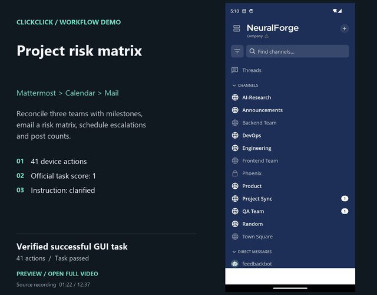](docs/assets/demos/mobileworld/project-risk-matrix.mp4) | [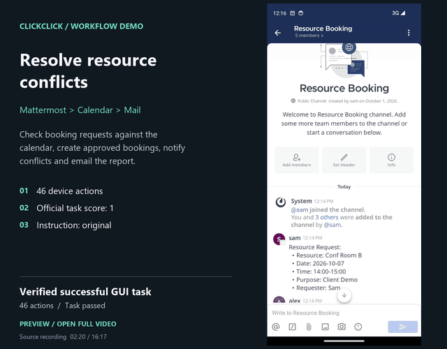](docs/assets/demos/mobileworld/resource-conflicts.mp4) |  |

| 讲座转日历 | 文件归档与邮件留档 | 按旅行地点整理照片 |
| --- | --- | --- |
| [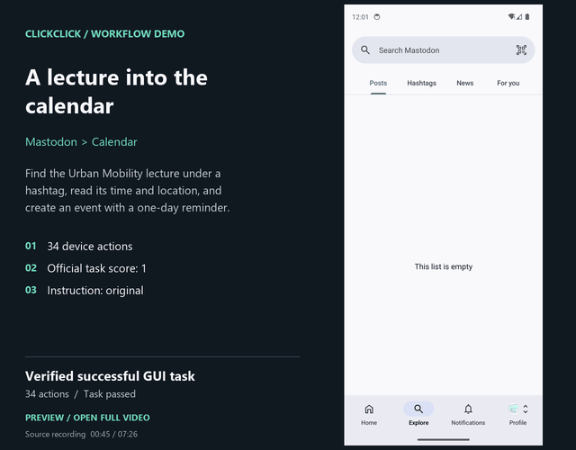](docs/assets/demos/mobileworld/lectures-to-calendar.mp4) | [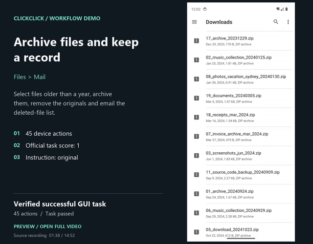](docs/assets/demos/mobileworld/archive-old-files.mp4) | [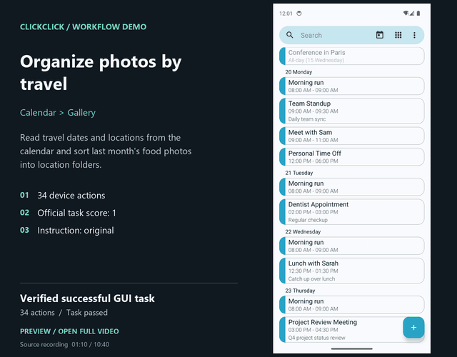](docs/assets/demos/mobileworld/photos-by-travel-location.mp4) |

[任务指令与录屏说明](docs/demos.md#mobileworld-recordings--mobileworld-录屏) · [最新截图与执行轨迹](https://lordrosenberg.github.io/ClickClick/mobileworld/)

### AndroidWorld 演示

真实成功任务录屏。点击预览，观看 **3 倍速完整视频**。

| 笔记 → 食谱 | 图片 → 费用记录 | 重复日历事件 |
| --- | --- | --- |
| [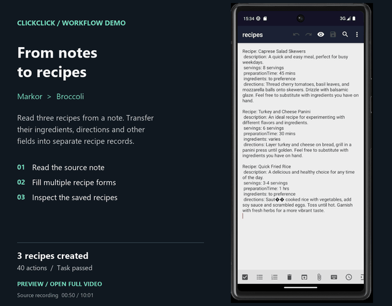](docs/assets/demos/notes-to-recipes.mp4) | [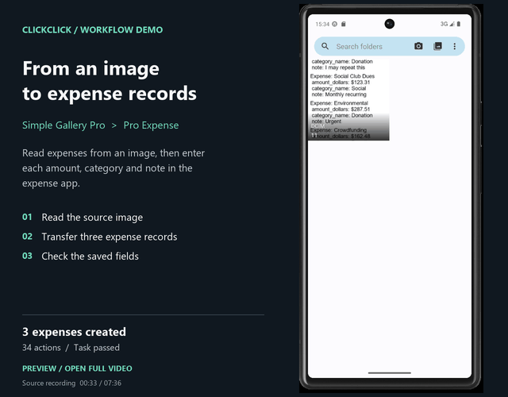](docs/assets/demos/image-to-expenses.mp4) | [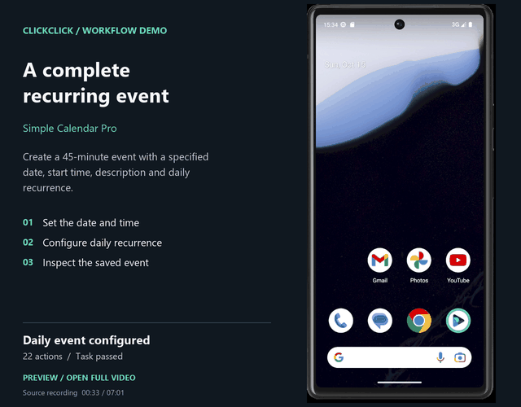](docs/assets/demos/recurring-calendar-event.mp4) |

| 费用去重 | 按顺序创建歌单 | 每周运动时长统计 |
| --- | --- | --- |
| [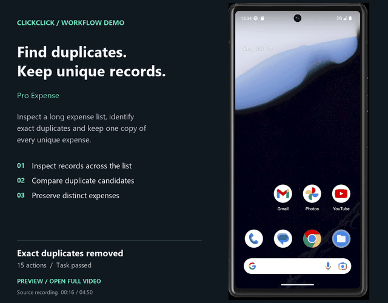](docs/assets/demos/deduplicate-expenses.mp4) | [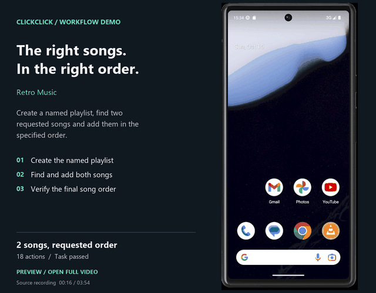](docs/assets/demos/ordered-playlist.mp4) | [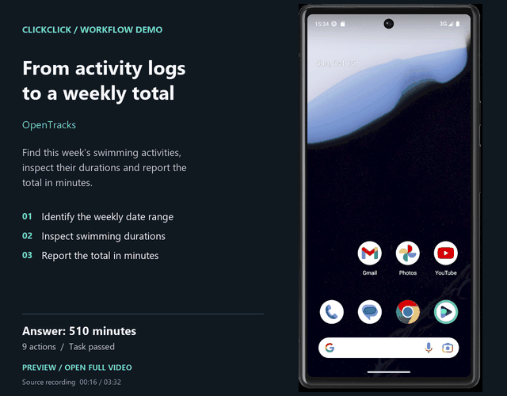](docs/assets/demos/weekly-activity-summary.mp4) |

[任务指令与录屏说明](docs/demos.md)

## 核心能力

- **规划与执行：** 根据实际页面调整计划，结合截图与无障碍结构操作设备，按需调用 Reviewer。
- **记忆与技能：** 保留跨应用任务的关键信息，回读原始记录，复用应用经验；可通过“优化我的工作流”生成技能候选，经审查后逐文件批准。[Skills 自进化](docs/skill-evolution.zh-CN.md)
- **过程可查看：** Console 展示截图、模型输入与输出、工具调用和用量；支持在助手旁打开只读投屏预览。[可观测性指南](docs/observability.zh-CN.md)
- **执行中可交互：** 开启 HITL 后，Agent 可提问等待回答，你也可补充要求或调整计划。已完成的外部操作不会自动撤销。[HITL 指南](docs/hitl.zh-CN.md)
- **模型与设备可选：** 支持配置规划和执行模型，连接本地真机、模拟器或远程 Driver。

## 核心架构

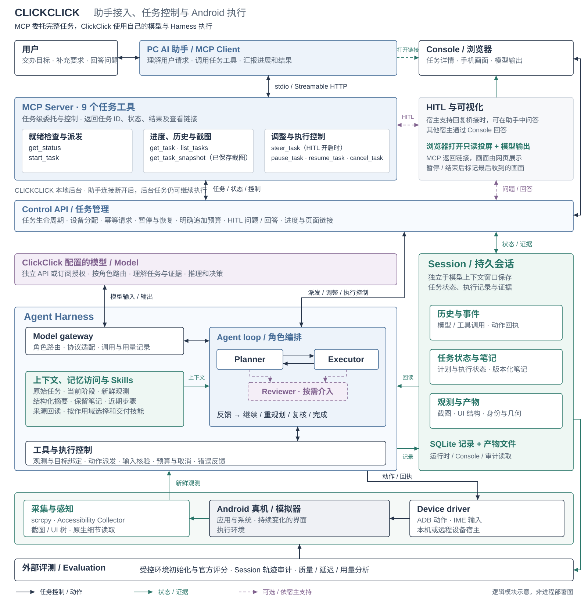

**Planner → Executor → 观测 → 继续或重规划**，Reviewer 按需介入。Harness 管理上下文、技能与执行，持久 Session 保存任务证据，Console 展示过程。

[架构详解](docs/architecture.zh-CN.md) · [技术概览](docs/reliability-design.zh-CN.md) · [设计取舍](docs/design-decisions.zh-CN.md)

## 通过 MCP 接入 PC 端 AI 助手

**推荐让 AI 助手安装并连接。** 展开并复制下面的完整指令，发给支持 MCP、能在电脑上执行命令的助手：

完整安装指令（点击展开）

> 请先完整阅读官方安装指南（https://github.com/LordRosenberg/ClickClick/blob/main/docs/desktop-setup.zh-CN.md），再帮我在这台电脑上安装并连接 ClickClick（https://github.com/LordRosenberg/ClickClick）。按安装指南识别 Windows/macOS 和 CPU 架构，从官方 Releases 下载匹配的安装器并核对该发布的 SHA-256；没有匹配安装器时，按源码部署指南处理，不把源码压缩包当安装器。助手引导首次安装应在安装器支持时传入 --origin assistant，使 HITL 默认开启；旧版不支持该选项时在首次 Console 设置中明确开启并保存，保留已有用户选择。安装后检查退出状态及后台 identity。打开本机设置页，让我选择订阅登录或 API，协助官方授权；API Key 由我在页面填写，不放进聊天。问我用 Wi-Fi、USB 还是已有模拟器，代办电脑侧连接并具体指导手机调试与权限确认。在设置页的“让助手添加”入口取得包含完整本机配置文件路径的接入提示词，读取该 stdio 配置，并用你自己的官方 MCP 管理命令或配置入口注册 clickclick，保留已有设置。若通过安装版 CLI 导出，必须指定 --client generic --transport stdio --output 和一个明确的本机文件完整路径，再读取该文件；不要调用 ClickClick register 代替你的注册步骤。能在当前会话加载 MCP 就调用 get_status，检查模型配置和手机初始化，分享 Console 链接。若需我重启客户端或新开会话，请报告“注册完成，待验证”，给出具体操作，并让我在新会话发送：“请调用 ClickClick 的 get_status，检查连接、模型配置和手机初始化，说明是否就绪及未完成事项。”不要把注册或 ADB 在线当成验证成功；get_status 不进行模型请求或手机任务测试。只有我明确要求时才执行实际手机测试任务。验证后在当前对话简短介绍 ClickClick 和基本用法，说明当前 HITL 开关、Console 配置位置及仅新任务生效；今后派发成功后优先用你的内置浏览器打开任务页，按任务复用，不可用时提供链接。

需要自行安装时，见[手动安装与手机连接指南](docs/desktop-setup.zh-CN.md)。

连接就绪后，直接在助手对话中描述任务：

> 用 ClickClick 把这篇笔记里的三份食谱录入食谱 App，保留食材和做法，核对保存结果，并告诉我是否完成。

执行中可查询进度、调整要求、暂停、恢复或取消，通过 Console 链接查看过程。运行时请保持电脑与手机在线。`get_status` 仅检查就绪状态，实际效果需通过任务验证。

[完整安装与手机连接指南](docs/desktop-setup.zh-CN.md) · [MCP 接入指南](docs/local-mcp.zh-CN.md) · [更多任务示例](docs/task-examples.zh-CN.md)

## 部署

源码安装需要 Python 3.12、Node.js/npm、Android SDK Platform-Tools，以及支持图像与工具调用的模型服务。按[部署指南](docs/deployment.zh-CN.md)完成环境安装、模型配置、设备连接和服务启动；使用桌面安装器可直接从设置页开始。

## 评测与复现

- **MobileWorld：** [最新成绩与配置](docs/mobileworld-results-20261007.md) · [固定配置复现指南（117 道原题 + 9 道变体）](docs/mobileworld-reproduction.zh-CN.md)。
- **交互类：** [评测方法与能力边界](docs/mobileworld-hitl-results-20261015.md)。
- **AndroidWorld：** [完整准备、运行与恢复指南](evaluation/androidworld/README.md) · [评测报告](docs/androidworld-results-20260921.md)。

## 文档导航

| 文档 | 内容 | English |
| --- | --- | --- |
| [PC 助手 MCP 接入](docs/local-mcp.zh-CN.md) | 接入、九个任务工具、进展与暂停恢复。 | [English](docs/local-mcp.md) |
| [桌面安装与连接](docs/desktop-setup.zh-CN.md) | 安装器、订阅/API、Wi-Fi/USB、注册与升级。 | [English quickstart](docs/local-mcp.md#desktop-setup) |
| [技术概览](docs/reliability-design.zh-CN.md) | 设计目标与核心机制：为什么这样组织 Agent。 | [English](docs/reliability-design.md) |
| [架构详解](docs/architecture.zh-CN.md) | 模块、接口与执行流程，以及各模块的详细设计。 | [English](docs/architecture.md) |
| [设计取舍](docs/design-decisions.zh-CN.md) | 审核、上下文、采集与输入的设计选择。 | [English](docs/design-decisions.md) |
| [部署指南](docs/deployment.zh-CN.md) | 模型、设备、安装与远程运行。 | [English](docs/deployment.md) |
| [可观测性](docs/observability.zh-CN.md) | Console 操作、轨迹检查与性能分析。 | [English](docs/observability.md) |
| [任务实例](docs/task-examples.zh-CN.md) | 自然语言任务示例和结果验证。 | [English](docs/task-examples.md) |
| [评测指南](docs/evaluation.zh-CN.md) | 基准配置、评分与复现。 | [English](docs/evaluation.md) |
| [Skills 指南](skills/README.zh-CN.md) | 应用知识、操作经验和技能编写。 | [English](skills/README.md) |
| [HITL 提问与确认](docs/hitl.zh-CN.md) | 必要时提问、回答入口与原调用恢复。 | [English](docs/hitl.md) |

许可证：[Apache 2.0](LICENSE)。

第三方组件见[许可证说明](THIRD_PARTY_NOTICES.md)。

## 项目趋势

<a href="https://www.star-history.com/?repos=LordRosenberg%2FClickClick&amp;type=date&amp;legend=top-left">
  <picture>
    <source media="(prefers-color-scheme: dark)" srcset="https://api.star-history.com/chart?repos=LordRosenberg/ClickClick&amp;type=date&amp;theme=dark&amp;legend=top-left" />
    <source media="(prefers-color-scheme: light)" srcset="https://api.star-history.com/chart?repos=LordRosenberg/ClickClick&amp;type=date&amp;legend=top-left" />
    
  </picture>
</a>

<a href="https://github.com/LordRosenberg/ClickClick/releases">
  <picture>
    <source media="(prefers-color-scheme: dark)" srcset="https://raw.githubusercontent.com/LordRosenberg/ClickClick/codex/androidworld-gallery/stats/installer-downloads-dark.svg" />
    <source media="(prefers-color-scheme: light)" srcset="https://raw.githubusercontent.com/LordRosenberg/ClickClick/codex/androidworld-gallery/stats/installer-downloads.svg" />
    
  </picture>
</a>
