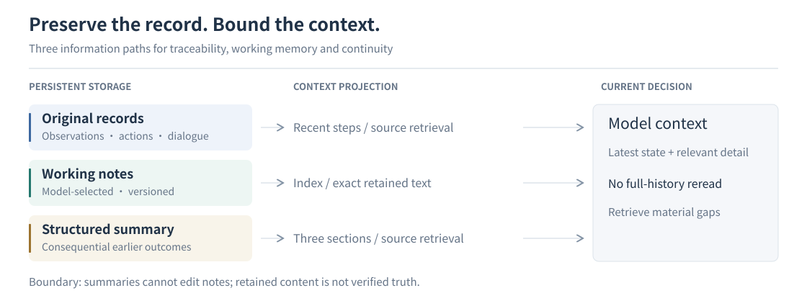

# System architecture

[README](../README.md) · [中文](architecture.zh-CN.md) · [Technical overview](reliability-design.md) · [Design decisions](design-decisions.md)

This guide describes **module boundaries, interfaces and task execution flow**, with links to detailed subsystem designs. The [technical overview](reliability-design.md) explains the goals behind the core mechanisms.

## What harness means here

The **agent harness** is the runtime surrounding model inference: it builds requests, manages role transitions, selects skills and history, validates tool submissions, dispatches actions and returns feedback. **Session** is the durable task record. **Device tools** interact with the phone and construct observations.

| Module | Responsibility | Main interface |
| --- | --- | --- |
| Model | Interpret the task, choose goals and actions, judge evidence. | Role-specific model requests and structured submissions. |
| Agent harness | Coordinate planning, context, skills, tools, budgets and feedback. | Task loop, role tool sessions and action validation. |
| Session | Store events, observations, dialogue, note versions and artifacts. | TaskStore backed by SQLite and artifact files. |
| Device tools | Capture UI state and execute Android operations. | Driver actions and ObservationPackage results. |
| Console / Control API | Manage tasks/devices and expose execution state. | HTTP APIs, SSE, Timeline and saved screenshots. |
| Evaluation | Initialize controlled tasks and score outcomes independently. | Benchmark adapter and external task predicates. |

These are logical boundaries. Control API hosts the harness; device tools can run locally or on a remote Driver host. A role's bounded tool session is distinct from the persistent Session. The storage model includes both append-only records and mutable task snapshots.

## Task lifecycle

1. Console or a caller submits an instruction, model configuration and target device.
2. The runtime prepares the device, captures an observation and restores task records.
3. Planner selects a current stage and relevant skills.
4. Executor reads the current stage, memory and observation, then submits an action or a stage transition.
5. The harness validates the submission, executes accepted actions and stores receipts and resulting evidence.
6. Execution continues, returns to planning, or requests independent review. Task termination preserves the final state and trace.

The original instruction remains recorded; later accepted user changes supersede conflicting requirements. Models interpret requirements; deterministic checks validate schemas, references, stage identity, supported input preconditions and limits.

## Roles and transitions

`Settings.agent_architecture` selects the policy. `plan_executor` is the default; `plan_reviewer` requires final review.

| Role / submission | Default `plan_executor` behavior |
| --- | --- |
| Planner `continue` | Keep the current stage and Executor dialogue after assessing a user adjustment. |
| Planner `execute` | Persist the revised current stage and invoke Executor. |
| Planner `complete` | Complete the task if submission checks and task limits permit it. |
| Planner `review` | Invoke Reviewer with the stated conflict and evidence. |
| Executor `act` | Validate and dispatch a typed action, then record feedback and continue. |
| Executor `advance` | Complete the identified stage and return to Planner. |
| Executor `replan` | Return the observed mismatch to Planner. |
| Executor `finish` | Ask Planner for the task-level verdict. |
| Executor `review` | Invoke Reviewer even in two-role mode. |
| Reviewer `complete` | Complete the task. |
| Reviewer `execute` / `replan` | Return to execution or planning according to the verdict and current stage. |
| Planner or Reviewer `inconclusive` | End without claiming success. |

In `plan_reviewer`, Planner completion and Executor `finish` route to Reviewer. This policy does not mean that every device action is reviewed. Explicit `review` remains available in either mode.

On-demand review is chosen inside an existing model decision, not by a separate review-selection model. Prompts distinguish a known missing device check from a dispute needing independent judgment. Repeating review with the same observation, plan revision, execution count and note versions fails explicitly instead of looping indefinitely.

Source: [runtime selection](../agent/runtime.py), [orchestration](../agent/revisable/orchestrator.py), [Planner/Reviewer schemas](../shared/revisable.py), [Executor submission](../agent/revisable/session.py).

## A device interaction

An observation package binds a capture identity to global pixels, normalized UI structure, frame/model geometry and capture metadata. `accepted`, `actionable` and `index_actionable` distinguish an accepted capture, usable coordinate actions and usable indexed targets. Executor must reference the current observation when acting; retrieved historical images cannot replace that action basis.

For supported local indexed taps, a private handle binds the selected index to the observed native node. The driver refreshes and checks the retained node before a single native click. Invalid or uncertain native results return feedback without silently reusing old coordinates. Other actions retain their documented coordinate paths.

Supported targeted text replacement resolves a field, establishes and checks focus, writes the text and verifies readback. Receipts separate dispatch, input and observed effects. An input value is not by itself proof that the app saved a record.

Skill-authorized compound actions run a closed sequence through the same primitive transactions. Intermediate observations are stored as historical evidence; the final observation supplies the next actionable state. Physical subactions and submitted action units are separately recorded.

## Observation path

The driver-owned scrcpy stream supplies agent pixels; Console details reads saved screenshots; the read-only task preview can display frames already published by a running task. PyAV decodes frames; Accessibility Collector supplies nodes, windows and available events. Perception builds the normalized UI and Set-of-Mark view. ADB screencap is the fallback pixel source.

Freshness checks use capture request boundaries and window generations. Bounded resampling handles transitions; usable pixels can remain available when structure is missing. Pixels and accessibility state are asynchronous, so this is not an atomic snapshot of every animated interface. See [capture design](design-decisions.md#scrcpy-collector-and-python).

`observe_screen` offers three views through the same capture boundary:

| Mode | Model input | Action basis |
| --- | --- | --- |
| `snapshot` | Current global screen and available UI structure | Accepted fresh global observation |
| `sequence` | A bounded sequence showing change over time | The latest accepted global observation |
| `detail` | Fresh native capture, locator overview and either a selected crop or four overlapping tiles | The paired fresh global observation; reading tiles are not actionable coordinates |

The detail path preserves observation identity, native frame geometry and crop bounds on its attachments. It avoids reusing old tree overlays or enlarging reduced pixels. See [native detail capture](../agent/screen_detail.py) and [ObservationPackage](../perception/observation.py).

## Context, memory and skills

Memory has three layers: original records preserve sources, versioned notes retain information needed later, and structured summaries connect earlier execution history. The original instruction, current stage, budget, fresh observation, historical summary, recent steps, retained notes and applicable skills are assembled independently for each role.

Compaction keeps the newest two complete execution steps. `clickclick.summary.v2` separates `results`, `decisions_and_attempts` and `critical_context`; every item binds to durable source references. The summary targets 3,000 characters with a 4,000-character hard limit. Schema, length and reference validation establish a mechanically valid summary, not semantic truth.

Each note has a versioned full body and an optional `retained` excerpt of at most 600 characters. A bounded 3,000-character packet restores selected excerpts alongside the note directory; unresolved questions and measurements are restored separately. Exact note-version and retained-text matches allow reversible display deduplication. `summary_source` and `read_history` retrieve the original evidence when detail is needed. Summaries cannot edit notes or delete raw records. See [Memory and context design](memory-and-context.md) for lifecycles, fields and budgets.

Planner selects stage skills from the catalog. Device profiles filter system-specific guidance; target and observed foreground identities determine applicable app knowledge. Role sections tailor the delivered body, with skill IDs, versions and content hashes recorded. App-owned compound recipes additionally require matching active stage and foreground scope. See the [skill authoring guide](../skills/README.md).

An explicit research entry point can extract skill revisions from real failures and detours. Learner maintains continuous analysis; an independent Skill Reviewer checks quality and selects necessary validation. One job supports multiple app files, joint checks and local admission per file. Candidates enter pending review rather than hot-writing the canonical library, and ordinary completion does not automatically start paid learning. See [Skill self-improvement](skill-evolution.md) for the cycle, evidence boundaries and current capability.

## HITL intervention and plan updates

MCP `steer_task` and the corresponding Control API append ordered, idempotent user changes to a durable task inbox. The original request remains intact. Planner keeps a still-valid stage and Executor dialogue or revises affected work. Every role receives user changes through independent dynamic context; compaction cannot discard them or rewrite the stable prompt prefix.

Model invocations carry instruction revisions and execution generations. Accepting a change invalidates undispatched obsolete work and allows replanning without waiting for stale inference; late replies remain diagnostic. Dispatch and reception have a deterministic order: an in-flight transaction records its actual receipt before subsequent work is replanned. Completion first creates linked follow-up work; an accepted update first must be processed before completion. Pause, cancellation and question handling retain their lifecycle boundaries.

HITL is frozen when a task is created. Assistant-guided first installations default it on, other installations off, and saved choices take precedence. Disabled tasks add no intervention policy, model tools or steering waiter; the MCP tool stays discoverable and returns settings guidance. See [HITL usage and integration](hitl.md).

Ordinary defaults are cumulative limits of 200 Executor decisions and 1000 model requests; explicit evaluation budgets take precedence. Exhaustion remains failed, with explicit extension from a safe budget checkpoint. Earlier attempts, receipts and total usage are retained; only explicit extra time extends a deadline. Ordinary failures are not resumable through this feature.

## Read-only preview alongside an assistant

Accepted delegation returns preview/details links and generic host presentation hints. An assistant with an in-app browser prefers the task preview and reuses its tab by task ID, falls back to details when unsupported, or shares links when browser opening is unavailable. This contract does not depend on a named assistant or sidebar API.

The local Android preview reads frames already published by the active task and appends model output through existing SSE and response artifacts. Task/device/run identity is checked and retained images are labelled. Viewing acquires no separate device lease, triggers no extra capture or input, and cannot change task outcomes. Details and preview offer navigation in both directions. See [Console observability](observability.md).

## Recovery after an unexpected interruption

The independent backend owns tasks; MCP/API clients submit and control them, so a client disconnect is distinct from a backend crash. After an unexpected backend exit, a durable scheduling scan finds non-terminal tasks whose owner was lost and resumes them under exclusive ownership. New tasks freeze `safe_auto` (the default), `manual` or `disabled` at creation; legacy tasks without recovery metadata are not forced to continue.

### Persistence and action ordering

**Model returns a call → T1 pre-dispatch transaction → Driver journal accepts and executes → T2 persists the receipt → post-observation → T3 commits the step and complete state.** T1 stores the normalized decision, notes and budget reservation; T3 atomically updates the step, AgentState, recovery manifest and accounting. Database transactions do not span ADB or model requests and cannot atomically commit a phone's side effects.

- `execution_epoch / worker_token` fence task writes; a cross-task monotonic `device_fence` fences device input. Recovery fences and drains the old input chain before taking over. Devices remain quarantined if quiescence cannot be established; cancellation and device cleanup are separate.
- The Driver journal deduplicates operation IDs with argument digests and retains receipts. Reusing an old ID never issues input again. Compound actions retain child ordinals; recovery neither restarts the sequence nor automatically runs its remaining tail.
- Recovery queries the original receipt within a bound. A missing receipt closes the original attempt as `unknown`; screenshots cannot establish whether the historical action executed. Old action grounding expires. The saved role receives a fresh `recovery_current` observation and decides what to do next, using a new ID for any new action.
- Unknown reservations become `settled_uncertain` instead of being refunded as unexecuted. Late facts are appended once without duplicating tool results, steps or charges, or reviving terminal tasks. Missing model usage also remains unknown.

### Recovery states and context

Successful recovery follows `recovering → queued → running` through ordinary scheduling. An unavailable device enters `waiting_for_device`; a timeout or structural problem enters `recovery_blocked`, with explicit recheck after resources are repaired. Terminal tasks stay terminal, and pause/cancellation take priority over continuation. Unknown results alone add no approval gate, read-only restriction or automatic HITL question.

The recovery manifest retains the original request, active plan, summary, current notes, next role, role prompts, loaded Skill bodies, retained dialogue and HITL/user-change records. Bodies use integrity-checked references; files are atomically published before references commit. Complete DB post-state and retained manifests can reconstruct missing metadata; unrecoverable required bodies produce an explicit error. Read tools reconnect and a fresh observation replaces old action grounding. Budgets, deadlines and creation-time HITL settings remain in force; clean pause/resume still uses the original checkpoint path.

### Entry points and key configuration

Console displays recovery phase, blocking reason, device quarantine and recent unknown operations. MCP `resume_task` and the existing `/resume` support eligible interrupted tasks. `POST /api/tasks/{task_id}/recover` accepts a unique `request_key` and idempotently acknowledges identical requests. Acceptance means the recovery intent was persisted; query task state to verify progress. Read-only status queries invoke neither models nor device actions.

| Environment variable | Default | Purpose |
| --- | --- | --- |
| `CLICKCLICK_TASK_RECOVERY_POLICY` | `safe_auto` | New-task policy, frozen at creation |
| `CLICKCLICK_TASK_RECOVERY_MAX_AUTO_ATTEMPTS` | `3` | Automatic attempts per failure episode |
| `CLICKCLICK_TASK_RECOVERY_SCAN_INTERVAL_S` | `5` | Durable scheduling scan interval |
| `CLICKCLICK_TASK_RECOVERY_BACKOFF_S` | `[1,5,15]` | Bounded retry backoff |
| `CLICKCLICK_TASK_RECOVERY_ATTEMPT_TIMEOUT_S` | `60` | Per-attempt recovery deadline |
| `CLICKCLICK_TASK_RECOVERY_DEVICE_WAIT_S` | `300` | Device-wait window retained across restarts |

## Operational boundaries

Cancellation and task limits stop further work at runtime boundaries. A receipt identifies what the device path reported; models and external evaluators determine semantic success. Recovery requires a compatible Driver, the original device and intact durable state; it does not provide transactional rollback or exactly-once business effects. MobileWorld checks cover hard exits, device failures and concurrent recovery; physical-phone disconnect/reboot and macOS input-process behavior still require separate acceptance. Deployment access and Android authorization are separate from tool validity checks.

## Module design guides

| Module | Design and documentation | Coverage |
| --- | --- | --- |
| Task orchestration and roles | [Roles and transitions](#roles-and-transitions), [Role policy](design-decisions.md#role-policy) | Stage progression, replanning, on-demand review and completion |
| Interruption recovery | [Recovery states, ordering and configuration](#recovery-after-an-unexpected-interruption), [Recovery trade-offs](design-decisions.md#recovery-and-execution-idempotency) | Durable execution facts, old-input isolation, unknown results and context reconstruction |
| Memory and context | [Memory and context design](memory-and-context.md) | Notes, structured summaries, source retrieval and storage |
| Skill management | [Skills guide](../skills/README.md), [Role-specific delivery](design-decisions.md#role-specific-skills) | Skill organization, app/device scope and role delivery |
| Skill self-improvement | [Skill self-improvement](skill-evolution.md) | Trajectory extraction, continuous exploration, independent review, selective validation and pending artifacts |
| Task observation | [scrcpy observation](scrcpy-observation.md), [Collector setup](accessibility-collector-setup.md) | Observation video, frame freshness, UI structure and fallback |
| Actions and input | [Native node binding](design-decisions.md#native-node-binding), [Targeted text replacement](design-decisions.md#targeted-text-replacement) | Target validation, focus, replacement and readback |
| Model integration | [Model routing](deployment.md#model-routing), [Prompt-cache continuity](design-decisions.md#prompt-cache-continuity) | Model configuration, role routing and request-context reuse |
| Console and observability | [Observability design](observability.md) | Event records, timelines, model calls and artifact inspection |
| Processes and device deployment | [Process topology](processes.md), [Deployment](deployment.md) | Local/remote Drivers, service boundaries and startup configuration |
| Evaluation integration | [Evaluation and reproduction](evaluation.md), [AndroidWorld adapter](androidworld-benchmark.md) | Task initialization, action accounting and independent scoring |

## Code map

| Boundary | Main implementation |
| --- | --- |
| Harness: runtime and role loop | [runtime.py](../agent/runtime.py), [revisable/orchestrator.py](../agent/revisable/orchestrator.py), [roles.py](../agent/revisable/roles.py) |
| Harness: tools and decisions | [session.py](../agent/session.py), [revisable/session.py](../agent/revisable/session.py), [revisable/tools.py](../agent/revisable/tools.py) |
| Harness: context and retrieval | [recall.py](../agent/revisable/recall.py), [context_projection.py](../agent/context_projection.py) |
| Harness: skill management | [agent/skills/](../agent/skills/), [pending.py](../agent/skills/pending.py); content in [skills/](../skills/) |
| Research: skill learning and review | [learning.py](../agent/skills/learning.py), [analysis_session.py](../agent/skills/analysis_session.py), [exploration.py](../agent/skills/exploration.py), [admission.py](../agent/skills/admission.py), [verification.py](../agent/skills/verification.py), [candidate_group.py](../agent/skills/candidate_group.py) |
| Harness: action and input control | [action_observation.py](../agent/action_observation.py), [targeted_input.py](../agent/targeted_input.py) |
| Device tools: capture and device access | [scrcpy_stream.py](../driver/scrcpy_stream.py), [scrcpy_observation.py](../driver/scrcpy_observation.py), [accessibility.py](../driver/accessibility.py), [perception/](../perception/) |
| Harness: model routing | [llm_gateway.py](../shared/llm_gateway.py), [model_router.py](../shared/model_router.py) |
| Session: records and artifacts | [store.py](../agent/revisable/store.py), [db.py](../shared/db.py), [artifacts.py](../shared/artifacts.py) |
| Console and runtime hosting | [control_api/](../control_api/), [web/](../web/) |
| Evaluation integration | [AndroidWorld adapter](../agent/integrations/android_world.py), [evaluation guide](evaluation.md) |

## HITL evaluation

MobileWorld User-Int.: **34/44 (77.27%)**, GPT-5.6-Sol (high), Jev off. See [usage and integration](hitl.md) and [evaluation methodology and limits](mobileworld-hitl-results-20261015.md).
