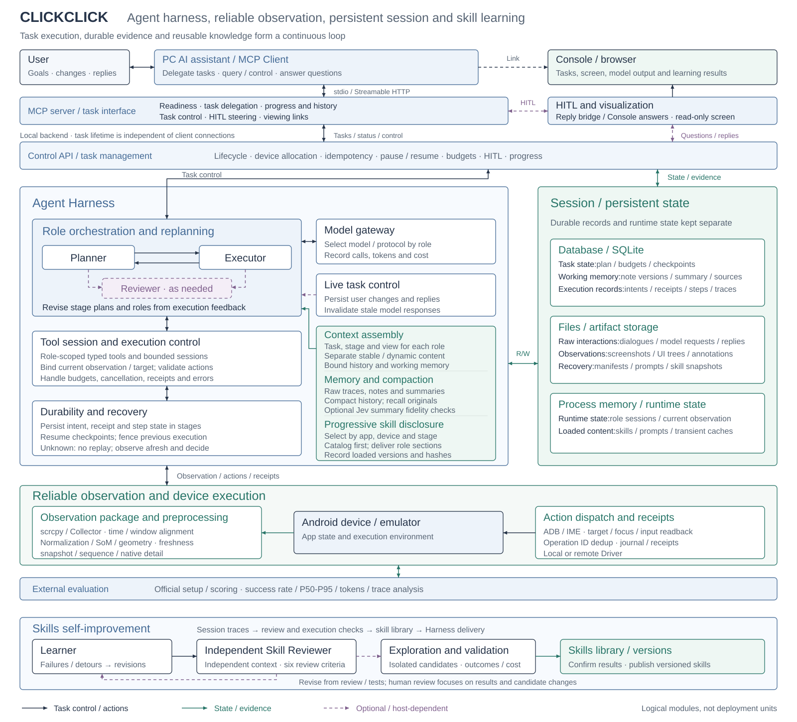

# System architecture

[README](../README.md) · [中文](architecture.zh-CN.md) · [Technical overview](reliability-design.md) · [Design decisions](design-decisions.md)

This guide describes **module boundaries, interfaces and task execution flow**, with links to detailed subsystem designs. The [technical overview](reliability-design.md) explains the goals behind the core mechanisms.

## What harness means here

The **agent harness** is the runtime surrounding model inference: it builds requests, manages role transitions, selects skills and history, validates tool submissions, dispatches actions and returns feedback. **Session** is the durable task record. **Device tools** interact with the phone and construct observations.

| Module | Responsibility | Main interface |
| --- | --- | --- |
| Model | Interpret the task, choose goals and actions, judge evidence. | Role-specific model requests and structured submissions. |
| Agent harness | Coordinate planning, context, skills, tools, budgets and feedback. | Task loop, role tool sessions and action validation. |
| Session | Store events, observations, dialogue, note versions and artifacts. | TaskStore backed by SQLite and artifact files. |
| Device tools | Capture UI state and execute Android operations. | Driver actions and ObservationPackage results. |
| Console / Control API | Manage tasks/devices and expose execution state. | HTTP APIs, SSE, Timeline and saved screenshots. |
| Evaluation | Initialize controlled tasks and score outcomes independently. | Benchmark adapter and external task predicates. |

These are logical boundaries. Control API hosts the harness; device tools can run locally or on a remote Driver host. A role's bounded tool session is distinct from the persistent Session. The storage model includes both append-only records and mutable task snapshots.

## Task lifecycle

1. Console or a caller submits an instruction, model configuration and target device.
2. The runtime prepares the device, captures an observation and restores task records.
3. Planner selects a current stage and relevant skills.
4. Executor reads the current stage, memory and observation, then submits an action or a stage transition.
5. The harness validates the submission, executes accepted actions and stores receipts and resulting evidence.
6. Execution continues, returns to planning, or requests independent review. Task termination preserves the final state and trace.

The original instruction remains recorded; later accepted user changes supersede conflicting requirements. Models interpret requirements; deterministic checks validate schemas, references, stage identity, supported input preconditions and limits.

## Roles and transitions

Planner uses rolling refinement: concretize one current stage and retain a tentative future roadmap. Executor performs that stage and returns results or mismatches; Planner checks the assumptions before choosing the next stage. Reviewer handles disputes on demand. Default `plan_executor` permits optional review; `plan_reviewer` requires final review. [Long-task orchestration](task-orchestration.md) owns planning granularity, role submissions, loop control, sessions and budgets.

## A device interaction

A model submits an action against the current observation. Harness checks invocation, target and budget; Driver executes and returns a receipt; post-observation supplies the next round. Supported local indexed taps refresh/check retained nodes, while targeted input verifies fields/focus and reads back. See [observation and execution consistency](observation-execution-consistency.md) for ordering and configuration.

## Observation path

Driver combines scrcpy pixels and Accessibility Collector structure, with ADB fallback pixels. Snapshot shows current state, sequence captures dynamic changes, and detail supplies native-resolution reading. Request/action frame boundaries and window checks reduce stale or mismatched evidence. [Observation/execution consistency](observation-execution-consistency.md) owns capture, action grounding and post-observation reuse; [scrcpy transport](scrcpy-observation.md) owns connection/performance diagnostics.

## Context, memory and skills

Original records, versioned notes and sourced summaries are stored separately. Each role assembles current requirements, plan, budget, observations and memory; see [memory/context](memory-and-context.md). [Session/storage](session-storage.md) owns database, file and process-memory responsibilities.

Planner selects stage skills from a catalog; app/device/role scope controls progressive delivery, as specified in [skill delivery](skill-delivery.md). An explicit learning entry turns traces into candidates, independently reviewed and selectively validated before human publication; see [self-learning](skill-evolution.md). Ordinary completion never starts paid learning automatically.

## HITL intervention and plan updates

Agents can ask and continue the original call; users can independently change requirements through an assistant or API. A durable inbox separates acceptance from application. Instruction revisions/execution generations invalidate undispatched stale calls; dispatched effects are recorded before applying changes. [Bidirectional HITL](hitl-design.md) owns settings, reply ownership and concurrency; [usage](hitl.md) owns user steps.

## Read-only preview alongside an assistant

Tasks return preview/details links that hosts may open and reuse. Preview consumes existing frames/model events without a second device lease, capture or input path. Disconnects, slow readers and missing frames do not change execution. See [observability](observability.md) for presentation and [MCP usage](local-mcp.md) for assistant setup.

## Recovery after an unexpected interruption

Client disconnect differs from backend failure. Clean pauses resume safe checkpoints; crash takeover must isolate old input, query receipts and restore the original role. Missing reliable outcomes stay unknown and lead to a new decision on fresh observations, never replay of saved actions. [Pause and crash recovery](crash-recovery.md) owns states, T1/T2/T3, idempotency, body manifests and configuration.

## Operational boundaries

Models own semantic choices; runtime checks structure, references, eligibility and budgets. SQLite does not atomically commit phone effects. Observations are not strict atomic snapshots; receipts/readback alone do not establish business success. Benchmark scoring remains independent of completion reports; see [evaluation design](evaluation-design.md) for evidence conditions.

## Module design documents

| Capability / shared subsystem | Detailed design | Scope |
| --- | --- | --- |
| Long-task orchestration | [Design](task-orchestration.md) | Stage plans, role transitions, tool sessions and budgets |
| Context and memory | [Design](memory-and-context.md) | Role context, notes, sourced summaries, compaction and retrieval |
| Observation/execution consistency | [Design](observation-execution-consistency.md) | Asynchronous capture, dynamic sequences, target/input checks and receipts |
| Skill reuse | [Design](skill-delivery.md) | Catalog, app/device scope and progressive role delivery |
| Skill self-learning | [Design](skill-evolution.md) | Extraction, independent review, selective validation and publication |
| Bidirectional HITL | [Design](hitl-design.md) | Question continuation, reply bridging, steering and concurrency |
| Pause and crash recovery | [Design](crash-recovery.md) | Checkpoints, T1/T2/T3, input fencing, unknowns and context restoration |
| Observability | [Design](observability.md) | Trace relationships, Console, read-only preview and metrics |
| Evaluation system | [Design](evaluation-design.md) | Independent scoring, adapters, controls, cost and utility |
| Session and storage | [Design](session-storage.md) | SQLite, files, memory, version references, atomic publication and GC |

Supporting modules and user guides:

- Assistant access: [MCP setup/control](local-mcp.md); model routing: [deployment configuration](deployment.md#model-routing).
- Capture connections: [scrcpy transport](scrcpy-observation.md), [Collector installation](accessibility-collector-setup.md).
- Deployment: [process topology](processes.md), [deployment guide](deployment.md).
- User workflows: [HITL](hitl.md), [skill authoring](../skills/README.md), [evaluation runs](evaluation.md).
- Rationale: [design-decision index](design-decisions.md). Each detailed design links its historical evidence without maintaining a second current specification.

## Code map

| Boundary | Main implementation |
| --- | --- |
| Harness: runtime and role loop | [runtime.py](../agent/runtime.py), [revisable/orchestrator.py](../agent/revisable/orchestrator.py), [roles.py](../agent/revisable/roles.py) |
| Harness: tools and decisions | [session.py](../agent/session.py), [revisable/session.py](../agent/revisable/session.py), [revisable/tools.py](../agent/revisable/tools.py) |
| Harness: context and retrieval | [recall.py](../agent/revisable/recall.py), [context_projection.py](../agent/context_projection.py) |
| Harness: skill management | [agent/skills/](../agent/skills/), [pending.py](../agent/skills/pending.py); content in [skills/](../skills/) |
| Research: skill learning and review | [learning.py](../agent/skills/learning.py), [analysis_session.py](../agent/skills/analysis_session.py), [exploration.py](../agent/skills/exploration.py), [admission.py](../agent/skills/admission.py), [verification.py](../agent/skills/verification.py), [candidate_group.py](../agent/skills/candidate_group.py) |
| Harness: action and input control | [action_observation.py](../agent/action_observation.py), [targeted_input.py](../agent/targeted_input.py) |
| Device tools: capture and device access | [scrcpy_stream.py](../driver/scrcpy_stream.py), [scrcpy_observation.py](../driver/scrcpy_observation.py), [accessibility.py](../driver/accessibility.py), [perception/](../perception/) |
| Harness: model routing | [llm_gateway.py](../shared/llm_gateway.py), [model_router.py](../shared/model_router.py) |
| Session: records and artifacts | [store.py](../agent/revisable/store.py), [db.py](../shared/db.py), [artifacts.py](../shared/artifacts.py) |
| Console and runtime hosting | [control_api/](../control_api/), [web/](../web/) |
| Evaluation integration | [AndroidWorld adapter](../agent/integrations/android_world.py), [evaluation guide](evaluation.md) |
