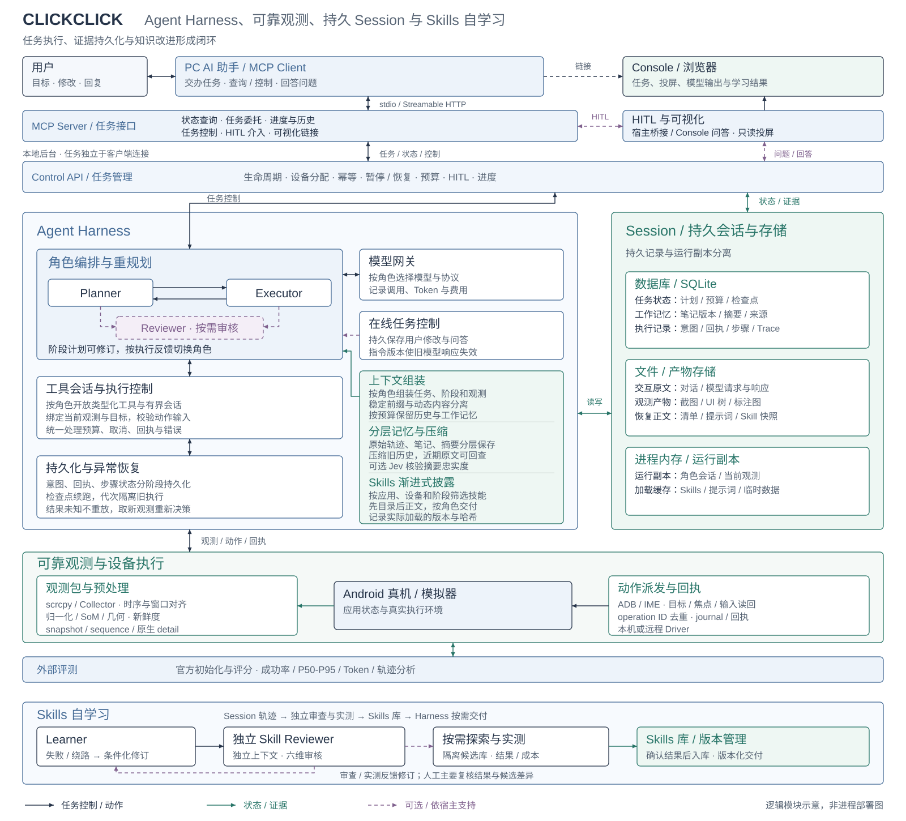

# 系统架构

[首页](../README.zh-CN.md) · [English](architecture.md) · [技术概览](reliability-design.zh-CN.md) · [设计取舍](design-decisions.zh-CN.md)

本文说明 ClickClick 的**模块边界、接口和任务执行流程**，并提供各模块详细设计的入口。核心机制的设计目标见[技术概览](reliability-design.zh-CN.md)。

## Harness 的定义

**Agent Harness** 是围绕模型推理的运行时：构造请求、管理角色转换、选择技能与历史、校验工具提交、派发动作并返回反馈。**Session** 是任务的持久记录。**设备工具** 操作手机并构建观测。

| 模块 | 职责 | 主要接口 |
| --- | --- | --- |
| 模型 | 理解任务、选择目标与动作、判断证据。 | 角色化模型请求与结构化提交。 |
| Agent Harness | 组织规划、上下文、技能、工具、预算和反馈。 | 任务循环、角色工具会话与动作校验。 |
| Session | 保存事件、观察、对话、笔记版本和产物。 | 基于 SQLite 与产物文件的 TaskStore。 |
| 设备工具 | 采集 UI 状态并执行 Android 操作。 | Driver 动作与 ObservationPackage。 |
| Console / Control API | 管理任务和设备，展示执行状态。 | HTTP API、SSE、Timeline 和已保存的截图。 |
| 评测 | 初始化受控任务并独立检查结果。 | 基准适配器与外部成功判定函数。 |

这些是逻辑边界。Control API 承载 Harness；设备工具可以在本机运行，也可以部署到远程 Driver。角色的有界工具会话不同于持久 Session。存储同时包含追加记录与可更新的任务快照。

## 任务生命周期

1. Console 或调用方提交指令、模型配置和目标设备。
2. 运行时准备设备、采集观察并恢复任务记录。
3. Planner 选择当前阶段及所需技能。
4. Executor 读取阶段、记忆和当前观察，提交动作或阶段转换。
5. Harness 校验提交、执行动作，保存回执及结果证据。
6. 任务继续执行、返回规划或请求独立审核；结束时保留最终状态与轨迹。

原始指令保留为历史意图，后续经用户确认的修改覆盖其中冲突的要求。模型解释任务含义，确定性检查负责 schema、来源引用、阶段身份、受支持输入的前置条件及预算。

## 角色与转换

Planner 采用滚动细化：只具体化一个当前阶段，未来结果保留为假设路线图。Executor 执行当前阶段并返回结果或偏差，Planner 核对假设后再选择下一阶段；Reviewer 按需处理争议。默认 `plan_executor`，`plan_reviewer` 要求最终审核。规划粒度、角色提交、循环控制、会话和预算统一见[长任务编排详设](task-orchestration.zh-CN.md)。

## 一次设备交互

模型基于当前观测提交动作，Harness 校验调用、目标和预算，Driver 执行并返回回执，后观测进入下一轮。支持的本地索引点击刷新并复核保留节点；定向输入核对字段、焦点并读回。完整时序与配置见[观测与执行一致性](observation-execution-consistency.zh-CN.md)。

## 观测通路

Driver 使用 scrcpy 像素与 Accessibility Collector 结构构建观测包，ADB 提供回退像素；snapshot 看当前状态，sequence 看动态变化，detail 提供原生细节。请求／动作帧边界和窗口检查减少旧画面与图树错配；采集通路、动作绑定及后观测复用统一见[观测与执行一致性](observation-execution-consistency.zh-CN.md)。连接与性能诊断见[scrcpy 通路说明](scrcpy-observation.md)。

## 上下文、记忆与技能

原始记录、版本笔记与来源摘要分层保存，各角色独立组装当前需求、计划、预算、观测和记忆。详见[记忆与上下文](memory-and-context.zh-CN.md)；数据库、文件与进程内存的分工见[Session 与存储](session-storage.zh-CN.md)。

Planner 从目录选阶段技能，再按应用、设备与角色渐进式交付正文，详见[技能交付](skill-delivery.zh-CN.md)。独立学习入口将已有轨迹转为候选，经审查、按需验证与人工确认后入库，详见[Skills 自学习](skill-evolution.zh-CN.md)。普通任务结束不自动启动付费学习。

## HITL 主动介入与计划更新

Agent 可提问后续接原调用，用户也可通过助手或 API 主动调整要求。持久收件箱区分接收与生效，指令版本／执行代次使未派发旧调用失效；已派发操作保留真实结果，再处理新要求。开关、单一回复入口与并发时序见[双向 HITL 详设](hitl-design.zh-CN.md)，操作见[使用指南](hitl.zh-CN.md)。

## 助手侧只读投屏预览

任务返回 preview/details 链接，宿主可打开并复用任务页面。预览使用已有画面和模型事件，不取得第二份设备 lease，也不创建额外采集或输入通路。断开、慢读或缺帧不改变执行；展示设计见[可观测性](observability.zh-CN.md)，助手注册和使用见[MCP 指南](local-mcp.zh-CN.md)。

## 异常中断恢复

客户端断开与后台崩溃分别处理。干净暂停从安全检查点续跑；异常接管须隔离旧输入、核对回执并恢复原角色。缺少可靠回执保留 unknown，取得最新观测后重新决策，不回放旧动作。状态机、T1/T2/T3、幂等、正文清单和恢复配置统一见[暂停与异常恢复详设](crash-recovery.zh-CN.md)。

## 运行边界

模型负责语义选择，运行时负责结构、引用、执行资格与预算检查。SQLite 事务不覆盖手机副作用；观测不是严格原子快照，回执和输入读回不单独证明业务完成。基准评分独立于完成报告，验证条件见[评价体系](evaluation-design.zh-CN.md)。

## 模块设计文档

| 核心能力／共享模块 | 独立详设 | 负责的内容 |
| --- | --- | --- |
| 长任务编排 | [详设](task-orchestration.zh-CN.md) | 阶段计划、角色转换、工具会话与预算 |
| 上下文与记忆 | [详设](memory-and-context.zh-CN.md) | 角色上下文、笔记、来源摘要、压缩与回查 |
| 观测与执行一致性 | [详设](observation-execution-consistency.zh-CN.md) | 异步图树、动态序列、目标／输入校验与回执时序 |
| 技能复用 | [详设](skill-delivery.zh-CN.md) | 目录、应用／设备作用域与按角色渐进交付 |
| Skills 自学习 | [详设](skill-evolution.zh-CN.md) | 轨迹提炼、独立审查、按需验证与人工发布 |
| 双向 HITL | [详设](hitl-design.zh-CN.md) | 提问续接、回复桥接、用户介入与在途并发 |
| 暂停与异常恢复 | [详设](crash-recovery.zh-CN.md) | 安全检查点、T1/T2/T3、输入隔离、unknown 与上下文重建 |
| 可观测性 | [详设](observability.zh-CN.md) | Trace 关联、Console、只读预览与指标定义 |
| 评价体系 | [详设](evaluation-design.zh-CN.md) | 独立评分、基准接入、对照与成本／收益口径 |
| Session 与存储 | [详设](session-storage.zh-CN.md) | SQLite、文件、内存、版本引用、原子发布与清理 |

支撑模块与操作指南：

- 助手接入：[MCP 安装与控制](local-mcp.zh-CN.md)；模型路由：[部署配置](deployment.zh-CN.md#model-routing)。
- 采集连接：[scrcpy 通路](scrcpy-observation.md)、[Collector 安装](accessibility-collector-setup.zh-CN.md)。
- 进程部署：[进程拓扑](processes.zh-CN.md)、[部署指南](deployment.zh-CN.md)。
- 操作与复现：[HITL 使用](hitl.zh-CN.md)、[技能编写](../skills/README.zh-CN.md)、[评测运行](evaluation.zh-CN.md)。
- 方案理由：[设计取舍索引](design-decisions.zh-CN.md)；历史证据从各详设进入，不重复维护当前设计。

## 代码映射

| 边界 | 主要实现 |
| --- | --- |
| Harness：运行时与角色循环 | [runtime.py](../agent/runtime.py)、[revisable/orchestrator.py](../agent/revisable/orchestrator.py)、[roles.py](../agent/revisable/roles.py) |
| Harness：工具与决策 | [session.py](../agent/session.py)、[revisable/session.py](../agent/revisable/session.py)、[revisable/tools.py](../agent/revisable/tools.py) |
| Harness：上下文与检索 | [recall.py](../agent/revisable/recall.py)、[context_projection.py](../agent/context_projection.py) |
| Harness：技能管理 | [agent/skills/](../agent/skills/)、[pending.py](../agent/skills/pending.py)；内容位于 [skills/](../skills/) |
| 研究：技能学习与审查 | [learning.py](../agent/skills/learning.py)、[analysis_session.py](../agent/skills/analysis_session.py)、[exploration.py](../agent/skills/exploration.py)、[admission.py](../agent/skills/admission.py)、[verification.py](../agent/skills/verification.py), [candidate_group.py](../agent/skills/candidate_group.py) |
| Harness：动作与输入控制 | [action_observation.py](../agent/action_observation.py)、[targeted_input.py](../agent/targeted_input.py) |
| 设备工具：采集与设备访问 | [scrcpy_stream.py](../driver/scrcpy_stream.py)、[scrcpy_observation.py](../driver/scrcpy_observation.py)、[accessibility.py](../driver/accessibility.py)、[perception/](../perception/) |
| Harness：模型路由 | [llm_gateway.py](../shared/llm_gateway.py)、[model_router.py](../shared/model_router.py) |
| Session：记录与产物 | [store.py](../agent/revisable/store.py)、[db.py](../shared/db.py)、[artifacts.py](../shared/artifacts.py) |
| Console 与运行时承载 | [control_api/](../control_api/)、[web/](../web/) |
