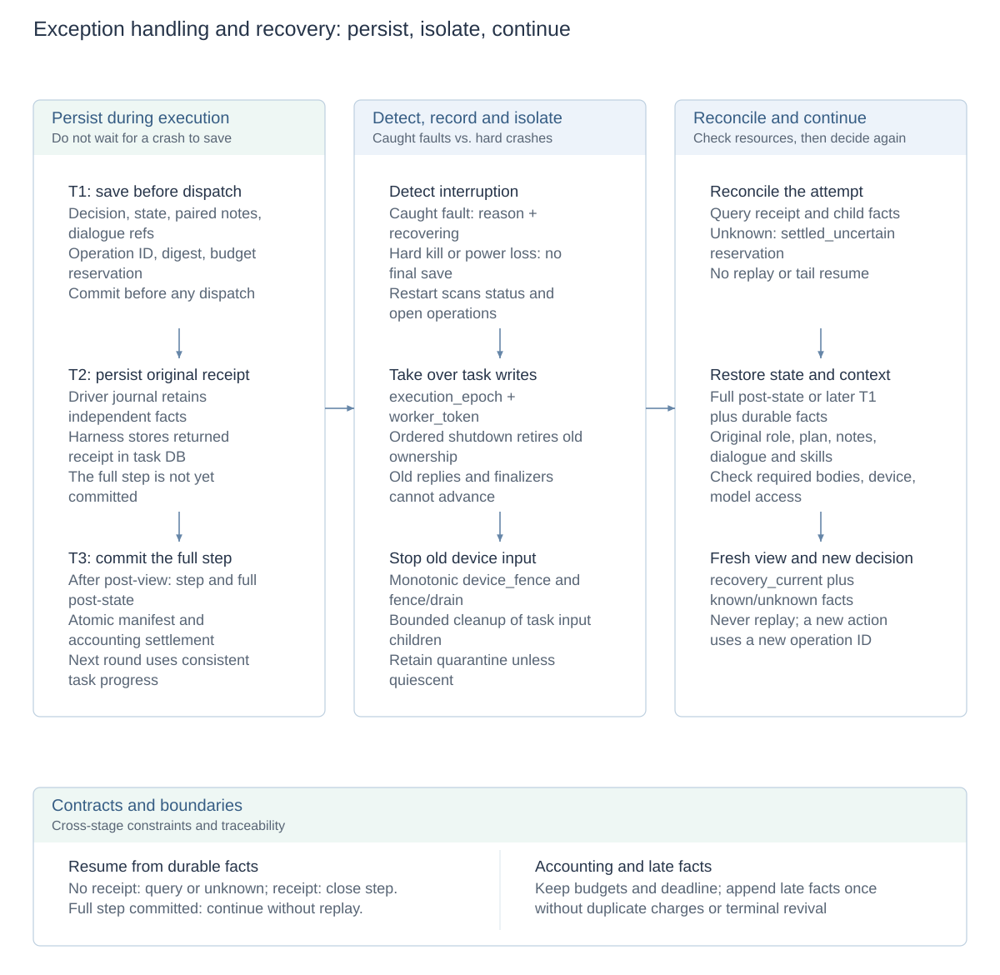
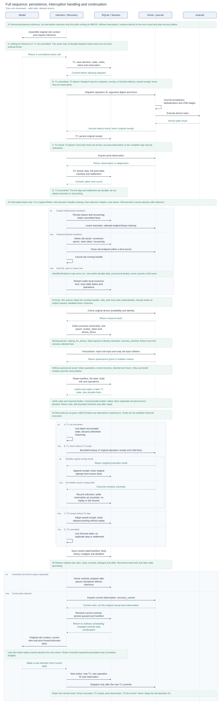
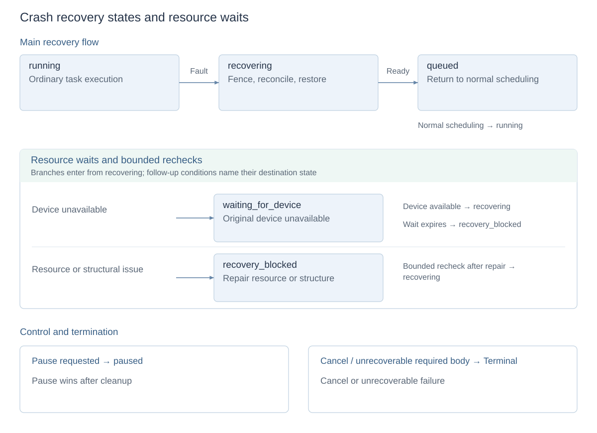

# Exception handling and interruption recovery

[Technical overview](reliability-design.md) · [Architecture and design index](architecture.md#module-design-documents) · [中文](crash-recovery.zh-CN.md)

The design combines **continuous persistence during normal execution, interruption detection and old-execution isolation, and fact reconciliation with context restoration to continue the original task**. It relies on previously committed facts rather than a final crash-time save, and never encloses device effects in a database transaction.

New tasks freeze `safe_auto / manual / disabled` at creation. Recovery retains task identity, history, budgets and absolute deadline; the coordinator never replays saved actions. Without a reliable receipt, it closes the original step as unknown, isolates old input, acquires current observations and returns control to the saved role. A model-chosen repeat is a new decision with a new operation ID and separate accounting.

## Design diagrams

<!-- design-diagram:recovery-mechanisms -->

Left to right: normal persistence, exception handling and recovery continuation. T1 saves intent before dispatch, T2 persists the original receipt, and T3 commits the full step; contents and interruption windows are described below. Hard kills and power loss permit no final save, so recovery uses previously durable facts.

[Mermaid source](diagrams/design-recovery-mechanisms.mmd)

<!-- /design-diagram:recovery-mechanisms -->

<!-- design-diagram:recovery-lifecycle -->

01 is the normal reference chain with interruption points A/B/C/D. An interrupted execution stops at its cut point and enters 02. Phase 03 isolates old execution, 04 reconciles facts by the last commit, and 05 restores the original role and continues. Uninterrupted tasks go directly to the next round without recovery. Harness/Recovery is a logical responsibility lifeline; execution identities differ before and after takeover.

[Mermaid source](diagrams/design-recovery-lifecycle.mmd)

<!-- /design-diagram:recovery-lifecycle -->

<!-- design-diagram:recovery-states -->

Main flow, resource branches, control and termination are shown separately; follow-up conditions name their destination states. These paths require an eligible policy: manual needs an explicit request; disabled does not continue. Ready alone does not reset attempts, and unknown alone does not block. Cancellation, pause and unrecoverable errors retain their paths.

[Mermaid source](diagrams/design-recovery-states.mmd)

<!-- /design-diagram:recovery-states -->

## Connecting persistence, exception handling and recovery

### What normal execution saves

T stands for transaction. The numbers identify three commit points within action handling, not recovery levels. Changes in an uncommitted transaction are not recovery evidence after process exit.

The task database uses SQLite WAL with `synchronous=FULL`. Complete-step commits keep the report, task state and settlement in one transaction, preventing a partially advanced report with stale state or accounting during recovery.

| Commit point | Durable data | Recovery purpose |
| --- | --- | --- |
| **T1: save intent before dispatch** | Normalized decision, complete current state, paired notes and dialogue body references; operation ID, argument digest, basis observation, invocation identity and compound relationships; budget reservation and recovery manifest | Record the intended effect, decision provenance and reserved budget before dispatch. Driver calls require a successful T1 commit. |
| **T2: persist the original receipt** | Original Driver result and deduplication identity, appended to task-database receipt records | Separate known results from operations requiring lookup; retain returned facts even if post-observation or step commit fails. |
| **T3: commit the complete step** | Step report, full post-state, recovery manifest, budget settlement and operation closure in one transaction | Keep the step, latest task state and accounting consistent before the next round. |

The **independent Driver journal** also retains acceptance, child execution stages and original receipts, covering the gap between device execution and Harness T2 persistence. Reusing an operation ID does not execute a new action. If the journal still has no reliable result, the outcome remains unknown; this is not an exactly-once guarantee for phone effects.

The recovery manifest links state to required bodies: original role, plan, notes, prompts, loaded skills, dialogue and human interaction records. Temporary writes, fsync, verification, atomic publication and reference pins protect bodies against dangling database references. These are saved during execution rather than assembled as an emergency in-memory snapshot by an exception handler.

### What happens when an interruption occurs

| Path | Handling at interruption time | How continuation becomes possible |
| --- | --- | --- |
| **Caught infrastructure exception** | Persist the reason and `recovering` state, then leave the current execution. Cleanup attempts to close the old endpoint, reap input children and prove quiescence; otherwise retain isolation. Existing T1/T2/T3 facts are not rolled back. | The scanner initiates recovery under the frozen policy; the original worker does not dispatch another action. Ordinary business failures and explicit terminal states retain their existing handling. |
| **Ordered backend shutdown** | First persist retirement of old ownership: increment epoch, clear token, mark `recovering`; then close the endpoint and cancel running handles with bounded cleanup. | The next startup takes over the same task. Shutdown is not user cancellation, and unfinished device isolation survives. |
| **Hard kill, system crash or power loss** | Handlers and finalizers may never run. No final reason, memory snapshot or receipt write is guaranteed. Only previously committed data, the Driver journal and published bodies are available. | After acquiring the local exclusive backend lock, startup scans task state. Running markers, retained ownership or open operations identify interruptions; takeover then isolates old input, reconciles facts and restores context. |

The scanner skips tasks with live running handles; it does not infer a stalled worker from elapsed task time and forcibly take over. `manual / disabled` tasks do not automatically continue. Safety cleanup and eligibility to resume remain separate.

### Recovery at each persistence window

| Interruption window | Established facts | Recovery behavior |
| --- | --- | --- |
| Waiting for a model / before T1 commits | No durable dispatch intent for this action, so the protocol must not have admitted it to Driver. Unreturned model reasoning is not recoverable. | Reconstruct the original role from the latest recoverable state and invoke again. Old replies cannot advance the new owner; recorded requests and consumption are retained. |
| T1 committed, T2 absent | Dispatch may not have started, may be running, or may have finished without a saved receipt. T1 alone cannot distinguish them. | Isolate old input, then query the Driver journal. Adopt a reliable original receipt or record unknown; never retry merely because only intent exists in the task DB. |
| T2 saved, T3 absent | The original receipt is known, but post-observation and complete step state may be unfinished. | Adopt the receipt and close the step/accounting, restore context and acquire current observations. Do not replay or present the recovery view as the original causal post-observation. |
| T3 committed | The step, complete state and settlement are already durable together. | Continue subsequent work from committed state with retained history/budgets; do not duplicate the step or settlement. |

Continuation first renews task-write identity and the device fence and proves old input quiescent. It then reconciles receipts, closes known/unknown operations, restores the original role and acquires `recovery_current`. Missing resources or required bodies cause bounded waits or explicit failure, rather than guessed context, old-action replay or budget resets.

Implementation: [dispatch persistence and receipts](../shared/recovery_context.py), [transactions and manifests](../shared/recovery_store.py), [exception boundary and recovery coordinator](../shared/recovery_runtime.py), [startup scans and shutdown handling](../control_api/main.py).

## Clean pause, budget continuation and crash takeover

| Path | Starting point | Additional handling |
| --- | --- | --- |
| Normal pause/resume | Saved safe checkpoint | Restore the valid role/progress and acquire current observations before continuing |
| Explicit continuation after exhaustion | Failed attempt with a safe budget checkpoint | Add the specified limits while retaining failure history and cumulative consumption |
| Crash recovery | Latest complete state and durable execution facts | Take ownership, isolate old input, query receipts/close unknowns and reconstruct context |

All return to ordinary scheduling under the same task identity. This does not make every ordinary failure resumable. Crash recovery grants no extra budget or time; pause, cancellation and terminal controls take precedence.

### Safe checkpoints

Normal pause responds at runtime control boundaries. Checkpoint preparation closes tool records, retains dialogue references only for closed steps, verifies those bodies, clears reconstructible delivered context, increments `checkpoint_version` and sets `checkpoint_resumable`. It first stores `pausing` with complete state; only completed execution cleanup publishes `paused`, preventing concurrent rescheduling while the old execution is still finishing.

`resume` checks cleanup and checkpoint validity before ordinary scheduling with current observations. Budget continuation additionally deduplicates explicit extensions by `request_key`, preserving earlier attempts, counters and failures. Pause is not rollback and cannot resume an arbitrary unfinished model request. Implementation: [checkpoints](../agent/orchestrator.py), [resume entry](../control_api/main.py).

## Execution and recovery boundaries

Persistence and recovery also obey the following ownership, effect and accounting constraints. No database transaction spans ADB or inference.

- `execution_epoch / worker_token` fence task writes. Cross-task monotonic `device_fence` fences input. Old responses, state writes and finalizers cannot advance the new owner.
- The independent Driver journal retains operation ID, argument digest, receipt and deduplication identity. Losing the result body does not permit replay of an old ID. Receipt-query and fence/drain control requests do not wait behind a blocked action request.
- Windows input processes use Job Objects and PID/creation-time identities; POSIX uses supervised process groups and child locks. If old input cannot be proven quiescent, retain device quarantine. Cancellation/terminal state and device cleanup are separate.
- Receipt queries are bounded. Missing reliable receipts become unknown; screenshots do not establish whether a historical action executed. A receipt usually establishes dispatch outcome rather than business completion.
- Unknown reservations settle automatically as `settled_uncertain`. Only a trusted original Driver receipt explicitly reporting zero action units permits release; model/page inferences cannot refund. Late facts append once without duplicate steps, tool results, accounting or revival of terminal tasks.
- Compound operations record parent/ordinal, dispatched children and unstarted tails. Recovery closes the attempt without restarting it or continuing its tail. Internal ADB subphases do not double-charge the compound parent.
- External tools without recovery metadata remain usable initially. Potential side effects retain T1/T2 facts; lost outcomes stay unknown without automatic retry. Each adapter owns any result-query capability and original permissions.

## States and operations

`recovering` checks ownership, isolates old input, verifies state/bodies, archives receipts, restores context and obtains current observation before entering `queued` and ordinary scheduling. Unavailable devices enter `waiting_for_device`; expired persistent waits or structural problems enter `recovery_blocked`. Unrecoverable required bodies fail explicitly with evidence retained.

| Reason | Behavior and next step |
| --- | --- |
| `explicit_recovery_required` | Explicitly request recovery/continuation for a manual task |
| `device_unavailable` | Reconnect the original device; wait deadline/attempts survive restart, with bounded resource-return rechecks |
| `device_identity_mismatch` | Restore the original binding rather than substituting another device |
| `old_input_chain_live` / `input_child_not_reaped` | Retain quarantine; restore the endpoint or stop the task's old input chain before rechecking; never delete fences/journals to bypass |
| `driver_recovery_unsupported` | Upgrade to recovery protocol 1; old endpoints cannot bypass journal requirements |
| `model_authorization_unavailable` / `model_configuration_unavailable` / `model_quota_unavailable` | Restore authorization/configuration/quota; do not loop inference while unavailable. A nonsecret configuration/authorization revision may trigger one bounded recheck |
| `control_changed_during_recovery` | Reload controls; cancellation wins, pause completes mechanical cleanup without extra inference |
| `auto_recovery_attempts_exhausted` | Repair resources or explicitly recheck; merely reaching ready without normal execution progress does not reset attempts |
| `required_context_unrecoverable` | Required content is missing/corrupt and retained state/manifests cannot reconstruct it; inspect evidence rather than guessing |
| `legacy_recovery_unsupported` / `crash_recovery_disabled` | Keep diagnostics/isolation but do not continue mid-execution; clean-pause rules remain available |

Unknown alone introduces no structural block, read-only restriction or approval. HITL off stays off; only an actual user choice under the original policy may require a question. Restart does not repeat a pending question or resurrect disconnected client subscriptions.

## API, MCP and Console

`POST /api/tasks/{task_id}/recover` accepts `{"request_key":"unique-request-key"}`. Identical key/request retries return the first acceptance; changed arguments conflict. Acceptance persists recovery intent rather than proving successful recovery. A scanner recovers missed scheduling notifications.

Existing `/resume` and MCP `resume_task` also inspect eligible interrupted tasks without adding low-level MCP tools. They grant no extra budget; explicit budget renewal remains a checkpoint operation. `get_status / get_task / list_tasks` are read-only and trigger no inference, screenshots or test actions. Console displays phase, reason, quarantine and unknown operations through existing controls, without an unknown-adjudication form.

Bounded `recovery` output contains policy, phase, attempt_no, reason, last_committed_seq, quarantined, available_actions and the latest eight unknowns. `model_usage.unknown_usage_rounds` marks rounds without reliable usage receipts, rather than zero tokens/cost; actual requests still count immediately toward budgets.

## Context and files

The manifest retains complete AgentState (original request, effective plan, summary, budgets and next_role), current notes, frozen role prompts, actual loaded skill bodies, HITL/user changes and retained dialogue references. Dependencies store nonsecret model/protocol identities. Recovery reconnects read tools, clears stale grounding/authorization and obtains `recovery_current`, which is not the original action's causal post-observation.

Bodies are written to same-directory temporary files, fsynced, verified and atomically published, with cross-process pins before reference commit. GC follows reachable manifests, operations, receipts and historical attempts. Normal actions do not validate the entire historical file chain. A damaged current manifest can reconstruct from complete DB post-state/later T1 state and durable facts, consulting retained manifests only for missing required bodies, without replaying effects. See [Session storage](session-storage.md).

## Configuration and evaluation

| Environment variable | Default | Meaning |
| --- | --- | --- |
| `CLICKCLICK_TASK_RECOVERY_POLICY` | `safe_auto` | New tasks only; frozen at creation |
| `CLICKCLICK_TASK_RECOVERY_MAX_AUTO_ATTEMPTS` | `3` | Automatic attempts per fault cycle |
| `CLICKCLICK_TASK_RECOVERY_SCAN_INTERVAL_S` | `5` | Durable scheduling scan interval |
| `CLICKCLICK_TASK_RECOVERY_BACKOFF_S` | `[1,5,15]` | Nonempty, nonnegative bounded backoff |
| `CLICKCLICK_TASK_RECOVERY_ATTEMPT_TIMEOUT_S` | `60` | Per-attempt time bound |
| `CLICKCLICK_TASK_RECOVERY_DEVICE_WAIT_S` | `300` | Persistent device-wait window |

MobileWorld single-task runs default to manual; `--recovery-policy safe_auto` explicitly enables experiments. Recovery runs, traces and scores remain separate without reviving terminal episodes or replacing published results.

## Upgrade, rollback and acceptance limits

Existing databases receive a WAL-consistent backup before upgrade; incremental migration is reentrant. A writer guard rejects older binaries against the new schema. Stop new admissions and drain ordinary work before upgrading; retain isolation/logs for interrupted tasks. Restoring an old database cannot undo external effects. Program rollback must preserve the new database, journals and artifacts and use compatible reads or a separate data root.

Safe-auto prerequisites are writable persistent storage with one backend owner, protocol-1 Driver deduplication/fence/drain/query support, interpretable state and required bodies, original device, permissions and valid budgets. Checks are structural rather than page keywords, success thresholds or model-specific approval.

Acceptance covered normal/hard-interruption MobileWorld controls, unknown handoff to the original role and supervised input-process-group hard-exit/cleanup in a Linux container. Detailed run logs and fault-injection harnesses remain in the development repository. Physical phone disconnect/reboot and macOS process behavior remain unvalidated.
