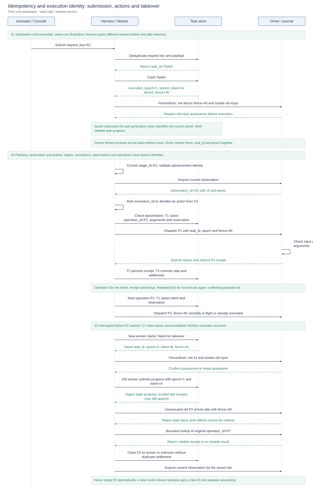

# Exception handling and interruption recovery

[Technical overview](reliability-design.md) · [Architecture and design index](architecture.md#module-design-documents) · [中文](crash-recovery.zh-CN.md)

The design combines **continuous persistence during normal execution, interruption detection and old-execution isolation, and fact reconciliation with context restoration to continue the original task**. It relies on previously committed facts rather than a final crash-time save, and never encloses device effects in a database transaction.

New tasks freeze `safe_auto / manual / disabled` at creation. Recovery retains task identity, history, budgets and absolute deadline; the coordinator never replays saved actions. Without a reliable receipt, it closes the original step as unknown, isolates old input, acquires current observations and returns control to the saved role. A model-chosen repeat is a new decision with a new operation ID and separate accounting.

## Design diagrams

<!-- design-diagram:recovery-mechanisms -->


Left to right: normal persistence, exception handling and recovery continuation. T1 saves intent before dispatch, T2 persists the original receipt, and T3 commits the full step; contents and interruption windows are described below. Hard kills and power loss permit no final save, so recovery uses previously durable facts.

[Mermaid source](diagrams/design-recovery-mechanisms.mmd)

<!-- /design-diagram:recovery-mechanisms -->

<!-- design-diagram:recovery-lifecycle -->


01 is the normal reference chain with interruption points A/B/C/D. An interrupted execution stops at its cut point and enters 02. Phase 03 isolates old execution, 04 reconciles facts by the last commit, and 05 restores the original role and continues. Uninterrupted tasks go directly to the next round without recovery. Harness/Recovery is a logical responsibility lifeline; execution identities differ before and after takeover.

[Mermaid source](diagrams/design-recovery-lifecycle.mmd)

<!-- /design-diagram:recovery-lifecycle -->

<!-- design-diagram:recovery-states -->


Main flow, resource branches, control and termination are shown separately; follow-up conditions name their destination states. These paths require an eligible policy: manual needs an explicit request; disabled does not continue. Ready alone does not reset attempts, and unknown alone does not block. Cancellation, pause and unrecoverable errors retain their paths.

[Mermaid source](diagrams/design-recovery-states.mmd)

<!-- /design-diagram:recovery-states -->

## Connecting persistence, exception handling and recovery

### What normal execution saves

T stands for transaction. The numbers identify three commit points within action handling, not recovery levels. Changes in an uncommitted transaction are not recovery evidence after process exit.

The task database uses SQLite WAL with `synchronous=FULL`. Complete-step commits keep the report, task state and settlement in one transaction, preventing a partially advanced report with stale state or accounting during recovery.

| Commit point | Durable data | Recovery purpose |
| --- | --- | --- |
| **T1: save intent before dispatch** | Normalized decision, complete current state, paired notes and dialogue body references; operation ID, argument digest, basis observation, invocation identity and compound relationships; budget reservation and recovery manifest | Record the intended effect, decision provenance and reserved budget before dispatch. Driver calls require a successful T1 commit. |
| **T2: persist the original receipt** | Original Driver result and deduplication identity, appended to task-database receipt records | Separate known results from operations requiring lookup; retain returned facts even if post-observation or step commit fails. |
| **T3: commit the complete step** | Step report, full post-state, recovery manifest, budget settlement and operation closure in one transaction | Keep the step, latest task state and accounting consistent before the next round. |

The recovery manifest links state to required bodies: original role, plan, notes, prompts, loaded skills, dialogue and human interaction records. Temporary writes, fsync, verification, atomic publication and reference pins protect bodies against dangling database references. These are saved during execution rather than assembled as an emergency in-memory snapshot by an exception handler.

### Why checkpoints alone cannot replace phased persistence

Here, checkpoints alone means saving only complete-step snapshots, not defining checkpoints as pause-only functionality. Complete T3 post-state and newer T1 state/context references can both serve as recovery checkpoints in the broader sense. Database commits and phone actions cannot share an atomic transaction. Without T1, recovery may not even identify the intended operation. If the phone executes before its receipt is saved, retrying from an old snapshot can send another email or create another record.

T1 therefore records intent before dispatch so recovery can identify open operations; T2 records known execution facts; T3 commits complete progress and consumption together. The Driver journal supplies execution-side acceptance and result facts. Recovery isolates old input, reconciles reliable receipts, retains unknown outcomes and acquires current observations for the saved role without automatically replaying actions. This supports eligible recovery, not exactly-once arbitrary business effects.

### How T3 keeps steps, current state and accounting consistent

One task-database transaction saves the **step report** describing the action and feedback, **full post-state** identifying committed progress and the continuation point, and **budget settlement/operation closure** accounting for consumption and reservations. Required bodies are published first, with recovery references committed in the transaction.

Separate commits could leave a completed step with stale task state, or saved progress without its consumption. T3 commits all these internal records or none. Uncommitted progress is reconciled using T1/T2 and journal facts rather than phone-action replay. Atomicity covers task-database progress and accounting; physical effects remain outside that transaction.

### Why T2 and T3 commit separately

They could be combined, but that would delay task-side receipt persistence and enlarge the failure window. After Driver returns, full-step handling still needs post-observation, report/post-state assembly and accounting; these can time out or fail. Waiting for all of them would also lose the received receipt from the uncommitted transaction, requiring another Driver journal lookup during recovery.

The current design commits the minimal original receipt at T2 before atomically saving complete progress at T3. It retains task-side execution evidence even if subsequent observation or step commit fails, at the cost of another database commit. A committed T2 is neither a complete step commit nor proof of business completion.

<a id="driver-journal"></a>

### Driver journal: contents and storage location

The Driver journal is a **durable execution-side ledger**, implemented as a separate SQLite file, `execution.db`, with WAL and `synchronous=FULL`. It records:

- `operations`: operation ID, task/device, argument digest, accepted/returned state and original receipt, supporting deduplication and result lookup.
- `guards`: each device's current fence, task, epoch and closed status, rejecting obsolete input.
- `subactions` / `children`: execution subphases, return codes, and supervised input PIDs/creation times for progress reconciliation and old-input cleanup.

Its location follows the actual execution path:

- **Local Driver:** `<task-database directory>/driver-execution/execution.db`, created by `journal_for()`.
- **Remote Driver:** `<remote Driver Settings.data_dir>/driver-execution/execution.db`, created by the RPC service on the remote Driver host.

`CLICKCLICK_DATA_DIR` can override the data root, default `./data`; relative paths resolve against the corresponding process's working directory. The journal resides on the computer hosting the execution path, while the phone performs UI actions. T2 writes `operation_receipts` in the task database, normally `clickclick.db`; these are separate database files. Local mode may place both in one process and on one disk, so logical separation does not imply physical fault isolation.

An existing operation ID never authorizes another execution; missing reliable journal outcomes remain unknown. Acceptance or an operation record alone does not prove business completion. Implementation: [journal database and deduplication](../driver/execution_journal.py), [local creation](../shared/recovery_runtime.py), [remote creation](../driver/rpc_server.py).

### Why T2 persists a receipt already saved in the journal

The journal owns execution-side deduplication and lookup facts. T2 incorporates the same receipt into durable task records for step closure, budget settlement and audit. Receipts already in the task database need not depend on Driver connectivity and journal access on every recovery; the journal primarily covers execution before task-side T2 persistence.

Two copies are not theoretically mandatory. A task could reference only the journal, provided it guarantees long-term lookup and handles cross-component reads, lifecycle and task-state associations. The current design trades another write for fewer recovery dependencies. It provides neither cross-database atomicity nor always-synchronized copies. If the journal has a result but T2 is absent, recovery queries the original operation ID and adopts a reliable receipt; otherwise it records unknown.

### What happens when an interruption occurs

| Path | Handling at interruption time | How continuation becomes possible |
| --- | --- | --- |
| **Caught infrastructure exception** | Persist the reason and `recovering` state, then leave the current execution. Cleanup attempts to close the old endpoint, reap input children and prove quiescence; otherwise retain isolation. Existing T1/T2/T3 facts are not rolled back. | The scanner initiates recovery under the frozen policy; the original worker does not dispatch another action. Ordinary business failures and explicit terminal states retain their existing handling. |
| **Ordered backend shutdown** | First persist retirement of old ownership: increment epoch, clear token, mark `recovering`; then close the endpoint and cancel running handles with bounded cleanup. | The next startup takes over the same task. Shutdown is not user cancellation, and unfinished device isolation survives. |
| **Hard kill, system crash or power loss** | Handlers and finalizers may never run. No final reason, memory snapshot or receipt write is guaranteed. Only previously committed data, the Driver journal and published bodies are available. | After acquiring the local exclusive backend lock, startup scans task state. Running markers, retained ownership or open operations identify interruptions; takeover then isolates old input, reconciles facts and restores context. |

The scanner skips tasks with live running handles; it does not infer a stalled worker from elapsed task time and forcibly take over. `manual / disabled` tasks do not automatically continue. Safety cleanup and eligibility to resume remain separate.

### Recovery at each persistence window

| Interruption window | Established facts | Recovery behavior |
| --- | --- | --- |
| Waiting for a model / before T1 commits | No durable dispatch intent for this action, so the protocol must not have admitted it to Driver. Unreturned model reasoning is not recoverable. | Reconstruct the original role from the latest recoverable state and invoke again. Old replies cannot advance the new owner; recorded requests and consumption are retained. |
| T1 committed, T2 absent | Dispatch may not have started, may be running, or may have finished without a saved receipt. T1 alone cannot distinguish them. | Isolate old input, then query the Driver journal. Adopt a reliable original receipt or record unknown; never retry merely because only intent exists in the task DB. |
| T2 saved, T3 absent | The original receipt is known, but post-observation and complete step state may be unfinished. | Adopt the receipt and close the step/accounting, restore context and acquire current observations. Do not replay or present the recovery view as the original causal post-observation. |
| T3 committed | The step, complete state and settlement are already durable together. | Continue subsequent work from committed state with retained history/budgets; do not duplicate the step or settlement. |

Continuation first renews task-write identity and the device fence and proves old input quiescent. It then reconciles receipts, closes known/unknown operations, restores the original role and acquires `recovery_current`. Missing resources or required bodies cause bounded waits or explicit failure, rather than guessed context, old-action replay or budget resets.

Implementation: [dispatch persistence and receipts](../shared/recovery_context.py), [transactions and manifests](../shared/recovery_store.py), [exception boundary and recovery coordinator](../shared/recovery_runtime.py), [startup scans and shutdown handling](../control_api/main.py).

## Clean pause, budget continuation and crash takeover

| Path | Starting point | Additional handling |
| --- | --- | --- |
| Normal pause/resume | Saved safe checkpoint | Restore the valid role/progress and acquire current observations before continuing |
| Explicit continuation after exhaustion | Failed attempt with a safe budget checkpoint | Add the specified limits while retaining failure history and cumulative consumption |
| Crash recovery | Latest complete state and durable execution facts | Take ownership, isolate old input, query receipts/close unknowns and reconstruct context |

All return to ordinary scheduling under the same task identity. This does not make every ordinary failure resumable. Crash recovery grants no extra budget or time; pause, cancellation and terminal controls take precedence.

<a id="checkpoint"></a>

## Checkpoints: contents, JSON structure and persistence timing

### Checkpoints, sessions and model context

A checkpoint is **durable recovery state and references to its required content**, regardless of whether the task is paused. A session holds the whole task's persistent records: dialogue, versioned notes, plans, operations and receipts. A checkpoint establishes a recoverable position within those records. Model context is assembled for a particular role and decision; it is neither the full session nor the serialized checkpoint unchanged.

Snapshots directly retain the instruction, current plan/stage, next role, summary, progress and budgets. References retrieve complete dialogue and other bodies. Relevant business facts, memory, budgets and current observations enter model input; earlier evidence remains available on demand. Ownership credentials and database deduplication indexes belong to runtime control and usually need not reach the model. Recovery reconstructs context and acquires current observations rather than using historical screens to ground actions.

### Physical storage and JSON shape

No single `checkpoint.json` contains every fact. `AgentState` serializes into `tasks.state_json`. A recovery manifest packages state and required versioned records into `artifacts/recovery/<content-hash>.json`, referenced by `tasks.active_manifest_id`. T1 separately stores complete state and decision-context references in `task_operations.intent_json`; operations, receipts, steps and budgets have their own tables.

This simplified manifest retains actual field names, omits other state/records and uses illustrative references:

```json
{
  "version": 1,
  "state_version": 42,
  "control_revision": 3,
  "state": {
    "instruction": "Create a meeting and send notifications",
    "step_number": 17,
    "role_invocation_count": 25,
    "revisable": {
      "revision": 3,
      "plan": {
        "current_stage": {
          "goal": "Send the meeting notification to attendees",
          "target_app": "Email",
          "skill_ids": []
        },
        "assumption_roadmap": []
      },
      "next_role": "executor",
      "summary": "Meeting created; notification delivery not confirmed.",
      "execution_count": 12,
      "dialogue_refs": ["d1"],
      "limits": {"device_actions": 100, "model_calls": 200},
      "checkpoint_version": 0,
      "checkpoint_resumable": false
    },
    "recovery": {}
  },
  "records": [
    {
      "task_id": "A",
      "kind": "dialogue",
      "record_key": "d1",
      "version": 1,
      "payload_json": "{\"step\":16,\"ref\":\"dialogue/example.json\"}"
    }
  ],
  "dependencies": {}
}
```

`state` is a structured object, persisted as JSON text in a SQLite TEXT column rather than an assembled prompt. Fields are strings, numbers, Booleans, arrays or nested objects. The manifest's `records` collect current required notes, role prompts, skill bodies, HITL/steering and dialogue versions. Only one dialogue record is shown; its `payload_json` is the original record's JSON string, with `ref` locating the body. This is not a copy of all historical records.

The example can have a complete T3 recovery snapshot even with `checkpoint_version=0`: that field counts the safe-continuation preparation below, not every saved state. `limits` retains caps and optional absolute `deadline_at`; consumed calls/actions remain in state and budget records and are not reset on recovery.

### What each persistence point saves

T1/T2/T3 are action-processing commit points, not the full task-state set or every persistence entry point.

| Point | Durable content and location | Snapshot/version behavior |
| --- | --- | --- |
| Task creation and recovery enablement | Initial state, frozen policy and manifest | Establishes recovery without a preexisting pause checkpoint |
| Planning updates and role handoff | AgentState plan revision, next role and feedback; runtime persistence updates state/manifest | Can save recovery state without a device action; does not by itself increment `checkpoint_version` |
| HITL wait/reply and steering | Pending question, originating invocation continuation, answers/adjustments and related task state | Interaction records also support recovery without sharing device T3; requirements and answers remain recoverable |
| **T1: before dispatch** | Action/arguments and invocation/observation identity in `task_operations`; complete state/context references in `intent_json`; reservation in `budget_ledger`, with a published manifest | Captures state near dispatch. T1 itself increments neither `state_version` nor `checkpoint_version`, although manifest content may change |
| **Driver acceptance/execution** | Independent journal acceptance, subphases and any original receipt | Supplies execution-side facts without incrementing task checkpoint counts |
| **T2: persist receipt** | Append to `operation_receipts`, update operation result and `operation_version` | Adds facts rather than a complete snapshot; no `checkpoint_version` increment |
| **T3: commit complete step** | Atomically commit `steps`, `tasks.state_json`, operation closure, budget settlement and manifest reference | Establishes complete post-state; increments `state_version`, preserving `checkpoint_version` |
| **Safe pause** | Retain closed dialogue, verify bodies, clear reconstructible context, save `pausing`; save `paused` after cleanup | `_prepare_checkpoint()` increments `checkpoint_version` in preparation; caller state commit makes it durable |
| **Budget exhaustion** | Prepare a safe checkpoint with budget dimension, stop reason and cumulative consumption | Calls `_prepare_checkpoint()`; budget type determines final eligibility, rather than making every budget failure resumable |
| **Caught exception/ordered shutdown** | Record exception/control state, retire ownership and attempt cleanup while retaining committed facts | Does not universally prepare a safe checkpoint; logging an exception does not capture a complete new memory image |
| **Hard kill/power loss** | Only earlier committed records and published bodies survive | Handlers/finalizers may not run; no final save is guaranteed |
| **Recovery takeover** | Reconcile manifest/state and receipts/unknowns, close attempts, persist `state.recovery`, current observations and reconstructed state/manifest | Can establish another recovery snapshot without incrementing `checkpoint_version`; an ensuing pause invokes safe preparation |

Snapshot persistence, operation closure and safe-continuation preparation are different events. Recovery consumes existing snapshots/facts before saving handoff state; persistence does not first begin at crash or takeover time.

### Which version changes when

| Field | Meaning and update rule |
| --- | --- |
| Manifest `version` | Recovery protocol/format version, currently 1; not a snapshot ordinal |
| `tasks.state_version` / manifest `state_version` | Persistent state-write version. `update_task(state=...)` and complete T3 state commits increment it; status-only updates do not. T1 can publish nearer state under the existing version, so it does not enumerate every manifest |
| `state.revisable.checkpoint_version` | Incremented by `_prepare_checkpoint()` after history/reference checks. Call sites are normal pause, budget exhaustion and recovery that must pause. Caller state commit is still required. This is not a universal recovery-snapshot version |
| `checkpoint_resumable` | Eligibility for the relevant safe continuation. Execution, terminal outcomes and particular budget types can clear it; a nonzero version does not guarantee current resumability |
| `tasks.active_manifest_id` | Content-hash reference to a published manifest. Changed content may create another file; identical content can reuse one. It is not the checkpoint counter |
| `operation_version` / `agent_records.version` / plan `revision` | Operation-fact changes, per-kind/key record versions and plan revisions respectively; none is a universal checkpoint number |

Current code has no universal `checkpoint_version` increment on every recovery snapshot. Each T3 can establish valid recovery state while the named field increments only at safe-continuation preparation; field naming alone does not define persistence timing.

### Task status, operation status and recovery progress

| Category | Storage and purpose | Relation to checkpoints |
| --- | --- | --- |
| **Task lifecycle** | `tasks.status`: `queued / running / pausing / paused / waiting_for_input / recovering / waiting_for_device / recovery_blocked / succeeded / failed / cancelled` | Stored alongside `tasks.state_json` for scheduling/termination; the status label is not snapshot content |
| **Operation lifecycle** | Main `task_operations.status` path: `dispatching → result_recorded → committed`; the enum also defines `prepared / superseded`. Known/unknown outcomes use `result_state` and receipts | Tracks one operation's recording progress. Its `intent_json.state` can contain a T1 snapshot, but status itself is not a snapshot. Unknowns may close as committed without proving business success |
| **Recovery procedure progress** | `tasks.recovery_json.phase` and `agent_records(kind=recovery_event)`: detected, verifying_owner, validating_state, collecting_results, recording_results, restoring_context, refreshing_device, waiting_for_device, blocked, unrecoverable, ready | Tracks recovery steps outside the manifest's `state.recovery`. Appending a recovery event alone neither creates a state snapshot nor increments the checkpoint counter |
| **Recovery handoff facts** | `AgentState.recovery`, appearing as manifest `state.recovery` | Snapshot content describing interruption gaps, original known/unknown operations and old/current observation references for the saved role |

For example, `tasks.recovery_json` may contain `{"phase":"collecting_results","attempt_no":1,"reason":null}`, meaning receipt lookup is in progress. Reconciled `state.recovery` may include `{"interruption_gap":true,"operations":[{"previous_operation_id":"P1","execution_result":"unknown"}],"observation_source":"recovery_current","current_observation_id":"O2"}`. This second example omits action/original-result fields to illustrate handoff shape. Both associate with the same task but are different stored fields.

Implementation: [AgentState and status enums](../shared/schemas.py), [plan/budget/checkpoint fields](../shared/revisable.py), [manifests and operations](../shared/recovery_store.py), [state/step commits](../shared/db.py), [snapshot loading and handoff](../shared/recovery_runtime.py), [role-state persistence](../agent/revisable/orchestrator.py).

### Safe checkpoints

Normal pause responds at runtime control boundaries. Checkpoint preparation closes tool records, retains dialogue references only for closed steps, verifies those bodies, clears reconstructible delivered context, increments `checkpoint_version` and sets `checkpoint_resumable`. It first stores `pausing` with complete state; only completed execution cleanup publishes `paused`, preventing concurrent rescheduling while the old execution is still finishing.

`resume` checks cleanup and checkpoint validity before ordinary scheduling with current observations. Budget continuation additionally deduplicates explicit extensions by `request_key`, preserving earlier attempts, counters and failures. Pause is not rollback and cannot resume an arbitrary unfinished model request. Implementation: [checkpoints](../agent/orchestrator.py), [resume entry](../control_api/main.py).

## Idempotency design

The design separates **duplicate requests, stale execution owners and duplicate operations**. Request deduplication prevents repeated submission or control admission; ownership checks prevent obsolete workers from advancing state or sending input; operation deduplication binds an operation to its original receipt. A task ID alone cannot solve all three, and these mechanisms do not guarantee exactly-once GUI business effects.

### Key identities and validation sequence

<!-- design-diagram:recovery-identities -->



Values are illustrative, using a single-device task. Harness is a logical lifeline spanning different workers before and after takeover. P1 is fully committed; the next operation P2 is interrupted after T1 and before T2. Recovery queries P2 without executing it again. Rejecting a late old action means it has not crossed the input boundary; effects that already occurred must still be retained and reconciled.

[Mermaid source](diagrams/design-recovery-identities.mmd)

<!-- /design-diagram:recovery-identities -->

| Identity | Scope and changes | Validation and purpose |
| --- | --- | --- |
| `request_key` | One submission/control request; retries retain the key | The relevant API compares key and payload, returning the existing admission result; conflicting payloads are rejected. Submission, recovery and budget extension have their own endpoint contracts, separate from device operations. |
| `task_id` | The whole task, retained across pause, takeover and continuation | Links state, history, notes, operations and budgets; identifies the task without establishing current authority. |
| `execution_epoch` | Per-task execution generation; incremented at claim, takeover and revocation boundaries | Checked with the token in task storage to reject old-generation progress. Epochs from different tasks are not comparable. |
| `worker_token` | Random credential of the current owner; replaced on claim/takeover and cleared on release | Matched with the epoch. In the current implementation they overlap in rejecting stale owners, rather than forming two irreplaceable idempotency layers. |
| `device_fence` | Monotonic per device across tasks; release may also increment it | Driver checks `fence + task_id + epoch` for the device. Takeover also requires fence/drain to establish old-input quiescence. |
| `stage_id` | Current plan stage; changed by plan revision | Orchestration rejects old-stage advancement; this is not a device-operation deduplication key. |
| `invocation_id` | Trace identity of a role invocation | Links role decisions, tool calls and operation intents without granting authority. Invocation leases separately invalidate calls after user changes. |
| `observation_id` | One registered observation; renewed for new observations | Action resolution validates the active basis and its UI indices/geometry. Historical observations do not authorize current actions. |
| `operation_id` | One concrete operation; generated before T1 and retained for receipt lookup | Task storage and Driver journal bind it to the argument digest. Same ID/payload returns a prior result or unknown without execution; conflicting payloads are rejected. A new model-chosen operation gets a new ID. |

### Why task and device authority are separate

`execution_epoch / worker_token` protect task state; `device_fence` protects physical input. Task A at epoch 5 and task B at epoch 1 may use the same device in succession, so task-local epochs alone do not order device ownership. The device fence increases across tasks. The current Driver matches fence, task and epoch, validating even requests that have already left Harness.

The current claim path replaces epoch and token together, expressing generation and current credential respectively. This field combination is not the only possible design. The required invariant is atomic authority updates with validation at write/dispatch boundaries, making old identities stale after release or takeover. Fencing task writes without isolating old input is insufficient for safe takeover.

### Receipt and settlement deduplication

T1 commits the operation ID, argument digest and budget reservation together. T2 deduplicates original receipts by `operation_id + source + source_generation + source_seq`. T3 atomically commits the step, full state, operation closure and settlement. Repeated recovery neither recreates the original operation nor duplicates its receipt or completed settlement; control-request admission alone does not establish successful recovery.

Revoking an old worker's authority does not discard execution facts: trusted late receipts may still append for the current owner to reconcile, without permitting old-worker plan progress, duplicate settlement or terminal revival. Missing reliable receipts close the original ID as unknown. Recovery does not evade deduplication by automatically retrying under a new ID. Only a new model decision based on current observations creates a new operation, which can have new business effects.

Implementation: [request deduplication](../control_api/main.py), [ownership/receipts/settlement](../shared/recovery_store.py), [intent and dispatch](../shared/recovery_context.py), [Driver fencing and deduplication](../driver/execution_journal.py), [invocation authority](../shared/task_control.py).

## Execution and recovery boundaries

Persistence and recovery also obey the following ownership, effect and accounting constraints. No database transaction spans ADB or inference.

- `execution_epoch / worker_token` fence task writes. Cross-task monotonic `device_fence` fences input. Old responses, state writes and finalizers cannot advance the new owner.
- The independent Driver journal retains operation ID, argument digest, receipt and deduplication identity. Losing the result body does not permit replay of an old ID. Receipt-query and fence/drain control requests do not wait behind a blocked action request.
- Windows input processes use Job Objects and PID/creation-time identities; POSIX uses supervised process groups and child locks. If old input cannot be proven quiescent, retain device quarantine. Cancellation/terminal state and device cleanup are separate.
- Receipt queries are bounded. Missing reliable receipts become unknown; screenshots do not establish whether a historical action executed. A receipt usually establishes dispatch outcome rather than business completion.
- Unknown reservations settle automatically as `settled_uncertain`. Only a trusted original Driver receipt explicitly reporting zero action units permits release; model/page inferences cannot refund. Late facts append once without duplicate steps, tool results, accounting or revival of terminal tasks.
- Compound operations record parent/ordinal, dispatched children and unstarted tails. Recovery closes the attempt without restarting it or continuing its tail. Internal ADB subphases do not double-charge the compound parent.
- External tools without recovery metadata remain usable initially. Potential side effects retain T1/T2 facts; lost outcomes stay unknown without automatic retry. Each adapter owns any result-query capability and original permissions.

## States and operations

`recovering` checks ownership, isolates old input, verifies state/bodies, archives receipts, restores context and obtains current observation before entering `queued` and ordinary scheduling. Unavailable devices enter `waiting_for_device`; expired persistent waits or structural problems enter `recovery_blocked`. Unrecoverable required bodies fail explicitly with evidence retained.

| Reason | Behavior and next step |
| --- | --- |
| `explicit_recovery_required` | Explicitly request recovery/continuation for a manual task |
| `device_unavailable` | Reconnect the original device; wait deadline/attempts survive restart, with bounded resource-return rechecks |
| `device_identity_mismatch` | Restore the original binding rather than substituting another device |
| `old_input_chain_live` / `input_child_not_reaped` | Retain quarantine; restore the endpoint or stop the task's old input chain before rechecking; never delete fences/journals to bypass |
| `driver_recovery_unsupported` | Upgrade to recovery protocol 1; old endpoints cannot bypass journal requirements |
| `model_authorization_unavailable` / `model_configuration_unavailable` / `model_quota_unavailable` | Restore authorization/configuration/quota; do not loop inference while unavailable. A nonsecret configuration/authorization revision may trigger one bounded recheck |
| `control_changed_during_recovery` | Reload controls; cancellation wins, pause completes mechanical cleanup without extra inference |
| `auto_recovery_attempts_exhausted` | Repair resources or explicitly recheck; merely reaching ready without normal execution progress does not reset attempts |
| `required_context_unrecoverable` | Required content is missing/corrupt and retained state/manifests cannot reconstruct it; inspect evidence rather than guessing |
| `legacy_recovery_unsupported` / `crash_recovery_disabled` | Keep diagnostics/isolation but do not continue mid-execution; clean-pause rules remain available |

Unknown alone introduces no structural block, read-only restriction or approval. HITL off stays off; only an actual user choice under the original policy may require a question. Restart does not repeat a pending question or resurrect disconnected client subscriptions.

## API, MCP and Console

`POST /api/tasks/{task_id}/recover` accepts `{"request_key":"unique-request-key"}`. Identical key/request retries return the first acceptance; changed arguments conflict. Acceptance persists recovery intent rather than proving successful recovery. A scanner recovers missed scheduling notifications.

Existing `/resume` and MCP `resume_task` also inspect eligible interrupted tasks without adding low-level MCP tools. They grant no extra budget; explicit budget renewal remains a checkpoint operation. `get_status / get_task / list_tasks` are read-only and trigger no inference, screenshots or test actions. Console displays phase, reason, quarantine and unknown operations through existing controls, without an unknown-adjudication form.

Bounded `recovery` output contains policy, phase, attempt_no, reason, last_committed_seq, quarantined, available_actions and the latest eight unknowns. `model_usage.unknown_usage_rounds` marks rounds without reliable usage receipts, rather than zero tokens/cost; actual requests still count immediately toward budgets.

## Context and files

The manifest retains complete AgentState (original request, effective plan, summary, budgets and next_role), current notes, frozen role prompts, actual loaded skill bodies, HITL/user changes and retained dialogue references. Dependencies store nonsecret model/protocol identities. Recovery reconnects read tools, clears stale grounding/authorization and obtains `recovery_current`, which is not the original action's causal post-observation.

Bodies are written to same-directory temporary files, fsynced, verified and atomically published, with cross-process pins before reference commit. GC follows reachable manifests, operations, receipts and historical attempts. Normal actions do not validate the entire historical file chain. A damaged current manifest can reconstruct from complete DB post-state/later T1 state and durable facts, consulting retained manifests only for missing required bodies, without replaying effects. See [Session storage](session-storage.md).

## Configuration and evaluation

| Environment variable | Default | Meaning |
| --- | --- | --- |
| `CLICKCLICK_TASK_RECOVERY_POLICY` | `safe_auto` | New tasks only; frozen at creation |
| `CLICKCLICK_TASK_RECOVERY_MAX_AUTO_ATTEMPTS` | `3` | Automatic attempts per fault cycle |
| `CLICKCLICK_TASK_RECOVERY_SCAN_INTERVAL_S` | `5` | Durable scheduling scan interval |
| `CLICKCLICK_TASK_RECOVERY_BACKOFF_S` | `[1,5,15]` | Nonempty, nonnegative bounded backoff |
| `CLICKCLICK_TASK_RECOVERY_ATTEMPT_TIMEOUT_S` | `60` | Per-attempt time bound |
| `CLICKCLICK_TASK_RECOVERY_DEVICE_WAIT_S` | `300` | Persistent device-wait window |

MobileWorld single-task runs default to manual; `--recovery-policy safe_auto` explicitly enables experiments. Recovery runs, traces and scores remain separate without reviving terminal episodes or replacing published results.

## Upgrade, rollback and acceptance limits

Existing databases receive a WAL-consistent backup before upgrade; incremental migration is reentrant. A writer guard rejects older binaries against the new schema. Stop new admissions and drain ordinary work before upgrading; retain isolation/logs for interrupted tasks. Restoring an old database cannot undo external effects. Program rollback must preserve the new database, journals and artifacts and use compatible reads or a separate data root.

Safe-auto prerequisites are writable persistent storage with one backend owner, protocol-1 Driver deduplication/fence/drain/query support, interpretable state and required bodies, original device, permissions and valid budgets. Checks are structural rather than page keywords, success thresholds or model-specific approval.

Acceptance covered normal/hard-interruption MobileWorld controls, unknown handoff to the original role and supervised input-process-group hard-exit/cleanup in a Linux container. Detailed run logs and fault-injection harnesses remain in the development repository. Physical phone disconnect/reboot and macOS process behavior remain unvalidated.
