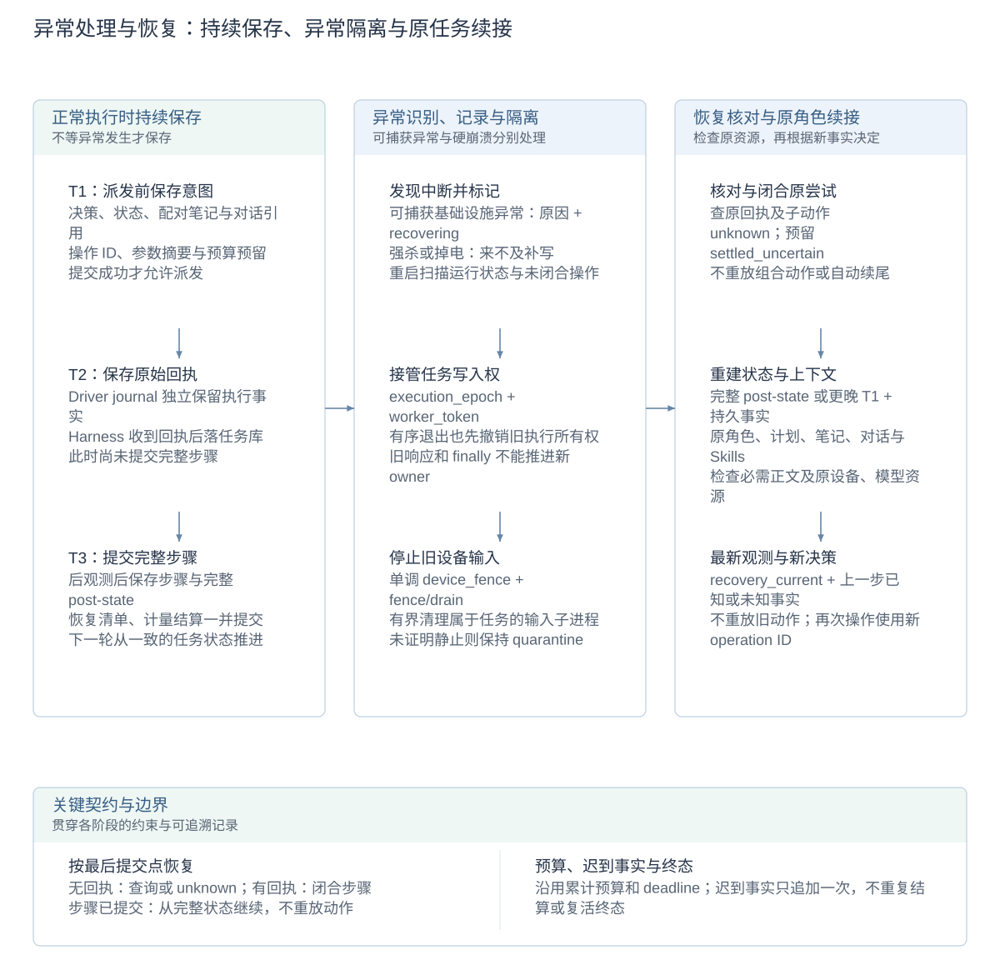
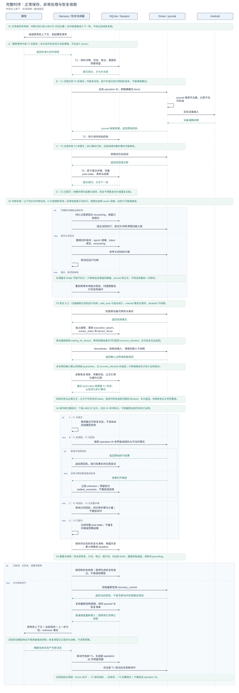
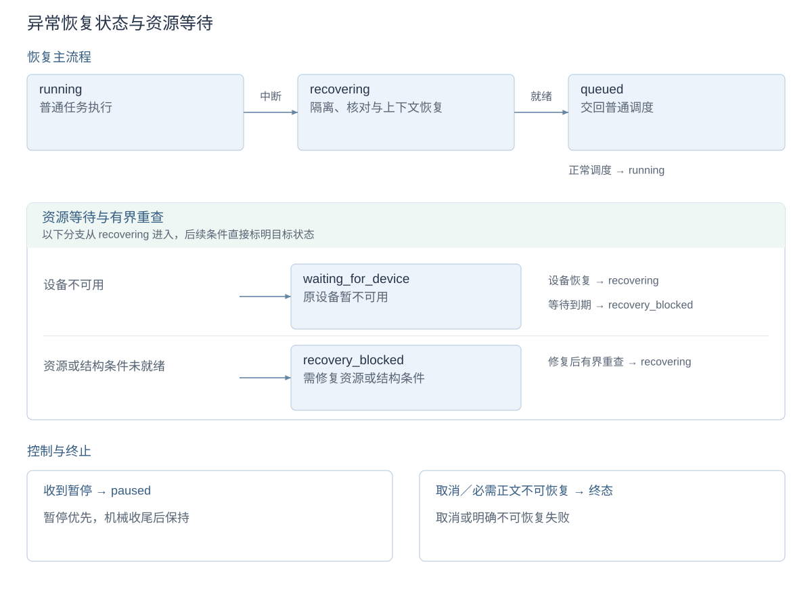

# 异常处理与中断恢复

[技术概览](reliability-design.zh-CN.md) · [架构与详设索引](architecture.zh-CN.md#模块设计文档) · [English](crash-recovery.md)

方案由三部分组成：**正常执行时持续保存可恢复事实，异常发生时识别中断并隔离旧执行，恢复时核对事实、重建上下文并续接原任务**。它不依赖崩溃前最后一次保存，也不把设备动作放进数据库事务。

新任务在创建时冻结 `safe_auto / manual / disabled`。恢复沿用任务 ID、历史、预算和绝对 deadline；协调器不重放保存的动作。原调用缺少可靠回执时，以 unknown 闭合原步骤，隔离旧输入链，取得最新观测，再交给保存的原角色决定后续工作。模型可以重新操作，但它是新决定、新 operation ID，独立计量。

## 设计图解

<!-- design-diagram:recovery-mechanisms -->

从左到右分别展示正常保存、异常处理和恢复续接。T1 是派发前保存意图，T2 是保存原始回执，T3 是提交完整步骤；具体保存内容和中断窗口见下文。强杀或掉电不能补写现场，恢复使用此前已经落盘的事实。

[Mermaid 源码](diagrams/design-recovery-mechanisms.zh-CN.mmd)

<!-- /design-diagram:recovery-mechanisms -->

<!-- design-diagram:recovery-lifecycle -->

01 展示正常保存参考链及 A/B/C/D 中断点；实际发生中断时只执行到对应位置，再转入 02 的异常处理。03 隔离旧执行，04 根据最后提交点核对事实，05 重建原角色并续跑。未发生中断的任务直接进入下一轮，不经过恢复段。图中 Harness／恢复协调器是一条逻辑职责线，接管前后属于不同执行身份。

[Mermaid 源码](diagrams/design-recovery-lifecycle.zh-CN.mmd)

<!-- /design-diagram:recovery-lifecycle -->

<!-- design-diagram:recovery-states -->

主流程、资源分支、控制与终止分区展示，后续条件直接标明目标状态。图示为策略允许的恢复路径，manual 需显式发起，disabled 不续跑。ready 不重置自动尝试计数；unknown 本身不进入 blocked。取消、暂停和不可恢复错误沿各自路径收尾。

[Mermaid 源码](diagrams/design-recovery-states.zh-CN.mmd)

<!-- /design-diagram:recovery-states -->

## 保存、异常处理与恢复如何衔接

### 正常执行时保存什么

T 是 transaction（数据库事务）的缩写，1/2/3 表示同一次动作处理中的三个提交点，不是三个恢复等级。提交前进程退出，该事务未提交的改动不会成为恢复依据。

任务库使用 SQLite WAL 和 `synchronous=FULL` 保存事务；完整步骤提交把步骤报告、任务状态和结算放在同一事务内，避免恢复时看到“报告已更新但状态或预算尚未更新”的半步进度。

| 提交点 | 已保存的数据 | 恢复时的用途 |
| --- | --- | --- |
| **T1：派发前保存意图** | 标准化决策、完整当前状态、配对笔记、对话正文引用；operation ID、参数摘要、依据观测、调用身份及组合动作关系；预算预留与恢复清单 | 在发生副作用前记录“准备做什么、由谁决定、依据什么、预留多少预算”。T1 成功后才允许调用 Driver。 |
| **T2：保存原始回执** | Driver 返回的原始结果和去重身份，追加到任务库的操作回执记录 | 区分已知结果与仍需查询的操作；即使后观测或步骤提交失败，也保留已返回的执行事实。 |
| **T3：提交完整步骤** | 步骤报告、完整 post-state、恢复清单、预算结算与操作闭合，同一事务提交 | 保证步骤记录、最新任务状态和计量一致，下一轮从该状态推进。 |

此外，**Driver 独立 journal** 保留操作接受、子动作执行阶段及原回执，填补“设备执行过但 Harness 尚未保存 T2”的信息窗口。相同 operation ID 不会作为新动作再执行；journal 仍没有可靠结果时只能记 unknown，不能据此保证设备效果恰好一次。

恢复清单把状态与必需正文关联起来：原角色、计划、笔记、提示词、已加载 Skills、对话与人工交互记录。正文通过临时写入、fsync、校验、原子发布和引用 pin 保护，避免数据库留下未发布文件的悬空引用。它们在执行过程中持续保存，不在异常处理器中临时拼一个内存快照。

### 异常发生时如何收尾或留下线索

| 异常路径 | 当时能做什么 | 后续如何接上 |
| --- | --- | --- |
| **运行中可捕获的基础设施异常** | 持久记录异常原因与 `recovering` 状态，退出当前执行；清理路径尝试关闭旧执行端、回收输入子进程并确认静止，不能确认则保留隔离。已经保存的 T1/T2/T3 不回滚。 | 扫描器按冻结策略启动恢复；原 worker 不继续派发下一动作。普通业务失败或明确终态仍走原收尾，不一律变成恢复。 |
| **有序关闭后台** | 先持久撤销旧执行所有权（递增 epoch、清除 token、标记 `recovering`），再关闭执行端并取消运行句柄；清理有时间上限。 | 下次启动接管原任务；退出不是用户取消，未清理完的设备隔离保留。 |
| **进程强杀、系统崩溃或掉电** | 异常处理器和 finally 可能完全不执行，无法保证补写原因、内存或回执。只有此前成功提交的数据、Driver journal 和已发布正文可用。 | 后台重启取得本地独占锁后扫描任务；运行标记、遗留所有权或未闭合操作构成中断线索。接管再执行输入隔离、事实核对和上下文恢复。 |

扫描器跳过仍有活跃运行句柄的任务；它不是按任务耗时猜测“卡死”再强行抢占。`manual / disabled` 不会因此自动续跑，安全清理与继续执行资格分别处理。

### 中断落在不同保存点时如何恢复

| 中断位置 | 能确定什么 | 恢复动作 |
| --- | --- | --- |
| 模型等待中／T1 尚未提交 | 没有此次动作的持久派发意图，按协议它不应进入 Driver；不能恢复模型内部未返回的思考。 | 从最近可恢复状态重建原角色并重新调用；旧响应不得推进新 owner，已记模型请求与消耗不清零。 |
| T1 已提交、T2 未保存 | 可能尚未派发、正在执行、已执行但回执丢失；单靠 T1 无法区分。 | 先隔离旧输入链，再查询 Driver journal；可信原回执可采纳，否则记 unknown。不能因为数据库里只有意图就重试。 |
| T2 已保存、T3 未提交 | 已有原始回执，但后观测和完整步骤状态可能不完整。 | 采纳回执并闭合原步骤与计量，重建上下文、获取最新观测；不重放动作，也不把恢复观测伪装成原动作后观测。 |
| T3 已提交 | 该步骤、完整状态和结算已经一致落盘。 | 从已提交状态续接后续工作，保留历史和累计预算，不重复步骤或结算。 |

所有续接都先更新任务写入身份和设备 fence，确认旧输入静止；再核对回执、闭合已知／unknown 操作，恢复原角色并取得 `recovery_current`。资源或必需正文不具备时走有界等待或明确失败，不通过猜补上下文、自动重放旧动作或重置预算绕过。

实现入口：[派发前保存与回执落库](../shared/recovery_context.py)、[事务与恢复清单](../shared/recovery_store.py)、[异常边界与恢复协调器](../shared/recovery_runtime.py)、[启动扫描和关闭收尾](../control_api/main.py)。

## 干净暂停、预算续跑与异常接管

| 路径 | 恢复起点 | 额外处理 |
| --- | --- | --- |
| 正常暂停／继续 | 已保存的安全检查点 | 恢复有效角色与进度，继续前获取当前观测 |
| 预算耗尽后显式续跑 | 具备安全预算检查点的失败尝试 | 明确追加对应限额，保留旧失败、历史和累计消耗 |
| 异常中断恢复 | 最近完整状态与持久执行事实 | 接管所有权、隔离旧输入链、核对回执并闭合 unknown、重建上下文 |

共享同一任务和正常调度，不把所有普通失败都改成可恢复。异常恢复本身不增加预算，也不延长绝对时限；暂停、取消及终态控制优先于再次执行。

### 安全检查点

正常暂停在运行时控制边界响应。检查点闭合工具记录，只保留已闭合步骤的对话引用，校验这些正文可读，清除可重建的已交付上下文，递增 `checkpoint_version` 并设置 `checkpoint_resumable`。先保存 `pausing` 与完整状态，执行端清理完成后才发布 `paused`，避免旧执行仍在收尾时被再次调度。

`resume` 检查原执行已清理、检查点有效，再进入普通调度并取得当前观测。预算续跑另外用 `request_key` 去重明确增额，保留旧 attempt、预算计数和失败事实；暂停不是回滚，也不能恢复任意未闭合模型请求。实现见[检查点](../agent/orchestrator.py)与[继续入口](../control_api/main.py)。

## 执行和恢复边界

上述保存与恢复流程还遵守以下所有权、副作用和计量约束。数据库事务不跨越 ADB 或模型请求。

- `execution_epoch / worker_token` 约束任务写入；`device_fence` 跨任务单调递增，约束设备输入。旧 worker 的模型响应、状态更新和 finally 不得推进新 owner。
- Driver 在独立 journal 中保留 operation ID、参数摘要、原回执及去重身份。原结果正文缺失也不重新执行旧 ID。查询与 fence/drain 控制面不等待阻塞的 act 请求结束。
- Windows 输入进程使用 Job Object 及 PID+创建时间记录；POSIX 使用受监督进程组和子进程锁。不能证明旧输入链已静止时保留设备 quarantine。取消/终态与设备清理分别处理。
- 恢复有界查找原回执；查不到就记 unknown，不用截图推断历史动作是否执行。原回执可证明派发返回，通常不能单独证明业务目标完成。
- unknown 预留自动结为 `settled_uncertain`，不等待人工。只有原始可信 Driver 回执明确报告零动作单位，才释放该预留；模型或页面推断不能退款。迟到事实追加，不重复步骤、工具结果、计量或复活终态。
- 组合动作记录 parent/ordinal、已发出子动作和未开始尾部。恢复关闭原尝试，不从头执行，也不自动续尾。Driver 内部 ADB 命令另有子阶段事实，不重复扣组合父步骤预算。
- 无恢复元数据的外部工具允许正常首次调用；可能有副作用的调用记录 T1/T2，丢失结果时保留 unknown，不自动重试。结果查询能力与原权限仍由具体适配器提供。

## 状态与操作

`recovering` 经所有权校验、旧输入隔离、状态/正文校验、回执归档、上下文恢复及最新观测进入 `queued`，再走普通调度。设备不可用时为 `waiting_for_device`，超过持久等待期限或遇到结构性问题时为 `recovery_blocked`。不可恢复的必需正文损坏会明确失败并保留证据。

| 情况/原因 | 行为与下一步 |
| --- | --- |
| `explicit_recovery_required` | manual 任务需通过原任务的恢复/继续入口显式发起检查。 |
| `device_unavailable` | 重连原设备。等待期限与尝试次数跨后台重启保留；资源重新可用后允许有界重查。 |
| `device_identity_mismatch` | 恢复原设备绑定，不能用另一设备替代。 |
| `old_input_chain_live` / `input_child_not_reaped` | 保留隔离。使原执行端可响应或停止属于该任务的旧输入链后重查；不删除 fence/journal 绕过。 |
| `driver_recovery_unsupported` | 升级到支持协议 1 的 Driver；旧执行端不能绕过 journal 获得自动恢复资格。 |
| `model_authorization_unavailable` / `model_configuration_unavailable` / `model_quota_unavailable` | 完成原授权、修正模型配置或恢复额度后重查。未修复时不循环调用模型；配置/授权文件的非秘密修订事实可触发一次有界自动重查。 |
| `control_changed_during_recovery` | 重新读取用户控制。取消优先，暂停机械收尾，不额外调用模型。 |
| `auto_recovery_attempts_exhausted` | 本故障周期的自动尝试用尽；修复资源或显式重查。仅 ready、不产生正常执行进展，不会重置自动尝试上限。 |
| `required_context_unrecoverable` | 当前必需正文缺失/损坏，且完整 post-state 与保留清单也无法恢复；查看日志和原产物，不能靠模型猜补。 |
| `legacy_recovery_unsupported` / `crash_recovery_disabled` | 保留诊断和设备隔离能力；不支持中途续跑。干净暂停恢复仍沿用原检查点规则。 |

unknown 本身不产生结构性 blocked、只读工具限制或额外审批。HITL off 不自动打开提问；只有模型依照原任务规则确实需要用户选择时，才使用原 HITL。未回答的问题不因重启重新提问；失效的客户端订阅也不会被重建成在线。

## API、MCP 与 Console

`POST /api/tasks/{task_id}/recover` 请求体为 `{"request_key":"unique-request-key"}`。相同 key/请求返回首次接受结果；异参冲突。接受只代表已持久化恢复意图，不等于任务恢复成功。后台扫描可找回丢失的调度通知。

既有 `/resume` 和 MCP `resume_task` 也可检查符合条件的异常任务，不增设低级 MCP 工具。它们不会给异常恢复增加预算；预算耗尽后的显式增额仍走原检查点续跑。`get_status / get_task / list_tasks` 只读，不触发模型请求、截图或验证动作。Console 展示恢复阶段、原因、隔离、unknown 及已有控制入口；没有 unknown 处置表单。

查询里的有界 `recovery` 包括 policy、phase、attempt_no、reason、last_committed_seq、quarantined、available_actions 和最近 8 项 unknown。`model_usage.unknown_usage_rounds` 表示缺少明确用量回执的轮次，不将它们当成零 token/cost；实际请求次数仍即时计入任务预算。

## 上下文和文件

清单保存完整 AgentState（原需求、有效计划、摘要、预算、next_role）、当前笔记、角色提示词、实际加载的 Skill 正文、HITL/用户调整记录及保留对话正文引用。配置依赖只存模型标识和协议等非秘密字段。恢复重新建立读取通道，清除旧 grounding/授权并取得 `recovery_current`；它不是原动作的因果后观测。

产物先在同目录临时写入、fsync、完整性校验，再原子发布；引用提交前有跨进程 pin 保护。GC 遍历当前清单、操作、回执与历史 attempt 的可达引用。正常动作不验证整条历史文件链。当前清单损坏时可从完整 DB post-state/更晚 T1 状态和持久事实重建，必要时只查缺失正文对应的保留清单，不重新执行已发生操作。

## 配置与评测

| 环境变量 | 默认 | 含义 |
| --- | --- | --- |
| `CLICKCLICK_TASK_RECOVERY_POLICY` | `safe_auto` | 仅新建任务采用，创建后冻结。 |
| `CLICKCLICK_TASK_RECOVERY_MAX_AUTO_ATTEMPTS` | `3` | 单故障周期自动尝试上限。 |
| `CLICKCLICK_TASK_RECOVERY_SCAN_INTERVAL_S` | `5` | 持久调度扫描间隔。 |
| `CLICKCLICK_TASK_RECOVERY_BACKOFF_S` | `[1,5,15]` | 有界退避，非负且非空。 |
| `CLICKCLICK_TASK_RECOVERY_ATTEMPT_TIMEOUT_S` | `60` | 单次恢复的时间上限。 |
| `CLICKCLICK_TASK_RECOVERY_DEVICE_WAIT_S` | `300` | 设备等待的持久时间窗口。 |

MobileWorld 单题入口默认冻结 manual，可用 `--recovery-policy safe_auto` 显式开展恢复实验。恢复实验、任务轨迹和成绩独立保存，不续活已结束 episode，也不替换已发布的历史成绩。

## 升级、回滚和验收限制

有旧任务的数据库升级前生成 WAL 一致性备份；增量迁移可以重入。新 schema 通过 writer guard 拒绝旧二进制继续写任务。升级应先停止接收新任务、等待正常任务收尾，异常任务则保留隔离和日志。不能用旧 DB 备份覆盖当前库来“撤销”已经发生的外部动作；需要回滚程序时保留新库/journal/产物，使用兼容读取或独立数据目录。

支持本机新任务启用 safe_auto 的检查项：持久数据目录可写且单后台独占；Driver 支持协议 1、去重、fence/drain 与结果查询；当前状态及必需正文可解释；原设备、权限和预算有效。检查仅涉及这些结构条件，不添加页面关键词、成功率阈值或模型专用审批。

验收范围包括 MobileWorld 任务中的正常／硬中断对照、unknown 与原角色上下文续接，以及 Linux 容器中受监督输入进程组的硬退出与回收。详细测试日志和故障注入脚本保留在开发仓库；未执行物理手机断连／重启验收，也未验证 macOS 进程行为。
