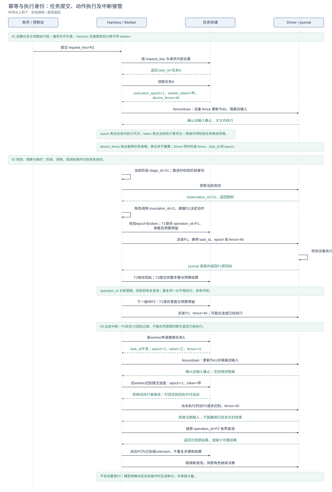

# 异常处理与中断恢复

[技术概览](reliability-design.zh-CN.md) · [架构与详设索引](architecture.zh-CN.md#模块设计文档) · [English](crash-recovery.md)

方案由三部分组成：**正常执行时持续保存可恢复事实，异常发生时识别中断并隔离旧执行，恢复时核对事实、重建上下文并续接原任务**。它不依赖崩溃前最后一次保存，也不把设备动作放进数据库事务。

新任务在创建时冻结 `safe_auto / manual / disabled`。恢复沿用任务 ID、历史、预算和绝对 deadline；协调器不重放保存的动作。原调用缺少可靠回执时，以 unknown 闭合原步骤，隔离旧输入链，取得最新观测，再交给保存的原角色决定后续工作。模型可以重新操作，但它是新决定、新 operation ID，独立计量。

## 设计图解

<!-- design-diagram:recovery-mechanisms -->


从左到右分别展示正常保存、异常处理和恢复续接。T1 是派发前保存意图，T2 是保存原始回执，T3 是提交完整步骤；具体保存内容和中断窗口见下文。强杀或掉电不能补写现场，恢复使用此前已经落盘的事实。

[Mermaid 源码](diagrams/design-recovery-mechanisms.zh-CN.mmd)

<!-- /design-diagram:recovery-mechanisms -->

<!-- design-diagram:recovery-lifecycle -->


01 展示正常保存参考链及 A/B/C/D 中断点；实际发生中断时只执行到对应位置，再转入 02 的异常处理。03 隔离旧执行，04 根据最后提交点核对事实，05 重建原角色并续跑。未发生中断的任务直接进入下一轮，不经过恢复段。图中 Harness／恢复协调器是一条逻辑职责线，接管前后属于不同执行身份。

[Mermaid 源码](diagrams/design-recovery-lifecycle.zh-CN.mmd)

<!-- /design-diagram:recovery-lifecycle -->

<!-- design-diagram:recovery-states -->


主流程、资源分支、控制与终止分区展示，后续条件直接标明目标状态。图示为策略允许的恢复路径，manual 需显式发起，disabled 不续跑。ready 不重置自动尝试计数；unknown 本身不进入 blocked。取消、暂停和不可恢复错误沿各自路径收尾。

[Mermaid 源码](diagrams/design-recovery-states.zh-CN.mmd)

<!-- /design-diagram:recovery-states -->

## 保存、异常处理与恢复如何衔接

### 正常执行时保存什么

T 是 transaction（数据库事务）的缩写，1/2/3 表示同一次动作处理中的三个提交点，不是三个恢复等级。提交前进程退出，该事务未提交的改动不会成为恢复依据。

任务库使用 SQLite WAL 和 `synchronous=FULL` 保存事务；完整步骤提交把步骤报告、任务状态和结算放在同一事务内，避免恢复时看到“报告已更新但状态或预算尚未更新”的半步进度。

| 提交点 | 已保存的数据 | 恢复时的用途 |
| --- | --- | --- |
| **T1：派发前保存意图** | 标准化决策、完整当前状态、配对笔记、对话正文引用；operation ID、参数摘要、依据观测、调用身份及组合动作关系；预算预留与恢复清单 | 在发生副作用前记录“准备做什么、由谁决定、依据什么、预留多少预算”。T1 成功后才允许调用 Driver。 |
| **T2：保存原始回执** | Driver 返回的原始结果和去重身份，追加到任务库的操作回执记录 | 区分已知结果与仍需查询的操作；即使后观测或步骤提交失败，也保留已返回的执行事实。 |
| **T3：提交完整步骤** | 步骤报告、完整 post-state、恢复清单、预算结算与操作闭合，同一事务提交 | 保证步骤记录、最新任务状态和计量一致，下一轮从该状态推进。 |

恢复清单把状态与必需正文关联起来：原角色、计划、笔记、提示词、已加载 Skills、对话与人工交互记录。正文通过临时写入、fsync、校验、原子发布和引用 pin 保护，避免数据库留下未发布文件的悬空引用。它们在执行过程中持续保存，不在异常处理器中临时拼一个内存快照。

### 为什么不能只靠 Checkpoint，而要分阶段持久化

这里“只靠 Checkpoint”特指只保存完整步骤结束后的快照，不能把 Checkpoint 限定为暂停功能：T3 的完整 post-state、T1 保存的较新状态与上下文引用，都可以作为广义恢复检查点。数据库提交和手机操作无法组成原子事务。若派发前没有 T1，崩溃后可能连“准备做哪次操作”都无法识别；若手机已经执行、回执尚未保存，直接从旧快照重试可能重复发送邮件或创建记录。

因此，派发前的 T1 保存“准备做什么”，让恢复能识别未闭合操作；执行后的 T2 保存“已知发生了什么”；T3 再把完整进度和消耗一起提交。Driver journal 补充设备侧接受与执行事实。恢复先隔离旧执行、核对可信回执，缺失结果保留 unknown，再取得新观测交给原角色决策，不自动重放旧动作。这提供符合条件的恢复能力，不保证任意业务副作用恰好发生一次。

### T3 怎样让步骤、最新状态和预算结算保持一致

T3 在同一个任务数据库事务里保存三类记录：**步骤报告**说明本步动作和反馈，**完整 post-state**说明任务推进到哪里及后续从哪里继续，**预算结算与操作闭合**记录消耗并结清对应预留。正文已发布后，相关恢复引用也随事务提交。

如果分开提交，可能出现“步骤已记完成，最新状态还停在上一步”，或者“进度已保存，消耗尚未记上”。T3 使这些内部记录要么全部提交，要么都不提交；未提交时按已有 T1/T2 和 journal 核对，不能直接重放手机动作。原子性覆盖任务库里的进度和计量，手机操作本身仍在事务之外。

### 为什么 T2 与 T3 分开提交

技术上可以合并，但会推迟回执进入任务库，扩大故障窗口。Driver 返回后，完整步骤仍需取得后观测、组装报告与 post-state 并结算预算；这些环节可能超时或失败。如果等到全部完成才落库，已收到的原回执也会随未提交事务一起丢失，恢复只能再查 Driver journal。

当前选择让 T2 先提交最小的原始回执事实，再由 T3 原子提交完整进度。这样，后观测或步骤提交失败时仍有任务库内的执行依据，代价是增加一次数据库提交。T2 已提交不等于本步已经完整提交，更不代表业务目标已完成。

<a id="driver-journal"></a>

### Driver journal：内容与存储位置

Driver journal 是**驱动侧的持久执行账本**，实现为独立 SQLite 文件 `execution.db`，使用 WAL 和 `synchronous=FULL`。它记录以下内容：

- `operations`：operation ID、所属任务／设备、参数摘要、接受／返回状态及原始回执，用于操作去重和结果查询。
- `guards`：每个设备当前的 fence、任务、epoch 与关闭状态，用于拒绝过期输入。
- `subactions` / `children`：子动作阶段、返回码，以及受监督输入进程的 PID 和创建时间，用于识别执行进展与清理旧输入。

存储位置按实际执行通路区分：

- **本地驱动**：`<任务数据库所在目录>/driver-execution/execution.db`，由 `journal_for()` 创建。
- **远程驱动**：`<远程 Driver 的 Settings.data_dir>/driver-execution/execution.db`，由 RPC 服务创建，保存在远程 Driver 主机。

数据目录可通过 `CLICKCLICK_DATA_DIR` 配置，默认 `./data`；相对路径由对应进程的工作目录解析。journal 位于承载驱动执行通路的电脑上，手机承担实际界面操作。T2 则写入任务数据库（默认 `clickclick.db`）的 `operation_receipts`，两者是独立数据库文件。本地模式下它们可以位于同一进程和磁盘，逻辑独立不等于物理故障隔离。

相同 operation ID 不会作为新动作再执行；journal 仍无可靠结果时只能保留 unknown。已有操作记录或接受状态都不能代替业务成功证据。实现见 [journal 数据库与执行去重](../driver/execution_journal.py)、[本地创建位置](../shared/recovery_runtime.py)、[远程创建位置](../driver/rpc_server.py)。

### journal 已保存回执，为什么 T2 还保存一次

journal 持有设备侧的去重和查询事实；T2 将同一回执纳入任务自己的持久记录，供步骤闭合、预算结算和审计使用。已进入任务库的回执不必每次恢复都重新依赖 Driver 在线、其日志仍可访问；journal 主要补足“设备已执行但任务库尚无 T2”的窗口。

这不是理论上必须保存两份。也可以让任务只引用 journal，但需要保证其长期可查，并处理跨组件读取、生命周期和任务状态关联。当前以额外持久化换取更少的恢复依赖；它既不形成跨库原子事务，也不意味着两份记录总是同步。journal 有记录而 T2 缺失时，恢复按原 operation ID 查询并采纳可信回执；查询仍无可靠结果则记录 unknown。

### 异常发生时如何收尾或留下线索

| 异常路径 | 当时能做什么 | 后续如何接上 |
| --- | --- | --- |
| **运行中可捕获的基础设施异常** | 持久记录异常原因与 `recovering` 状态，退出当前执行；清理路径尝试关闭旧执行端、回收输入子进程并确认静止，不能确认则保留隔离。已经保存的 T1/T2/T3 不回滚。 | 扫描器按冻结策略启动恢复；原 worker 不继续派发下一动作。普通业务失败或明确终态仍走原收尾，不一律变成恢复。 |
| **有序关闭后台** | 先持久撤销旧执行所有权（递增 epoch、清除 token、标记 `recovering`），再关闭执行端并取消运行句柄；清理有时间上限。 | 下次启动接管原任务；退出不是用户取消，未清理完的设备隔离保留。 |
| **进程强杀、系统崩溃或掉电** | 异常处理器和 finally 可能完全不执行，无法保证补写原因、内存或回执。只有此前成功提交的数据、Driver journal 和已发布正文可用。 | 后台重启取得本地独占锁后扫描任务；运行标记、遗留所有权或未闭合操作构成中断线索。接管再执行输入隔离、事实核对和上下文恢复。 |

扫描器跳过仍有活跃运行句柄的任务；它不是按任务耗时猜测“卡死”再强行抢占。`manual / disabled` 不会因此自动续跑，安全清理与继续执行资格分别处理。

### 中断落在不同保存点时如何恢复

| 中断位置 | 能确定什么 | 恢复动作 |
| --- | --- | --- |
| 模型等待中／T1 尚未提交 | 没有此次动作的持久派发意图，按协议它不应进入 Driver；不能恢复模型内部未返回的思考。 | 从最近可恢复状态重建原角色并重新调用；旧响应不得推进新 owner，已记模型请求与消耗不清零。 |
| T1 已提交、T2 未保存 | 可能尚未派发、正在执行、已执行但回执丢失；单靠 T1 无法区分。 | 先隔离旧输入链，再查询 Driver journal；可信原回执可采纳，否则记 unknown。不能因为数据库里只有意图就重试。 |
| T2 已保存、T3 未提交 | 已有原始回执，但后观测和完整步骤状态可能不完整。 | 采纳回执并闭合原步骤与计量，重建上下文、获取最新观测；不重放动作，也不把恢复观测伪装成原动作后观测。 |
| T3 已提交 | 该步骤、完整状态和结算已经一致落盘。 | 从已提交状态续接后续工作，保留历史和累计预算，不重复步骤或结算。 |

所有续接都先更新任务写入身份和设备 fence，确认旧输入静止；再核对回执、闭合已知／unknown 操作，恢复原角色并取得 `recovery_current`。资源或必需正文不具备时走有界等待或明确失败，不通过猜补上下文、自动重放旧动作或重置预算绕过。

实现入口：[派发前保存与回执落库](../shared/recovery_context.py)、[事务与恢复清单](../shared/recovery_store.py)、[异常边界与恢复协调器](../shared/recovery_runtime.py)、[启动扫描和关闭收尾](../control_api/main.py)。

## 干净暂停、预算续跑与异常接管

| 路径 | 恢复起点 | 额外处理 |
| --- | --- | --- |
| 正常暂停／继续 | 已保存的安全检查点 | 恢复有效角色与进度，继续前获取当前观测 |
| 预算耗尽后显式续跑 | 具备安全预算检查点的失败尝试 | 明确追加对应限额，保留旧失败、历史和累计消耗 |
| 异常中断恢复 | 最近完整状态与持久执行事实 | 接管所有权、隔离旧输入链、核对回执并闭合 unknown、重建上下文 |

共享同一任务和正常调度，不把所有普通失败都改成可恢复。异常恢复本身不增加预算，也不延长绝对时限；暂停、取消及终态控制优先于再次执行。

<a id="checkpoint"></a>

## Checkpoint：内容、JSON 结构与生成时机

### Checkpoint、Session 和模型上下文的关系

Checkpoint 是**用于恢复的持久任务状态及其关联内容的引用**，不以任务是否暂停为定义。Session 是整项任务的持久记录集合，包含历史对话、版本笔记、计划、操作与回执等；Checkpoint 从这些记录中确定一个可恢复位置。模型上下文则是为某个角色、某一轮决策组装的输入，不等于全部 Session，也不等于原样序列化的 Checkpoint。

快照直接保存原需求、当前计划／阶段、下一角色、摘要、进度与预算等状态，完整对话和其他正文通过引用恢复。必要业务信息、相关记忆、预算及最新观测进入模型输入；更早证据按需回查。任务所有权凭证、数据库去重索引等由运行时处理，通常不需要模型阅读。恢复后重建角色上下文并取得新观测，不把历史画面当作当前动作依据。

### 实际以什么形态落盘

没有一个包办全部事实的 `checkpoint.json` 文件。`AgentState` 序列化到 `tasks.state_json`；恢复清单把状态与必需版本记录打包到 `artifacts/recovery/<内容hash>.json`，`tasks.active_manifest_id` 保存其引用。T1 的 `task_operations.intent_json` 另含当时完整状态和决策上下文引用；操作、回执、步骤与预算分别保存在相关表中。

以下是恢复清单的简化示意，保留实际字段名，省略其他状态和版本记录，引用值为示例：

```json
{
  "version": 1,
  "state_version": 42,
  "control_revision": 3,
  "state": {
    "instruction": "创建会议并发送通知",
    "step_number": 17,
    "role_invocation_count": 25,
    "revisable": {
      "revision": 3,
      "plan": {
        "current_stage": {
          "goal": "向参会人发送会议通知",
          "target_app": "邮件",
          "skill_ids": []
        },
        "assumption_roadmap": []
      },
      "next_role": "executor",
      "summary": "会议已创建，通知尚未确认发送。",
      "execution_count": 12,
      "dialogue_refs": ["d1"],
      "limits": {"device_actions": 100, "model_calls": 200},
      "checkpoint_version": 0,
      "checkpoint_resumable": false
    },
    "recovery": {}
  },
  "records": [
    {
      "task_id": "A",
      "kind": "dialogue",
      "record_key": "d1",
      "version": 1,
      "payload_json": "{\"step\":16,\"ref\":\"dialogue/example.json\"}"
    }
  ],
  "dependencies": {}
}
```

`state` 是结构化对象，不是拼好的一整段提示词；在 SQLite 的 TEXT 列中以 JSON 字符串保存。字段可以是字符串、数字、布尔值、列表或嵌套对象。`records` 按当前清单收集笔记、角色提示词、技能正文、HITL／用户变更及所需对话版本；示例仅展示一条对话记录，其 `payload_json` 也是原记录的 JSON 字符串，正文由 `ref` 定位。它不是全量历史的副本。

示例中 `checkpoint_version=0` 仍可以有完整 T3 恢复快照：该字段只计数后述安全续跑准备，不代表此前没有保存状态。`limits` 保存上限和可选绝对 `deadline_at`，已用模型请求、动作等计数另在状态／预算流水中保留；恢复不重置它们。

### 每个时间点保存什么

T1／T2／T3 是动作处理中的提交点，不是任务状态全集，也不是全部持久化入口。

| 时间点 | 保存的数据与位置 | 与快照／版本的关系 |
| --- | --- | --- |
| 创建并启用恢复协议 | 初始任务状态、冻结策略及恢复清单 | 建立初始恢复基础，不要求已有暂停检查点 |
| 规划更新、角色交接 | 计划版本、下一角色、反馈等 AgentState；运行时持久化入口更新状态和清单 | 即使没有手机动作，也可保存新恢复状态；不因此增加 `checkpoint_version` |
| HITL 等待／回答、用户变更 | 待答问题、原调用续接、回答／变更记录及相关任务状态 | 独立交互记录也属于恢复依据，不统一走设备动作 T3；原要求和回答可按记录恢复 |
| **T1：派发前** | `task_operations` 保存动作、参数、调用／观测身份；`intent_json` 保存完整状态及对话等引用；`budget_ledger` 保存预留，并发布清单 | 形成更接近派发点的状态与意图快照；T1 本身不递增 `state_version` 或 `checkpoint_version`，清单内容仍可变化 |
| **Driver 接受／执行** | 独立 journal 记录接受、子动作阶段及可取得的原回执 | 补足设备侧事实；不更新任务快照的检查点计数 |
| **T2：回执落库** | `operation_receipts` 追加原回执，更新操作结果和 `operation_version` | 新增执行事实，本身不是完整快照；不增加 `checkpoint_version` |
| **T3：完整步骤提交** | `steps`、`tasks.state_json`、操作闭合、预算结算和清单引用同事务提交 | 形成完整 post-state 恢复点，`state_version` 递增；`checkpoint_version` 保持原值 |
| **安全暂停** | 整理已闭合对话引用、验证正文、清除可重建上下文，保存 `pausing` 状态；清理后保存 `paused` | `_prepare_checkpoint()` 准备时递增 `checkpoint_version`，随后状态事务提交才持久可见 |
| **预算耗尽** | 同样准备安全检查点，保存预算种类、停止原因和累计消耗 | 会调用 `_prepare_checkpoint()`；最终续跑资格由预算类型决定，并非所有预算失败都可续跑 |
| **可捕获异常／有序关闭** | 持久记录异常／控制状态、撤销旧执行权并尝试清理，保留已提交快照和操作事实 | 不统一调用安全检查点准备；记录异常不等于生成完整的新内存快照 |
| **强杀／掉电** | 只剩此前成功提交的数据和已发布文件 | 不能保证异常处理或 finally 执行，更不能依赖最后一次保存 |
| **恢复接管** | 核对清单、状态、回执／unknown，闭合原操作，保存 `state.recovery`、新观测及重建后的状态／清单 | 可形成新的恢复快照，通常不递增 `checkpoint_version`；若接管后应暂停，则调用安全检查点准备 |

因此，“何时保存快照”“是否已闭合某个操作”和“是否生成安全续跑检查点”是不同问题。恢复扫描先利用既有快照与持久事实，再写恢复交接状态；不是等到崩溃时或恢复时才首次存档。

### 哪个版本号在什么时候变化

| 字段 | 实际含义与更新条件 |
| --- | --- |
| 清单顶层 `version` | 恢复协议／格式版本，当前为 1；不是快照序号 |
| `tasks.state_version`／清单 `state_version` | 持久状态写入版本。`update_task(state=...)` 和完整 T3 状态提交会递增；仅更新任务状态标签不会因此递增。T1 可发布含更近状态的清单而沿用原状态版本，不能仅按这个数枚举全部清单 |
| `state.revisable.checkpoint_version` | `_prepare_checkpoint()` 在闭合历史与引用校验成功后递增。调用点为正常暂停、预算耗尽，以及恢复后需要暂停的分支；准备后还需调用方提交状态。它不是所有恢复快照的统一版本号 |
| `checkpoint_resumable` | 当前是否具备相应安全续跑资格；继续执行、终态或特定预算类型可清除。数值版本非零不等于当前仍可恢复 |
| `tasks.active_manifest_id` | 已发布恢复清单的内容 hash 引用；内容改变可产生新文件，相同内容可复用。它与检查点计数不是同一个编号 |
| `operation_version`／`agent_records.version`／计划 `revision` | 分别记录操作事实变化、某类某 key 记录版本和计划修订；均不作为统一 Checkpoint 编号 |

当前代码没有“每发布一份恢复快照就递增”的统一 `checkpoint_version`。T3 每步生成有效恢复点与这个字段仅在安全续跑准备时递增，可以同时成立；不能据字段名推导生成时机。

### 任务状态、操作状态、恢复进度分别存在哪里

| 类别 | 存储位置与作用 | 与 Checkpoint 的关系 |
| --- | --- | --- |
| **任务生命周期状态** | `tasks.status`：`queued / running / pausing / paused / waiting_for_input / recovering / waiting_for_device / recovery_blocked / succeeded / failed / cancelled` | 与 `tasks.state_json` 并列保存，管理调度和终态；状态标签本身不是快照正文 |
| **操作记录状态** | `task_operations.status` 的主要路径为 `dispatching → result_recorded → committed`；枚举另定义 `prepared / superseded`。结果是否已知另看 `result_state` 和回执 | 描述单次操作的记录处理进度；同一行 `intent_json.state` 可以携带 T1 快照，但 `status` 不是快照。`committed` 也不证明业务成功，unknown 同样可以闭合 |
| **恢复流程进度** | `tasks.recovery_json.phase` 及 `agent_records(kind=recovery_event)`：记录 detected、verifying_owner、validating_state、collecting_results、recording_results、restoring_context、refreshing_device、waiting_for_device、blocked、unrecoverable、ready | 描述恢复手续走到哪一步，不属于上述清单中的 `state.recovery`；单纯追加恢复事件不创建状态快照或增加检查点计数 |
| **恢复交接事实** | `AgentState.recovery`，即清单中的 `state.recovery` | 作为快照内容保存中断缺口、原操作的 known／unknown、旧观测及新观测引用，供原角色继续决策 |

例如，`tasks.recovery_json` 可以是 `{"phase":"collecting_results","attempt_no":1,"reason":null}`，表示协调器正在查原回执；核对后的 `state.recovery` 可以含 `{"interruption_gap":true,"operations":[{"previous_operation_id":"P1","execution_result":"unknown"}],"observation_source":"recovery_current","current_observation_id":"O2"}`。后一个例子省略动作与原结果等字段，用于说明交接事实的形态；两者通过同一任务关联，不能混作一个字段。

实现入口：[AgentState 与各状态枚举](../shared/schemas.py)、[计划／预算／检查点字段](../shared/revisable.py)、[快照清单与操作记录](../shared/recovery_store.py)、[状态／步骤事务](../shared/db.py)、[恢复装载与交接](../shared/recovery_runtime.py)、[角色状态持久化](../agent/revisable/orchestrator.py)。

### 安全检查点

正常暂停在运行时控制边界响应。检查点闭合工具记录，只保留已闭合步骤的对话引用，校验这些正文可读，清除可重建的已交付上下文，递增 `checkpoint_version` 并设置 `checkpoint_resumable`。先保存 `pausing` 与完整状态，执行端清理完成后才发布 `paused`，避免旧执行仍在收尾时被再次调度。

`resume` 检查原执行已清理、检查点有效，再进入普通调度并取得当前观测。预算续跑另外用 `request_key` 去重明确增额，保留旧 attempt、预算计数和失败事实；暂停不是回滚，也不能恢复任意未闭合模型请求。实现见[检查点](../agent/orchestrator.py)与[继续入口](../control_api/main.py)。

## 幂等设计

幂等设计分别处理**重复请求、过期执行者和重复操作**。请求去重避免重复创建任务或重复接受控制；执行权校验阻止旧 worker 推进任务或继续输入；操作去重将同一次操作与原回执绑定。三个问题不能仅靠一个任务 ID 解决，也不构成任意 GUI 业务效果恰好一次的保证。

### 关键 ID 与校验时序

<!-- design-diagram:recovery-identities -->



图中编号仅作示意，以单设备任务说明主执行链；Harness 是逻辑职责线，接管前后属于不同 worker。P1 已完整保存；下一操作 P2 在 T1 之后、T2 之前中断，恢复只查询 P2 的原结果，不自动重新执行。旧动作迟到被拒绝，指它尚未越过设备输入边界；已经发生的效果仍需保留和核对。

[Mermaid 源码](diagrams/design-recovery-identities.zh-CN.mmd)

<!-- /design-diagram:recovery-identities -->

| 标识 | 作用域与变化 | 校验位置与用途 |
| --- | --- | --- |
| `request_key` | 一次提交或控制请求；网络重试沿用同一个 key | 对应 API 在受理处检查 key 与请求内容，返回已有受理结果；同 key 异参冲突。创建任务、恢复和预算增额各自按入口合同去重，不共用设备动作身份。 |
| `task_id` | 整项任务；暂停、接管和续跑沿用 | 关联状态、历史、笔记、操作和预算；它回答“哪项任务”，不能单独证明当前执行资格。 |
| `execution_epoch` | 任务内的执行代次；领取、接管及撤销等边界递增 | 与 token 一起在任务存储校验，拒绝旧代次推进；不同任务的 epoch 不能直接比较新旧。 |
| `worker_token` | 当前执行者的随机凭证；领取或接管时更新，释放时清空 | 与 epoch 一起匹配当前 owner。当前实现中两者对旧执行者的拦截存在重叠，不应解释为两个不可替代的独立幂等层。 |
| `device_fence` | 每个设备各自持续递增，换任务不重置；释放等边界也可递增 | Driver 按设备校验 `fence + task_id + epoch`，拒绝旧输入；接管还须完成 fence/drain，确认旧输入链静止。 |
| `stage_id` | 当前计划阶段；计划修订后更新 | 编排层校验阶段推进身份，避免旧 `advance` 推进新阶段；不用于设备动作去重。 |
| `invocation_id` | 一次角色调用的追踪身份 | 将角色调用与其决策、工具调用和操作意图关联；ID 本身不授予执行权。用户变更后的调用失效还由调用 lease 控制。 |
| `observation_id` | 一份已登记观测；新观测使用新 ID | 动作解析层校验当前依据，绑定图树、索引及坐标空间；历史观测不能直接授权当前动作。 |
| `operation_id` | 一次具体操作；在 T1 前生成，原回执查询始终使用原 ID | 任务库和 Driver journal 将操作与参数摘要绑定。Driver 收到同 ID、同参数时返回已有结果或 unknown，不再执行；同 ID 异参冲突。模型重新决定操作时必须使用新 ID。 |

### 为什么同时保留任务执行权与设备执行权

`execution_epoch / worker_token` 保护任务状态，`device_fence` 保护真实输入通路。例如，同一设备先后执行任务 A（epoch=5）和任务 B（epoch=1），任务内代次无法单独表达设备所有权的先后；设备 fence 则跨任务递增。当前 Driver 同时匹配设备上的 fence、任务和 epoch；即使旧请求已经离开 Harness，也要在驱动侧再次检查。

`execution_epoch` 与 `worker_token` 在当前领取流程中同时更新，分别便于表达代次和当前凭证，并非理论上只能采用这组字段。幂等所需的不变量是：执行资格必须原子更新并在写入／派发边界校验，释放和接管后旧身份失效。仅校验任务写入而不隔离旧设备输入，仍不足以安全接管。

### 回执与结算怎样避免重复

T1 将 `operation_id`、参数摘要和预算预留一起提交；T2 用 `operation_id + source + source_generation + source_seq` 去重原始回执；T3 将步骤、完整状态、操作闭合和预算结算一起提交。重复恢复不重新创建原操作，不重复追加同一回执或结算已闭合操作；控制入口收到请求也不等于恢复已经成功。

旧 worker 失去推进资格，不代表丢弃真实执行事实：迟到的可信回执仍可追加，供当前执行者核对，但不能让旧 worker 推进计划、重复结算或复活终态。缺少可靠回执时记录 unknown，沿原 `operation_id` 闭合原尝试；不通过更换 ID 自动重试来绕过去重。模型根据新观测明确作出的后续操作才生成新 ID，仍可能产生新的业务效果。

实现入口：[请求去重](../control_api/main.py)、[执行权／回执／结算](../shared/recovery_store.py)、[操作意图与派发](../shared/recovery_context.py)、[Driver fence 与操作去重](../driver/execution_journal.py)、[调用资格](../shared/task_control.py)。

## 执行和恢复边界

上述保存与恢复流程还遵守以下所有权、副作用和计量约束。数据库事务不跨越 ADB 或模型请求。

- `execution_epoch / worker_token` 约束任务写入；`device_fence` 跨任务单调递增，约束设备输入。旧 worker 的模型响应、状态更新和 finally 不得推进新 owner。
- Driver 在独立 journal 中保留 operation ID、参数摘要、原回执及去重身份。原结果正文缺失也不重新执行旧 ID。查询与 fence/drain 控制面不等待阻塞的 act 请求结束。
- Windows 输入进程使用 Job Object 及 PID+创建时间记录；POSIX 使用受监督进程组和子进程锁。不能证明旧输入链已静止时保留设备 quarantine。取消/终态与设备清理分别处理。
- 恢复有界查找原回执；查不到就记 unknown，不用截图推断历史动作是否执行。原回执可证明派发返回，通常不能单独证明业务目标完成。
- unknown 预留自动结为 `settled_uncertain`，不等待人工。只有原始可信 Driver 回执明确报告零动作单位，才释放该预留；模型或页面推断不能退款。迟到事实追加，不重复步骤、工具结果、计量或复活终态。
- 组合动作记录 parent/ordinal、已发出子动作和未开始尾部。恢复关闭原尝试，不从头执行，也不自动续尾。Driver 内部 ADB 命令另有子阶段事实，不重复扣组合父步骤预算。
- 无恢复元数据的外部工具允许正常首次调用；可能有副作用的调用记录 T1/T2，丢失结果时保留 unknown，不自动重试。结果查询能力与原权限仍由具体适配器提供。

## 状态与操作

`recovering` 经所有权校验、旧输入隔离、状态/正文校验、回执归档、上下文恢复及最新观测进入 `queued`，再走普通调度。设备不可用时为 `waiting_for_device`，超过持久等待期限或遇到结构性问题时为 `recovery_blocked`。不可恢复的必需正文损坏会明确失败并保留证据。

| 情况/原因 | 行为与下一步 |
| --- | --- |
| `explicit_recovery_required` | manual 任务需通过原任务的恢复/继续入口显式发起检查。 |
| `device_unavailable` | 重连原设备。等待期限与尝试次数跨后台重启保留；资源重新可用后允许有界重查。 |
| `device_identity_mismatch` | 恢复原设备绑定，不能用另一设备替代。 |
| `old_input_chain_live` / `input_child_not_reaped` | 保留隔离。使原执行端可响应或停止属于该任务的旧输入链后重查；不删除 fence/journal 绕过。 |
| `driver_recovery_unsupported` | 升级到支持协议 1 的 Driver；旧执行端不能绕过 journal 获得自动恢复资格。 |
| `model_authorization_unavailable` / `model_configuration_unavailable` / `model_quota_unavailable` | 完成原授权、修正模型配置或恢复额度后重查。未修复时不循环调用模型；配置/授权文件的非秘密修订事实可触发一次有界自动重查。 |
| `control_changed_during_recovery` | 重新读取用户控制。取消优先，暂停机械收尾，不额外调用模型。 |
| `auto_recovery_attempts_exhausted` | 本故障周期的自动尝试用尽；修复资源或显式重查。仅 ready、不产生正常执行进展，不会重置自动尝试上限。 |
| `required_context_unrecoverable` | 当前必需正文缺失/损坏，且完整 post-state 与保留清单也无法恢复；查看日志和原产物，不能靠模型猜补。 |
| `legacy_recovery_unsupported` / `crash_recovery_disabled` | 保留诊断和设备隔离能力；不支持中途续跑。干净暂停恢复仍沿用原检查点规则。 |

unknown 本身不产生结构性 blocked、只读工具限制或额外审批。HITL off 不自动打开提问；只有模型依照原任务规则确实需要用户选择时，才使用原 HITL。未回答的问题不因重启重新提问；失效的客户端订阅也不会被重建成在线。

## API、MCP 与 Console

`POST /api/tasks/{task_id}/recover` 请求体为 `{"request_key":"unique-request-key"}`。相同 key/请求返回首次接受结果；异参冲突。接受只代表已持久化恢复意图，不等于任务恢复成功。后台扫描可找回丢失的调度通知。

既有 `/resume` 和 MCP `resume_task` 也可检查符合条件的异常任务，不增设低级 MCP 工具。它们不会给异常恢复增加预算；预算耗尽后的显式增额仍走原检查点续跑。`get_status / get_task / list_tasks` 只读，不触发模型请求、截图或验证动作。Console 展示恢复阶段、原因、隔离、unknown 及已有控制入口；没有 unknown 处置表单。

查询里的有界 `recovery` 包括 policy、phase、attempt_no、reason、last_committed_seq、quarantined、available_actions 和最近 8 项 unknown。`model_usage.unknown_usage_rounds` 表示缺少明确用量回执的轮次，不将它们当成零 token/cost；实际请求次数仍即时计入任务预算。

## 上下文和文件

清单保存完整 AgentState（原需求、有效计划、摘要、预算、next_role）、当前笔记、角色提示词、实际加载的 Skill 正文、HITL/用户调整记录及保留对话正文引用。配置依赖只存模型标识和协议等非秘密字段。恢复重新建立读取通道，清除旧 grounding/授权并取得 `recovery_current`；它不是原动作的因果后观测。

产物先在同目录临时写入、fsync、完整性校验，再原子发布；引用提交前有跨进程 pin 保护。GC 遍历当前清单、操作、回执与历史 attempt 的可达引用。正常动作不验证整条历史文件链。当前清单损坏时可从完整 DB post-state/更晚 T1 状态和持久事实重建，必要时只查缺失正文对应的保留清单，不重新执行已发生操作。

## 配置与评测

| 环境变量 | 默认 | 含义 |
| --- | --- | --- |
| `CLICKCLICK_TASK_RECOVERY_POLICY` | `safe_auto` | 仅新建任务采用，创建后冻结。 |
| `CLICKCLICK_TASK_RECOVERY_MAX_AUTO_ATTEMPTS` | `3` | 单故障周期自动尝试上限。 |
| `CLICKCLICK_TASK_RECOVERY_SCAN_INTERVAL_S` | `5` | 持久调度扫描间隔。 |
| `CLICKCLICK_TASK_RECOVERY_BACKOFF_S` | `[1,5,15]` | 有界退避，非负且非空。 |
| `CLICKCLICK_TASK_RECOVERY_ATTEMPT_TIMEOUT_S` | `60` | 单次恢复的时间上限。 |
| `CLICKCLICK_TASK_RECOVERY_DEVICE_WAIT_S` | `300` | 设备等待的持久时间窗口。 |

MobileWorld 单题入口默认冻结 manual，可用 `--recovery-policy safe_auto` 显式开展恢复实验。恢复实验、任务轨迹和成绩独立保存，不续活已结束 episode，也不替换已发布的历史成绩。

## 升级、回滚和验收限制

有旧任务的数据库升级前生成 WAL 一致性备份；增量迁移可以重入。新 schema 通过 writer guard 拒绝旧二进制继续写任务。升级应先停止接收新任务、等待正常任务收尾，异常任务则保留隔离和日志。不能用旧 DB 备份覆盖当前库来“撤销”已经发生的外部动作；需要回滚程序时保留新库/journal/产物，使用兼容读取或独立数据目录。

支持本机新任务启用 safe_auto 的检查项：持久数据目录可写且单后台独占；Driver 支持协议 1、去重、fence/drain 与结果查询；当前状态及必需正文可解释；原设备、权限和预算有效。检查仅涉及这些结构条件，不添加页面关键词、成功率阈值或模型专用审批。

验收范围包括 MobileWorld 任务中的正常／硬中断对照、unknown 与原角色上下文续接，以及 Linux 容器中受监督输入进程组的硬退出与回收。详细测试日志和故障注入脚本保留在开发仓库；未执行物理手机断连／重启验收，也未验证 macOS 进程行为。
