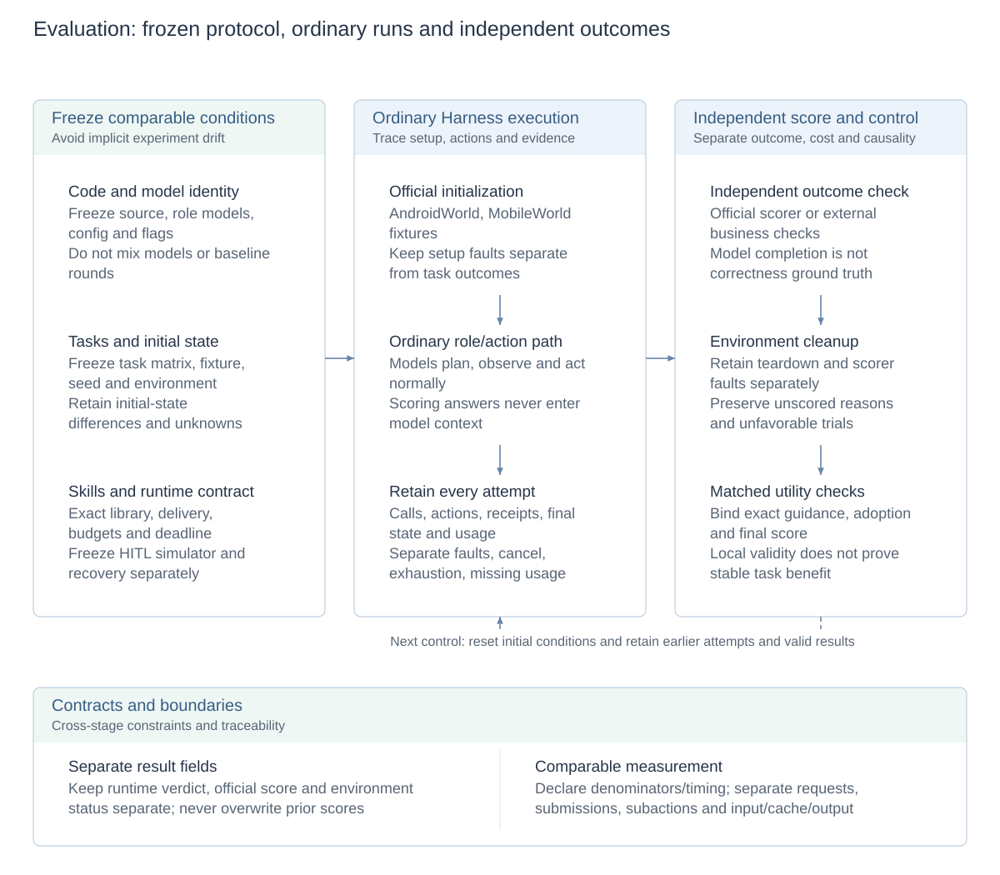
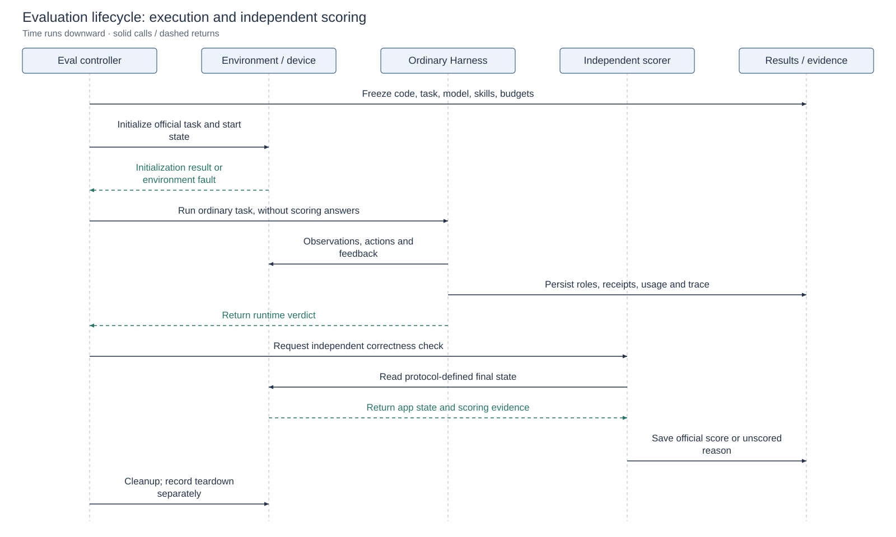

# Evaluation system and benchmark integration

[Technical overview](reliability-design.md) · [Architecture and design index](architecture.md#module-design-documents) · [中文](evaluation-design.zh-CN.md) · [Run and reproduce](evaluation.md)

This design distinguishes runtime completion, business outcomes, execution cost and learning utility. Installation/commands remain in the user guide; frozen results remain in their reports.

## Design diagrams

<!-- design-diagram:evaluation-mechanisms -->

Evaluation separates runtime verdicts, app correctness, environment status and resource use. Controls keep conditions matched and retain outcomes, regressions and unscored reasons.

[Mermaid source](diagrams/design-evaluation-mechanisms.mmd)

<!-- /design-diagram:evaluation-mechanisms -->

<!-- design-diagram:evaluation-lifecycle -->

Record model completion, official score and environment faults separately, retaining attempts, unscored outcomes and unknown usage.

[Mermaid source](diagrams/design-evaluation-lifecycle.mmd)

<!-- /design-diagram:evaluation-lifecycle -->

## Separate execution from evaluation

| Object | Judgment source | Meaning |
| --- | --- | --- |
| Runtime completion | Valid Planner/Reviewer completion submission | The agent considers work finished, not independent proof of business correctness |
| Action path | Argument checks, Driver receipts, post-observations and input readback | Process and local effects, not necessarily complete saved results |
| Task correctness | Independent business-state checks or official benchmark scorer | Results, completeness and protocol-specific constraints |
| Execution cost | Linked traces, provider usage and timing | Time, requests, actions and context overhead |
| Skill utility | Exact-candidate-bound validation and matched controls | Local validity, adoption and whole-task benefit distinguished |

Console records help explain execution. The scorer independently checks final state rather than treating the model's completion report as truth. Correlated changes do not establish that one skill or optimization was the sole cause.

## Benchmark lifecycle and adapter boundaries

The controller freezes task, model, library, initialization and budgets; initializes device/apps; invokes the ordinary Harness; collects execution; then independently scores and cleans up. AndroidWorld bridges official environment/state scoring. MobileWorld uses its official environment and GUI/interaction protocols. Each report owns its frozen instances and action-space definition.

Initialization, execution, scoring and teardown are recorded separately. Offline devices, evaluator faults and incomplete cleanup remain environment incidents or unscored outcomes, never fabricated passes or discarded unfavorable samples. Resume preserves valid results/configuration. Recovery experiments remain separate rather than reviving terminal episodes or rewriting historical scores.

## Counting units and evidence links

Task records link role invocations, model rounds, tool calls, operations/action units and observations. One role invocation may contain several model requests; one compound submission may contain several physical subactions. Compaction also consumes requests. Submitted and physical actions require their own definitions and denominators.

Task wall-clock, worker time and model latency have different boundaries. P50/P95 require a defined sample and timing scope. Provider input/cache/output and local text/image estimates remain distinct. Missing usage is unknown rather than zero cost. Stable references retrieve diagnostics and bodies; see [observability](observability.md).

## Controls and skill validation

Freeze code, model, configuration, task matrix, initial state and skill library. Keep unrecovered tasks, regressions, environment differences and unknowns. Actual delivery records must establish an empty-library condition. Different models, cohorts or baseline rounds cannot be pooled into one uplift. Same-target reruns, cross-input reuse and independent relearning answer different questions.

Validation receipts bind candidate hash, base library, task, model and initialization contract. Catalog presence, body delivery, action adoption and task success require separate checks. Whole-task failure need not refute independently supported local knowledge, while local validity cannot establish stable aggregate utility. Choose exploration/ordinary trials by evidence gaps rather than mandating a full matrix for every candidate. See [self-learning](skill-evolution.md).

## Configuration and reports

Ordinary budgets are defined in [orchestration](task-orchestration.md). Explicit benchmark settings take precedence; reports retain action space, model-call limits and deadline. HITL simulators and recovery policy are frozen independently rather than silently inheriting installation defaults.

- [AndroidWorld adapter](androidworld-benchmark.md) · [frozen full-suite report](androidworld-results-20260921.md)
- [MobileWorld report](mobileworld-results-20261007.md) · [reproduction](mobileworld-reproduction.md) · [interaction report](mobileworld-hitl-results-20261015.md)
- [Recovery design and acceptance scope](crash-recovery.md) · [historical skill experiments](skill-learning-experiments.md)

Each report concerns its declared protocol, rather than certifying every device, task and model from a local success.
