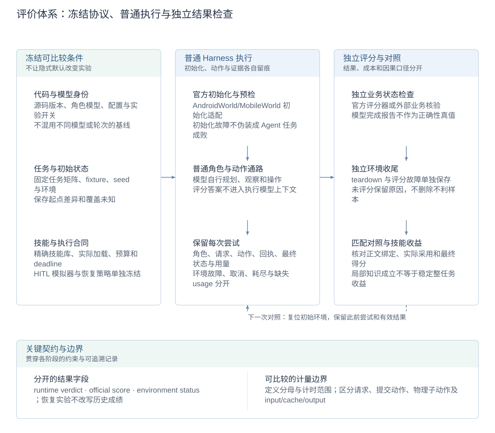
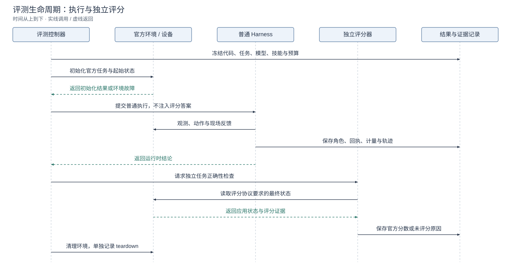

# 评价体系与评测接入详设

[技术概览](reliability-design.zh-CN.md) · [架构与详设索引](architecture.zh-CN.md#模块设计文档) · [English](evaluation-design.md) · [运行与复现指南](evaluation.zh-CN.md)

本页说明如何区分执行完成、业务效果、运行成本与学习收益。命令、安装和复现步骤留在使用指南；冻结成绩留在对应报告。

## 设计图解

<!-- design-diagram:evaluation-mechanisms -->

评价将运行时结论、应用正确性、环境状态和资源消耗分别记录；对照复跑保持条件一致，保留有效结果、退化和未评分原因。

[Mermaid 源码](diagrams/design-evaluation-mechanisms.zh-CN.mmd)

<!-- /design-diagram:evaluation-mechanisms -->

<!-- design-diagram:evaluation-lifecycle -->

模型完成结论、官方得分和环境故障分别记录；保留每次尝试、未评分结果及用量未知。

[Mermaid 源码](diagrams/design-evaluation-lifecycle.zh-CN.mmd)

<!-- /design-diagram:evaluation-lifecycle -->

## 执行与评价分离

| 评价对象 | 判断来源 | 含义 |
| --- | --- | --- |
| 运行时完成 | Planner/Reviewer 的有效完成提交 | Agent 认为任务可结束，不单独证明业务正确 |
| 动作通路 | 参数校验、Driver 回执、后观测与输入读回 | 操作过程及局部效果，不等于目标已经全部保存 |
| 任务正确性 | 独立业务数据核验或基准官方评分器 | 检查结果、完整性及协议要求的约束 |
| 运行成本 | 关联 trace、提供方用量与计时 | 解释耗时、请求、动作与上下文开销 |
| 技能收益 | 精确候选绑定的独立验证及匹配对照 | 区分局部知识成立、实际采用与整任务收益 |

Console 记录可用于解释原因；评分器独立判断最终状态，不把模型的完成报告回传成评分依据。观察到相关变化也不能自动证明某条技能或优化是唯一原因。

## 基准生命周期与适配边界

评测控制器冻结任务、模型、技能库、初始化条件和预算，初始化设备／应用，将任务交给普通 Harness，收集过程，再调用独立评分并清理环境。AndroidWorld 适配器衔接官方环境与状态评分；MobileWorld 使用其官方环境及相应 GUI／交互协议。具体冻结实例和动作空间以各次报告为准。

初始化、执行、评分与 teardown 分开记录。设备离线、评分器故障和未完成清理保留为环境事件或未评分结果，不能假装任务通过，也不能删除后仅报告有利样本。中断续跑保存已有结果与配置；恢复实验单独记录，不复活已终止 episode 或重写历史成绩。

## 计量单位与证据链

任务关联角色 invocation、模型轮次、工具调用、operation/动作单位和观测。一次角色调用可含多轮模型请求；一次复合提交可含多个物理子动作；历史压缩也消耗模型请求。报告提交动作与物理动作时需保留各自定义，不能互换分母。

任务墙钟、worker 时间和模型延迟边界不同；P50/P95 需说明样本和计时范围。提供方 input/cache/output 与本地文本／图片估算分别保存；缺失用量保持未知，不能按零计费。采集诊断和正文可按稳定引用回查，详见[可观测性详设](observability.zh-CN.md)。

## 对照与技能验证

对照冻结代码、模型、配置、任务矩阵、初始状态及技能库；保留未恢复、退化、环境差异和未知。空库须由实际加载记录证明。不同模型、不同样本或不同轮次的基线不拼成一个提升率；同目标、跨输入和独立重学分别解释。

技能候选的正文 hash、基础库、任务、模型和初始化合同绑定验证回执。目录出现、正文加载、动作采用、任务成功分别核对；整任务失败不必否定有独立证据的局部知识，局部成立也不证明稳定整体收益。按证据缺口选择探索／普通运行，不无条件复跑完整矩阵。详见[Skills 自学习](skill-evolution.zh-CN.md)。

## 配置与报告入口

普通任务预算见[编排详设](task-orchestration.zh-CN.md)；基准显式配置优先，动作空间、模型调用上限与 deadline 必须随报告保存。HITL 模拟用户和恢复策略分别冻结，不能由安装默认值隐式改变实验。

- [AndroidWorld 适配器](androidworld-benchmark.md) · [冻结全量报告](androidworld-results-20260921.md)
- [MobileWorld 报告](mobileworld-results-20261007.md) · [复现](mobileworld-reproduction.zh-CN.md) · [交互报告](mobileworld-hitl-results-20261015.md)
- [恢复设计与验收范围](crash-recovery.zh-CN.md) · [技能历史实验](skill-learning-experiments.zh-CN.md)

这些报告记录特定协议下的结果，不能用其中一项局部成功推断所有设备、任务与模型都已验证。
