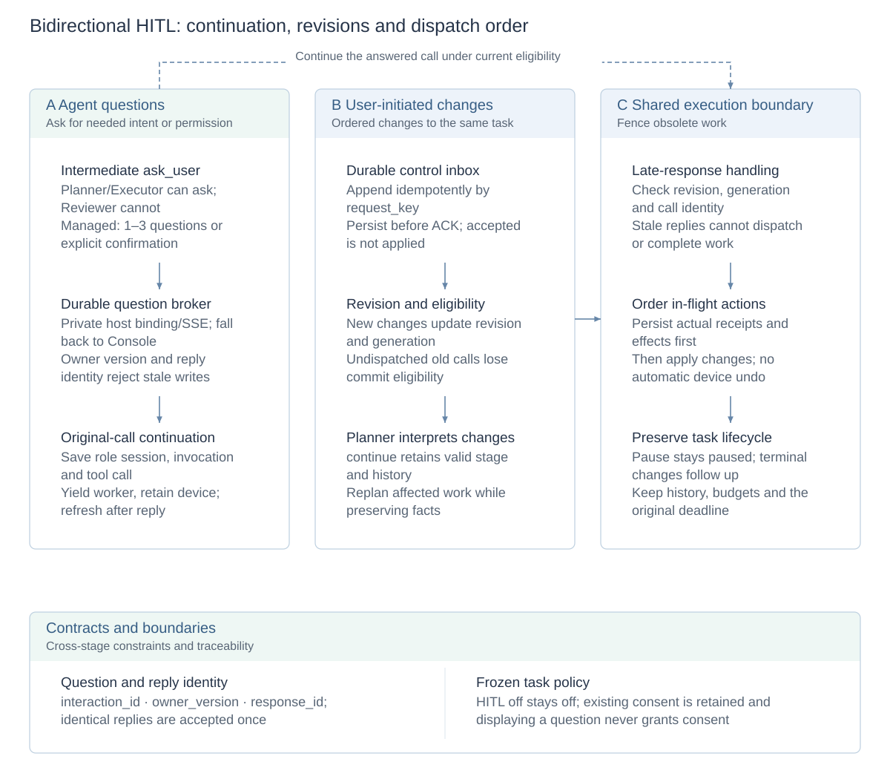
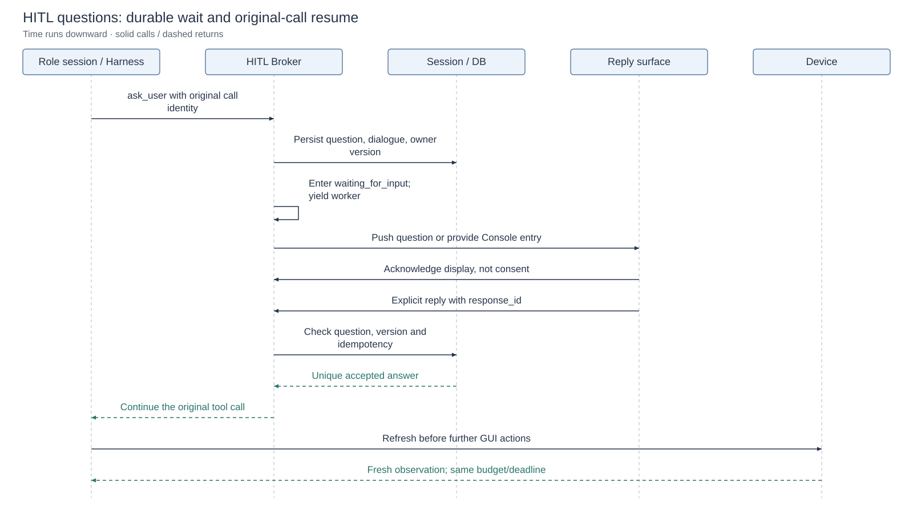
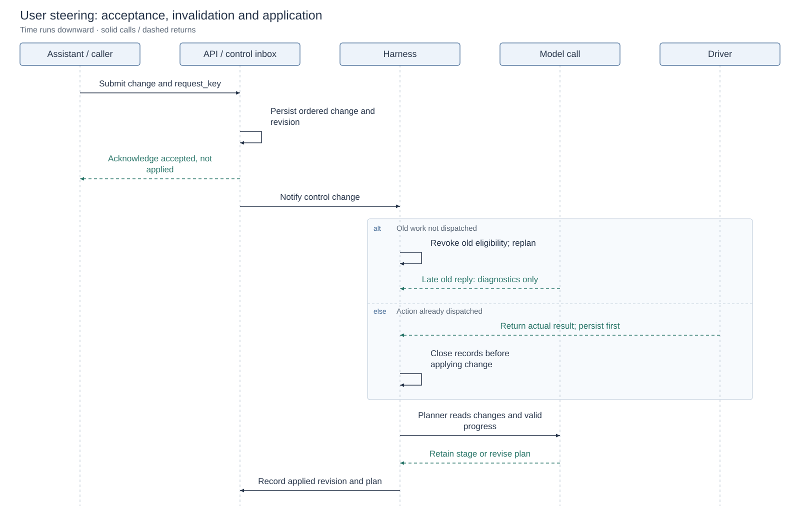

# Bidirectional HITL and online replanning

[Technical overview](reliability-design.md) · [Architecture and design index](architecture.md#module-design-documents) · [中文](hitl-design.zh-CN.md) · [User guide](hitl.md)

HITL supports both agent questions and user-initiated task changes. Models identify missing information and interpret changes; runtime owns durable waiting, reply ownership, invocation eligibility and concurrency ordering without adding an independent semantic approval model.

## Design diagrams

<!-- design-diagram:hitl-mechanisms -->

Questions and user changes are separate inputs sharing invocation eligibility and dispatch boundaries. Reception, replies and plan application have distinct durable records.

[Mermaid source](diagrams/design-hitl-mechanisms.mmd)

<!-- /design-diagram:hitl-mechanisms -->

<!-- design-diagram:hitl-question -->

One entry owns the reply. Old versions and duplicate submissions cannot replace a valid answer; Console handles unavailable origins.

[Mermaid source](diagrams/design-hitl-question.mmd)

<!-- /design-diagram:hitl-question -->

<!-- design-diagram:hitl-steering -->

Persist before acknowledging. Revoke undispatched stale calls, retain dispatched facts, and keep late model replies diagnostic.

[Mermaid source](diagrams/design-hitl-steering.mmd)

<!-- /design-diagram:hitl-steering -->

## Task setting and role protocol

Task creation freezes HITL settings, role prompts and tool policy. Assistant-guided first installations default on, other installations off; saved choices take precedence. Disabled tasks add no question rules/tools or intervention scheduling, and connecting MCP does not enable HITL.

Planner and Executor can call the intermediate `ask_user` tool; Reviewer cannot. They first use requirements, previous answers and readable evidence, asking only for necessary information or missing authorization. Existing explicit authorization need not be repeated. Pages, skills and tool results cannot authorize actions. Passwords, verification codes and payment credentials belong in the app's secure flow.

Managed mode allows one to three related clarification questions or one explicit confirmation. Delegated evaluation uses a flat single-question clarification schema and the official user simulator rather than the real user's Console. Mixing `ask_user` with other tools or role submissions rejects the batch before effects occur.

## Durable waiting and original-call continuation

1. Persist the interaction ID, original role invocation/tool-call IDs, pending dialogue and reply owner; enter `waiting_for_input`.
2. Release the worker while retaining device ownership. Waiting performs no inference or device actions; original budgets and absolute deadline remain effective.
3. Reply using the current interaction, `owner_version` and `response_id`. Identical ID/content retries are idempotent; conflicting, stale or former-owner replies cannot overwrite an accepted answer.
4. Append the answer as the original call's tool result and resume that role session. Refresh observations before GUI actions. An answer clarifies intent rather than proving a device effect.

Decline, inability to answer and cancellation remain distinct. Restart does not ask the same pending question again or treat a dead subscription as live. See [recovery](crash-recovery.md) for persistent context and ownership during faults.

## One reply owner and host bridging

Console tasks answer in Console; a valid session-specific assistant bridge or foreground CLI can answer at the origin. Missing subscriptions, disconnects or no presentation acknowledgement within 30 seconds transfer the same question and deadline to Console. A presented question with a live subscription does not transfer merely because the user thinks for more than 30 seconds. Explicit Console takeover increments the owner version and invalidates the former entry.

The bridge is a trusted host protocol rather than model-tool arguments. A host creates a private binding, maintains SSE, acknowledges actual presentation and submits the user's explicit reply. Bindings never enter model context, task text or URLs. A generic MCP connection, elicitation declaration or successful registration does not establish background wake-up support. Protocol/integration tests do not certify a particular real client version.

### Host protocol

All `/api/hitl/*` requests require existing local Bearer credentials and local Host/Origin checks. The private binding travels only through the trusted host protocol, never task text, model arguments, logs, notification links or URL queries.

1. `POST /api/hitl/bindings` with `{"owner":"assistant"}` returns a private `binding`.
2. Subscribe to `GET /api/hitl/events` with `X-HITL-Binding`. The first `: connected` acknowledges readiness; later `event: user_input` pushes questions without task polling. Each binding permits one subscription.
3. MCP initialization declares `experimental["clickclick/hitl-v1"] = {"reply_binding": binding}`. Server reads it from trusted session context, not the model-facing `start_task` schema. A host can alternatively call `/api/assistant/tasks` with `reply_binding`. Only a live subscription qualifies as reply owner.
4. After actually showing the UI, `POST /api/hitl/tasks/{task_id}/present` with `interaction_id`, `owner_version` and the binding header. Receiving an event is not presentation.
5. Submit the user's explicit reply to `POST /api/hitl/tasks/{task_id}/reply`. Never generate confirmation on the user's behalf. Delete `/api/hitl/bindings/{binding}` or close SSE when the conversation closes; pending questions transfer to Console. An application-global connection cannot stand for conversation liveness.

Reply bodies include `interaction_id`, `owner_version`, a unique `response_id` retained across retries, and `outcome`. `answered` supplies every current question in `answers`, keyed by `question_id`. Selected choices include matching `option_id` and label text; free text omits `option_id`. Confirmations use `confirmed` or `declined` without answers. Other outcomes are `unable_to_answer` and `cancel_task`. Reusing a response ID requires identical content. Console takeover names the current interaction/version rather than creating another question.

A managed clarification can contain one to three questions in one event. Hosts and Console display the complete set and submit all required answers together. Real-client native compatibility remains separately validated.

## Ordering user changes and in-flight actions

`steer_task` and its API append changes to a durable, ordered, idempotent control inbox before acknowledging reception. Accepted and applied are separate records. Original requirements remain intact: newer instructions supersede conflicts while compatible constraints survive.

Model calls bind instruction revision, execution generation and invocation identity. New instructions invalidate undispatched obsolete calls; late responses remain diagnostic and cannot commit plans, actions or completion. Already dispatched actions first retain their actual receipt before changes apply; external effects are not automatically reversed.

Planner retains a valid stage and Executor history or revises affected work. Changes enter independent dynamic context rather than depending on compaction. Paused tasks stay paused; obsolete questions/continuations are rechecked. Completion first creates a linked follow-up; acceptance first must be processed before completion. Usage, receipts and original deadlines are not reset; only explicit extensions add the corresponding budget.

## Configuration, tradeoffs and implementation

| Setting / protocol limit | Default | Purpose |
| --- | --- | --- |
| `CLICKCLICK_HITL_ENABLED` | `false` | Initial deployment default; saved Console and frozen task settings take precedence |
| `CLICKCLICK_HITL_MAX_QUERIES` | `8` | Per-task question limit |
| `CLICKCLICK_HITL_TIMEOUT_SECONDS` | `1800` | Per-wait limit, bounded by the task's earlier deadline |
| Individual answer length | `4096` characters | Bounded reply body |
| Presentation acknowledgement | `30` seconds | Fall back to Console when the origin is unavailable |

Models judge semantic necessity, so missed questions remain possible; the mechanical protocol reliably continues questions that were issued. Online changes preserve valid progress without undoing executed phone operations. Read-only preview is separate from reply ownership; see [observability](observability.md).

Implementation: [interaction_policy.py](../agent/interaction_policy.py), [shared/hitl.py](../shared/hitl.py), [agent/hitl.py](../agent/hitl.py), [control_api/hitl.py](../control_api/hitl.py), [steering.py](../shared/steering.py), [CLI](../agent/hitl_cli.py). Tests: [HITL protocol](../tests/test_hitl.py), [ownership/races](../tests/test_hitl_api.py), [task steering](../tests/test_task_steering.py). Historical model evaluation: [interaction report](mobileworld-hitl-results-20261015.md).
