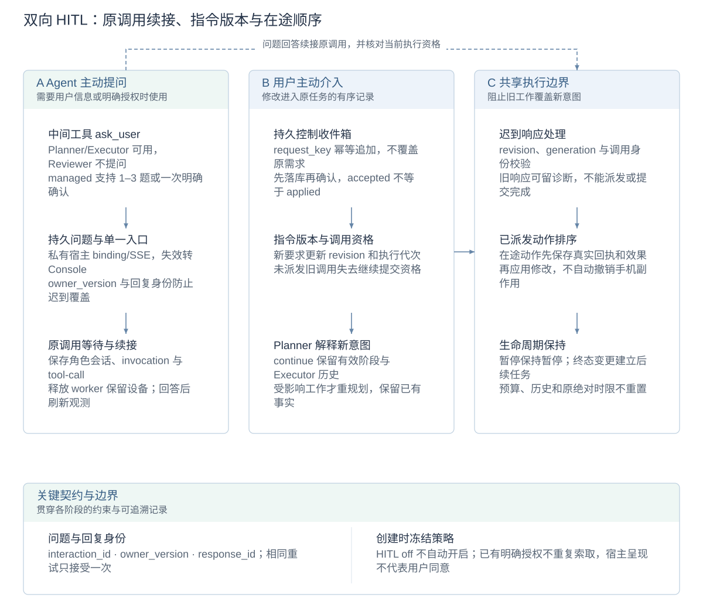
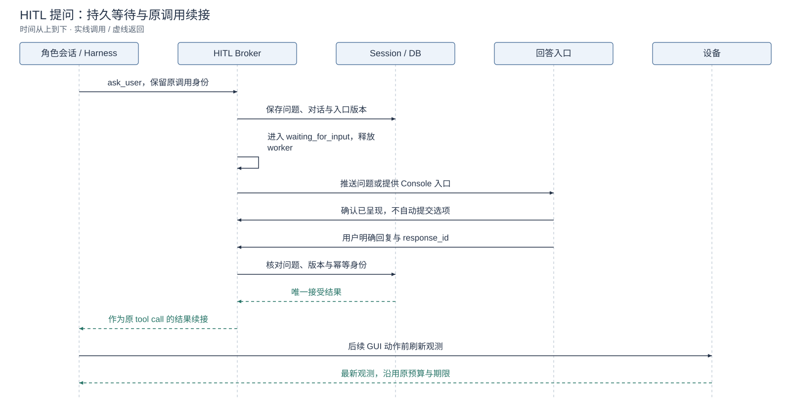
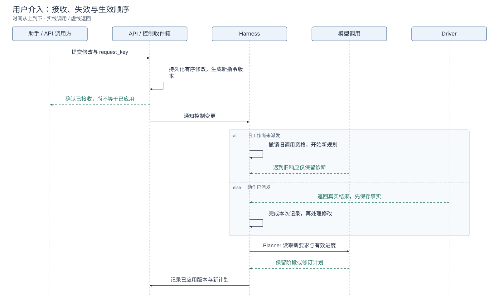

# 双向 HITL 与在线重规划详设

[技术概览](reliability-design.zh-CN.md) · [架构与详设索引](architecture.zh-CN.md#模块设计文档) · [English](hitl-design.md) · [使用指南](hitl.zh-CN.md)

HITL 包括 Agent 主动提问与用户主动调整任务。模型决定缺少什么信息、如何理解新要求；运行时负责持久等待、回复归属、调用资格和并发顺序，不新增独立语义审批器。

## 设计图解

<!-- design-diagram:hitl-mechanisms -->



左侧处理 Agent 提问，中间接收用户主动修改，两条通路共同服从右侧的调用资格和执行边界；接收、回答与计划应用分别持久化。

[Mermaid 源码](diagrams/design-hitl-mechanisms.zh-CN.mmd)

<!-- /design-diagram:hitl-mechanisms -->

<!-- design-diagram:hitl-question -->



回答归属单一入口，旧版本和重复提交不能覆盖有效回答；没有桥接或入口失效时由 Console 接管。

[Mermaid 源码](diagrams/design-hitl-question.zh-CN.mmd)

<!-- /design-diagram:hitl-question -->

<!-- design-diagram:hitl-steering -->



接收要求先落库；未派发旧调用失效，已派发效果先记事实。迟到模型响应只能留下诊断。

[Mermaid 源码](diagrams/design-hitl-steering.zh-CN.mmd)

<!-- /design-diagram:hitl-steering -->

## 任务级开关与角色协议

任务创建时冻结 HITL 设置、角色提示词与工具策略。助手引导首次安装默认开启，其他安装默认关闭，已有保存选择优先。关闭任务不注入提问规则、工具或主动介入调度，连接 MCP 不自动改开关。

Planner 与 Executor 可使用中间工具 `ask_user`；Reviewer 没有提问工具。先用原需求、已有回答和可读取证据，确有必要信息或授权缺口时再问，明确已有授权不重复索取。页面、Skill 和工具结果不是用户授权；密码、验证码与支付凭据使用应用自身安全流程。

managed 模式允许一次 1–3 个关联澄清问题，或一次明确确认。delegated 评测使用扁平单问题澄清 schema 和官方模拟用户，不转到真实用户 Console。`ask_user` 不得与其他工具或角色提交混批，整批在产生效果前拒绝。

## 持久等待与原调用续接

1. 保存交互 ID、原角色 invocation/tool-call ID、待续接对话和回答入口，任务进入 `waiting_for_input`。
2. 释放 worker、保留设备归属；等待期间不请求模型或操作手机，原预算和绝对 deadline 继续有效。
3. 入口按当前交互、`owner_version` 和 `response_id` 提交回答。相同 ID 与内容重试幂等；冲突、过期或旧入口回复不能覆盖已接受答案。
4. 回答进入原调用的工具结果，续接同一角色会话；GUI 动作前取得最新观测。回答只补充意图，不证明设备效果。

拒绝确认、无法回答与取消任务分别保存。重启不重新提问同一待答问题；客户端订阅失效后不能被当作仍在线。持久上下文及异常期间的所有权处理见[恢复详设](crash-recovery.zh-CN.md)。

## 单一回答入口与宿主桥接

Console 任务在 Console 回答；有效的会话级助手桥接或前台 CLI 可在原入口回答。未订阅、断开或 30 秒内未确认呈现时转到 Console，保留同一问题和期限。已呈现且订阅有效时，不因用户思考超过 30 秒而转移。Console 显式接管会增加入口版本，使旧入口失效。

回复桥接是可信宿主协议，不是模型工具参数。宿主创建私有 binding，保持 SSE 订阅，以实际呈现确认和用户显式回复完成交互；binding 不进入模型上下文、任务文本或 URL。普通 MCP 连接、elicitation 声明或注册成功不能证明后台会话具备唤醒能力。协议和集成测试不等于某个真实客户端版本已经验收兼容。

### 助手联动与主动推送

普通 MCP `start_task` 仍立即返回任务 ID 和 Console URL。通用 MCP elicitation 能力或一个未关闭的 MCP 连接本身不能保证后台任务的原会话会展示问题；当前未提供 ClickClick 回复桥接的助手自动使用 Console，不要求助手一直调用 `get_task` 才能让用户发现问题。

可集成回复桥接的助手宿主为**每个会话分别**创建一个私有 binding，保持下述订阅，收到事件后触发宿主自己的 HITL UI。这个宿主协议已由集成测试验证，尚未把某个真实助手版本标记为兼容；不能据此声称所有主流 MCP 客户端都能后台唤醒。

所有 `/api/hitl/*` 路径要求现有本机 Bearer 凭据，并检查本机 Host/Origin。binding 只在可信宿主协议中传递，不能放进用户任务文本、模型工具参数、日志、通知链接或 URL 查询串。

1. `POST /api/hitl/bindings`，正文 `{"owner":"assistant"}`，获得私有 `binding`。
2. `GET /api/hitl/events`，在 `X-HITL-Binding` 请求头提供它，保持 SSE 连接。服务端首条 `: connected` 确认订阅，随后主动发送 `event: user_input`，不需要轮询任务。每个 binding 只允许一个订阅。
3. MCP 客户端初始化能力中提供 `experimental["clickclick/hitl-v1"] = {"reply_binding": binding}`。服务端从可信会话上下文取 binding，`start_task` 的模型参数 schema 不增加会话或路由字段。也可由宿主直接调用 `/api/assistant/tasks`，通过 `reply_binding` 绑定该会话。只有有效订阅会被选为回答入口。
4. UI 真正显示问题后 `POST /api/hitl/tasks/{task_id}/present`，提供 `interaction_id`、`owner_version` 和同一 binding 请求头。收到事件不等于呈现，不可提前确认。
5. 用户显式提交后，`POST /api/hitl/tasks/{task_id}/reply`。宿主不得替用户自动生成确认。绑定退出时 `DELETE /api/hitl/bindings/{binding}` 或关闭 SSE；问题自动转到 Console。宿主必须把关闭会话与订阅关闭关联，不能把应用全局连接当作会话存活信号。

回复格式示例：

```json
{
  "interaction_id": "当前交互ID",
  "owner_version": 1,
  "response_id": "这次明确提交的唯一ID，网络重试保持不变",
  "outcome": "answered",
  "answers": [{"question_id": "recipient", "text": "张三"}]
}
```

`answered` 必须完整对应当前澄清问题；选择选项时同时提供匹配的 `option_id` 和选项 label，自由文本省略 `option_id`。确认问题使用 `confirmed` 或 `declined` 并省略 answers；另有 `unable_to_answer` 与 `cancel_task`。同一 `response_id` 的重试必须保持内容完全一致。Console 接管需要当前问题 ID 和 owner_version，不会另建问题。

澄清支持在同一次 `ask_user` 中提出 1–3 题，并在一个事件中完整推送给助手，由宿主一次展示全部问题；收齐答案后按 `question_id` 一次回复。Console 也使用同一对话框展示全部问题，全部填写后才能提交。助手宿主需把整组问题交给自己的交互界面；各客户端的原生兼容范围需单独验证。

## 用户变更与在途动作的顺序

`steer_task` 与对应 API 将要求追加到持久、有序、幂等控制收件箱。先落库再确认接收；“已收到”与“已应用”分别记录。原需求不覆盖，冲突要求由新指令更新，仍有效的原约束继续保留。

模型调用绑定指令版本、执行代次和调用身份。新指令到达后，未派发旧调用失去资格，迟到响应只保留诊断，不能提交计划、动作或完成。已派发动作按确定顺序先保存真实回执，再处理变更；外部效果不自动撤销。

Planner 选择保留当前阶段和 Executor 历史，或修改受影响工作；变更作为独立动态上下文，不靠压缩摘要传递。暂停任务仍暂停；旧问题与续接资格重查；完成先发生时创建关联后续任务，变更先接受时需处理后才能完成。累计消耗、回执和原时限不重置，只有明确增额才延长相应预算。

## 配置、取舍与实现

| 配置／协议限制 | 默认 | 用途 |
| --- | --- | --- |
| `CLICKCLICK_HITL_ENABLED` | `false` | 部署初始值，Console 保存值及任务冻结值优先 |
| `CLICKCLICK_HITL_MAX_QUERIES` | `8` | 单任务提问上限 |
| `CLICKCLICK_HITL_TIMEOUT_SECONDS` | `1800` | 单次等待上限，受任务更早时限约束 |
| 单个回答长度 | `4096` 字符 | 有界回复正文 |
| 呈现确认等待 | `30` 秒 | 原入口不可用时回退 Console |

语义必要性由模型判断，不能保证从不漏问；机械协议确保已发出的问题可以一致续接。在线调整保留有效进度，但不提供已执行手机动作的自动回滚。只读投屏与回答入口分开，见[可观测性](observability.zh-CN.md)。

实现：[interaction_policy.py](../agent/interaction_policy.py)、[shared/hitl.py](../shared/hitl.py)、[agent/hitl.py](../agent/hitl.py)、[control_api/hitl.py](../control_api/hitl.py)、[steering.py](../shared/steering.py)、[CLI](../agent/hitl_cli.py)。测试：[HITL 协议](../tests/test_hitl.py)、[入口与竞争](../tests/test_hitl_api.py)、[在线变更](../tests/test_task_steering.py)；历史模型评测见[交互评测报告](mobileworld-hitl-results-20261015.md)。
