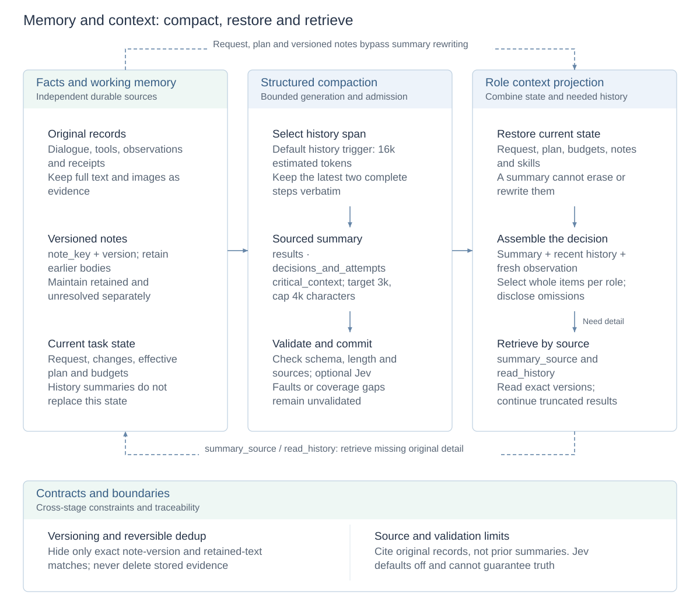

# Memory and context management

[Architecture and design index](architecture.md#module-design-documents) · [中文](memory-and-context.zh-CN.md)

**Keep important information, read a bounded context, retrieve detail when needed.** ClickClick stores original records, working notes and structured summaries separately, then assembles the context needed for the current decision.

## What the model sees

<!-- design-diagram:memory-assembly -->

Compaction replaces only older history. Requirements, plan and notes restore independently; summaries cite original sources, while recent steps and fresh views remain available.

[Mermaid source](diagrams/design-memory-assembly.mmd)

<!-- /design-diagram:memory-assembly -->

The original instruction supplies the goal and user constraints. Planner supplies the current stage and plan; runtime supplies budgets and the latest observation. Notes carry information needed later, while summaries connect earlier execution to recent steps. Each has its own owner.

Planner reads task goals, stage and decision memory; Executor combines the current stage, fresh observation, recent complete history and applicable skills; Reviewer independently assesses disputes and evidence. Requirements/user changes, plan, budget, notes and skills enter context independently rather than being copied through summaries. Summaries cover earlier execution; retrieval supplies detail.

## Notes: carry information forward

Executor writes a note when information is **needed later, may leave context, and is not already adequately retained**. An address needed in another app qualifies; routine clicks, recovered errors and unchanged failed attempts remain in the original history.

A method failure still affecting unfinished work retains its scope and observed outcome. Returning to a usable screen does not erase that obstacle, and retaining it does not create a permanent retry prohibition.

| Content | Purpose | Update behavior |
| --- | --- | --- |
| Body | Complete data, order, sources and necessary uncertainty | Update the same `note_key` for the same subject; earlier versions remain |
| `retained` | Short content directly visible in later decisions | Nonempty text sets it; omission or `null` preserves it; an empty string clears it |
| `unresolved` | A material question still affecting the task outcome | Omission does not clear it; resolution needs an explanation and sources |

`retained` is maintained separately from the body: a body correction may also require updating or clearing its excerpt. Plans own ordinary pending steps; optional additional verification does not automatically become an unresolved question.

| Write operation | Versions and order |
| --- | --- |
| Revise a key | Create a version and keep earlier versions |
| Identical replacement | No new version or refreshed timestamp |
| Append in sequence | Preserve occurrence order, including repeated equal values |

## Compaction: summarize earlier work, keep recent steps intact

A separate compaction session uses the same configured model as Executor and exposes only a summary submission tool. Images are omitted from text compaction; original dialogue, screenshots and note versions remain retrievable.

| Summary section | Keep | Exclude |
| --- | --- | --- |
| `results` | Observed outcomes, artifacts and necessary data | Reports or candidates presented as verified facts |
| `decisions_and_attempts` | Consequential actual attempts, outcomes and scope | Inferred causes, new verification obligations or retry bans |
| `critical_context` | Necessary historical detail absent from the other sections | Copies of the task checklist, current plan or routine action log |

Each item links to its sources. Compaction uses short labels that runtime resolves to durable references. The execution model normally reads concise prose and uses `summary_source` to retrieve the summary and underlying records when details matter.

**Deduplication affects display only.** A summary item is hidden when both its note version and full retained text match a note supplied in the current context. If that note is omitted later, the summary copy reappears. Stored content remains intact; semantic similarity does not authorize merging.

| Compaction rule | Behavior |
| --- | --- |
| Trigger | History exceeds its budget and replacement is expected to release space |
| History budget | 16,000 estimated tokens by default; history only, not the total model window |
| Recent context | Keep the latest two complete execution steps and receipts verbatim |
| Summary capacity | Target 3,000 characters; hard cap 4,000, including headings and separators |
| Invalid submission | At most three model rounds including the initial call, or two in Jev enforce; do not replace active history before validation or forcibly truncate content |

`CLICKCLICK_CHATGPT_HISTORY_TOKENS` configures the ChatGPT history budget; explicit model/role budgets take precedence. A larger budget retains more original text and increases per-request context cost.

### Main configuration

| Setting | Default / purpose |
| --- | --- |
| `CLICKCLICK_EXECUTOR_CONTEXT_TOKENS` | `16000`, Executor history-compaction threshold |
| `CLICKCLICK_CHATGPT_HISTORY_TOKENS` | Optional ChatGPT-channel history budget |
| Model `context.executor.history_tokens` | Explicit model/role history override |
| Model `context.max_input_tokens` | Optional estimated complete-request capacity, separate from history budget |

The complete request also includes prompts, stage, memory, tools and images. Thresholds/image estimates are not provider-billed tokens; compare caching, compaction and extra retrieval together. Recent-history, note and summary capacities follow the protocol in [summary](../agent/revisable/summary.py) and [TaskStore](../agent/revisable/store.py).

## Storage: database, files and runtime memory

SQLite retains current state, versioned records and indexes; files retain dialogue, images and large bodies; process memory holds active working copies. See [Session and storage](session-storage.md) for ownership, integrity and backup.

### Finding a note and its earlier versions

**A key names a note; a source reference identifies a particular version of it.** Consider a delivery address the model needs to remember:

| What happens | Stored result | Source reference for retrieval |
| --- | --- | --- |
| Record “8 Pine Road” | Name the note `delivery_address` and save version 1 | `note:delivery_address@1` |
| Correct the address to “18 Pine Road” | Keep the same name and save version 2; version 1 remains | `note:delivery_address@2` |
| Check the originally recorded address | Read version 1 to retrieve “8 Pine Road” | `note:delivery_address@1` |

In the reference, `note` identifies the record type, `delivery_address` is its name, and `@1` selects version 1. The model uses the name to update the note and a versioned reference to retrieve exact saved content.

The database also records the owning task, so two tasks can each have a `delivery_address` note without mixing them. The model's `note_key` is stored as `record_key`; it is a logical name, not an automatically generated row number.

A dialogue file reference such as `dialogue/<hash>.json` is instead a disk path. The database uses it to locate an original message file under `artifacts/`; file paths and versioned note references locate different kinds of stored content.

## Optional Jev text-fidelity checks

Default `CLICKCLICK_JEV_MODE=off`; optional `shadow` records judgments and `enforce` participates in summary admission. Jev checks fidelity to original text, not image pixels or business truth. Inherited citations resolve to original records; old summaries cannot prove themselves.

The current `facets` path first checks whole/contiguous assertions, then relation/error diagnostics and applicable detail questions. Identical complete evidence sets batch together, with at most two concurrent batches sharing an eight-second deadline. Oversized evidence is explicitly unverified, never truncated into a purported pass. Rejection thresholds are 0.88 for components, 0.95 for multi-component wholes and 0.74 for targeted details. Complete fidelity judgments must all reach 0.60 for validated support; gray results retain `validated=false`.

Feedback supplies rejected spans, sources and reasons. Format and semantic issues share one correction; accepted items retain text and sources. Failed correction keeps accepted/unassessed items from the last mechanically valid candidate, omits known rejections and retains an audit. This can produce incomplete or empty memory while originals and recent steps survive.

Default `CLICKCLICK_JEV_FAILURE_POLICY=bypass` admits mechanically valid but unvalidated candidates on service, capacity or coverage failures. Service errors open a provider/credential-scoped 60-second cooldown without spending a correction. Compaction has a 90-second deadline when a candidate exists. No mechanically valid candidate, primary-model authorization/quota, storage failures and cancellation retain their established handling. Experimental `rollback` can still exceed raw-context capacity.

Complete judgments cache by task, assertion, original evidence/context and model/question identity; thresholds are reapplied and faults never cache as passes. Source caps and profile settings are in [Settings](../shared/config.py); calibration and natural/controlled-error results remain in [historical experiments](memory-context-experiments.md). This optional check does not guarantee error-free summaries.

## Retrieval: read the source when detail matters

| Need | Read path |
| --- | --- |
| A note outside directly retained content | Obtain its source handle from the note directory and use `read_history` |
| Full note and linked sources | `read_history(source=…, full=true)` |
| Basis for a summary | Read `summary_source`, then follow item sources to dialogue or observations |
| An earlier screen | Read an image by observation source; historical images are not current action coordinates |
| An unknown source | Literal keyword search; no match is not proof of absence |

Context assembly selects whole items within its capacity and reports omissions. Known sources remain directly readable; truncated results include continuation handles. Internal tracing IDs stay in storage, while routine prose exposes usable read/update handles.

### Capacity reference

Text lengths are measured in characters, not tokens; item counts are stated separately.

| Content | Capacity |
| --- | --- |
| Ordinary notes | 64 keys; 6,000 per body |
| Retained excerpts | 600 each; 3,000 for the injected packet including metadata |
| Unresolved questions | Up to 8; 400 each |
| Note directory | 2,400 per page |
| Planner / Reviewer recent notes and operation summary | 12,000 each |
| Measurements | Up to 4; 6,000 budget |
| Ordinary history read / full known-source read | 3,000 / 12,000 |
| Keyword search | Up to 6 matching records |

**Limits:** traceable sources do not prove a conclusion correct. Models can omit information, retain stale judgments or misuse notes; original records support checking and correction. Persistent storage does not guarantee lossless recovery from every interruption.

[Architecture](architecture.md) · [Note and storage implementation](../agent/revisable/store.py) · [Structured summary implementation](../agent/revisable/summary.py)

## Historical experiments

See the [historical record](memory-context-experiments.md) for Jev trials and retired Reader/text-tree/summary-mode experiments rather than current runtime paths.
