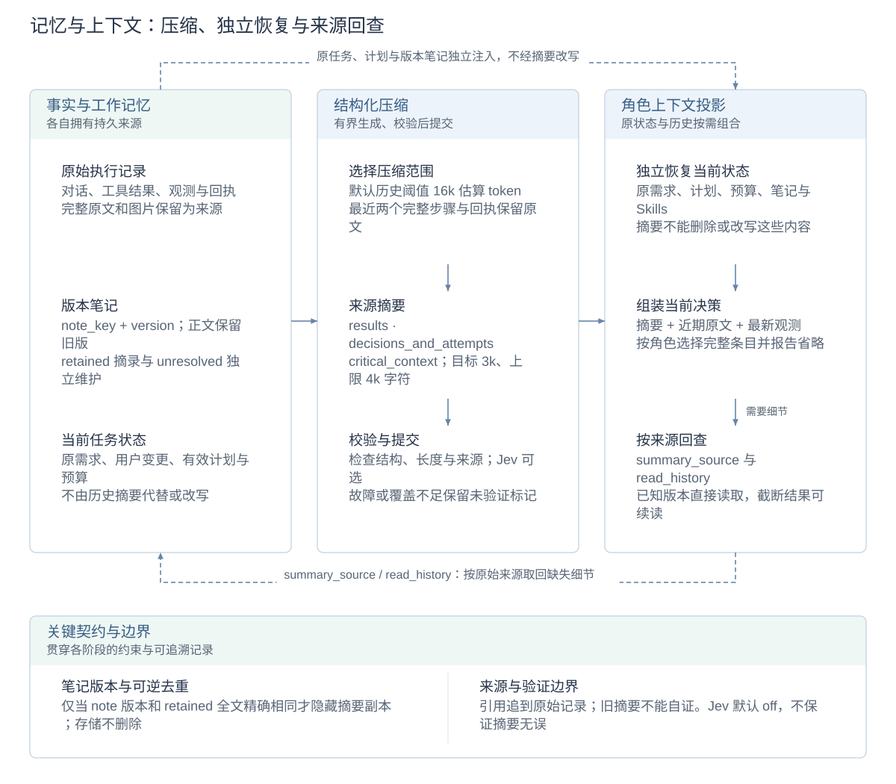

# 记忆与上下文管理

[架构与详设索引](architecture.zh-CN.md#模块设计文档) · [English](memory-and-context.md)

**重要信息留得住，每次决策读得少，需要细节时找得到。** ClickClick 分别保存原始记录、工作笔记和结构化摘要，为模型组装当前任务所需的上下文。

## 模型每次看到什么

<!-- design-diagram:memory-assembly -->

压缩只替换较早过程。任务、计划与笔记独立恢复，摘要条目绑定原始来源；需要细节时回查，最近两步和当前观测继续服务执行。

[Mermaid 源码](diagrams/design-memory-assembly.zh-CN.mmd)

<!-- /design-diagram:memory-assembly -->

原始指令提供目标和用户约束，Planner 提供当前阶段与计划，运行时提供预算和最新观测。笔记保存后续所需的信息，摘要衔接较早的执行过程，各自独立维护。

Planner 读取任务级目标、阶段与决策记忆；Executor 组合当前阶段、最新观测、近期完整执行历史和适用技能；Reviewer 围绕争议与证据独立判断。原始需求／用户变更、计划、预算、笔记和技能各自进入上下文，不依靠摘要复制它们。摘要仅概括较早过程，历史检索按需补足细节。

## 笔记：带走后面需要的信息

Executor 在信息**后续需要、可能离开上下文、尚未充分保留**时写笔记。例如，跨应用录入前保存地址；普通点击、已无后续影响的错误和重复失败明细留在原始历史中。仍影响未完成任务的方法失败，应保留其适用范围与实际结果，避免仅因界面恢复可用就丢掉仍有效的障碍；这不构成永久重试禁令。

| 内容 | 用途 | 更新方式 |
| --- | --- | --- |
| 正文 | 保存完整数据、顺序、来源和必要的不确定性 | 同一主题更新同一 `note_key`，旧版本保留 |
| `retained` | 选出后续决策要直接看到的短内容 | 非空值设置；省略或 `null` 保持原值；空字符串清除 |
| `unresolved` | 标记仍影响任务结果的实质问题 | 省略不会清除；以带说明和来源的解决记录关闭 |

`retained` 是正文的独立摘录：修改正文时，需要同步纠正或清除已失效的摘录。普通待办由计划管理，可选的进一步核验不自动成为未解决问题。

| 写入动作 | 版本与顺序 |
| --- | --- |
| 修改同一 key | 生成新版本，保留旧版本 |
| 完全相同的覆盖 | 不增版本、不刷新时间 |
| 顺序追加 | 保留发生顺序，相同值的两次发生仍是两条 |

## 压缩：概括旧过程，保留近期原文

压缩由与 Executor 相同配置模型的独立会话完成，只提供摘要提交工具。图片不参与文字压缩，原始对话、截图和笔记版本仍可回查。

| 摘要栏目 | 保留什么 | 不写什么 |
| --- | --- | --- |
| `results` | 已观察结果、产物和必要的数据 | 把转述或候选写成已验证事实 |
| `decisions_and_attempts` | 影响后续选择的实际尝试、结果与范围 | 猜测原因、新增验证要求或重试禁令 |
| `critical_context` | 前两栏没有覆盖的必要历史细节 | 复制任务清单、当前计划或普通操作日志 |

每条摘要关联来源。压缩会话使用短标签，运行时将它们还原为持久引用；执行模型平时阅读简短正文，缺少细节时通过 `summary_source` 回查摘要及原始记录。

**去重只影响展示。** 摘要条目与本次已提供笔记的版本、保留全文都相同时，隐藏摘要中的副本；笔记未被提供时，副本重新显示。存储中的内容不删除，也不按语义相似度合并。

| 压缩规则 | 行为 |
| --- | --- |
| 触发 | 历史超过预算，且摘要替换预计能释放空间 |
| 历史预算 | 默认 16,000 个估算 token；只计历史，不等于模型总窗口 |
| 近期保留 | 最近两个完整执行步骤及回执不压缩 |
| 摘要容量 | 目标 3,000 字符，硬上限 4,000，包含标题与分隔符 |
| 提交失败 | 普通压缩最多三轮模型调用（含首次），Jev enforce 最多两轮；有效提交前不替换活跃历史，不强行截断 |

ChatGPT 的历史预算可用 `CLICKCLICK_CHATGPT_HISTORY_TOKENS` 设置；显式模型／角色预算优先。预算越高，原文保留越多，每次请求的上下文成本也越高。

### 主要配置

| 配置 | 默认／作用 |
| --- | --- |
| `CLICKCLICK_EXECUTOR_CONTEXT_TOKENS` | `16000`，Executor 历史压缩阈值 |
| `CLICKCLICK_CHATGPT_HISTORY_TOKENS` | 可选，ChatGPT 通道历史预算 |
| 模型配置 `context.executor.history_tokens` | 显式模型／角色覆盖历史阈值 |
| 模型配置 `context.max_input_tokens` | 可选，估算完整请求容量；不是历史预算 |

完整请求还包含提示词、阶段、记忆、工具和图片。阈值与图片估算不等于提供方计费 token；缓存、压缩和额外回查要合计比较。近期保留、笔记与摘要容量由协议固定，具体定义见[摘要实现](../agent/revisable/summary.py)与[任务存储](../agent/revisable/store.py)。

## 可选 Jev 文字忠实度校验

默认 `CLICKCLICK_JEV_MODE=off`；可选 `shadow` 记录判断，`enforce` 参与摘要接纳。Jev 只检查文字是否忠实于原始来源，不读取图片像素，也不替模型证明业务结论。摘要继承引用必须追到原始记录，旧摘要不能证明自身正确。

当前 `facets` 路径先检查整句与原文连续子句，再获取关系／错误类型诊断与适用的细节判断。相同完整来源集合合批，最多两批并发，共享 8 秒截止；来源超限明确标为无法校验，不截断证据后宣称通过。固定拒绝阈值为子句 0.88、复杂整句 0.95、明确细节 0.74；完整忠实判断均达到 0.60 才标记已验证，灰区保留 `validated=false`。

反馈给摘要会话的是错误片段、来源和原因，格式与语义共用一次修正；已接纳项保持正文与来源。修正仍失败时保留最后机械有效候选中的已接纳／未评估条目，排除已知拒绝项并保存审计，可能得到不完整甚至空摘要。原文和近期步骤仍保留。

默认 `CLICKCLICK_JEV_FAILURE_POLICY=bypass`：服务、容量或覆盖不足时提交机械有效但未验证的候选；服务故障按提供方／凭据冷却 60 秒，不增加修正调用。已有候选的压缩总时限为 90 秒。尚无机械有效候选、主模型认证／额度、存储失败与取消沿用原处理。严格实验可选 `rollback`，但原文也可能超过模型容量。

完整判断按任务、主张、原始来源／上下文和模型／问题身份缓存，阈值重新应用；失败不缓存为通过。来源上限、阈值等配置见[Settings](../shared/config.py)，具体历史校准与自然／受控错误结果见[历史实验](memory-context-experiments.zh-CN.md)。这是一项可选校验，不保证摘要无误。

## 存储：数据库、文件、内存各司其职

SQLite 保存当前状态、版本记录与索引；文件保存对话、图片和大正文；进程内存维护活跃工作副本。存储分工、发布完整性与备份见[Session 与存储详设](session-storage.zh-CN.md)。

### 如何找到同一条笔记，以及它的旧版本

**key 是笔记的名称，来源引用则指定“哪条笔记的哪个版本”。** 例如，模型要记住一个配送地址：

| 发生的事情 | 保存结果 | 回查用的来源引用 |
| --- | --- | --- |
| 首次记下“松林路 8 号” | 命名为 `delivery_address`，保存第 1 版 | `note:delivery_address@1` |
| 地址更正为“松林路 18 号” | 沿用同一个名称，保存第 2 版；第 1 版仍在 | `note:delivery_address@2` |
| 想确认最初记下的地址 | 按第 1 版的引用读取，得到“松林路 8 号” | `note:delivery_address@1` |

引用中的 `note` 表示笔记，`delivery_address` 是名称，`@1` 表示第 1 版。模型使用这个名称更新笔记，使用带版本的引用回读确切内容。

数据库还会记录所属任务，因此两个任务都可以有名为 `delivery_address` 的笔记，互不混淆。`note_key` 在数据库中称为 `record_key`；它是逻辑名称，不是数据库自动生成的行号。

对话文件的 `dialogue/<hash>.json` 则是磁盘路径：数据库用它找到 `artifacts/` 下的原始消息文件，与上述笔记引用是两种不同的定位方式。

## 回查：按需读取完整来源

| 需要什么 | 如何获得 |
| --- | --- |
| 当前保留内容之外的笔记 | 从笔记目录取得来源句柄，调用 `read_history` |
| 笔记全文及关联来源 | `read_history(source=…, full=true)` |
| 摘要的依据 | 读取 `summary_source`，再沿条目来源读取原始对话或观测 |
| 早先的画面 | 按观测来源读取图片；历史图片不作为当前点击坐标 |
| 不知道确切来源 | 字面关键词查询；无匹配不表示信息不存在 |

上下文按容量选取完整条目，标明省略；已知来源可直接回读，截断结果提供继续读取位置。内部追踪编号保存在记录中，日常正文只保留可用的读取／更新句柄。

### 容量参考

文本长度按字符计数，不是 token；条目数量单独标明。

| 内容 | 容量 |
| --- | --- |
| 普通笔记 | 64 个 key；每条正文 6,000 |
| 保留摘录 | 每条 600；整个注入包 3,000，包含元数据 |
| 未解决问题 | 最多 8 条；每条 400 |
| 笔记目录 | 每页预算 2,400 |
| Planner / Reviewer 的近期笔记、操作摘要 | 各自预算 12,000 |
| 工具测量 | 最多 4 条；预算 6,000 |
| 普通历史读取 / 指定来源全文读取 | 3,000 / 12,000 |
| 关键词查询 | 最多 6 条匹配记录 |

**能力边界：** 来源可追溯不等于结论正确。模型仍可能遗漏信息、保留过时判断或误用笔记；原始记录用于核对和纠正。持久保存也不等于任意中断都能无损恢复。

[架构](architecture.zh-CN.md) · [笔记与存储实现](../agent/revisable/store.py) · [结构化摘要实现](../agent/revisable/summary.py)

## 历史实验

Reader、文字节点数组、摘要模式及未采纳方案的完整过程已移至[历史实验记录](memory-context-experiments.zh-CN.md#reader-pdf-observation-experiment)，不作为当前运行路径。
