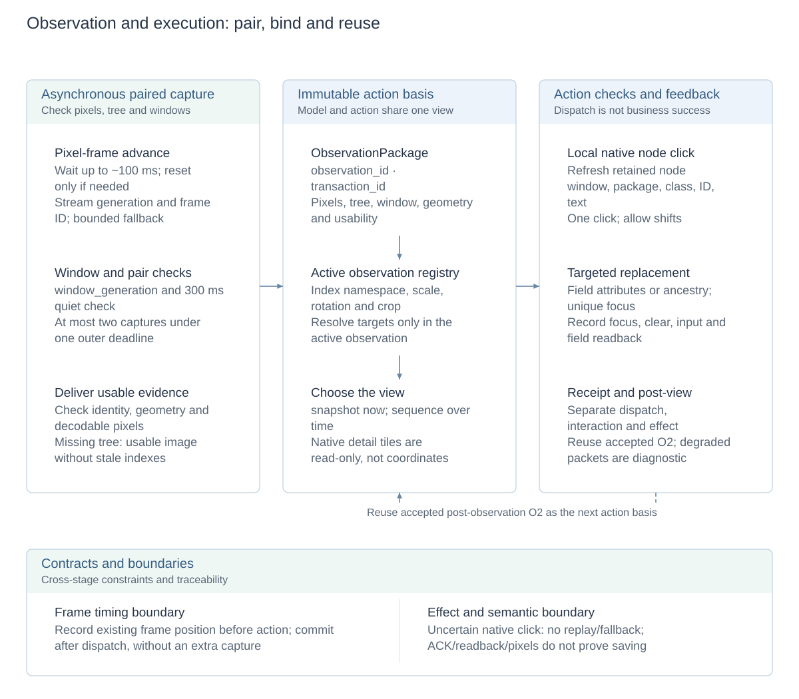
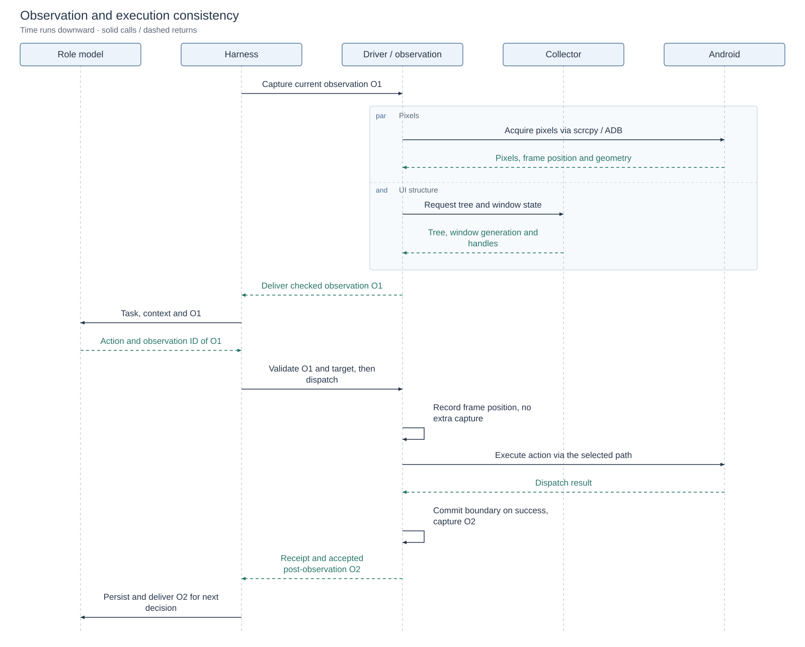
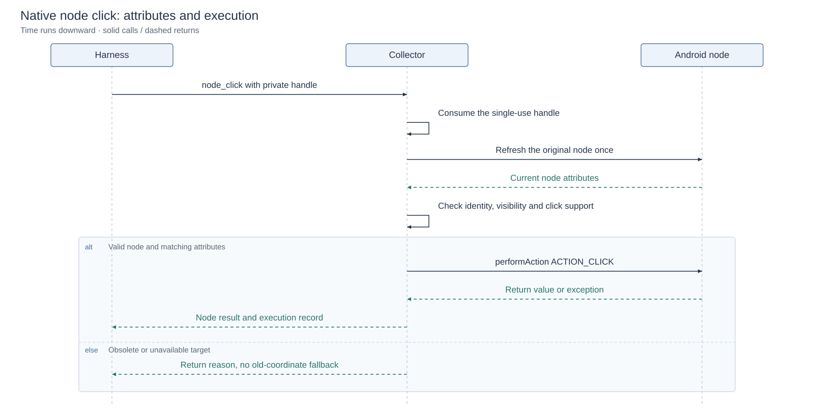
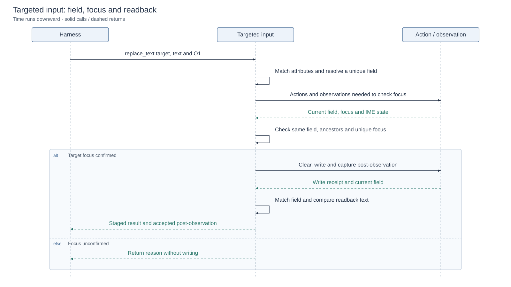

# Observation and execution consistency

[README](../README.md) · [中文](observation-execution-consistency.zh-CN.md) · [Architecture](architecture.md) · [Technical overview](reliability-design.md)

This guide connects current observation acquisition, model input, action grounding, target checks and execution feedback in one place.

## Design diagrams

<!-- design-diagram:observation-package -->

Capture, grounding and execution checks address different problems. Action-specific checks return receipts and accepted post-observations to the next round.

[Mermaid source](diagrams/design-observation-package.mmd)

<!-- /design-diagram:observation-package -->

## Methods and purpose

| Problem | Method | Purpose and effect |
| --- | --- | --- |
| A current request reuses known old pixels | Stream generations, increasing frame IDs, request/action frame boundaries and selected video refresh | Wait for updated decoded pixels and reduce reuse of old cached results |
| Screens and trees are difficult to combine during navigation | Foreground identity, window generations, a short quiet interval, complete capture and bounded recapture | Exclude detectable window transitions and geometry conflicts; deliver usable paired or degraded evidence |
| Multiple images and read-tool rounds confuse action grounding | Immutable observation IDs, element-index namespaces and a transform registry | Resolve actions against the referenced observation's elements and image geometry |
| A control moves while the model reasons | Retained native node references, attribute fingerprints and Collector node clicks | Continue acting on the original object instead of hitting another control at its old position |
| Text goes into the wrong field | Field-attribute matching, ancestor paths, unique focus and input readback | Check the write target and report focus, clear, input and readback results |
| Dispatch success is mistaken for business completion | Separate dispatch, interaction acknowledgment, effect and post-observation; reuse accepted post-observations | Preserve execution evidence for the model and Console, supporting continuation, observation or replanning |

## Ordering of an interaction

The main diagram shows the path with accepted observations and combines Driver with the observation transaction; pixels and tree can be acquired in parallel. Pixel acquisition includes reading or waiting on an existing stream, rather than sending a screenshot request to the phone every time. Android arrows show the logical device path. The following diagrams expand native-node and targeted-input interactions.

[Mermaid source](diagrams/observation-execution-main.mmd)

Ordinary pre-dispatch work records the existing video-frame position. It does not take an extra screenshot or replace the observation used to decide that action. Observations used to establish input focus are steps within targeted text input itself.

## Observation packages and action grounding

`ObservationPackage` holds acquired evidence; registry entries add element namespaces and coordinate transforms.

| Information | Main fields | Purpose |
| --- | --- | --- |
| Observation identity | `observation_id`, `transaction_id`, `observation_source` | Associate an observation with its acquisition and source |
| Pixels, tree and targets | Global pixels, normalized UI, `element_set_id` | Bind element indexes to a specific observation |
| Image geometry | Native/model dimensions, rotation, crop, `transform_id` | Convert between model-image and device coordinates |
| Usability | `accepted`, `actionable`, `index_actionable` | Distinguish accepted evidence, actionable grounding and indexed targets |
| Capture records | Providers, timing, window generation, completeness, recapture and degradation reasons | Support mechanical checks, trace inspection and latency analysis |

Registered observation identity, elements and transforms remain immutable. A new actionable observation switches the active ID; reading a historical image does not switch it.

## Paired capture and observation updates

### Organize pixels and tree within one capture

Driver obtains decoded pixels from scrcpy and UI trees from Accessibility Collector, checking foreground app identity, window state, tree completeness, pixel decodability and coordinate compatibility. Tree and pixel acquisition may overlap, but components from different complete capture attempts are not stitched into a new active basis.

When tree traversal takes longer, final selection may use a newer frame already decoded from the same stream, without another screenshot or video reset. Normalization and Set-of-Mark rendering use the capture's recorded device and image geometry.

### Window state and bounded recapture

Collector records invalidating window changes in `window_generation`. The host compares state around capture and checks a 300 ms quiet interval. Window transitions, input focus, geometry and structural changes participate in invalidation; ordinary content updates remain diagnostic and do not require page content to stop changing.

If the first capture has a retryable mechanical problem, the transaction may wait once and acquire a complete replacement. At most two complete attempts share one outer deadline. Acquisition does not loop until two images match. When window checks pass and pixels are independently usable but the tree is not, image-only evidence can be delivered without the unusable tree's indexes or annotations.

This reduces detectable navigation-related mismatches while keeping videos, animations and loading pages observable. It does not require asynchronous pixels and trees to represent an identical instant or classify the page's business meaning.

### Frame updates and selected RESET_VIDEO

Explicit pixel acquisition currently follows this sequence:

1. Record the stream generation and current decoded-frame position, first publishing any already-decoded pending image.
2. Within the round budget, give the active stream up to about 100 ms to naturally produce a greater frame ID.
3. Use an updated frame immediately. If none arrives, wait for decoder initialization when necessary, then attempt the official `RESET_VIDEO` control message.
4. On successful reset, clear the local pixel ring and reset the decoder under its consumption lock, then wait for a later decodable frame within the remaining refresh budget. Reset does not fabricate a new connection generation.
5. If scrcpy cannot supply eligible pixels for the request, Driver may use sequential ADB screencap fallback within the outer budget.

`RESET_VIDEO` requests new output when the stream has not advanced promptly; **it is not sent for every capture**. Frame IDs and timing describe client-side decoding/publication updates and reduce known old-frame reuse; an increasing frame ID is not proof of a phone business effect.

Before dispatch, Driver also records the frame position and commits that action boundary only after successful dispatch. Subsequent frame selection checks the same generation and a greater frame ID. Recording this boundary does not take a pre-action screenshot.

### snapshot, sequence and detail

| Mode | Method and purpose | Subsequent action basis |
| --- | --- | --- |
| `snapshot` | A current global screen and available UI structure | The active global observation |
| `sequence` | Bounded temporal samples showing loading, animation or other changes | The latest accepted global observation; earlier frames remain history |
| `detail` | Native pixels, a locator overview and selected crop or overlapping tiles for small text and detail | The paired global observation; reading tiles are not direct action coordinates |

Detail regions use full-screen normalized coordinates. Without a region, four tiles overlap by 12% on each axis; crops have at most a 1,600-pixel longest side and never upscale source pixels. This addresses transport downsampling; intrinsically small app rendering still needs app-side zoom. Extra images increase context cost, so prefer the necessary region. Usage and double taps: [supplementary guide (Chinese)](screen-detail.md).

## Observation ID, index and coordinate binding

The submitted observation ID must match the active action basis. Indexes resolve only within that observation's element set, never by applying an earlier image's index to a newer tree.

For coordinate actions, validate the point in the model image, apply the registered scale/rotation/crop transform and validate the resulting device point. Materially out-of-bounds points or missing geometry produce validation feedback, rather than clamping across a large distance to a screen edge or selecting a nearby control.

This establishes which observation and coordinate space an action uses. Applicable native-node and focus checks then address execution objects changing while the model reasons.

## Native node binding and attribute checks

The diagram shows the principal checks; expired, obsolete or unavailable targets can return at the corresponding earlier step.

[Mermaid source](diagrams/observation-execution-node-click.mmd)

### Retain the observed object

For nodes advertising `ACTION_CLICK`, Collector retains an `AccessibilityNodeInfo` reference and generates a random private handle. Harness binds `tap(index)` from the current observation to that handle. Models do not supply handles, and serialized actions do not retain replayable native handles.

A handle refers to the retained original node, rather than searching a newer tree for the same index. Storage retains at most 16,000 nodes for 120 seconds and clears on service restart.

### Refresh, check and click the node

Collector consumes the handle before work, refreshes the retained node once and compares its stored attribute fingerprint.

| Check | Method and purpose |
| --- | --- |
| Identity attributes | Fingerprint window ID, package, class, resource ID, text, description, hint and password/editable/checkable attributes; exclude password text |
| Current usability | Require visibility, enabled state and continued `ACTION_CLICK` support |
| Permitted changes | Exclude bounds, focus and selection from the fingerprint, allowing position and interaction-state changes |
| Dispatch | Call `performAction(ACTION_CLICK)` once on the retained node, rather than using its old center coordinate |

A moved control can therefore still receive the click when its original node remains valid and its identity attributes match. Invalid nodes, changed attributes, unavailable controls and expired handles return explicit results. Once selected, this path does not automatically retry, substitute a parent or fall back to old coordinates. A refresh exceeding 1.5 seconds cannot dispatch a late click; the host exchange has a 2.5-second timeout.

This applies to standalone `tap(index)` with a compatible Collector and in-process Android Driver. Coordinate taps, long presses, drags, compound actions and targeted-input helper taps retain their coordinate paths. When no handle or compatible transport exists, coordinate resolution is selected initially; a failed native click does not authorize coordinate fallback. Changed business meaning behind identical exposed attributes still requires model judgment from observations.

## Targeted text replacement and focus consistency

Targeted input checks field identity separately from the native-click text fingerprint, because writing changes the editable value.

[Mermaid source](diagrams/observation-execution-text-input.mmd)

| Field condition | Matching method |
| --- | --- |
| Resource ID available | Match app, display, window, resource ID and control role |
| No resource ID | Match native hint with app, Activity, display, window ID/type and role; require a unique target and a checkable ancestor path |
| After focusing | Match the field in the new observation, verify its ancestor path and unique effective focus; non-editable IME controls in another window do not impersonate the app editor |

The sequence is: resolve a supported unique field → establish input conditions using focus and IME state → reconfirm target focus → clear/write → read the same field and compare its text.

Password or disabled fields, ambiguous targets and unconfirmed focus do not directly use this combined write path. Receipts report focus, clear, input and readback separately. Partial failure preserves completed steps without automatically replaying an uncertain write. Matching readback establishes the visible field value; subsequent business evidence establishes whether the app saved it.

## Receipts, post-observations and the next decision

`ActionObservationTransaction` separates dispatch from observable results:

| Record | Purpose and effect |
| --- | --- |
| Dispatch result | Report whether the command was dispatched through the device path |
| Interaction acknowledgment | Link target-specific accessibility events when available as additional execution evidence |
| Effect result | Generic actions remain `unknown` even with accepted post-observations; actions with exact mechanical predicates, such as launching a resolved app, can record a specific outcome |
| Post-observation | Record the current capture after dispatch for the model's subsequent judgment |
| `visible_change = none` | Record matching app identity, tree text and source pixels across accepted observations; this only reports no observed visible change |

An unchanged image does not automatically fail an action, and changed pixels do not automatically establish business success. `performed` only means Android reported handling the native click.

Acknowledgment uses a bounded safe-event ring: at most 256 records and 15 seconds, retaining sequence/time, event type, package/window, class/resource ID, bounds and structural flags rather than text, descriptions, input values or passwords. A pre-dispatch cursor precedes one bounded read after successful dispatch. Current transactions request at most 64 events; the decoder supports up to 128. A target/action-family match is `confirmed`; complete coverage without a match is `unobserved`; unsupported, evicted or degraded evidence is `unavailable`. Neither latter value means failure. Role feedback may expose `confirmed`, which still does not prove business success.

Accepted post-observations are persisted and carried into the next execution round instead of immediately acquiring unrelated evidence again. A pre-action package returned by `sleep` is not new evidence, so the next round observes again. Degraded packages from failed capture remain diagnostic rather than becoming new active action grounding. Models use subsequent observations to decide how to continue after failed or unknown results.

## Main parameters

| Parameter | Current default | Purpose |
| --- | --- | --- |
| Current/temporal outer observation budgets | 12,000/8,000 ms | Bound the complete observation request |
| Collector primary attempt | 2,500 ms | Bound tree acquisition |
| scrcpy round refresh budget | 800 ms, including the initial approximately 100 ms natural-update wait | Obtain updated frames or reach fallback within a bound |
| Window quiet interval | 300 ms | Check recent invalidating window transitions |
| Complete capture attempts | At most 2 | Initial capture plus one selected complete recapture |
| `CLICKCLICK_OBSERVATION_RESAMPLE_SETTLE_MS` | 1,000 ms | Set the wait before recapture and after successful dispatch, subject to the outer budget |
| `CLICKCLICK_NODE_CLICK_ENABLED` | Enabled | Select native-node execution for eligible local indexed taps |
| `CLICKCLICK_INTERACTION_EVENT_READS_ENABLED` | Enabled | Read cursors/events and correlate interaction evidence; disabling preserves ordinary capture |

Apart from the listed environment variables, these durations and counts are current implementation constants. See [Collector setup](accessibility-collector-setup.md) and [scrcpy observation](scrcpy-observation.md) for provisioning and device measurement.

Historical event-coverage and drawing-target samples are in the [interaction evidence report](interaction-grounding.md); its old switches are not current configuration guidance.

## Implementation map

| Implementation | Responsibility |
| --- | --- |
| [driver/android.py](../driver/android.py), [scrcpy_observation.py](../driver/scrcpy_observation.py) | Tree/pixel acquisition, window checks, frame selection, refresh and fallback |
| [action_observation.py](../agent/action_observation.py) | Complete capture, recapture, dispatch, post-observations and receipts |
| [observation.py](../perception/observation.py) | Normalized UI, annotations, observation packages and usability |
| [observation_space.py](../agent/observation_space.py), [executor.py](../agent/executor.py) | Observation registry, index resolution, coordinate transforms and action-path selection |
| [NodeClickStore.kt](../android/accessibility-collector/app/src/main/java/ai/clickclick/collector/NodeClickStore.kt) | Native-node retention, attribute fingerprints, single-use consumption and clicks |
| [targeted_input.py](../agent/targeted_input.py) | Input-field matching, focus establishment and readback |
| [revisable/orchestrator.py](../agent/revisable/orchestrator.py) | Observation persistence and accepted post-observation handoff |

Historical device checks for moved, replaced and disabled targets and handle replay are in the [native-node technical report](native-node-click-20260920.md). See [observability](observability.md) for inspecting execution records.

Editable sources for all three diagrams are in the collapsible blocks above. Regenerate the bilingual SVGs with [render_observation_sequences.mjs](../scripts/render_observation_sequences.mjs).
