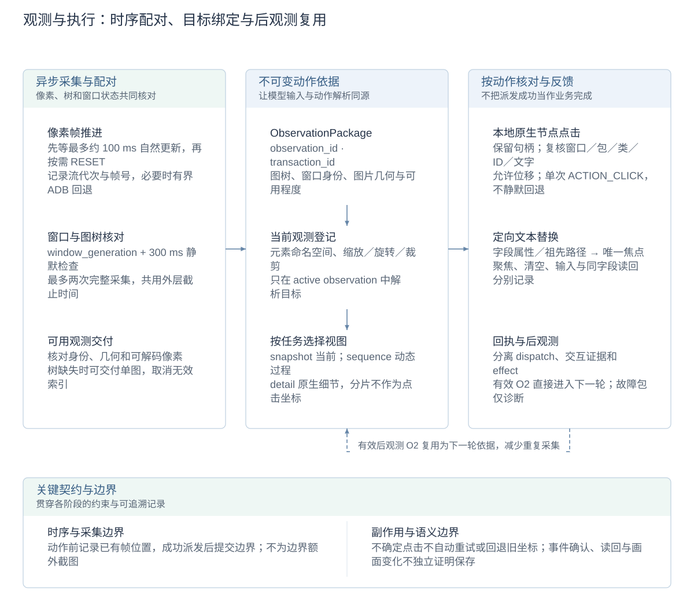
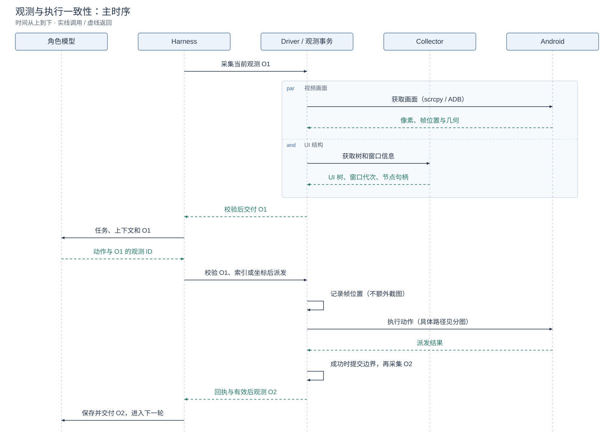
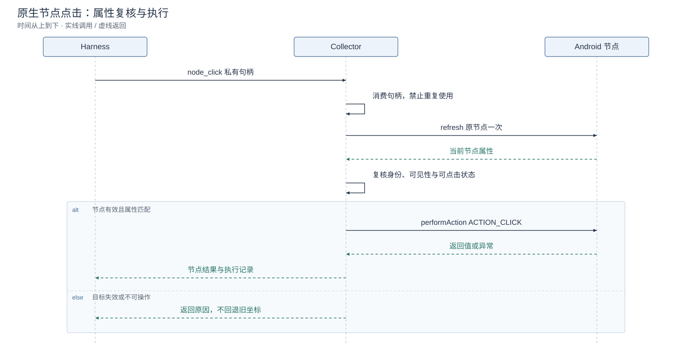
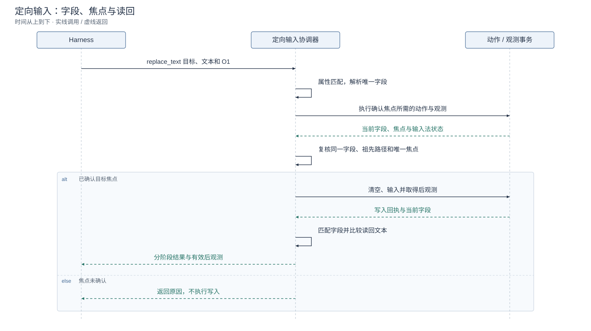

# 观测与执行一致性详设

[首页](../README.zh-CN.md) · [English](observation-execution-consistency.md) · [系统架构](architecture.zh-CN.md) · [技术概览](reliability-design.zh-CN.md)

本文集中说明当前观测如何进入模型、动作如何引用这份观测、执行前如何核对目标，以及执行结果如何回到下一轮决策。

## 设计图解

<!-- design-diagram:observation-package -->

采集、动作依据和执行校验分别负责不同问题；执行分支按动作类型选用，回执与有效后观测共同进入下一轮。

[Mermaid 源码](diagrams/design-observation-package.zh-CN.mmd)

<!-- /design-diagram:observation-package -->

## 方案与用途

| 要解决的问题 | 采用的方法 | 用途与效果 |
| --- | --- | --- |
| 当前请求直接复用已知旧画面 | 视频流代次、递增帧号、采集请求／动作帧边界、按需视频刷新 | 等待更新的解码画面，减少旧缓存被当作本轮结果 |
| 页面切换期间图树难以配用 | 前后台身份、窗口代次、短静默区间、完整采集与有界重采 | 排除可检测的窗口切换和几何冲突，提供当前可用的图树或降级观测 |
| 多张图片和多轮读工具混淆动作依据 | 不可变观测 ID、元素索引命名空间、坐标变换登记 | 动作始终使用所引用观测的索引和图片几何 |
| 模型思考期间控件位置变化 | 原生节点引用、属性指纹复核、Collector 节点点击 | 节点位置改变后仍可操作原对象，避免使用旧坐标误点其他控件 |
| 文本输入落入错误字段 | 字段属性匹配、祖先路径、唯一焦点与输入读回 | 核对写入对象，反馈聚焦、清空、输入和读回结果 |
| 派发成功被误当作业务完成 | 分离派发、交互确认、效果与后观测；复用有效后观测 | 给模型和 Console 保留实际执行依据，支持继续、观察或重规划 |

## 一次执行的时序

主图展示取得有效观测时的正常流程，将 Driver 与观测事务合并展示；图树可以并行获取。画面获取包含读取或等待已有视频流，不表示每次都向手机发送截图请求。Android 箭头表示逻辑设备通路，节点点击和定向输入的具体交互见后面的分图。

[Mermaid 源码](diagrams/observation-execution-main.zh-CN.mmd)

普通动作派发前只记录已有视频帧的位置，不额外截图，也不替换模型做出本次决策时的观测。定向输入为确认焦点而进行的观察，属于该输入操作自身的执行步骤。

## 观测包与动作依据

`ObservationPackage` 保存采集结果，观测登记项补充元素命名空间和坐标变换信息。

| 信息 | 主要字段 | 作用 |
| --- | --- | --- |
| 观测身份 | `observation_id`、`transaction_id`、`observation_source` | 关联当前观测、采集过程及其来源 |
| 图树与目标 | 全局像素、规范化 UI、`element_set_id` | 让元素索引归属于一份明确观测 |
| 图片几何 | 原生尺寸、模型图片尺寸、旋转、裁剪、`transform_id` | 在模型图片与设备坐标之间转换 |
| 可用程度 | `accepted`、`actionable`、`index_actionable` | 分别表示接受该观测、可作为动作依据、可使用索引目标 |
| 采集记录 | 提供方、时间、窗口代次、完整性、重采及降级原因 | 支持机械校验、轨迹回查与耗时分析 |

观测登记表中的身份、元素集合和变换信息一经登记保持不可变。新观测成为有效依据时切换 active ID；回看历史图片不改变 active ID。

## 图树采集与更新

### 同一次采集组织图树

Driver 从 scrcpy 解码画面，从 Accessibility Collector 获取 UI 树，并核对前台应用身份、窗口状态、树完整性、像素可解码性与坐标兼容性。图树采集可以并行，但不把不同完整采集轮次的图和树拼接成新的有效依据。

如果树遍历较慢，结束时可以从同一视频流选取已经解码的较新画面，无需为此再启动截图或视频重置。规范化 UI 和 Set-of-Mark 标注使用本次记录的设备与图片几何。

### 窗口状态与有界重采

Collector 通过 `window_generation` 记录需要重新核对的窗口变化，主机比较采集前后状态，并检查最近 300 ms 的窗口静默时间。窗口切换、输入焦点、几何或结构变化参与窗口失效判断；普通内容更新保留为诊断信息，不要求页面内容停止变化。

首次采集遇到可重采的机械问题时，事务可等待一次，再重新获取完整观测；最多两次完整采集，共用外层截止时间。不会为了等到两张相同图片而持续采样。窗口检查通过、画面独立可用而树不可用时，可交付单图，并取消不可用树的索引和标注。

这种方法减少窗口切换导致的图树错配，同时保持视频、动画和加载页面可被观察。它不要求异步图树来自完全相同的瞬间，也不判断页面业务含义。

### 帧更新与按需 RESET_VIDEO

当前显式像素采集采用以下流程：

1. 记录视频流代次和当前已解码帧号，先纳入已解码但尚未发布的待发布帧。
2. 在本轮预算内，先等待最多约 100 ms，让活跃视频流自然产生更大帧号。
3. 已取得更新帧时直接使用；没有更新时，待视频解码初始化后尝试官方 `RESET_VIDEO`。
4. 重置成功时，在解码互斥锁下清空本地像素缓存并重置解码器，再在剩余刷新预算内等待后续可解码帧。重置不伪造新的连接代次。
5. scrcpy 无法提供本次可用像素时，Driver 可在外层预算内顺序回退到 ADB screencap。

因此，`RESET_VIDEO` 用于视频流没有及时推进时请求重新产生画面，**不是每次采集都执行**。帧号与时间记录描述客户端解码／发布的更新，用来减少复用已知旧画面；不据此把帧号增长当作手机业务效果证明。

动作派发前也会记录帧位置，仅在派发成功后提交动作帧边界。后续画面选择检查同一流代次及更大帧号。这里记录边界，不额外采集动作前截图。

### snapshot、sequence 与 detail

| 模式 | 方法与用途 | 后续动作依据 |
| --- | --- | --- |
| `snapshot` | 一份当前全局画面及可用 UI 结构，查看当前状态 | 当前有效的全局观测 |
| `sequence` | 有界连续采样，展示加载、动画或其他时间变化 | 最新有效的全局观测；早期帧作为历史证据 |
| `detail` | 原生像素、定位缩略图及指定裁剪或重叠分片，读取小字与细节 | 配套的全局观测；阅读分片不直接用作动作坐标 |

detail 区域使用全屏归一化坐标；未指定时返回四个轴向重叠 12% 的分片，局部图最长边不超过 1,600 像素且不放大原图。它解决传输降采样导致的可读性问题；页面自身绘制过小仍需应用实际缩放。更多图片增加上下文成本，优先选择必要区域。调用用法与双击操作见[补充操作说明](screen-detail.md)。

## 观测 ID、索引与坐标绑定

模型提交的观测 ID 必须对应当前有效动作依据。索引只在该观测的元素集合中解析，不把上一张图的索引套到新树上。

坐标动作先检查模型图片中的位置，再按该观测登记的缩放、旋转和裁剪变换映射到设备坐标，并检查设备范围。明显越界或几何缺失时返回校验反馈，不把错误点大幅夹到屏幕边缘，也不自动改选附近控件。

此处解决“动作引用哪份观测、采用哪套坐标”的问题。执行对象在模型思考期间发生变化时，再由适用的节点或焦点检查处理。

## 原生节点绑定与属性复核

图示保留主要检查路径；过期、失效或不可操作的目标可以在对应步骤提前返回。

[Mermaid 源码](diagrams/observation-execution-node-click.zh-CN.mmd)

### 观察时保留对象

对声明支持 `ACTION_CLICK` 的节点，Collector 保存原生 `AccessibilityNodeInfo` 引用，生成随机私有句柄。Harness 将当前观测中的 `tap(index)` 绑定到这个句柄；模型不提供句柄，序列化动作也不保存可重放的节点句柄。

句柄指向观察时保留的原节点，不是在新树中重新查找同编号节点。存储最多保留 16,000 个节点，句柄有效期为 120 秒，服务重启时清理。

### 执行时检查属性并点击节点

Collector 先消费句柄，再刷新原节点一次，比较观察时保存的属性指纹。

| 检查内容 | 方法与用途 |
| --- | --- |
| 身份属性 | 窗口 ID、包名、类名、资源 ID、文本、描述、hint，以及密码／可编辑／可勾选属性生成指纹；密码正文不进入指纹 |
| 当前可操作状态 | 要求节点可见、启用，且仍支持 `ACTION_CLICK` |
| 允许变化的属性 | 位置边界、焦点、选中状态不进入身份指纹，允许有效节点的位置或交互状态变化 |
| 实际派发 | 通过检查后，对保留节点执行一次 `performAction(ACTION_CLICK)`，不使用原来的坐标中心 |

因此，控件位置移动而原节点仍有效、身份属性未变时，可以继续点击原对象，减少布局偏移引起的误点。节点失效、属性改变、不可操作或句柄过期时返回明确结果；已经选择此路径后，不自动重试、改绑父节点或回退旧坐标。设备刷新超过 1.5 秒不会继续派发迟到点击，主机交换超时为 2.5 秒。

该路径适用于兼容 Collector 与进程内 Android Driver 的独立 `tap(index)`。坐标点击、长按、拖动、复合动作和定向输入辅助点击仍使用各自的坐标路径；没有可用句柄或不支持该通路时，在路径选择阶段按坐标解析。原生节点已被选中后的失败，不属于坐标回退条件。相同暴露属性下的业务含义变化仍需模型结合观测判断。

## 定向文本替换与焦点一致性

定向输入单独核对字段身份，不直接套用节点点击的文本指纹，因为输入本身会改变字段值。

[Mermaid 源码](diagrams/observation-execution-text-input.zh-CN.mmd)

| 字段条件 | 匹配方式 |
| --- | --- |
| 有资源 ID | 使用应用、display、窗口、资源 ID 和控件角色定位字段 |
| 无资源 ID | 使用原生 hint，并结合应用、Activity、display、窗口 ID／类型和角色；要求目标唯一且存在可核对的祖先路径 |
| 聚焦后复核 | 在新观测中匹配同一字段，核对祖先路径及唯一有效焦点；另一窗口的非编辑输入法控件不冒充应用输入字段 |

执行流程为：解析受支持且唯一的字段 → 根据焦点和输入法状态建立输入条件 → 重新确认目标焦点 → 清空／输入 → 读取同一字段并比较文本。

密码字段、禁用字段、不明确的目标及未确认焦点不直接执行这条组合写入路径。回执分别记录 focus、clear、input 和 readback；中途失败保留已发生步骤，不自动重放未知写入。文本一致说明字段读回符合预期，应用是否保存仍由后续业务证据判断。

## 回执、后观测与下一轮决策

`ActionObservationTransaction` 将派发结果与可观察结果分开记录：

| 记录 | 用途与效果 |
| --- | --- |
| 派发结果 | 说明命令是否通过设备通路派发 |
| 交互确认 | 在可用时关联对应目标的无障碍事件，作为额外执行证据 |
| 效果结果 | 通用动作即使取得有效后观测也保持 `unknown`；启动应用等有精确机械条件的动作可记录明确结果 |
| 后观测 | 记录动作后本轮采集的图树与身份，作为后续模型判断的依据 |
| `visible_change = none` | 前后有效观测的应用身份、树文本及源像素完全一致时记录；仅表示未观察到可见变化 |

画面未变化不自动判定动作失败，画面变化也不自动证明业务成功。`performed` 只表示 Android 报告处理了节点点击。

交互确认使用有界安全事件环：最多 256 条、15 秒，保留序号／时间、事件类型、包／窗口、类名／资源 ID、边界和结构标志，不收集文字、描述、输入值或密码。派发前记录事件游标，成功派发后在剩余预算内读取一次；当前事务请求最多 64 条，解码接口上限 128。匹配目标与动作类型记 `confirmed`；覆盖完整但未匹配为 `unobserved`；不支持、淘汰或传输退化为 `unavailable`，后两者均不表示动作失败。角色动作反馈可提供 `confirmed`，不将其解释成业务成功。

有效后观测会保存并交给下一轮执行复用，避免马上再做一次无关采集。`sleep` 返回的动作前观测不当作新证据，下一轮重新观察；采集失败的降级包保留为诊断，不冒充新的有效动作依据。失败或结果未知的操作由模型结合后续观测决定如何继续。

## 主要参数

| 参数 | 当前默认 | 用途 |
| --- | --- | --- |
| 当前／时间序列观测外层预算 | 12,000／8,000 ms | 限制一次观测请求的总体耗时 |
| Collector 主尝试预算 | 2,500 ms | 限制树采集等待 |
| scrcpy 本轮刷新预算 | 800 ms，含先行的约 100 ms 自然推进等待 | 在有限时间内取得更新帧或进入回退 |
| 窗口静默时间 | 300 ms | 核对近期窗口切换状态 |
| 完整采集次数 | 最多 2 次 | 首次采集加一次按需完整重采 |
| `CLICKCLICK_OBSERVATION_RESAMPLE_SETTLE_MS` | 1,000 ms | 控制重采及成功派发后的等待间隔；均受外层预算约束 |
| `CLICKCLICK_NODE_CLICK_ENABLED` | 开启 | 在适用的本地索引点击中启用原生节点路径 |
| `CLICKCLICK_INTERACTION_EVENT_READS_ENABLED` | 开启 | 采集游标／事件并关联交互证据；关闭不影响正常图树采集 |

除列出的环境变量外，上述时间和次数来自当前实现常量。部署与设备测量方法见 [Collector 指南](accessibility-collector-setup.zh-CN.md)和 [scrcpy 通路](scrcpy-observation.md)。

事件覆盖与绘图目标的历史设备采样见[交互证据验证记录](interaction-grounding.md)，不将该报告中的旧开关作为当前配置依据。

## 实现索引

| 实现 | 职责 |
| --- | --- |
| [driver/android.py](../driver/android.py)、[scrcpy_observation.py](../driver/scrcpy_observation.py) | 图树获取、窗口检查、视频帧选择、更新与回退 |
| [action_observation.py](../agent/action_observation.py) | 完整采集、重采、派发与后观测、回执 |
| [observation.py](../perception/observation.py) | 规范化图树、标注、观测包及可用程度 |
| [observation_space.py](../agent/observation_space.py)、[executor.py](../agent/executor.py) | 观测登记、索引解析、坐标变换和动作路径选择 |
| [NodeClickStore.kt](../android/accessibility-collector/app/src/main/java/ai/clickclick/collector/NodeClickStore.kt) | 原生节点保留、属性指纹、单次消费及点击 |
| [targeted_input.py](../agent/targeted_input.py) | 输入字段匹配、焦点建立和读回 |
| [revisable/orchestrator.py](../agent/revisable/orchestrator.py) | 保存观测并将有效后观测交给下一轮 |

原生节点移动、替换、禁用与句柄重放的历史设备验证见[专项技术报告](native-node-click-20260920.md)。执行记录的查看方式见[可观测性设计](observability.zh-CN.md)。

三张时序图的可编辑源保存在本文折叠块中，使用 [render_observation_sequences.mjs](../scripts/render_observation_sequences.mjs) 重新生成中英文 SVG。
