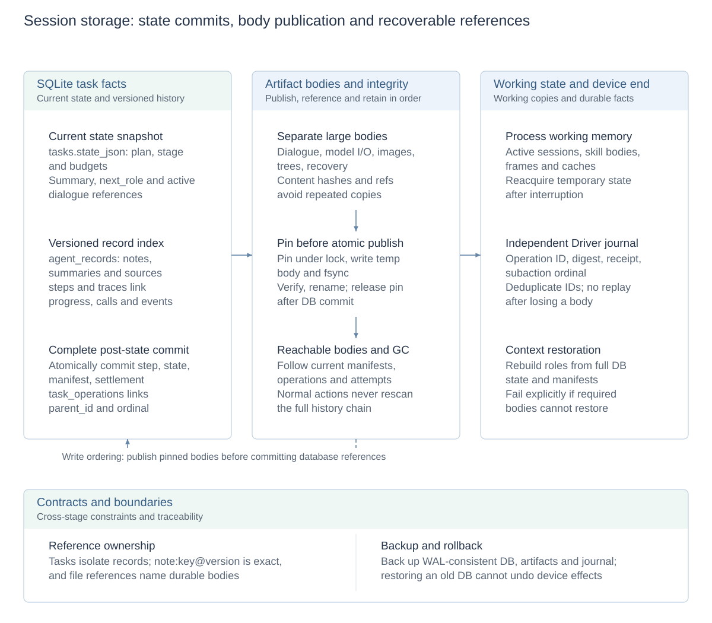
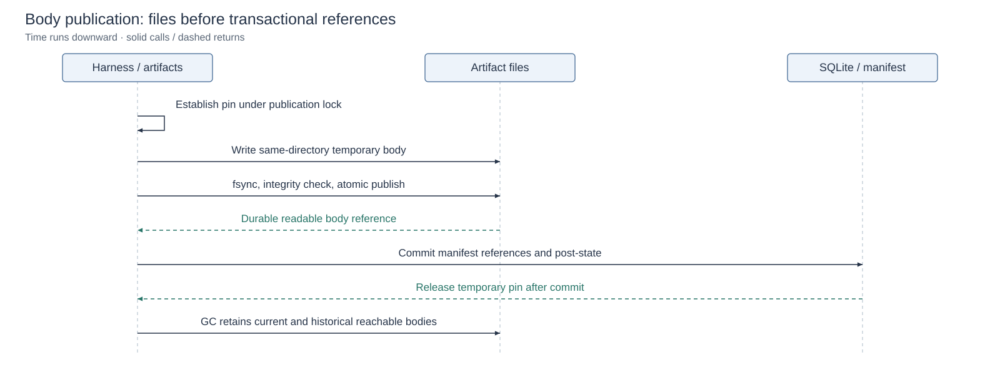

# Session and storage design

[Architecture and design index](architecture.md#module-design-documents) · [中文](session-storage.zh-CN.md) · [Memory and context](memory-and-context.md)

Session holds durable task facts and current state, rather than being a model window or one role invocation. Role changes, user waits, pauses and backend restarts access the same task record. Role context is a decision-specific projection of those records.

A checkpoint is recovery state and references within the session, not limited to pause saves: normal T3, pre-dispatch T1 and takeover can persist recovery state. Current `checkpoint_version` counts safe-continuation preparation rather than all snapshots. See the [checkpoint chapter](crash-recovery.md#checkpoint) for JSON shape, persistence points and the distinction between task status, operation status and recovery progress.

## Design diagrams

<!-- design-diagram:session-storage-map -->

Database, files and execution state have distinct owners. Publish bodies before committing references; current state, history and Driver journal jointly support queries and recovery.

[Mermaid source](diagrams/design-session-storage-map.mmd)

<!-- /design-diagram:session-storage-map -->

<!-- design-diagram:session-publish -->

Pins protect pending references and GC retains reachable bodies; ordinary actions do not rescan the full historical chain.

[Mermaid source](diagrams/design-session-publish.mmd)

<!-- /design-diagram:session-publish -->

## Responsibilities by storage form

| Form | Content categories | Ownership and lifecycle |
| --- | --- | --- |
| SQLite: `tasks.state_json` | Current plan/stage, budgets, summary and active dialogue references | Complete task snapshot updated with committed progress |
| SQLite: `agent_records` | Versioned notes, summaries/sources, observation metadata, stages/events/measurements | Addressed by task, kind, key and version; retains traceable records |
| SQLite: `steps` / `traces` | Steps, invocation relationships and diagnostics | Facts and indexes for execution, queries and Console |
| Artifact files | Dialogue, model requests/responses, screenshots, UI trees/annotations and recovery bodies | Referenced from the database and read independently rather than copied into every snapshot |
| Driver journal | Operation IDs, argument digests, dispatch identities and original receipts | Independent execution-end deduplication and result-query facts |
| Process memory | Active role sessions, loaded bodies, decoded frames, caches and working state | Live execution; durable content reconstructs from manifests while temporary state is reacquired |

`Settings.data_dir` / `CLICKCLICK_DATA_DIR` selects the root, default `./data`; the database is `clickclick.db`. Artifacts include `artifacts/dialogue/`, `history_images/`, `trees/`, `som/` and `llm/`. The local Driver journal is `driver-execution/execution.db` under the task-database directory; a remote journal uses that path under the remote Driver data root. Both are separate from task-side T2 receipts; see [Driver journal details](crash-recovery.md#driver-journal) for contents and responsibilities. Copying only the task database is not a complete backup.

## Identity, versions and source references

Task IDs isolate tasks. Role invocation, model round, tool call, operation ID and observation ID identify different facts; nearby timestamps or a shared action position do not establish a common invocation.

A note's `note_key` is a task-local logical name; `note:<key>@<version>` locates an exact version. Revisions create versions while identical replacements do not. Source handles retrieve exact evidence rather than substituting a mutable latest body for what a past call actually read. Dialogue file references and note-version references locate different storage objects.

## Commit, query and body loading

Roles/tools produce records; TaskStore retains task facts; queries connect stable references into timelines. Large bodies and images load on demand. The state snapshot provides the execution position, while steps and traces reconstruct process for Console, diagnosis and evaluation. Neither replaces the other.

Actions persist T1 intent/reservation, T2 original receipt and T3 step/complete post-state. T3 commits related execution state and accounting together so that an existing step cannot leave current state one round behind. Database transactions do not cover device effects; the [recovery design](crash-recovery.md) owns interruption windows.

## Artifact integrity and cleanup

Publication records a pin under the cross-process publication lock before writing a same-directory temporary body, fsyncing, checking and atomically publishing it. Database references commit afterward, then the corresponding temporary pin is released. GC follows current manifests, operations, receipts and historical attempts. A damaged current manifest may reconstruct from complete DB state and retained manifests; unrecoverable required bodies fail explicitly instead of being guessed by a model.

These checks belong to publication and recovery, rather than scanning the entire history before normal actions. Backup needs a WAL-consistent database and related artifacts/journals; restoring an old database cannot undo phone effects. Preview frames are temporary display state; historical screenshots are saved evidence. Neither automatically becomes a new action basis.

## Implementation and related designs

[TaskStore](../agent/revisable/store.py), [SQLite](../shared/db.py), [artifacts](../shared/artifacts.py), [recovery store](../shared/recovery_store.py), [recovery bodies](../shared/recovery_context.py), [trace](../agent/traces.py). Context selection: [memory design](memory-and-context.md). Presentation/accounting: [observability](observability.md).
