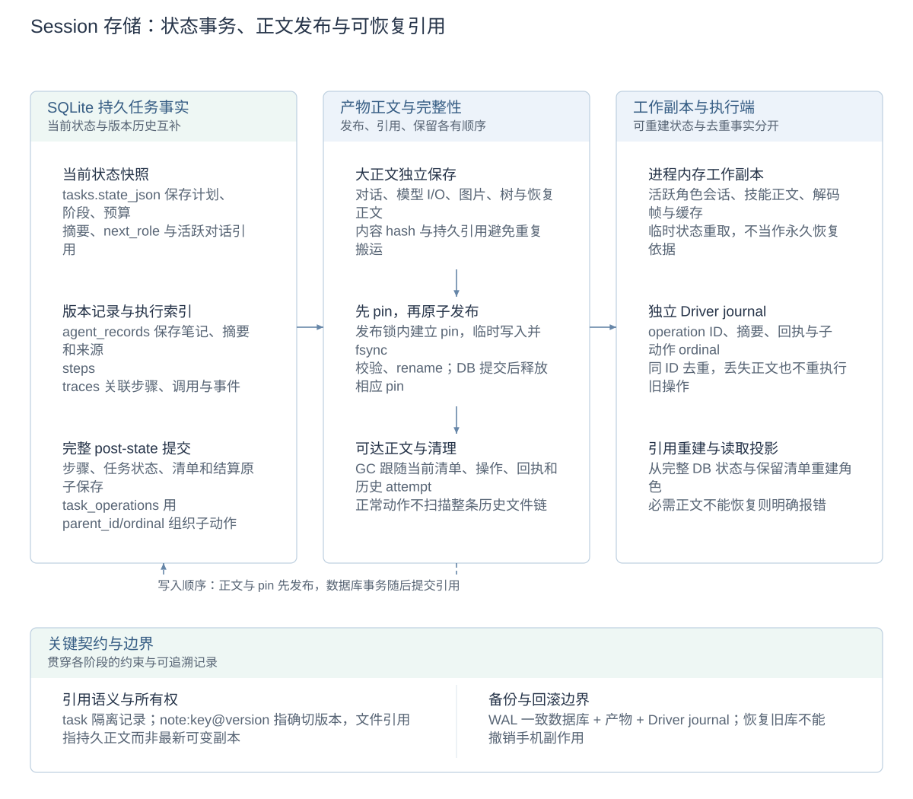
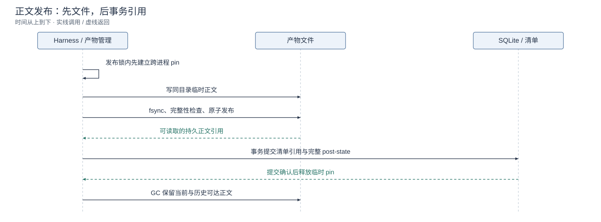

# Session 与存储详设

[架构与详设索引](architecture.zh-CN.md#模块设计文档) · [English](session-storage.md) · [记忆与上下文](memory-and-context.zh-CN.md)

Session 是任务的持久事实与当前状态，不等于模型窗口或某次角色会话。任务切换角色、等待用户、暂停或重启后台时，读取同一任务记录；角色上下文只是其中面向当前决策的投影。

## 设计图解

<!-- design-diagram:session-storage-map -->

按数据归属组织数据库、文件和执行端工作状态。大正文先发布，再提交引用；当前状态、历史事实和 Driver 去重记录共同支持查询与恢复。

[Mermaid 源码](diagrams/design-session-storage-map.zh-CN.mmd)

<!-- /design-diagram:session-storage-map -->

<!-- design-diagram:session-publish -->

pin 保护正在提交的引用，GC 按可达关系保留正文；正常动作不会反复扫描整个历史文件链。

[Mermaid 源码](diagrams/design-session-publish.zh-CN.mmd)

<!-- /design-diagram:session-publish -->

## 按存储形态分工

| 形态 | 内容类别 | 所有权与生命周期 |
| --- | --- | --- |
| SQLite：`tasks.state_json` | 当前计划／阶段、预算、摘要及活跃对话引用 | 完整任务状态快照，随已提交进度更新 |
| SQLite：`agent_records` | 版本笔记、摘要与来源、观测元信息、阶段／事件／测量 | 按 task、kind、key、version 定位；保留可追溯记录 |
| SQLite：`steps` / `traces` | 步骤、调用关联与诊断事件 | 为执行、查询与 Console 提供索引和事实 |
| 产物文件 | 对话正文、请求／响应、截图、UI 树与标注、恢复正文 | 数据库保存引用；正文独立读取，不全部重复塞进快照 |
| Driver journal | operation ID、参数摘要、派发身份及原始回执 | 独立执行端保存去重和结果查询事实 |
| 进程内存 | 活跃角色会话、已加载正文、解码帧、缓存与当前状态副本 | 支撑实时执行；持久部分按清单重建，临时状态重新获取 |

数据根目录由 `Settings.data_dir` / `CLICKCLICK_DATA_DIR` 指定，默认 `./data`，数据库为 `clickclick.db`。产物包括 `artifacts/dialogue/`、`history_images/`、`trees/`、`som/`、`llm/` 等；恢复正文与 journal 的实际定位由对应存储实现管理，不能只复制数据库就视为完整备份。

## 身份、版本与来源引用

task ID 隔离任务；角色 invocation、模型轮次、tool call、operation ID 和 observation ID 分别标识不同事实，不以相近时间或同一动作位置冒充相同调用。

笔记 `note_key` 是任务内逻辑名，`note:<key>@<version>` 指向确切版本。修改产生新版本，完整相同覆盖不增版本；源引用用于回查，不把可变的“最新正文”当作当时已经读到的证据。对话文件引用和笔记版本引用分别定位文件与逻辑记录。

## 提交、查询与正文读取

普通角色与工具产生记录，TaskStore 保存任务事实，查询层把稳定引用连接为时间线；大型正文和图片按需读取。状态快照为后续执行提供当前位置，步骤和 trace 为 Console、诊断与评测还原过程，两者不能互相替代。

动作相关持久化分 T1 意图与预留、T2 原回执、T3 步骤与完整 post-state。T3 将相关执行状态和计量一起提交，避免“步骤存在但最新状态仍停在上一轮”。数据库事务不覆盖设备副作用，异常窗口由[恢复详设](crash-recovery.zh-CN.md)统一处理。

## 产物完整性与清理

发布操作在跨进程发布锁内先保存 pin，再写同目录临时正文、fsync 并校验，原子发布后才提交数据库引用，提交后释放相应临时 pin。GC 按当前清单、操作、回执和历史 attempt 的可达关系保留正文。当前清单损坏时可从完整 DB 状态与保留清单重建；无法恢复的必需正文明确失败，不让模型猜补。

这些检查服务于正文发布与恢复，正常动作不扫描整条历史链。备份需要 WAL 一致数据库及相关产物／journal；旧数据库不能用于撤销已经发生的手机效果。预览帧是临时展示状态，历史截图是已存证据，二者都不自动成为新的动作依据。

## 实现与关联设计

[TaskStore](../agent/revisable/store.py)、[SQLite](../shared/db.py)、[产物](../shared/artifacts.py)、[恢复存储](../shared/recovery_store.py)、[恢复正文](../shared/recovery_context.py)、[Trace](../agent/traces.py)。记忆选择见[上下文详设](memory-and-context.zh-CN.md)，展示与计量见[可观测性](observability.zh-CN.md)。
