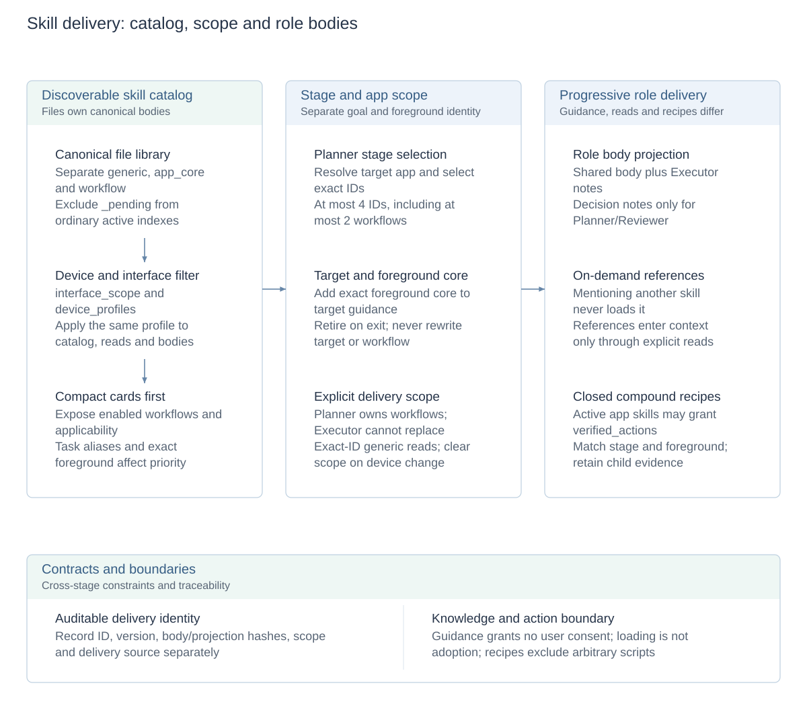

# Skill selection and progressive delivery

[Technical overview](reliability-design.md) · [Architecture and design index](architecture.md#module-design-documents) · [中文](skill-delivery.zh-CN.md)

This design owns discovery, scope and delivery of published skills in ordinary tasks. See [authoring](../skills/README.md) for file format and [self-learning](skill-evolution.md) for trajectory-based candidates and publication.

## Design diagrams

<!-- design-diagram:skill-delivery-flow -->

Filter applicable knowledge, then let Planner select stage skills. Foreground core adds local guidance; role bodies, references and compound recipes have distinct delivery rules.

[Mermaid source](diagrams/design-skill-delivery-flow.mmd)

<!-- /design-diagram:skill-delivery-flow -->

## Content organization and ownership

| Type | Content | Delivery basis |
| --- | --- | --- |
| `generic` | Cross-app methods and prior knowledge | Exact-ID loading after discovery or stage selection |
| App `core` | Controls, semantic distinctions and common cautions | Resolved stage target and exactly observed foreground app |
| App `workflow` | Conditional procedures, verification and pitfalls | Planner selection from the complete app catalog |
| `references` | Supplementary resources | Explicit reads, never automatic injection |
| `_pending` | Unapproved candidates and review evidence | Excluded from the ordinary active index |

`SKILL.md` files supply runtime bodies. IDs must be globally unique; body, version and hash are recorded together. The active set is a working copy rather than a second authoritative library. Guidance text cannot grant user authorization.

## Progressive disclosure from catalog to body

1. Planner first receives compact cards for enabled workflows. Task aliases and exact foreground identity prioritize cards without hiding discoverable entries when users omit app names.
2. Planner resolves the stage target app and selects skills. Target aliases must resolve to an available app; a guessed uninstalled package is not a valid target.
3. Each stage selects at most four generic/workflow IDs, including at most two app workflows. Planner owns app-workflow selection; Executor cannot replace it. Generic skills can be loaded by a provided exact ID.
4. Stage delivery includes target app core, selected bodies and eligible foreground app core. Mentioning another skill does not load it, and references do not expand automatically.
5. Delivery records IDs, versions, hashes, source and scope. Console and validation distinguish catalog presence, selection, loading and actual adoption.

This uses structured catalogs, app identities and model selection to reduce full-library input while preserving explicit reads.

## App, device and stage scope

Stage target and current foreground are different identities. Exact foreground observation may temporarily add its core for cross-app handoffs or system UI, but does not rewrite the target or select a foreground workflow. It leaves delivery when the app leaves foreground; matching target/foreground cores are deduplicated.

`interface_scope` distinguishes `app / system / generic`. System skills require `device_profiles`; profiles filter catalogs, bodies and explicit reads. Unknown devices receive only unrestricted content; device switching clears old scopes. Shared configuration resolves aliases and profiles rather than transferring skills between packages merely because their UI looks similar.

App-version conditions remain prose and are not automatically checked against installed versions. Package equality does not prove compatibility with every version.

Legacy files use existing ownership mappings for known system components; other app packages and app-independent content default to app/generic. This is not a package-prefix or preinstallation heuristic. New skills still declare ownership explicitly and split mixed flows by owner.

## Role projection and compound actions

Shared text supplies common knowledge. `Executor notes` go only to Executor; `Decision notes` go to Planner/Reviewer. Projections have their own hashes: Planner delivery cannot establish that Executor received a different body.

App core/workflow `verified_actions` can declare supported closed compound recipes. Authorization requires matching active skill, stage target and actual foreground app. Generic skills cannot grant these recipes, arbitrary scripts or model-generated sequences. Subactions retain the ordinary execution boundary and intermediate evidence; the final observation becomes the next action basis. See [observation and execution consistency](observation-execution-consistency.md).

## Configuration, tradeoffs and implementation

`CLICKCLICK_SKILLS_DIR` selects the skill root, defaulting to the repository's `skills/`; device configuration selects applicable profiles. The four-skill/two-workflow limits, role sections and scopes belong to the delivery protocol. Learned candidates enter the canonical library only after independent review, applicable validation and human approval; ordinary completion does not trigger automatic learning.

Exact app matching reduces irrelevant guidance but requires maintained aliases, profiles and conditions. Progressive delivery lowers repeated context, while models can still miss a skill or ignore valid guidance. Inspect delivery and action adoption separately.

Implementation: [library.py](../agent/skills/library.py), [catalog/active bodies](../agent/session.py), [role tools](../agent/revisable/session.py), [delivery analysis](../agent/skills/activation.py), [app/profile aliases](../shared/app_alias_profiles.json), [pending.py](../agent/skills/pending.py).
