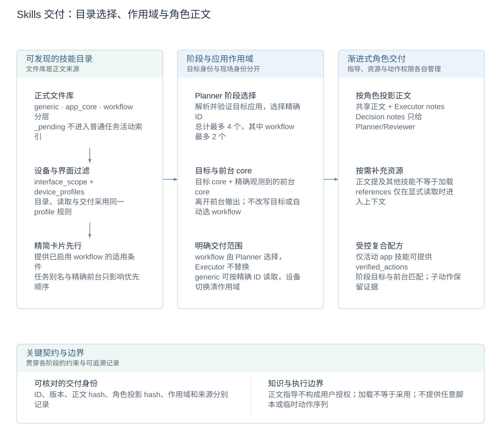

# Skills 选择与渐进式交付详设

[技术概览](reliability-design.zh-CN.md) · [架构与详设索引](architecture.zh-CN.md#模块设计文档) · [English](skill-delivery.md)

本文负责正式技能在普通任务中的发现、作用域和交付。文件格式见[编写指南](../skills/README.zh-CN.md)，从轨迹生成候选及批准流程见[Skills 自学习](skill-evolution.zh-CN.md)。

## 设计图解

<!-- design-diagram:skill-delivery-flow -->

先过滤可用知识，再由 Planner 选择阶段技能；前台 core 补充现场指导，正文按角色披露，引用资源和复合动作按各自条件开放。

[Mermaid 源码](diagrams/design-skill-delivery-flow.zh-CN.mmd)

<!-- /design-diagram:skill-delivery-flow -->

## 内容组织与数据归属

| 类型 | 保存内容 | 交付依据 |
| --- | --- | --- |
| `generic` | 跨应用方法与先验 | 目录发现后按精确 ID 加载或阶段选择 |
| App `core` | 应用控件、语义区别与通用注意事项 | 已解析的阶段目标应用及精确观测前台应用 |
| App `workflow` | 有适用条件的任务流程、核验与避坑 | Planner 从完整应用目录中选定 |
| `references` | 按需读取的补充资源 | 显式读取，不自动注入 |
| `_pending` | 待批准候选及审查证据 | 不进入普通任务活动索引 |

`SKILL.md` 文件是运行时正文来源。全库 ID 必须唯一，正文、版本与 hash 一起记录；运行时活动集合是工作副本，不是另一套权威知识库。技能提供指导，不因文字中出现命令就取得用户授权。

## 目录到正文的渐进式披露

1. Planner 先收到已启用 workflow 的精简卡片。任务中的应用别名和精确前台身份用于排序，不因用户没写出应用名就隐藏其他可发现目录。
2. Planner 解析阶段目标应用并选择阶段技能。目标别名需解析到可用应用，猜测但未安装的包名不能成为有效目标。
3. 每阶段最多选择四个 generic/workflow ID，其中应用 workflow 最多两个。App workflow 由 Planner 选择，Executor 不自行替换；generic 可按已提供的精确 ID 加载。
4. 进入阶段后交付目标 app core、已选正文及符合条件的前台 app core。正文提到别的技能不代表自动加载；补充资源也不自动展开。
5. 记录实际交付的 ID、版本、内容 hash、来源与作用域，使 Console 和后续验证能够区分“列入目录”“选择”“加载”与“实际采用”。

该路径使用结构化目录、应用身份和模型选择，减少全库正文输入，同时保留明确的按需读取入口。

## 应用、设备与阶段作用域

阶段目标与当前前台是两种身份。精确观测前台可以临时补充自身 core，以处理跨应用交接或系统界面，但不能改写目标应用或自动选中其 workflow；离开前台后撤出，相同目标与前台去重。

`interface_scope` 区分 `app / system / generic`。`system` 必须声明 `device_profiles`；设备 profile 同时过滤目录、正文和显式读取。未知设备仅使用无 profile 限制的内容，切换设备会清理原作用域。应用别名和 profile 由共享配置解析，不凭相同 UI 外观继承别的包名技能。

App 版本条件保留在正文，目前不自动校验安装版本。跨版本适用性仍需实际证据，不能将同包名匹配等同于所有版本验证。

旧文件兼容时，已知系统组件使用既有归属映射，其他 app 包和无应用内容分别采用 app／generic；这不按包名前缀或是否预装来猜测。新增技能仍应显式声明界面归属，混合流程按所有者拆分。

## 按角色投影与复合动作

共享正文提供共同知识；`Executor notes` 只给 Executor，`Decision notes` 给 Planner/Reviewer。正文投影具有各自 hash，不能用 Planner 收到的投影证明 Executor 已加载另一份正文。

App core/workflow 中的 `verified_actions` 可声明受支持的封闭复合配方。授权要求活动技能、阶段目标和实际前台应用匹配；generic 不授予这些能力，也不接受任意脚本或模型临时编排的序列。每个子动作仍经过原有执行边界，保存中间证据，最终观测成为下一动作依据。详见[观测与执行一致性](observation-execution-consistency.zh-CN.md)。

## 配置、取舍与实现

`CLICKCLICK_SKILLS_DIR` 指定技能根目录，默认仓库 `skills/`；设备配置选择适用 profile。单阶段四个技能／两个 workflow、角色分段和作用域属于交付协议。学习候选须经独立审查、相应验证及人工批准后才进入正式目录；普通任务结束不自动学习。

精确应用匹配减少无关指导，代价是别名、设备 profile 和适用条件需要维护。渐进式交付降低重复上下文，但模型仍可能漏选或未采用正确规则，需通过加载记录与动作证据分别检查。

实现：[library.py](../agent/skills/library.py)、[目录与活跃正文](../agent/session.py)、[角色工具](../agent/revisable/session.py)、[交付分析](../agent/skills/activation.py)、[应用与设备别名配置](../shared/app_alias_profiles.json)、[pending.py](../agent/skills/pending.py)。
