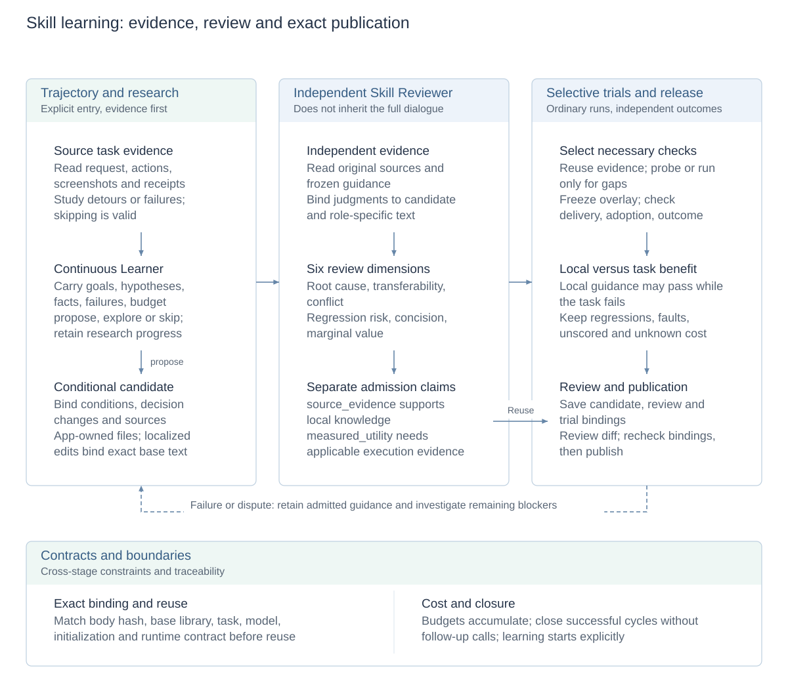
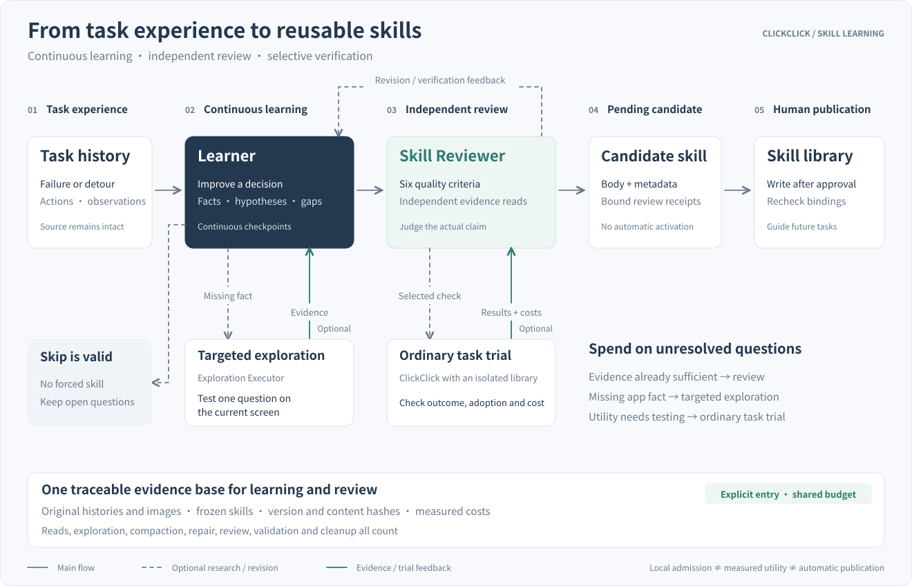

# Skill self-improvement

[README](../README.md) · [中文](skill-evolution.zh-CN.md) · [Architecture](architecture.md) · [Skills guide](../skills/README.md)

**Turn failures and detours from real tasks into guidance for the next run.** ClickClick's Learner analyzes task histories, explores missing app facts when needed, and proposes conditional skill revisions. An independent Skill Reviewer checks their quality and selects necessary trials with ordinary ClickClick execution.

Self-improvement updates file-based skill knowledge rather than model weights. The design supports local knowledge admission, selective execution checks and per-file publication. Learning uses an explicit entry point; candidates stay pending until users review outcomes/diffs and approve. Historical measurements remain separate.

## Design diagrams

<!-- design-diagram:skill-learning-mechanisms -->

Learning improves the next decision. Local validity, task utility and publication are separate judgments; evidence gaps select trials, while unresolved goals continue in the same research session.

[Mermaid source](diagrams/design-skill-learning-mechanisms.mmd)

<!-- /design-diagram:skill-learning-mechanisms -->

## What is learned: a better decision

Useful knowledge changes a future decision: a hidden entry point, a control's scope, a conditional shortcut, an observed pitfall, or information and state that must be preserved. Repeating the clicks from one task is insufficient.

Learning targets two situations:

- **Successful tasks with detours.** Extract the working route from the existing history, checking whether earlier attempts produced state needed later. Omit avoidable actions while retaining saves, identity checks and result verification.
- **Failed tasks.** First retain narrowly supported local knowledge, then explore missing facts. A complete successful route is not required to learn a useful pitfall, but an unknown breakthrough cannot become a verified procedure.

An action is not inherently wasteful. Opening a menu may be a detour for renaming and necessary for another goal. Learner must describe the purpose, observable conditions, changed decision, original cost and replacement overhead, retaining unknown costs. One failure cannot establish a universal ban. Efficient sources, sufficient existing guidance or inadequate evidence may legitimately produce a skip.

## From task experience to a candidate skill

The main flow runs left to right; exploration and trials are optional branches below it. The loops address evidence gaps, and trial results also return to the continuous research conversation. Not every candidate requires device exploration or another task run. After successful checks, a final Reviewer verdict with no remaining checks or revisions lets the host archive actual feedback and finish without an extra closing model request. Failed, incomplete or disputed results still return to analysis.

### Responsibilities

- **Source task records** retain instructions, actions, observations, notes and outcomes. Learning references them without changing the source task or replacing benchmark scores.
- **Learner** analyzes dependencies, failures and detours; chooses propose, explore or skip; tracks facts, hypotheses and unknowns; and writes skill bodies and retrieval metadata.
- **Exploration Executor** reuses observation, action validation and device tools to test a concrete question on the current screen. Historical images are evidence, not coordinates for current actions.
- **Skill Reviewer** uses a separate context and reads original evidence and frozen guidance independently. It checks quality and selects necessary verification. It does not inherit the entire Learner conversation or receive device/publication tools. Its responsibility differs from the Reviewer role in ordinary task execution.
- **The evaluation controller and ordinary ClickClick** run selected checks with isolated skill libraries. The controller coordinates conditions, costs and device lifecycle; AndroidWorld/MobileWorld official initialization and scoring serve their respective experiments. The ordinary executor receives the candidate, not the full research conversation.
- **Pending review and human approval** bind the exact candidate, base version, review and applicable validation. Approval rechecks those bindings; an old receipt cannot authorize a changed body or library.

## Independent review: local facts and task benefit are separate

Skill Reviewer checks six criteria: **root cause, transferability, conflicts, regression risk, concision and marginal value**. It asks whether applicability is detectable before the changed decision, whether existing knowledge already covers it, whether omitted actions create necessary state, and whether the decision value justifies new guidance.

Three conclusions remain distinct:

1. **Local knowledge is supported.** Native observations establish a location, semantic distinction or conditional rule with useful, nonredundant decision value. `source_evidence` admission does not require prior whole-task success, nor establish average savings or complete transfer.
2. **Candidate execution demonstrates task benefit.** Ordinary execution independently assesses outcome, delivery, action adoption and full cost. `measured_utility` claims require the corresponding matched comparisons and coverage; local admission is not a substitute.
3. **The candidate may enter the canonical library.** Applicable evidence, all six review criteria, candidate/base/library/runtime bindings and environment conditions remain valid, followed by current human approval. A passing review is not publication.

Preflight catches concrete conflicts, invalid scope and low-value drafts before expensive execution. Unknown future benefit may proceed to necessary verification but cannot become a fact. Confirmed regression and unresolved environment effects cannot be erased by narrowing the claim.

## Multiple apps and local admission

One learning job can propose several skill files and their dependencies. Knowledge about the second app's own controls belongs to that app; the originating workflow retains the necessary handoff. Prioritize failures, harmful side effects and substantial avoidable work, rather than every harmless detour.

A candidate group uses one frozen joint overlay. Reviewer applies all six criteria per file and records each local effect as supported, contradicted or unassessed. Effect evidence must cite actual actions and observations: body delivery and whole-task success alone do not establish adoption. Necessary checks newly selected in final review also run. Completed checks can be reused under identical body, base-library and runtime bindings, without a default per-file comparison matrix.

A failed task or rejected sibling does not invalidate an independently supported file. Failed dependencies, known regression and unsupported clauses still block affected candidates. A file is the approval unit; one valid rule cannot carry unverified content into the library. Every human approval rechecks the group receipt and accepts only eligible files.

Completed reviews and trials remain accessible through content-hashed references. The current body, claim scope and key outcomes stay in the conversation. Shared rule contracts are delivered once while each file retains its own guidance binding, reducing repeated input without losing continuous research or source access.

## What to verify, and when to rerun

Learner may propose a verification goal. Independent Reviewer selects decision-changing checks already declared by the trusted evaluator. Existing evidence may suffice; one missing fact may warrant a local probe; execution-effect questions may require ordinary task trials.

Verification separates catalog exposure, Planner reading or selection, exact Executor delivery, and actual mechanism adoption. Activation alone does not demonstrate adoption. An executor's completion report does not replace independent outcome checks.

Candidate body, base library, task, model, initialization and runtime contracts bind source and new results. Completed evidence can be reused under exact bindings; a new body cannot inherit an older body's outcomes. Environment failures, unscored executions and unknown costs remain separate from skill scores and zero-cost claims.

Replication has several meanings:

- **Same-goal repetition** checks completion recurrence for an exact body, not transfer to changed inputs.
- **Different-input trials** test the unchanged rule on new task data or conditions.
- **Blank-conversation reacquisition** tests independent extraction from the source, not parameter transfer.

There is no default full comparison matrix. Claims requiring complete utility coverage must still satisfy it; local knowledge does not require endless verification of unclaimed global benefits.

## Continuous analysis and context management

Local admission and source-task completion are different objectives. When the task objective remains unresolved, accepted guidance survives while the same conversation/budget investigates a distinct remaining blocker. Only an ordinary run bound to the exact candidate, base library, environment and independent scorer can close that objective; explicit skip or exhaustion preserves it as unresolved. Reviewer distinguishes missing delivery, non-adoption, ineffective guidance, other blockers and environment faults. Localized edits bind exact base text and are materialized into complete files before review.

Learner retains research progress within a bound learning job. The current goal, candidate, supported facts, failed attempts, review disputes, unknowns and remaining budget move across phases rather than restarting settled analysis.

Initial input contains necessary task facts, counts and a referenced chronological action directory. Original records, images and complete skill bodies are paged on demand. Capacity-deferred results retain the original call and exact source; undelivered content is not treated as absent. Frozen full-file hashes and role-projection hashes are distinct: a Planner projection is not compared against an Executor hash.

When history exceeds its window, referenced checkpoints preserve dependencies and unresolved questions while originals remain retrievable. Format/reference validation does not prove semantic fidelity. Learning checkpoints differ from ordinary Executor history summaries; see [Memory and context design](memory-and-context.md) for task notes and summaries.

Stable rules and tool contracts are placed before changing phase facts and budgets where possible for prompt caching. Actual cache usage and provider tokens are measured separately. Evidence, current budgets and context limits take priority over cache continuity. No new case index, background memory agent, experience-pruning service or arbitrary hard skill-token quota is introduced.

## Output: conditional guidance and retrieval metadata

Candidates use existing `SKILL.md` conventions in the relevant app core or workflow, in sections such as Procedure, Verification, Pitfalls and Hints. Unrelated valid guidance and necessary checks remain intact. Research costs, disputes and evidence directories stay in analysis records rather than filling runtime skill text.

Supported semantic fields—`description`, `tags`, `triggers`, `app_aliases` and `capability`—may change under the same independent review. Kind-specific constraints still apply: workflows use capability and do not accept triggers. Package names, skill identity, interface scope and action authorization remain protected; learning does not grant arbitrary action or script permissions. See the [Skills guide](../skills/README.md) for formatting and delivery.

Reusable rules refer to purposes and observable mechanisms rather than this task's filename, amount, answer set or historical coordinates. Transfer-shaped wording is not transfer evidence. Rediscovering authored knowledge does not automatically establish incremental value over the complete authored library.

## Examples and evidence boundaries

Local validity, action adoption and whole-task utility remain separate. [Historical experiments](skill-learning-experiments.md) preserve app examples, frozen controls, failures and costs rather than treating a selected cohort as general current-version performance.

## Costs and device environment

A declared disposable research environment may reuse audited device state. Source changes, unresolved effects and cleanup boundaries still require rechecks; independent cleanup must pass before candidate adjudication, ordinary validation or exit.

Reads, exploration, compaction, repair, review, validation and environment work share explicit budgets. Provider retries and continuation do not reset them; writing, final review and cleanup retain capacity. Missing child receipts leave unknown costs or reserved upper bounds, not invented paid-call counts. Experimental limits are configurable; production thresholds still need calibration against reuse benefits.

The October 7 blank-conversation jobs, including ordinary trials and environment work, used 31 requests/about 7.9 minutes for account language and 62 requests/about 16.9 minutes for language filtering. Native analysis/review used 10/30 requests and 0/6 compactions respectively, with native cache-read/input around 2–3%. Different task complexity prevents a controlled speed comparison. Some ordinary token usage is unavailable, so these counts cannot establish monetary cost.

Exploration reuses device ownership, cancellation, observation and action boundaries. The evaluation controller invokes official initialization, scoring and cleanup where supported; failed initialization does not refute an app mechanism. Disposable official fixtures may expose scoped reset capabilities that personal devices do not receive. Unresolved effects remain explicit. Actions are not transactional rollbacks, and task initialization does not guarantee identical browser pages or account state.

Ordinary completion records local mechanical clues without automatic learning-model requests or device exploration. Personal optimization and operator research require explicit entry points. Automatic user-history upload and cloud publication are not implemented. See [Learning cost and contribution policy](skill-learning-policy.md).

## Why the approach evolved

The key move from unusable to useful was replacing operation summaries with evidence-supported decision improvements, then reviewing each claim at its actual scope rather than requiring success before learning. Continuous research memory and independent evidence access addressed forgotten phases, missing records and guidance-identity errors.

The move toward better usability is spending only on unresolved questions: trajectory-first analysis, selective validation, exact evidence reuse and closure when successful review has no follow-up. Few-shot examples, schema cleanup, metadata and caching support this approach but cannot replace it. Changes evolved together without individual controlled ablations; no single fix receives credit for all outcomes.

## Current capability and remaining limits

The implementation supports extracting local GUI procedures/pitfalls, independent review and selective ordinary-task validation. Task benefits, limited replication and cross-input evidence remain bound to their frozen conditions in [historical experiments](skill-learning-experiments.md). Separate local rules are not complete task-family procedure packages.

Complex cross-app failure exploration, long-run average utility, causal effects across starting states, production cost and statistical reliability remain unresolved. Complete authored skills are a direction, not this phase's mandatory parity threshold. Fixed-test-script generation remains deferred. Automatic publication, continuous pruning and unrestricted autonomous exploration are not implemented capabilities.

## Implementation entry points

- [learning.py](../agent/skills/learning.py): diagnosis, candidate contracts, independent review and learning cycle.
- [analysis_session.py](../agent/skills/analysis_session.py): continuous conversation, checkpoints and feedback archives.
- [task_goal.py](../agent/skills/task_goal.py): source-task completion, retained local candidates and exact-validation closure.
- [exploration.py](../agent/skills/exploration.py), [research_tools.py](../agent/skills/research_tools.py): evidence reading, execution and environment integration.
- [admission.py](../agent/skills/admission.py), [verification.py](../agent/skills/verification.py): claim-scoped admission and isolated validation.
- [candidate_group.py](../agent/skills/candidate_group.py): multi-file ownership, dependencies, joint validation and local admission.
- [diagnosis.py](../agent/skills/diagnosis.py), [strategy.py](../agent/skills/strategy.py), [skill_edits.py](../agent/skills/skill_edits.py): deployment diagnosis, strategy comparison records and exact-base edits.
- [pending.py](../agent/skills/pending.py): pending artifacts and approval-time binding checks.
- OpenSpec design and evolution (development-repository experiment): historical decisions and experimental boundaries.

## Historical validation and main configuration

Quantitative reruns, common-library controls and cold-start costs are in [historical experiments](skill-learning-experiments.md). Personal optimization defaults to 24 model requests, 30 actions and 900 seconds, with explicit consent for model cost and device work. See [cost and contribution policy](skill-learning-policy.md) for ranges and interfaces. Research budgets are separate from ordinary tasks and do not retroactively define experimental cost.

Former experiment sections now live in [historical validation](skill-learning-experiments.md).
