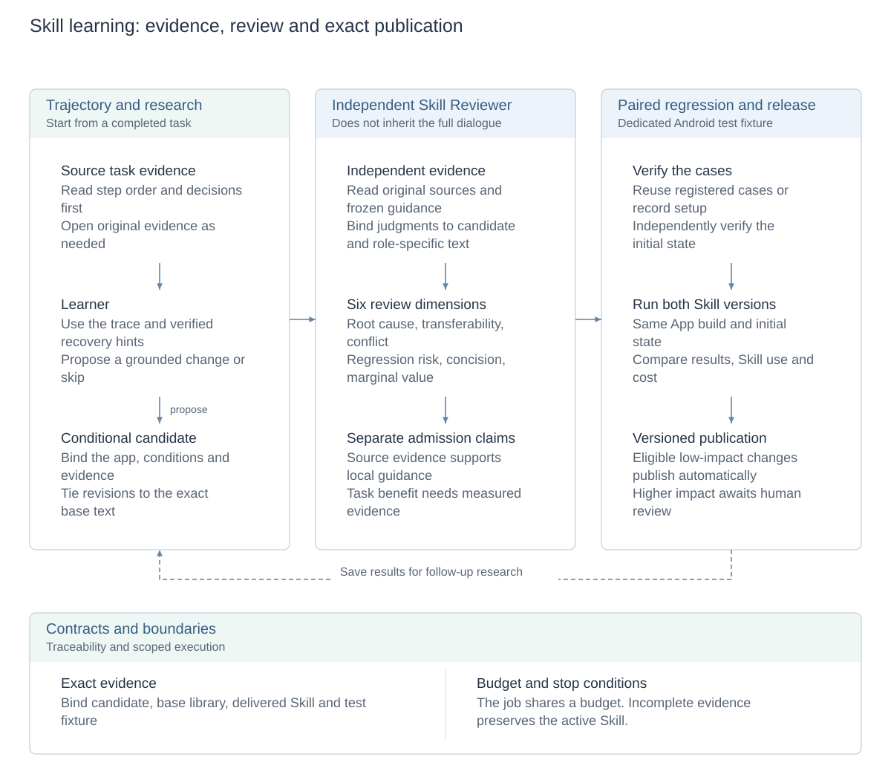
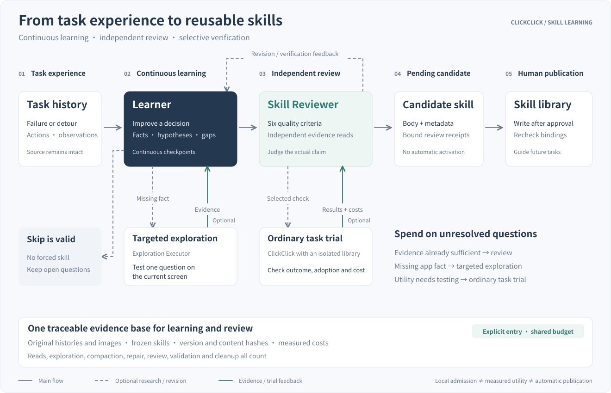

# Skill self-improvement

[README](../README.md) · [中文](skill-evolution.zh-CN.md) · [Architecture](architecture.md) · [Skills guide](../skills/README.md) · [GUI script design](gui-script-design.md)

**Turn failures and detours from real tasks into guidance for the next run.** The Learner proposes changes to the file-based `SKILL.md` library. An independent Skill Reviewer checks the evidence, and the publication gate decides whether the exact candidate can enter the active library.

From task details, **Skills self-learning** can carry one reviewed Android App change through case preparation, paired regression and publication. An opted-in App-build audit also uses the Learner to maintain existing guidance. Ordinary completion can record local clues without inference or device actions. The build audit is off by default, and device testing requires explicit authorization.

## From task details to publication

Open a finished task, accept the model budget and authorize operations on the test device, then click **Skills self-learning**. Configure `CLICKCLICK_SKILL_LOOP_FIXTURE_JSON` with the dedicated Android emulator's `serial`, `avd`, `snapshot` and dedicated local `adb_port`. An optional `model` selects the evaluation model. Install the test App in that fixture. The job checks the emulator identity and snapshot and rejects devices visible to the ordinary task pool. The original task stays read-only.

1. **Learn from cited evidence.** The worker freezes the current Skill library and runs the shared Learner and Reviewer against the task's read-only records. The initial packet gives the goal, outcome, counts, loaded Skill identities, clues and a chronological action directory with source references. The Learner can page in original actions, receipts, observations, screenshots or full Skill text when it needs to settle a question. This phase has zero device actions.
2. **Select one reviewed candidate.** One App-scoped addition or revision enters the Console's paired regression path. If several qualify, the automatic flow stops with an ambiguity reason. A manual `skill-loop` CLI plan can name the exact target. The paired worker reports whole-file deletions and multi-file groups as unsupported. The shared Learner handles those operations through human-reviewed paths.
3. **Reuse a case or record its setup.** The case registry identifies a setup by Skill path, App package, build and case key. The Learner sees the candidate diff and the witnessed before/after state, and chooses a registered case that exercises the branch where available. Otherwise it proposes a bounded setup goal and pre- and post-branch checks, an independent result and preservation guards from observed facts. Ordinary ClickClick performs only the setup goal with recording enabled. The fixture is reset and the generated [GUI setup script](gui-script-design.md) must replay unassisted, reach the expected initial state and leave the final goal unfinished before registration can proceed. An operator-supplied case also needs the replay proof. A reused case with a different AVD or snapshot proof is checked again.
4. **Run the previous and candidate Skills on the same case.** For each arm, the evaluator restores the same snapshot, replays the same setup and verifies the initial state and runtime configuration. The App build, final goal, model, parameters and execution limits are matched. The control uses the frozen library as it stands, including the previous version when the file exists. The candidate arm overlays the exact new file. Ordinary ClickClick performs the final task. Independent checks score the result, the changed branch and preservation guards, and actual model request records verify which Skill version and role projection were delivered. Case registration establishes a start state. The paired runs establish what each Skill did from that state.
5. **Protect registered behavior.** The automatic job includes the remaining distinct cases registered for the same Skill, App and build. Earlier successful paths must retain their results and guards. An earlier positive case may reach them through a new route. A near miss must still avoid the branch. An explicit plan can also name a variant, near miss or related normal case. The controller reserves room for both arms and the setup replays before allocating action limits. Missing coverage, mismatched starts, failed guards or unavailable cleanup keep the gate from passing.
6. **Publish only the reviewed bytes.** Once the pair passes, Skill Reviewer assesses the impact using the actual observations and results. A low-impact App-local workflow change needs a narrow visible condition, evidence of the intended branch and preserved behavior. For revisions, the Skill version must change and applicability metadata must stay the same. Changes to shared scope, permissions, account state, sharing, payments or destructive behavior are high impact. A valid high-impact candidate waits for human approval. Insufficient evidence blocks publication. The publisher rechecks the current library, base, candidate and evidence bindings before writing. It keeps the previous version for a paired revision and records how approval was granted.

Automatic case planning checks unambiguous semantic facts from the recorded UI tree and the linked native action. A replay script can use visual steps as well. Cases whose conditions are only visually observable can be authored as explicit plans, then checked by the evaluator. When automatic planning lacks a grounded case, the job records the gap.

The Console shows learning, planning, recording, replay, regression and publication as the job progresses. **Stop learning** cancels the learning job. A missing fixture, exhausted budget, failed regression or stale active library preserves the active Skill. If device state is uncertain, the evaluator records that reconciliation is required and quarantines the fixture. Run reports live under `skill-loop/runs/`, and verified cases under `skill-loop/cases/` in the configured data directory. Reviewable candidates appear in Skills → Pending.

The Console shares the model-request, action and wall-clock allowances across all stages, including setup, each arm and impact review. The defaults are 24 model requests, 30 actions and 900 seconds. The job can stop before another case when the remaining allowance is insufficient. See [learning cost and contribution policy](skill-learning-policy.md).

## Maintaining Skills after an App build changes

Enable local recording and set `CLICKCLICK_SKILL_VERSION_AUDIT_ENABLED=true` to opt in. The audit starts from the Android build observed while an App workflow Skill was actually delivered to Executor. The first observed build establishes a baseline. A later terminal task can open one audit job for up to three changed workflows with paired native action evidence. The audit binds the App, Skill version and exact delivered projection. Its chronological outline links a dispatched action to the accepted before and same-App after observations. The Learner can query those records and any available images within the job's request and time limits, with zero device actions.

An observed build change starts the investigation. The Learner still needs a witnessed conflict, replacement path or reusable rule to propose an addition or revision. Existing guidance remains in effect for untouched paths. A single task cannot establish compatibility for other Skill clauses, workflows or builds. Missing evidence stays explicitly unassessed. The task's Skill links show audit status and any pending candidate. Background proposals still require human approval. Use the explicit Console loop when the change needs device investigation or a paired run.

A whole-file deletion requires independent evidence of the impact on the entire Skill, including lost guidance, dependencies and retrieval coverage. If approved by a person, publication rechecks the exact base and archives the removed file. A single conflicting route calls for a scoped revision.

## Learning from a script recovery

When the [GUI script repair flow](gui-script-design.md) observes a reusable alternative route, it can save a hypothesis linked to the verified assisted replay, the original task, App build and before/after observations. A later, explicit Skills learning job can read that replay history under its own source references and use a verified witness for case planning at the matching build. A locator adjustment or dismissal of a temporary dialog can repair a run without supporting a reusable Skill. The same candidate review, independent regression and publication checks apply to any rule inferred from a replay.

## Design diagrams

<!-- design-diagram:skill-learning-mechanisms -->

The design traces task evidence through an independent review, verified case preparation and paired regression. Local validity, task utility and publication are separate judgments.

[Mermaid source](diagrams/design-skill-learning-mechanisms.mmd)

<!-- /design-diagram:skill-learning-mechanisms -->

## What is learned: a better decision

Useful knowledge changes a future decision: a hidden entry point, a control's scope, a conditional shortcut, an observed pitfall, or information and state that must be preserved. Repeating the clicks from one task is insufficient.

Learning targets two situations:

- **Successful tasks with detours.** Extract the working route from the existing history, checking whether earlier attempts produced state needed later. Omit avoidable actions while retaining saves, identity checks and result verification.
- **Failed tasks.** First retain narrowly supported local knowledge, then explore missing facts. A complete successful route is not required to learn a useful pitfall, but an unknown breakthrough cannot become a verified procedure.

An action is not inherently wasteful. Opening a menu may be a detour for renaming and necessary for another goal. Learner must describe the purpose, observable conditions, changed decision, original cost and replacement overhead, retaining unknown costs. One failure cannot establish a universal ban. Efficient sources, sufficient existing guidance or inadequate evidence may legitimately produce a skip.

## From task experience to a candidate skill

This earlier human-reviewed research flow illustrates how exploration and trials address specific evidence gaps and return results to the continuing research conversation. A final Reviewer verdict with all checks satisfied lets the host archive the results and finish. The Console's paired publication gate is described [above](#console-loop).

### Responsibilities

- **Source task records** retain instructions, actions, observations, notes and outcomes. Learning references them without changing the source task or replacing benchmark scores.
- **Learner** analyzes dependencies, failures and detours; chooses propose, explore or skip; tracks facts, hypotheses and unknowns; and writes skill bodies and retrieval metadata.
- **Exploration Executor** reuses observation, action validation and device tools to test a concrete question on the current screen. Historical images are evidence, not coordinates for current actions.
- **Skill Reviewer** uses a separate context and reads original evidence and frozen guidance independently. It checks quality and selects necessary verification. It does not inherit the entire Learner conversation or receive device/publication tools. Its responsibility differs from the Reviewer role in ordinary task execution.
- **The evaluation controller and ordinary ClickClick** run selected checks with isolated skill libraries. The controller coordinates conditions, costs and device lifecycle; AndroidWorld/MobileWorld official initialization and scoring serve their respective experiments. The ordinary executor receives the candidate, not the full research conversation.
- **Publication** binds the exact candidate, base version, review and applicable validation. Both automatic publication and human approval recheck those bindings before writing the file.

## Independent review: local facts and task benefit are separate

Skill Reviewer checks six criteria: **root cause, transferability, conflicts, regression risk, concision and marginal value**. It asks whether applicability is detectable before the changed decision, whether existing knowledge already covers it, whether omitted actions create necessary state, and whether the decision value justifies new guidance.

Three conclusions remain distinct:

1. **Local knowledge is supported.** Native observations establish a location, semantic distinction or conditional rule with useful, nonredundant decision value. `source_evidence` admission does not require prior whole-task success, nor establish average savings or complete transfer.
2. **Candidate execution demonstrates task benefit.** Ordinary execution independently assesses outcome, delivery, action adoption and full cost. `measured_utility` claims require the corresponding matched comparisons and coverage; local admission is not a substitute.
3. **The candidate may enter the canonical library.** Applicable evidence, all six review criteria, candidate/base/library/runtime bindings and environment conditions must remain valid. The applicable publication decision authorizes writing that exact candidate.

Preflight catches concrete conflicts, invalid scope and low-value drafts before expensive execution. Unknown future benefit may proceed to necessary verification but cannot become a fact. Confirmed regression and unresolved environment effects cannot be erased by narrowing the claim.

## Multiple apps and local admission

One learning job can propose several skill files and their dependencies. Knowledge about the second app's own controls belongs to that app; the originating workflow retains the necessary handoff. Prioritize failures, harmful side effects and substantial avoidable work, rather than every harmless detour.

A candidate group uses one frozen joint overlay. Reviewer applies all six criteria per file and records each local effect as supported, contradicted or unassessed. Effect evidence must cite actual actions and observations: body delivery and whole-task success alone do not establish adoption. Necessary checks newly selected in final review also run. Completed checks can be reused under identical body, base-library and runtime bindings, without a default per-file comparison matrix.

A failed task or rejected sibling does not invalidate an independently supported file. Failed dependencies, known regression and unsupported clauses still block affected candidates. A file is the approval unit; one valid rule cannot carry unverified content into the library. Every human approval rechecks the group receipt and accepts only eligible files.

Completed reviews and trials remain accessible through content-hashed references. The current body, claim scope and key outcomes stay in the conversation. Shared rule contracts are delivered once while each file retains its own guidance binding, reducing repeated input without losing continuous research or source access.

## What to verify, and when to rerun

Learner may propose a verification goal. Independent Reviewer selects decision-changing checks already declared by the trusted evaluator. Existing evidence may suffice; one missing fact may warrant a local probe; execution-effect questions may require ordinary task trials.

Verification separates catalog exposure, Planner reading or selection, exact Executor delivery, and actual mechanism adoption. Activation alone does not demonstrate adoption. An executor's completion report does not replace independent outcome checks.

Candidate body, base library, task, model, initialization and runtime contracts bind source and new results. Completed evidence can be reused under exact bindings; a new body cannot inherit an older body's outcomes. Environment failures, unscored executions and unknown costs remain separate from skill scores and zero-cost claims.

Replication has several meanings:

- **Same-goal repetition** checks completion recurrence for an exact body, not transfer to changed inputs.
- **Different-input trials** test the unchanged rule on new task data or conditions.
- **Blank-conversation reacquisition** tests independent extraction from the source, not parameter transfer.

There is no default full comparison matrix. Claims requiring complete utility coverage must still satisfy it; local knowledge does not require endless verification of unclaimed global benefits.

## Continuous analysis and context management

Local admission and source-task completion are different objectives. When the task objective remains unresolved, accepted guidance survives while the same conversation/budget investigates a distinct remaining blocker. Only an ordinary run bound to the exact candidate, base library, environment and independent scorer can close that objective; explicit skip or exhaustion preserves it as unresolved. Reviewer distinguishes missing delivery, non-adoption, ineffective guidance, other blockers and environment faults. Localized edits bind exact base text and are materialized into complete files before review.

Learner retains research progress within a bound learning job. The current goal, candidate, supported facts, failed attempts, review disputes, unknowns and remaining budget move across phases rather than restarting settled analysis.

Initial input contains necessary task facts, counts and a referenced chronological action directory. Original records, images and complete skill bodies are paged on demand. Capacity-deferred results retain the original call and exact source; undelivered content is not treated as absent. Frozen full-file hashes and role-projection hashes are distinct: a Planner projection is not compared against an Executor hash.

When history exceeds its window, referenced checkpoints preserve dependencies and unresolved questions while originals remain retrievable. Format/reference validation does not prove semantic fidelity. Learning checkpoints differ from ordinary Executor history summaries; see [Memory and context design](memory-and-context.md) for task notes and summaries.

Stable rules and tool contracts are placed before changing phase facts and budgets where possible for prompt caching. Actual cache usage and provider tokens are measured separately. Evidence, current budgets and context limits take priority over cache continuity. The separate regression case registry stores verified fixtures keyed by Skill and App build.

## Output: conditional guidance and retrieval metadata

Candidates use existing `SKILL.md` conventions in the relevant app core or workflow, in sections such as Procedure, Verification, Pitfalls and Hints. Unrelated valid guidance and necessary checks remain intact. Research costs, disputes and evidence directories stay in analysis records rather than filling runtime skill text.

Supported semantic fields—`description`, `tags`, `triggers`, `app_aliases` and `capability`—may change under the same independent review. Kind-specific constraints still apply: workflows use capability and do not accept triggers. Package names, skill identity, interface scope and action authorization remain protected; learning does not grant arbitrary action or script permissions. See the [Skills guide](../skills/README.md) for formatting and delivery.

Reusable rules refer to purposes and observable mechanisms rather than this task's filename, amount, answer set or historical coordinates. Transfer-shaped wording is not transfer evidence. Rediscovering authored knowledge does not automatically establish incremental value over the complete authored library.

## Examples and evidence boundaries

In an isolated Android emulator test, ClickClick learned a shortcut for opening a note’s table of contents. Both Skill versions passed the same result and record preservation checks. Actions fell from five to one, and model requests from eleven to six. The verified low-impact revision published automatically. These figures describe this case and its frozen setup. See the [historical experiments](skill-learning-experiments.md) for other test conditions and results.

## Costs and device environment

A declared disposable research environment may reuse audited device state. Source changes, unresolved effects and cleanup boundaries still require rechecks; independent cleanup must pass before candidate adjudication, ordinary validation or exit.

Reads, exploration, compaction, repair, review, validation and environment work share explicit budgets. Provider retries and continuation do not reset them; writing, final review and cleanup retain capacity. Missing child receipts leave unknown costs or reserved upper bounds, not invented paid-call counts. Experimental limits are configurable; production thresholds still need calibration against reuse benefits.

The October 7 blank-conversation jobs, including ordinary trials and environment work, used 31 requests/about 7.9 minutes for account language and 62 requests/about 16.9 minutes for language filtering. Native analysis/review used 10/30 requests and 0/6 compactions respectively, with native cache-read/input around 2–3%. Different task complexity prevents a controlled speed comparison. Some ordinary token usage is unavailable, so these counts cannot establish monetary cost.

Exploration reuses device ownership, cancellation, observation and action boundaries. The evaluation controller invokes official initialization, scoring and cleanup where supported; failed initialization does not refute an app mechanism. Disposable official fixtures may expose scoped reset capabilities that personal devices do not receive. Unresolved effects remain explicit. Actions are not transactional rollbacks, and task initialization does not guarantee identical browser pages or account state.

Ordinary completion records mechanical clues locally by default. An opted-in Android build change can start the Learner with existing task evidence and zero device actions. Explicit entry points authorize personal exploration and operator research. See [Learning cost and contribution policy](skill-learning-policy.md) for budgets and contribution scope.

## Why the approach evolved

The key move from unusable to useful was replacing operation summaries with evidence-supported decision improvements, then reviewing each claim at its actual scope rather than requiring success before learning. Continuous research memory and independent evidence access addressed forgotten phases, missing records and guidance-identity errors.

The move toward better usability is spending only on unresolved questions: trajectory-first analysis, selective validation, exact evidence reuse and closure when successful review has no follow-up. Few-shot examples, schema cleanup, metadata and caching support this approach but cannot replace it. Changes evolved together without individual controlled ablations; no single fix receives credit for all outcomes.

## Current capability and remaining limits

The implementation supports extracting local GUI procedures/pitfalls, independent review and selective ordinary-task validation. Task benefits, limited replication and cross-input evidence remain bound to their frozen conditions in [historical experiments](skill-learning-experiments.md). Separate local rules are not complete task-family procedure packages.

Complex cross-app failure exploration, long-run average utility, causal effects across starting states, production cost and statistical reliability remain open questions. The automated paired path currently targets one Android App Skill at a time. Its verified coverage is bounded by the known setup, cases, observed branches and App build.

## Implementation entry points

- [learning.py](../agent/skills/learning.py): diagnosis, candidate contracts, independent review and learning cycle.
- [analysis_session.py](../agent/skills/analysis_session.py): continuous conversation, checkpoints and feedback archives.
- [task_goal.py](../agent/skills/task_goal.py): source-task completion, retained local candidates and exact-validation closure.
- [exploration.py](../agent/skills/exploration.py), [research_tools.py](../agent/skills/research_tools.py): evidence reading, execution and environment integration.
- [admission.py](../agent/skills/admission.py), [verification.py](../agent/skills/verification.py): claim-scoped admission and isolated validation.
- [candidate_group.py](../agent/skills/candidate_group.py): multi-file ownership, dependencies, joint validation and local admission.
- [diagnosis.py](../agent/skills/diagnosis.py), [strategy.py](../agent/skills/strategy.py), [skill_edits.py](../agent/skills/skill_edits.py): deployment diagnosis, strategy comparison records and exact-base edits.
- [pending.py](../agent/skills/pending.py): pending artifacts and approval-time binding checks.
- `control_api/skill_loop_jobs.py` and `evaluation/gui_skill_loop.py` run the Console job, paired evaluation and publication gate.
- `evaluation/gui_skill_auto_plan.py`, `evaluation/gui_skill_case_recording.py` and `evaluation/gui_skill_case_registry.py` plan, verify and store cases.
- `agent/skills/version_audit.py` and `evaluation/gui_skill_replay_evidence.py` bind build drift and script recovery to witnessed history.

## Historical validation and main configuration

Quantitative reruns, common-library controls and cold-start costs are in [historical experiments](skill-learning-experiments.md). Personal optimization defaults to 24 model requests, 30 actions and 900 seconds, with explicit consent for model cost and device work. See [cost and contribution policy](skill-learning-policy.md) for ranges and interfaces. Research budgets are separate from ordinary tasks and do not retroactively define experimental cost.

Former experiment sections now live in [historical validation](skill-learning-experiments.md).
