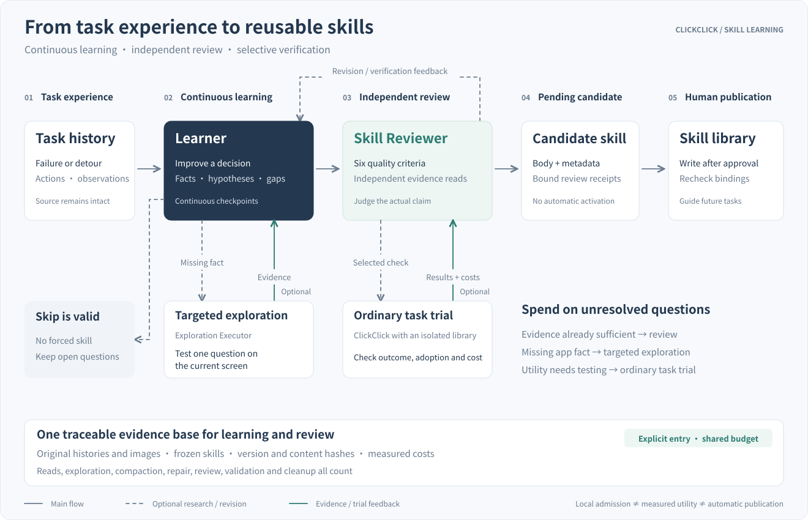

# Skill self-improvement

[README](../README.md) · [中文](skill-evolution.zh-CN.md) · [Architecture](architecture.md) · [Skills guide](../skills/README.md)

**Turn failures and detours from real tasks into guidance for the next run.** ClickClick's Learner analyzes task histories, explores missing app facts when needed, and proposes conditional skill revisions. An independent Skill Reviewer checks their quality and selects necessary trials with ordinary ClickClick execution.

Self-improvement here means updating file-based skill knowledge, not training model weights. **Design and experimental status as of October 8, 2026:** local admission, execution benefits and some reuse have been demonstrated. Learning still requires an explicit research entry point; candidates enter pending review, and automatic publication is not implemented.

## What is learned: a better decision

Useful knowledge changes a future decision: a hidden entry point, a control's scope, a conditional shortcut, an observed pitfall, or information and state that must be preserved. Repeating the clicks from one task is insufficient.

Learning targets two situations:

- **Successful tasks with detours.** Extract the working route from the existing history, checking whether earlier attempts produced state needed later. Omit avoidable actions while retaining saves, identity checks and result verification.
- **Failed tasks.** First retain narrowly supported local knowledge, then explore missing facts. A complete successful route is not required to learn a useful pitfall, but an unknown breakthrough cannot become a verified procedure.

An action is not inherently wasteful. Opening a menu may be a detour for renaming and necessary for another goal. Learner must describe the purpose, observable conditions, changed decision, original cost and replacement overhead, retaining unknown costs. One failure cannot establish a universal ban. Efficient sources, sufficient existing guidance or inadequate evidence may legitimately produce a skip.

## From task experience to a candidate skill

The main flow runs left to right; exploration and trials are optional branches below it. The loops address evidence gaps, and trial results also return to the continuous research conversation. Not every candidate requires device exploration or another task run. After successful checks, a final Reviewer verdict with no remaining checks or revisions lets the host archive actual feedback and finish without an extra closing model request. Failed, incomplete or disputed results still return to analysis.

### Responsibilities

- **Source task records** retain instructions, actions, observations, notes and outcomes. Learning references them without changing the source task or replacing benchmark scores.
- **Learner** analyzes dependencies, failures and detours; chooses propose, explore or skip; tracks facts, hypotheses and unknowns; and writes skill bodies and retrieval metadata.
- **Exploration Executor** reuses observation, action validation and device tools to test a concrete question on the current screen. Historical images are evidence, not coordinates for current actions.
- **Skill Reviewer** uses a separate context and reads original evidence and frozen guidance independently. It checks quality and selects necessary verification. It does not inherit the entire Learner conversation or receive device/publication tools. Its responsibility differs from the Reviewer role in ordinary task execution.
- **The evaluation controller and ordinary ClickClick** run selected checks with isolated skill libraries. The controller coordinates conditions, costs and device lifecycle; AndroidWorld/MobileWorld official initialization and scoring serve their respective experiments. The ordinary executor receives the candidate, not the full research conversation.
- **Pending review and human approval** bind the exact candidate, base version, review and applicable validation. Approval rechecks those bindings; an old receipt cannot authorize a changed body or library.

## Independent review: local facts and task benefit are separate

Skill Reviewer checks six criteria: **root cause, transferability, conflicts, regression risk, concision and marginal value**. It asks whether applicability is detectable before the changed decision, whether existing knowledge already covers it, whether omitted actions create necessary state, and whether the decision value justifies new guidance.

Three conclusions remain distinct:

1. **Local knowledge is supported.** Native observations establish a location, semantic distinction or conditional rule with useful, nonredundant decision value. `source_evidence` admission does not require prior whole-task success, nor establish average savings or complete transfer.
2. **Candidate execution demonstrates task benefit.** Ordinary execution independently assesses outcome, delivery, action adoption and full cost. `measured_utility` claims require the corresponding matched comparisons and coverage; local admission is not a substitute.
3. **The candidate may enter the canonical library.** Applicable evidence, all six review criteria, candidate/base/library/runtime bindings and environment conditions remain valid, followed by current human approval. A passing review is not publication.

Preflight catches concrete conflicts, invalid scope and low-value drafts before expensive execution. Unknown future benefit may proceed to necessary verification but cannot become a fact. Confirmed regression and unresolved environment effects cannot be erased by narrowing the claim.

## Multiple apps and local admission

One learning job can propose several skill files and their dependencies. Knowledge about the second app's own controls belongs to that app; the originating workflow retains the necessary handoff. Prioritize failures, harmful side effects and substantial avoidable work, rather than every harmless detour.

A candidate group uses one frozen joint overlay. Reviewer applies all six criteria per file and records each local effect as supported, contradicted or unassessed. Effect evidence must cite actual actions and observations: body delivery and whole-task success alone do not establish adoption. Necessary checks newly selected in final review also run. Completed checks can be reused under identical body, base-library and runtime bindings, without a default per-file comparison matrix.

A failed task or rejected sibling does not invalidate an independently supported file. Failed dependencies, known regression and unsupported clauses still block affected candidates. A file is the approval unit; one valid rule cannot carry unverified content into the library. Every human approval rechecks the group receipt and accepts only eligible files.

Completed reviews and trials remain accessible through content-hashed references. The current body, claim scope and key outcomes stay in the conversation. Shared rule contracts are delivered once while each file retains its own guidance binding, reducing repeated input without losing continuous research or source access.

## What to verify, and when to rerun

Learner may propose a verification goal. Independent Reviewer selects decision-changing checks already declared by the trusted evaluator. Existing evidence may suffice; one missing fact may warrant a local probe; execution-effect questions may require ordinary task trials.

Verification separates catalog exposure, Planner reading or selection, exact Executor delivery, and actual mechanism adoption. Activation alone does not demonstrate adoption. An executor's completion report does not replace independent outcome checks.

Candidate body, base library, task, model, initialization and runtime contracts bind source and new results. Completed evidence can be reused under exact bindings; a new body cannot inherit an older body's outcomes. Environment failures, unscored executions and unknown costs remain separate from skill scores and zero-cost claims.

Replication has several meanings:

- **Same-goal repetition** checks completion recurrence for an exact body, not transfer to changed inputs.
- **Different-input trials** test the unchanged rule on new task data or conditions.
- **Blank-conversation reacquisition** tests independent extraction from the source, not parameter transfer.

There is no default full comparison matrix. Claims requiring complete utility coverage must still satisfy it; local knowledge does not require endless verification of unclaimed global benefits.

## Continuous analysis and context management

Learner retains research progress within a bound learning job. The current goal, candidate, supported facts, failed attempts, review disputes, unknowns and remaining budget move across phases rather than restarting settled analysis.

Initial input contains necessary task facts, counts and a referenced chronological action directory. Original records, images and complete skill bodies are paged on demand. Capacity-deferred results retain the original call and exact source; undelivered content is not treated as absent. Frozen full-file hashes and role-projection hashes are distinct: a Planner projection is not compared against an Executor hash.

When history exceeds its window, referenced checkpoints preserve dependencies and unresolved questions while originals remain retrievable. Format/reference validation does not prove semantic fidelity. Learning checkpoints differ from ordinary Executor history summaries; see [Memory and context design](memory-and-context.md) for task notes and summaries.

Stable rules and tool contracts are placed before changing phase facts and budgets where possible for prompt caching. Actual cache usage and provider tokens are measured separately. Evidence, current budgets and context limits take priority over cache continuity. No new case index, background memory agent, experience-pruning service or arbitrary hard skill-token quota is introduced.

## Output: conditional guidance and retrieval metadata

Candidates use existing `SKILL.md` conventions in the relevant app core or workflow, in sections such as Procedure, Verification, Pitfalls and Hints. Unrelated valid guidance and necessary checks remain intact. Research costs, disputes and evidence directories stay in analysis records rather than filling runtime skill text.

Supported semantic fields—`description`, `tags`, `triggers`, `app_aliases` and `capability`—may change under the same independent review. Kind-specific constraints still apply: workflows use capability and do not accept triggers. Package names, skill identity, interface scope and action authorization remain protected; learning does not grant arbitrary action or script permissions. See the [Skills guide](../skills/README.md) for formatting and delivery.

Reusable rules refer to purposes and observable mechanisms rather than this task's filename, amount, answer set or historical coordinates. Transfer-shaped wording is not transfer evidence. Rediscovering authored knowledge does not automatically establish incremental value over the complete authored library.

## Examples and evidence boundaries

**Markor: rename from the file list after saving.** Learner extracted a conditional route for a saved note whose remaining goal is renaming, rather than a filename-specific click script. The original candidate saved three actions. With a different filename and content, the unchanged body completed a task the baseline could not finish within the original budget. This supports cross-input reuse, not every version or starting state.

**Mastodon: save inline language checkboxes on their form.** When web Preferences shows inline Filter languages checkboxes and Save changes on the same page, Back is not a way to close the list. Selection and post-save checks remain necessary. The original body succeeded twice; a separately reacquired body also succeeded with observed same-form saving. Benefits for different language sets remain untested, and navigation differences prevent attribution of the entire action gap to this rule.

**Mastodon: posting defaults are not account language.** The source page's scope explanation supports a non-obvious pitfall. A blank-conversation candidate run succeeded, but went directly to the website without encountering that explanation. Mechanism adoption and causal benefit remain unproved, and that successful run cost more than the failed baseline.

**Mastodon: automated deletion exceptions.** The new rule distinguishes the requested exclusive exceptions, clears extra exceptions, inspects settings below the viewport and verifies saved state. The empty-library source failed in 36 actions; a same-goal candidate trial succeeded in 28, with native actions establishing adoption. Not all eight actions saved can be attributed to this rule. This is one same-goal trial, without changed-input stability evidence. The native run produced one Chrome file; automated boundary tests cover multi-file admission, but no native multi-file group success has been demonstrated. See the iteration report (Chinese) (development-repository experiment).

Negatives remain visible: a file task had one failure-to-success result without sufficient admission evidence; Calendar did not recover its goal; an efficient GitHub source correctly skipped learning. Removing these outcomes would misrepresent reliability. See stage acceptance (Chinese) (development-repository experiment) and latest MobileWorld records (Chinese) (development-repository experiment) for data and comparison definitions.

## Costs and device environment

Reads, exploration, compaction, repair, review, validation and environment work share explicit budgets. Provider retries and continuation do not reset them; writing, final review and cleanup retain capacity. Missing child receipts leave unknown costs or reserved upper bounds, not invented paid-call counts. Experimental limits are configurable; production thresholds still need calibration against reuse benefits.

The October 7 blank-conversation jobs, including ordinary trials and environment work, used 31 requests/about 7.9 minutes for account language and 62 requests/about 16.9 minutes for language filtering. Native analysis/review used 10/30 requests and 0/6 compactions respectively, with native cache-read/input around 2–3%. Different task complexity prevents a controlled speed comparison. Some ordinary token usage is unavailable, so these counts cannot establish monetary cost.

Exploration reuses device ownership, cancellation, observation and action boundaries. The evaluation controller invokes official initialization, scoring and cleanup where supported; failed initialization does not refute an app mechanism. Disposable official fixtures may expose scoped reset capabilities that personal devices do not receive. Unresolved effects remain explicit. Actions are not transactional rollbacks, and task initialization does not guarantee identical browser pages or account state.

Ordinary completion records local mechanical clues without automatic learning-model requests or device exploration. Personal optimization and operator research require explicit entry points. Automatic user-history upload and cloud publication are not implemented. See [Learning cost and contribution policy (Chinese)](skill-learning-policy.zh-CN.md).

## Why the approach evolved

The key move from unusable to useful was replacing operation summaries with evidence-supported decision improvements, then reviewing each claim at its actual scope rather than requiring success before learning. Continuous research memory and independent evidence access addressed forgotten phases, missing records and guidance-identity errors.

The move toward better usability is spending only on unresolved questions: trajectory-first analysis, selective validation, exact evidence reuse and closure when successful review has no follow-up. Few-shot examples, schema cleanup, metadata and caching support this approach but cannot replace it. Changes evolved together without individual controlled ablations; no single fix receives credit for all outcomes.

## Current capability and remaining limits

Discoverable GUI mechanisms in this cohort reached a usable experimental stage: autonomous local procedures and pitfalls, independent review, some ordinary task benefits, and limited replication and cross-input evidence. Separate local rules are not complete task-family procedure packages.

Complex cross-app failure exploration, long-run average utility, causal effects across starting states, production cost and statistical reliability remain unresolved. Complete authored skills are a direction, not this phase's mandatory parity threshold. Fixed-test-script generation remains deferred. Automatic publication, continuous pruning and unrestricted autonomous exploration are not implemented capabilities.

## Quantitative follow-up: 2026-10-13

On forty frozen, selected AndroidWorld tasks, an empty library passed 31/40 and the native-generated library passed 33/40: 77.5% to 82.5%, +5 percentage points / +6.45% relative. Four of nine original failures recovered (44.4%); two originally successful tasks failed and remain counted, giving a net gain of two. All nine originally successful tasks with recorded generated-skill activation passed. Activation is not sole-cause proof; these observations do not cover all 116 tasks or estimate stable average rates.

A separate six-task MobileWorld target cohort improved 5/6 to 6/6: 83.3% to 100%, +20% relative, with one failure recovery and all five normal tasks passing. It is small and uses a different model from AndroidWorld; do not pool the environments or generalize to all 117 tasks. Normal actions increased from 122 to 126 and requests from 167 to 179, so there is no aggregate speedup evidence.

The AndroidWorld target of a 15% relative lift was missed. Ordinary prompts, harness and official budgets were frozen; Jev/video were disabled and skills were not published. Starting-state unknowns/differences and unscored failures remain explicit. AndroidWorld's 29 pairs that succeeded in both runs used 391 versus 377 actions but 583 versus 591 requests; not all action differences can be attributed to generated knowledge. See the phase acceptance and limitations (Chinese) (development-repository experiment) and per-task evidence (development-repository experiment).

## Common-library follow-up and cost fixes: 2026-10-15

The same selected 40 tasks now have a complete fresh empty/generated-library comparison: official success 29/40→36/40 (72.5%→90%), +17.5 percentage points / +24.1% relative; seven of eleven failures recovered and no original successes failed. Six recoveries have inspected guidance delivery and mechanism adoption. BrowserDraw received no generated body, so its recovery remains separate. Completed-within-budget 27/40→35/40 stays secondary. The earlier 31→33 result is preserved, without mixing its baseline into the new rate. The latest report (development-repository experiment) includes all 40 rows, five exact generated documents, new independent reviews and hashes. This is a selected historical authored-success pool with training overlap, not the full 116 tasks, forty unseen tasks or a stable causal effect. Extra measured initial-state coverage matches 26/40; fourteen remain unknown.

Continuous exploration is connected to the dedicated disposable-fixture entry. The Expense comparison reduced adapter attempts from eight to two, but an extra probe and nine GUI actions increased native calls from 65 to 78 and metered time from 1052 to 1368 seconds. Fewer initializations do not imply lower total cost. Demonstrated duplication prompted source-bound analysis updates, grounded summary/claim batching before one action, direct handoff to mandatory host cleanup, corrected native remaining time and read-only export of already paid scores. Three new targets used 228 learning/source-validation requests and about 43 recorded job minutes: two recovered, one retained independently supported local knowledge without whole-task recovery. Controls, guards, cohort evaluation and historical discovery are additional. Two fixed-context comparisons did not establish stable cost reduction. Ordinary prompts, harness and task limits remain frozen; no case index or automatic publication was added. The cost/evidence record (development-repository experiment) retains faults and unknowns.

## Current loop and full cold-start costs: 2026-10-15

Failure research tracks local admission and source-task completion separately. A local pass does not end an unresolved task-success objective. Learner keeps accepted rules, carries the same conversation and original budget forward, and investigates a distinct remaining blocker after failed ordinary trials. Only an ordinary run bound to the exact candidate, base library, environment and independent oracle can close the task objective. An explicit skip or exhausted budget preserves the unresolved outcome.

In a declared disposable research environment, continuous probes may reuse audited device state. Source changes, pending effects and cleanup boundaries still require fresh verification. Independent cleanup must pass before candidate adjudication, ordinary validation or exit. Reviewer diagnoses distinguish delivery, adoption, ineffective rules, other blockers and environment faults. Learner compares mechanisms and complete route costs. Localized edits bind the exact base text; the host resolves unique anchors and materializes the full file before review. These changes are confined to self-learning; ordinary prompts and harness are unchanged.

An integration fix also removes premature rejection at the legacy small-window boundary. Fallback fitting uses the metadata reserve already enforced by adaptive native pages, while the complete serialized exchange remains within the original input limit. Required candidates, blocking review reasons and task facts remain intact. This fix has offline regression evidence only and does not rewrite the frozen experiment below.

The fresh pass screened 40 existing empty-library traces: 25 skipped before model work, two lacked initializer-state coverage, and 13 targets learned independently from an empty library. Learning, exploration, review, cleanup and ordinary validation used 726 requests and 163.97 recorded job minutes. Additional empty-library controls used 33 requests, giving 759 new requests in total. Paid-target means were 55.85 requests and 12.61 minutes, with a 12.27-minute median and 20.62-minute P90. The nine official-failure targets averaged 15.92 minutes; two successful-trajectory extractions averaged 1.80 minutes. Unrecovered targets remain included. This is neither all historical R&D cost nor steady-state incremental learning cost.

Six of nine measurable failure targets had an oracle-passing source trial; five also completed within budget. One of those five needed controller-initiated review-only recovery after a provider fault, leaving four of nine complete native automatic loops. One additional target that already passed the oracle recovered runtime completion. Twelve targets received native local admission and one passed review-only fault recovery; thirteen documents must not be advertised as thirteen proven high-value skills.

On the same nine tasks, the prior accumulated library and this fresh pass both had six oracle successes; complete execution changed from six to five. Audio naming and note merging did not recover this time. One recipe-deduplication task newly completed; another passed only the oracle. Different protocols prevent a code-regression conclusion, but this pass did not fully reproduce the existing library's results. The new candidates have not been composed into a common library or subjected to a normal-task regression matrix, so they do not establish a new 40-task or full-116 score.

Thirteen Learner conversations recorded one compaction, with history_tokens=80,000 and max_input_tokens=100,000. Returned usage totals include 15,537,353 input tokens and 1,458,304 cached-read tokens; usage for 220 calls and monetary cost remain unknown. Missing usage is not zero cost. The [public per-task summary](assets/skill-learning-results-20261015.json) contains no credentials, screenshots or machine-local paths; full native receipts and experimental skills remain in the development repository's OpenSpec records.

## Implementation entry points

The 2026-10-14 four-hour pressure check did not establish stable additional task recovery. Expense produced independently supported detail/removal/backup distinctions and continued after local admission, but its matched source still failed. Native Audio counterevidence exposed a doubled app-reported suffix after the earlier body had passed two task instances; the revised body passed local review but failed its matched source. Old-body successes cannot qualify the repair. Native-only input/transport/evidence fixes passed their related checks; they are not additional success-rate results. The full acceptance record (development-repository experiment) retains negative outcomes, costs and an unscored normal guard interrupted by a Windows crash in `nvoglv64.dll`.

The 2026-10-14 refinement adds evidence-linked Reviewer diagnoses, explicit selection among distinct source-local recovery mechanisms with actual probe outcome/cost feedback, and exact-base localized edits materialized into complete files before independent review. Existing drafts and grouped proposals are supported. The same two roles, shared budgets, ordinary actor and admission/publication gates remain; no mandatory trial matrix or case index was added. Schema labels and repeated learning instructions were compacted within existing context limits. Framework checks do not establish additional native task gains; the quantitative results above remain unchanged.

- [learning.py](../agent/skills/learning.py): diagnosis, candidate contracts, independent review and learning cycle.
- [analysis_session.py](../agent/skills/analysis_session.py): continuous conversation, checkpoints and feedback archives.
- [task_goal.py](../agent/skills/task_goal.py): source-task completion, retained local candidates and exact-validation closure.
- [exploration.py](../agent/skills/exploration.py), [research_tools.py](../agent/skills/research_tools.py): evidence reading, execution and environment integration.
- [admission.py](../agent/skills/admission.py), [verification.py](../agent/skills/verification.py): claim-scoped admission and isolated validation.
- [candidate_group.py](../agent/skills/candidate_group.py): multi-file ownership, dependencies, joint validation and local admission.
- [diagnosis.py](../agent/skills/diagnosis.py), [strategy.py](../agent/skills/strategy.py), [skill_edits.py](../agent/skills/skill_edits.py): deployment diagnosis, strategy comparison records and exact-base edits.
- [pending.py](../agent/skills/pending.py): pending artifacts and approval-time binding checks.
- OpenSpec design and evolution (development-repository experiment): historical decisions and experimental boundaries.
