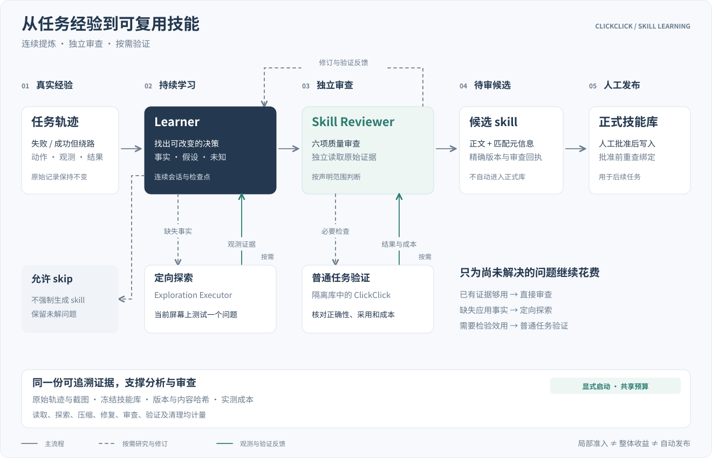

# Skills 自进化

[首页](../README.zh-CN.md) · [English](skill-evolution.md) · [系统架构](architecture.zh-CN.md) · [Skills 指南](../skills/README.zh-CN.md)

**把真实任务中的失败和绕路，转成下一次可用的操作知识。** ClickClick 的学习器分析任务轨迹，必要时探索应用，生成条件明确的 skill 修订，由独立 Skill Reviewer 审查，并按需要交给普通 ClickClick 验证。

这里的“自进化”是更新文件中的技能知识，不是训练模型权重。设计与实测状态截至 **2026-10-15**：已有局部知识准入、执行收益和部分复用证据；学习仍需显式研究入口，候选进入 pending，当前没有自动发布闭环。

## 学什么：改变下一次决策

值得学习的不是这次点了哪些按钮，而是哪些应用机制能改变下一次决策：隐藏入口、控件作用域、条件化捷径、已证实的避坑点，以及必须保留的信息或状态。

学习主要来自两种场景：

- **任务成功但绕路。** 从真实成功轨迹找出正确路径，分析之前的尝试是否产生后续需要的状态；只省去不必要的操作，保留保存、身份确认和结果核验。
- **任务失败。** 先提炼已有证据明确支持的局部知识，再针对缺失事实探索。没找到完整成功路线，不妨碍保存一个有价值且成立的窄规则；未知突破口不能写成已验证流程。

动作本身不天然是绕路。打开菜单在重命名任务里可能浪费时间，在其他任务里可能必不可少。Learner 需要说明目的、可观察条件、待改变的决策、原开销和替代开销；不能从一次失败推导出“永远不要用这个入口”。高效完成、已有指南足够或缺乏可靠证据时，允许直接 skip。

## 从任务经验到候选 skill

主流程从左到右，探索与验证位于下方的按需支路。图中的回路按证据缺口选择，不要求每个候选都探索设备或复跑任务；验证结果同时回到连续研究会话。成功验证后，最终 Reviewer 明确没有后续检查或修订要求时，系统归档真实反馈并结束当前周期，不再追加一个收尾模型请求。未完成、失败或有争议的结果仍回传分析。

### 模块分工

- **原任务记录**保留指令、动作、观测、笔记与结果。学习使用其来源引用，不篡改原任务或覆盖评测成绩。
- **Learner**分析必要路径、失败尝试和绕路，选择 propose、explore 或 skip，维护当前知识、假设及未知，生成正文和匹配元信息。
- **探索 Executor**复用已有观察、动作校验与设备工具，在当前屏幕上测试一个具体问题。历史截图是证据，不是当前动作坐标的依据。
- **Skill Reviewer**使用独立上下文，按需读取原始证据及冻结指南，审查规则质量并选择必要验证。它不继承 Learner 的整段对话，也没有设备操作或发布权限；它与普通任务执行中的 Reviewer 角色职责不同。
- **评测控制器与普通 ClickClick**在隔离技能库中执行所选检查。控制器协调条件、成本和设备生命周期；AndroidWorld/MobileWorld 的官方初始化与评分用于相应实验。普通执行器使用候选完成原任务，不接收 Learner 的整段研究对话。
- **pending 与人工批准**保存精确候选、基础版本、审查和相应验证记录。批准前重查绑定，旧回执不能授权一个已改变的正文或库。

## 独立审查：局部事实与整任务收益分开

Skill Reviewer 检查六项：**根因、迁移性、冲突、退化风险、简洁性、边际价值**。它要检查规则能否在改变决策之前识别适用条件，是否与已有知识重复，是否省掉了有用状态，以及预期收益是否值得新增指导。

三个结论分别记录：

1. **局部知识成立。** 原始观测支持某个入口、语义区别或条件规则，且它有非重复的决策价值。可走 `source_evidence` 准入，不要求先证明整任务成功；这不证明平均节省或完整迁移。
2. **候选执行取得任务收益。** 普通执行独立检查结果、实际加载、动作采用和完整成本。`measured_utility` 声明需满足相应匹配对照与覆盖要求，不能靠局部准入替代。
3. **有资格写入正式库。** 相应证据、六项审查、候选/基础库/运行合同绑定及环境要求仍有效，并经过当前人工批准。通过审查不意味着已经发布。

预审先发现具体冲突、错误范围和低价值内容，避免为明显不合格的草稿花费完整执行成本。未知的未来收益可进入必要验证，但不能被写成事实。已经观察到的退化或未解决环境影响也不能靠缩小声明抹掉。

## 多应用候选与局部验收

同一学习作业可提出多个 skill 文件及其依赖关系。第二个应用自身的控件或功能知识归属于该应用；发起应用的 workflow 只保留必要的跨应用交接。优先修复失败、明显副作用和显著操作开销，不要求消除每次无关紧要的绕路。

候选组放入一个冻结的联合 overlay，Reviewer 逐文件审查六项标准，并分别记录局部效果为 supported、contradicted 或 unassessed。效果证据必须指向实际动作和观测，不能仅以加载正文或整任务成功作为采用证明。最终审查新增的必要检查也会执行；完全相同的正文、基础库与运行合同下，已完成检查可复用，不默认逐文件铺开对照矩阵。

整任务失败或一个文件不合格，不否定另一个已独立证明有效的文件。依赖未通过、已知退化和文件中未证实的其他规则仍会阻断受影响候选；文件是批准单位，不能借其中一条有效规则夹带其他内容。候选组的绑定回执在每次人工批准时重新核对，只批准条件满足的文件。

已完成候选的完整评审与验证记录通过带 hash 的来源入口按需读取，当前正文、声明范围和关键结果继续保留在会话中；共享规则合同只传一次，各文件的指南身份仍独立绑定。这减少重复输入，同时保留连续研究和回查能力。

## 验证什么，什么时候复跑

Learner 可以提出验证目标，独立 Reviewer 从可信评测器已声明的检查中选择能改变判断的部分。已有原始证据足够时不运行新任务；缺失一个事实时可先做局部探索；需要检验执行效果时再跑普通任务。

普通验证需要分清：候选被列入目录、Planner 读取或选择、Executor 收到精确正文、实际动作采用规则。只有加载记录，不能证明机制采用；只有执行器的完成报告，不能替代独立结果检查。

来源和新结果通过候选正文、基础库、任务、模型、初始化和运行合同绑定。绑定一致且已完成的结果可复用；新正文不能继承旧正文成绩。环境故障、未评分执行和未知成本单独保留，不记成 skill 失败、成功或零成本。

复现证据也有不同含义：

- **同目标重跑**检验指定正文在相同目标下的完成复现，不证明换输入迁移。
- **不同输入验证**检验原样规则能否用于新的任务数据或条件。
- **空白会话重学**检验能否从原来源独立提炼相近知识，不替代迁移验证。

默认不铺开完整对照矩阵。若声明要求完整效用覆盖，相应检查仍必须完成；局部知识不因缺少未声明的全局收益证明而被无限验证。

## 连续分析与上下文管理

Learner 在同一学习作业内持续积累研究进度。当前目标、候选、已验证事实、失败尝试、审查争议、未知和剩余预算随阶段传递，避免换阶段就重新分析已经解决的问题。

初始输入提供必要的任务信息、计数和带引用的动作顺序目录。原始记录、截图和完整 skill 正文按需分页读取；结果因容量延期时，保留原调用与精确来源，不能把未交付内容当成不存在。冻结指南的完整文件 hash 与角色正文 hash 分开，Planner 的投影不拿 Executor 的 hash 判断。

历史超限时生成带来源的检查点，保留必要依赖与未解问题，原始记录仍可回查。格式和引用校验不证明摘要语义一定正确。学习检查点也不同于普通 Executor 的执行历史摘要；普通任务的笔记和摘要机制见[记忆与上下文详设](memory-and-context.zh-CN.md)。

固定规则和工具合同尽量位于稳定前缀，变化的阶段事实和预算放在后部，以利用 prompt cache。实际命中和提供方用量单独计量，不为缓存舍弃必要证据或沿用旧预算。这里没有新增案例索引、背景记忆 Agent、经验淘汰服务或任意 skill token 硬配额。

## 输出：条件化知识与检索元信息

候选按现有 `SKILL.md` 格式写入相应 app core 或 workflow，落在 Procedure、Verification、Pitfalls、Hints 等适合的段落。保留无关有效知识和必要核验；研究开销、争议与证据目录保存在分析记录，不全部塞入运行时技能。

受支持的语义匹配字段 `description`、`tags`、`triggers`、`app_aliases`、`capability` 可与正文一起接受审查。各 skill 类型的格式限制仍有效，例如 workflow 使用 capability、不接受 triggers。包名、技能身份、界面作用域和执行授权等确定性字段受保护，不因学习打开任意动作或脚本权限。文件格式与交付机制见[Skills 指南](../skills/README.zh-CN.md)。

一条可复用规则应围绕目的和可观察机制表达，避免固化本次文件名、金额、答案组合或历史坐标。但写得可迁移不等于已经验证迁移；自主重新发现人工规则也不自动证明相对完整人工库有新增价值。

## 实际例子与证据边界

**Markor：已保存笔记后从文件列表重命名。** Learner 提炼的是“保存完成且剩余目标是重命名时，回列表长按 Rename”，不是固定文件名的点击脚本。原任务候选省 3 动作；更换文件名和内容后，同一正文在原预算内完成了基线未完成的任务。这提供跨输入复用证据，不覆盖所有版本和起点。

**Mastodon：内联语言复选框在同页保存。** 条件是 web Preferences 中 Filter languages 为内联列表且 Save changes 同页；不能把 Back 当成关闭选择器，仍须核对勾选和保存后状态。原候选两次普通任务成功，另一份从空白会话重学的正文也成功并确认同页保存采用。尚未验证换语言组合的收益；不同导航路线也使全部步数差无法归因于这条规则。

**Mastodon：发帖默认语言不等于账户语言。** 源页面解释了 Posting defaults 的作用域，支持一个非显然避坑点。空白重学候选运行成功，但直接走网页、未触发该解释页面，因此此次机制采用和成功归因仍未证实；这次成功也比失败基线更贵。

**Mastodon：自动删帖的例外条件。** 新候选按任务要求区分“只保留”的例外，清除多余例外，滚动检查下方设置并确认保存后的状态。空库来源 36 动作失败，同一目标的候选复跑 28 动作成功，原生动作证实规则被采用。全部 8 步差异不能归因于该规则；这仍是单次同目标验证，未证明跨数据稳定性。本轮原生试验产出一个 Chrome 文件，多应用候选组与局部验收机制另有自动化边界测试，尚无原生多文件组成功案例。完整数据见本轮记录（开发仓库实验记录）。

反例同样保留：文件任务有一次失败转成功但证据不足以准入，Calendar 未恢复目标，高效的 GitHub 来源正确 skip。不能删去这些结果再报告整体成功率。数据与比较口径见阶段验收（开发仓库实验记录）和最新 MobileWorld 记录（开发仓库实验记录）。

## 成本与设备环境

读取、探索、压缩、修复、审查、验证与环境工作共享显式预算。provider 重试和续跑不重置额度；保留写作、最终审查与清理容量。缺少子任务实际回执时明确记录未知或预留上界，不能当作真实已付调用数。实验预算可配置，生产阈值仍需用复用收益校准。

10 月 7 日的两次空白重学含普通复跑和环境工作：账户语言 31 次请求、约 7.9 分钟；语言过滤 62 次请求、约 16.9 分钟。其中 native 分析与审查分别为 10/30 次，压缩 0/6 次，两轮 native cache-read/input 约 2–3%。任务复杂度不同，这不是受控速度对比；部分普通 token 用量未知，不能据此推算货币费用。

设备探索复用已有互斥、取消、观察和动作边界。评测控制器调用相应官方环境初始化、评分和清理；初始化失败不是应用机制的反证。实验中的可抛弃官方 fixture 可使用受限复位能力，个人设备不获得同样的重置权限。未解决副作用保持显式，不能假定动作可事务回滚，也不能把任务初始化等同于全部浏览器页面和账号状态相同。

普通任务结束只记录本地机械线索，不自动调用学习模型或操作设备。个人优化与运维实验通过显式入口启动；当前没有用户轨迹自动上传或云端自动发布服务。个人成本与贡献协议见[学习成本与贡献边界](skill-learning-policy.zh-CN.md)。

## 方案为何这样演进

从不能用到能用，关键是将事后操作总结改成有证据的决策改进，并按局部声明审查，解除“先成功才能学习”的循环前提。连续研究记忆和双方独立查证解决了阶段遗忘、缺失证据与指南身份不一致的问题。

从能用到更好用，关键是只为尚未解决的问题继续花费：优先轨迹、选择必要验证、复用精确旧结果、结束无后续的成功周期。few-shot、schema 精简、匹配元信息和缓存是辅助措施，不能代替学习目标与证据闭环。多个改动共同演进，未做逐项受控消融，不把所有效果归给某一项修复。

## 当前能力与后续边界

本批可从 GUI 发现的机制已达到阶段可用：能自主提炼局部流程和避坑，独立审查，取得部分普通任务收益，并有有限复现及跨输入证据。不同类型的局部知识不是完整任务族流程包。

复杂跨应用失败探索、长期平均收益、跨起点因果性、生产成本及统计可靠率仍未解决。人工 skills 的完整覆盖作为方向，不是本阶段必须追平的下限。固定测试脚本生成仍搁置；自动发布、持续淘汰和全量自主探索不属于当前已实现能力。

## 2026-10-13 量化复验

在冻结的40个筛选 AndroidWorld 任务上，空库官方成功31/40，使用原生生成库后33/40：77.5%→82.5%，增加5个百分点、相对提升6.45%。9个原失败任务恢复4个（44.4%），同时保留2个正常任务失败，净增2个成功；不是全量116题或稳定平均收益。9个原成功且实际激活生成skill的正常任务均通过，但激活不等于因果证明，其他失败仍计入分母。

独立的6题 MobileWorld 目标集为5/6→6/6，83.3%→100%，相对提升20%，恢复1个失败、5个原成功均通过。样本小且与 AndroidWorld 使用不同模型，不能合并或代表全量117题。正常任务动作122→126、请求167→179，没有整体提速证据。

本轮没有达到 AndroidWorld 相对提升15%的目标。两轮保留原普通提示词、harness及官方预算，Jev关闭、不录视频、不发布skills；初始化快照的未知/差异及未计分故障不隐藏。AndroidWorld 的29个前后成功任务动作391→377，请求583→591；不能把全部动作差异归因于生成知识。完整口径与阶段验收（开发仓库实验记录）及逐题数据（开发仓库实验记录）可供复核。

## 2026-10-15 共同库复验与开销修复

同一组选定40题的新空库／共同生成库配对已结清：官方成功29/40→36/40（72.5%→90%），增加17.5个百分点、相对提升24.1%；11个失败恢复7个，原成功转失败0个。六个恢复有具体规则输入与关键操作采用证据，BrowserDraw没有收到生成正文，其恢复单列。完整预算内正常完成为27/40→35/40，保持次要指标；前面的31→33旧成绩不改写，也不混用旧基线。五份生成正文、新独立审查、全40行结果及hash见最新量化报告（开发仓库实验记录）。这是有历史人工成功记录的筛选集合、含训练重叠的学习后复跑，不是全116题、40题未见泛化或稳定因果提升。额外已测初态匹配26/40，14项覆盖未知。

连续探索已接入专用可处置fixture入口。Expense对照中adapter尝试2/8，但多一探针及9次GUI操作使调用78/65、原生时间1368/1052秒；减少初始化不等于总学习更省。针对已观察开销增加同来源分析增量、摘要／claim与单动作交接、候选直接交接宿主强制清理，并修正原生剩余时间及已付费评分只读导出。新增三题学习及源验证共228请求、约43分钟，两个恢复、一个保留有效局部知识但整题未恢复；基线、保护、整批评测和历史发现费用另计。两次固定上下文的比较没有证明稳定降耗。普通提示词、harness及各题上限保持冻结；没有新增案例索引或自动发布。开销诊断与完整账本（开发仓库实验记录）保留全部故障和未知项。

## 2026-10-15 当前闭环与完整冷启动成本

失败研究同时维护两个结论：局部规则是否成立，以及来源任务是否真正完成。局部接纳后，若精确候选的来源复验仍失败，Learner继续沿用同一研究会话和原预算，保留已通过的规则，分析新的阻塞；不会因为一次局部pass直接结束。只有匹配正文、基础库、环境及独立评分的普通执行，才能关闭任务成功目标。无值得继续的可行检查或预算不足时明确退出，保留未恢复状态。

在声明为可处置的专用环境中，连续探针可复用已核对的设备状态；来源改变、待恢复影响或清理边界仍强制重新核验。候选只在独立清理通过后进入审查、普通复验或退出。Reviewer的失败归因区分未送达、未采用、规则无效、其他阻塞和环境故障；Learner比较不同机制及完整执行成本。局部编辑绑定精确基础正文，宿主唯一定位并物化完整文件后审核。上述能力仅属于自学习，普通执行提示词与harness不变。

合入前另修复兼容小窗口的过早拒绝：必需的候选、审查意见和任务事实能放入原请求上限时，回退分配复用自适应历史分页的元数据预留，并继续核验完整序列化交换。未扩大输入上限或删除必要证据。此项修复只有离线回归证据，不改写下面冻结实验的数据。

本次固定40份既有空库轨迹：25份在模型调用前跳过，2份初态覆盖不足，13个目标独立从空库重新学习。学习、探索、审查、清理和普通复验共726次调用、163.97分钟；另有空库控制33次调用，总计759次。每个付费目标平均55.85次调用、12.61分钟，中位12.27分钟、P90为20.62分钟。9个官方失败目标平均15.92分钟，2个成功轨迹提炼目标平均1.80分钟；这是包含未恢复目标的整批成本，不是历史全部研发费用或同一应用持续积累后的稳态成本。

9个可测失败目标有6个源试验官方评分通过，其中5个同时在预算内完整完成；5个中1个在供应商故障后由控制器发起仅审查续接，因此完整原生自动闭环为4/9。另有1个原已官方成功、但运行时未完整结束的目标得到修复。12个目标局部接纳，另1个经故障续接审查；不能把13份正文都计为已证实高价值skill。

对齐同样9题，上轮积累库与本轮冷启动的官方成功均为6/9，完整完成由6/9变为5/9。录音命名、合并笔记本轮未恢复；新增一个菜谱去重完整恢复，另一个仅官方评分通过。两轮协议不同，不能据此认定代码退化；本轮也未完整复现已有库效果。新候选尚未组合为共同库或完成正常任务回归矩阵，因此不生成新的40题或全116题成功率。

本轮观察到13个Learner会话、1次压缩；配置为history_tokens=80,000、max_input_tokens=100,000。已返回usage的输入小计15,537,353token，缓存读取1,458,304；220个调用usage未知，金额未知。缺失usage保持未知，不作为零成本。以上[公开逐题汇总](assets/skill-learning-results-20261015.json)不含凭据、设备画面或本机文件路径；完整原生回执和实验skills保存在开发仓库的OpenSpec实验记录中。

## 实现入口

2026-10-14 四小时压力验证没有补出稳定任务恢复的新证据。费用规则能提炼详情读取和误触删除确认等局部知识，并在接纳后继续探索，但源任务仍失败；录音旧正文虽有源与换名成功，后续原生取证发现app报告的双后缀问题，修订正文局部通过但源复验失败。不能用旧成功为修订版背书。该轮修复了学习格式、预算内传输重试、原生证据衔接及旧输入投影限制；离线通过不代表成功率提升。完整验收记录（开发仓库实验记录）保留反证、环境中断、未恢复目标与成本。

2026-10-14 的实现增强了三个环节：Reviewer 用原生证据区分未送达、未采用、规则无效与后续障碍；Learner 在已有恢复选项中比较不同机制并记录选择、实际探测结果和成本；已有文件及当前隔离草稿支持绑定精确基础版本的局部编辑，由宿主生成完整正文再审核。仍使用同一 Learner＋Reviewer 和共享预算，没有必跑矩阵，也没有新增案例索引或自动发布。候选/说明去重精简以保持原上下文上限。框架测试不代表新增成功率收益，前述量化结果保持原口径。

- [learning.py](../agent/skills/learning.py)：诊断、候选格式、独立审查与学习闭环。
- [analysis_session.py](../agent/skills/analysis_session.py)：连续会话、检查点和反馈归档。
- [task_goal.py](../agent/skills/task_goal.py)：来源任务成功目标、局部候选保留和精确复验关闭条件。
- [exploration.py](../agent/skills/exploration.py)、[research_tools.py](../agent/skills/research_tools.py)：证据读取、探索执行与环境衔接。
- [admission.py](../agent/skills/admission.py)、[verification.py](../agent/skills/verification.py)：声明范围准入与隔离验证。
- [candidate_group.py](../agent/skills/candidate_group.py)：多文件归属、依赖、联合验证和局部准入。
- [diagnosis.py](../agent/skills/diagnosis.py)、[strategy.py](../agent/skills/strategy.py)、[skill_edits.py](../agent/skills/skill_edits.py)：复验归因、策略比较记录及精确基础局部修改。
- [pending.py](../agent/skills/pending.py)：待审产物与批准前的绑定检查。
- OpenSpec 设计与演进记录（开发仓库实验记录）：完整历史决策和实验边界。
