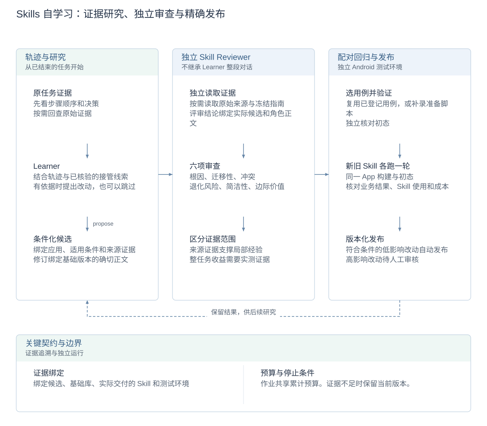
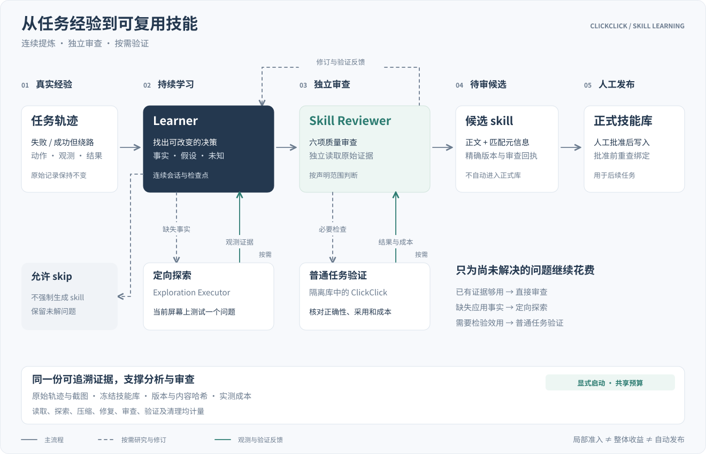

# Skills 自进化

[首页](../README.zh-CN.md) · [English](skill-evolution.md) · [系统架构](architecture.zh-CN.md) · [Skills 指南](../skills/README.zh-CN.md) · [GUI 脚本详设](gui-script-design.zh-CN.md)

**把真实任务中的失败和绕路，转成下一次可用的操作知识。** Learner 提出 `SKILL.md` 文件变更，独立的 Skill Reviewer 审查证据，发布环节依据检查结果决定这份候选能否写入正式库。

从任务详情点 **Skills 自学习**，可以把一项经审查的 Android App 技能改动推进到用例准备、配对回归和发布。启用 App 构建版本审查后，同一个 Learner 也可维护已有技能。普通任务结束时可记录本地线索，该步骤无需模型调用或设备操作。版本审查默认关闭，测试设备操作需显式授权。

## 从任务详情到发布

打开已结束的任务，确认模型预算和本次操作测试设备的授权，再点击 **Skills 自学习**。服务端通过 `CLICKCLICK_SKILL_LOOP_FIXTURE_JSON` 配置专用 Android 模拟器的 `serial`、`avd`、`snapshot` 和独立本机 `adb_port`，可选填 `model` 指定评测模型。测试 App 需预装在环境中。作业核对模拟器身份和快照，排除普通任务能使用的设备。原任务保持只读。

1. **按来源查证学习。** 作业冻结当前技能库，对原任务记录运行同一套 Learner 和 Reviewer。首轮给出任务目标、结果、计数、已交付 Skill 身份、机械线索和带来源引用的按序动作目录。Learner 针对待判断的问题分页回查原始动作、回执、观测、截图或完整 Skill 正文。这一阶段的设备动作额度为零。
2. **选择一项已审查的候选。** Console 配对回归接收一项有明确 App 作用域的新增或修订。同时出现多个可选候选时，自动作业记录歧义并停止。手动 `skill-loop` 计划可指定精确目标。配对回归对整文件删除和多文件候选组报告不支持，共享 Learner 有独立的人工审查路径处理它们。
3. **复用用例，缺少时补录初态。** 用例按技能路径、App 包名、构建版本和用例键标识。Learner 结合候选差异和已观察到的前后状态，优先选择能覆盖改动分支的登记用例。缺用例时，从已观测事实提出受限的准备目标、分支前后条件、独立结果和保护条件。普通 ClickClick 开启录制后只执行初态准备。随后重置环境，[GUI 准备脚本](gui-script-design.zh-CN.md) 必须无接管回放成功，核对初态并确认最终目标尚未完成，才可登记。开发者提供的现成用例也需通过回放验证。登记用例的验证证明若对应其他 AVD 或快照，则在当前环境重新核验。
4. **从同一用例出发，分别执行旧版和候选。** 两组各自恢复同一快照，重放同一初态脚本，核对初态和运行配置。两组使用相同 App 构建版本、目标、模型、参数和执行限额。旧组使用冻结时的正式库，原文件存在时包含原版本。候选组仅用精确新文件覆盖该位置。正式任务交由普通 ClickClick 执行，独立检查结果、改动分支和保护条件。评测还从实际请求记录核对两组收到的 Skill 版本与角色正文。登记回答“能否反复准备同一起点”，配对回归回答“从这个起点采用哪个 Skill，结果如何”。
5. **保护已登记的行为。** 自动作业纳入同一 Skill、App 和构建版本下其他不同的已登记用例。历史成功路径要保住结果和保护条件，可以经新的路线达成。原本不满足改动条件的用例仍须避开该分支。显式计划还可指定变体、近邻反例和相关正常用例。控制器先为两组初态回放及任务执行留出动作额度。覆盖缺失、初态不匹配、保护条件失败或无法确认清理，均会使回归无法通过。
6. **发布精确受检的正文。** 配对回归通过后，Skill Reviewer 依据实际观测和结果判断影响。低影响限于 App 内部工作流的窄改动，需要有可观察的适用条件、改动分支和行为保全证据。修订已有 Skill 还需更新版本号，并保留原有适用范围元数据。涉及共享作用域、权限、账号状态、分享、支付或破坏性行为的改动属于高影响，通过检查后进入人工待审批。影响证据不足则阻止发布。写入前会重查正式库、基础版本、候选正文和证据绑定。配对修订保留上一版，并记录批准方式。

自动用例规划从记录的 UI 树和与之关联的原生动作中核对无歧义的语义条件。回放脚本也支持视觉步骤。如果用例条件只能从图像确认，可以手工编写显式计划，再交给评测器核验。自动规划缺少足以落地的用例证据时，会保留缺口。

Console 显示学习、规划、补录、回放、回归和发布进度，**停止本次学习**只取消学习作业。测试环境缺失、预算用尽、回归失败或正式库已变化时，活动版本保持原样。设备状态不确定时，评测器记录需核对设备状态并隔离测试环境。运行报告保存在数据目录的 `skill-loop/runs/`，已验证用例保存在 `skill-loop/cases/`。可审批的候选可在 Skills 的待审批列表查看。

模型请求、设备动作和总时限在各阶段共用，涵盖准备、配对执行和影响审查。默认上限是 24 次模型请求、30 次动作和 900 秒。剩余额度不足以覆盖待验证用例时，作业可以提前结束。详见[学习成本与贡献边界](skill-learning-policy.zh-CN.md)。

## App 构建版本变更后的 Skills 维护

开启本地记录并设置 `CLICKCLICK_SKILL_VERSION_AUDIT_ENABLED=true` 后，系统记录 App 在前台且工作流 Skill 实际已交付给 Executor 时的 Android 构建版本。首次观测用来建立基准。之后的任务结束时，同一次审查作业最多覆盖三条构建版本有变化且具备成对原生动作证据的工作流。审查按 App、Skill 版本和实际交付正文绑定。按时序列出的动作链接到当时接受的动作前观测、已派发动作及同 App 的动作后观测。Learner 在请求与时间预算内按需查看这些记录和可用截图，设备动作额度为零。

版本号变化用于发起研判。提出新增或修订前，Learner 仍需找到实际冲突、替代路径或可复用规则的证据。未走到的路径继续沿用旧指导，一条任务不足以确认其他条款、工作流或构建版本的兼容性。证据缺口保留为未评估，任务的 Skill 关联页显示审查状态和待审批候选。后台建议仍需人工批准。需探索测试设备或执行配对验证时，可显式启动 Console 学习闭环。

整文件删除需要独立证据覆盖整个 Skill，包括失去的指导、依赖和检索覆盖。人工批准时会检查精确基础版本，并归档删除的文件。只有一条路径冲突时，应修订该路径的适用条件。

## 从脚本接管中学习

[GUI 脚本自愈](gui-script-design.zh-CN.md)观察到可复用替代路径时，可保存一条假设，并绑定已核验的接管回放、原任务、App 构建版本以及动作前后观测。后续显式 Skills 学习可按这些引用查看独立的回放轨迹，并用匹配构建版本的已核验证据规划用例。定位器调整或关闭临时弹窗可以解决一次回放问题，通常不足以提炼复用规则。回放衍生规则也经过相同的候选审查、独立回归和发布检查。

## 设计图解

<!-- design-diagram:skill-learning-mechanisms -->

设计图串起任务证据、独立审查、初态核验和配对回归。局部知识成立、任务收益和正式发布分别判断。

[Mermaid 源码](diagrams/design-skill-learning-mechanisms.zh-CN.mmd)

<!-- /design-diagram:skill-learning-mechanisms -->

## 学什么：改变下一次决策

值得学习的不是这次点了哪些按钮，而是哪些应用机制能改变下一次决策：隐藏入口、控件作用域、条件化捷径、已证实的避坑点，以及必须保留的信息或状态。

学习主要来自两种场景：

- **任务成功但绕路。** 从真实成功轨迹找出正确路径，分析之前的尝试是否产生后续需要的状态；只省去不必要的操作，保留保存、身份确认和结果核验。
- **任务失败。** 先提炼已有证据明确支持的局部知识，再针对缺失事实探索。没找到完整成功路线，不妨碍保存一个有价值且成立的窄规则；未知突破口不能写成已验证流程。

动作本身不天然是绕路。打开菜单在重命名任务里可能浪费时间，在其他任务里可能必不可少。Learner 需要说明目的、可观察条件、待改变的决策、原开销和替代开销；不能从一次失败推导出“永远不要用这个入口”。高效完成、已有指南足够或缺乏可靠证据时，允许直接 skip。

## 从任务经验到候选 skill

这张早期人工审批流程图用于说明按需探索与验证。两者针对具体证据缺口，验证结果回到连续研究会话。最终 Reviewer 确认所需检查已满足时，系统归档结果并结束该轮。Console 的配对发布条件见[前文](#console-loop)。

### 模块分工

- **原任务记录**保留指令、动作、观测、笔记与结果。学习使用其来源引用，不篡改原任务或覆盖评测成绩。
- **Learner**分析必要路径、失败尝试和绕路，选择 propose、explore 或 skip，维护当前知识、假设及未知，生成正文和匹配元信息。
- **探索 Executor**复用已有观察、动作校验与设备工具，在当前屏幕上测试一个具体问题。历史截图是证据，不是当前动作坐标的依据。
- **Skill Reviewer**使用独立上下文，按需读取原始证据及冻结指南，审查规则质量并选择必要验证。它不继承 Learner 的整段对话，也没有设备操作或发布权限；它与普通任务执行中的 Reviewer 角色职责不同。
- **评测控制器与普通 ClickClick**在隔离技能库中执行所选检查。控制器协调条件、成本和设备生命周期；AndroidWorld/MobileWorld 的官方初始化与评分用于相应实验。普通执行器使用候选完成原任务，不接收 Learner 的整段研究对话。
- **发布**绑定精确候选、基础版本、审查和相应验证记录。自动发布和人工批准都会在写入前重查这些绑定。

## 独立审查：局部事实与整任务收益分开

Skill Reviewer 检查六项：**根因、迁移性、冲突、退化风险、简洁性、边际价值**。它要检查规则能否在改变决策之前识别适用条件，是否与已有知识重复，是否省掉了有用状态，以及预期收益是否值得新增指导。

三个结论分别记录：

1. **局部知识成立。** 原始观测支持某个入口、语义区别或条件规则，且它有非重复的决策价值。可走 `source_evidence` 准入，不要求先证明整任务成功；这不证明平均节省或完整迁移。
2. **候选执行取得任务收益。** 普通执行独立检查结果、实际加载、动作采用和完整成本。`measured_utility` 声明需满足相应匹配对照与覆盖要求，不能靠局部准入替代。
3. **有资格写入正式库。** 相应证据、六项审查、候选与基础库和运行环境的绑定都必须仍然有效。适用的发布决定只授权写入该候选。

预审先发现具体冲突、错误范围和低价值内容，避免为明显不合格的草稿花费完整执行成本。未知的未来收益可进入必要验证，但不能被写成事实。已经观察到的退化或未解决环境影响也不能靠缩小声明抹掉。

## 多应用候选与局部验收

同一学习作业可提出多个 skill 文件及其依赖关系。第二个应用自身的控件或功能知识归属于该应用；发起应用的 workflow 只保留必要的跨应用交接。优先修复失败、明显副作用和显著操作开销，不要求消除每次无关紧要的绕路。

候选组放入一个冻结的联合 overlay，Reviewer 逐文件审查六项标准，并分别记录局部效果为 supported、contradicted 或 unassessed。效果证据必须指向实际动作和观测，不能仅以加载正文或整任务成功作为采用证明。最终审查新增的必要检查也会执行；完全相同的正文、基础库与运行合同下，已完成检查可复用，不默认逐文件铺开对照矩阵。

整任务失败或一个文件不合格，不否定另一个已独立证明有效的文件。依赖未通过、已知退化和文件中未证实的其他规则仍会阻断受影响候选；文件是批准单位，不能借其中一条有效规则夹带其他内容。候选组的绑定回执在每次人工批准时重新核对，只批准条件满足的文件。

已完成候选的完整评审与验证记录通过带 hash 的来源入口按需读取，当前正文、声明范围和关键结果继续保留在会话中；共享规则合同只传一次，各文件的指南身份仍独立绑定。这减少重复输入，同时保留连续研究和回查能力。

## 验证什么，什么时候复跑

Learner 可以提出验证目标，独立 Reviewer 从可信评测器已声明的检查中选择能改变判断的部分。已有原始证据足够时不运行新任务；缺失一个事实时可先做局部探索；需要检验执行效果时再跑普通任务。

普通验证需要分清：候选被列入目录、Planner 读取或选择、Executor 收到精确正文、实际动作采用规则。只有加载记录，不能证明机制采用；只有执行器的完成报告，不能替代独立结果检查。

来源和新结果通过候选正文、基础库、任务、模型、初始化和运行合同绑定。绑定一致且已完成的结果可复用；新正文不能继承旧正文成绩。环境故障、未评分执行和未知成本单独保留，不记成 skill 失败、成功或零成本。

复现证据也有不同含义：

- **同目标重跑**检验指定正文在相同目标下的完成复现，不证明换输入迁移。
- **不同输入验证**检验原样规则能否用于新的任务数据或条件。
- **空白会话重学**检验能否从原来源独立提炼相近知识，不替代迁移验证。

默认不铺开完整对照矩阵。若声明要求完整效用覆盖，相应检查仍必须完成；局部知识不因缺少未声明的全局收益证明而被无限验证。

## 连续分析与上下文管理

Learner 在同一学习作业内持续积累研究进度。当前目标、候选、已验证事实、失败尝试、审查争议、未知和剩余预算随阶段传递，避免换阶段就重新分析已经解决的问题。

局部准入与来源任务成功是两个目标。原任务目标尚未解决时，保留已接纳规则，在原会话和预算内继续调查不同的剩余障碍；只有绑定精确候选、基础库、环境与独立评分的普通运行才能关闭该任务目标。显式 skip 或预算耗尽保留未解决结论。Reviewer 结合证据区分未交付、未采用、规则无效、其他障碍与环境故障；局部编辑绑定精确基础正文，由宿主生成完整文件再审查。

初始输入提供必要的任务信息、计数和带引用的动作顺序目录。原始记录、截图和完整 skill 正文按需分页读取；结果因容量延期时，保留原调用与精确来源，不能把未交付内容当成不存在。冻结指南的完整文件 hash 与角色正文 hash 分开，Planner 的投影不拿 Executor 的 hash 判断。

历史超限时生成带来源的检查点，保留必要依赖与未解问题，原始记录仍可回查。格式和引用校验不证明摘要语义一定正确。学习检查点也不同于普通 Executor 的执行历史摘要；普通任务的笔记和摘要机制见[记忆与上下文详设](memory-and-context.zh-CN.md)。

固定规则和工具合同尽量位于稳定前缀，变化的阶段事实和预算放在后部，以利用 prompt cache。实际命中和提供方用量单独计量，证据、当前预算和上下文限制优先。另有独立的回归用例登记区，按 Skill 和 App 构建版本存放已核验初态。

## 输出：条件化知识与检索元信息

候选按现有 `SKILL.md` 格式写入相应 app core 或 workflow，落在 Procedure、Verification、Pitfalls、Hints 等适合的段落。保留无关有效知识和必要核验；研究开销、争议与证据目录保存在分析记录，不全部塞入运行时技能。

受支持的语义匹配字段 `description`、`tags`、`triggers`、`app_aliases`、`capability` 可与正文一起接受审查。各 skill 类型的格式限制仍有效，例如 workflow 使用 capability、不接受 triggers。包名、技能身份、界面作用域和执行授权等确定性字段受保护，不因学习打开任意动作或脚本权限。运行时选择与作用域见[技能交付详设](skill-delivery.zh-CN.md)，文件格式见[编写指南](../skills/README.zh-CN.md)。

一条可复用规则应围绕目的和可观察机制表达，避免固化本次文件名、金额、答案组合或历史坐标。但写得可迁移不等于已经验证迁移；自主重新发现人工规则也不自动证明相对完整人工库有新增价值。

## 实际例子与证据边界

在一次独立 Android 模拟器测试中，ClickClick 学到了打开笔记目录的捷径。两版 Skill 均通过同样的结果和数据保全检查，动作从 5 次减到 1 次，模型请求从 11 次减到 6 次，通过验证的低影响修订自动发布。数字只对应这次用例及其冻结配置。其他测试条件与结果见[历史实验](skill-learning-experiments.zh-CN.md)。

## 成本与设备环境

在明确可抛弃的研究环境中可复用已审计设备状态；来源变更、未决副作用和 cleanup 边界仍须重新核对，独立清理通过后才能进行候选裁决、普通验证或退出。

读取、探索、压缩、修复、审查、验证与环境工作共享显式预算。provider 重试和续跑不重置额度；保留写作、最终审查与清理容量。缺少子任务实际回执时明确记录未知或预留上界，不能当作真实已付调用数。实验预算可配置，生产阈值仍需用复用收益校准。

10 月 7 日的两次空白重学含普通复跑和环境工作：账户语言 31 次请求、约 7.9 分钟；语言过滤 62 次请求、约 16.9 分钟。其中 native 分析与审查分别为 10/30 次，压缩 0/6 次，两轮 native cache-read/input 约 2–3%。任务复杂度不同，这不是受控速度对比；部分普通 token 用量未知，不能据此推算货币费用。

设备探索复用已有互斥、取消、观察和动作边界。评测控制器调用相应官方环境初始化、评分和清理；初始化失败不是应用机制的反证。实验中的可抛弃官方 fixture 可使用受限复位能力，个人设备不获得同样的重置权限。未解决副作用保持显式，不能假定动作可事务回滚，也不能把任务初始化等同于全部浏览器页面和账号状态相同。

普通任务结束时默认记录本地机械线索。启用 Android 工作流版本审查后，构建变化可触发同一个 Learner 读取已有任务证据，设备动作额度为零。个人设备探索和运维实验仍由显式入口授权。开关、模型预算与贡献范围见[学习成本与贡献边界](skill-learning-policy.zh-CN.md)。

## 方案为何这样演进

从不能用到能用，关键是将事后操作总结改成有证据的决策改进，并按局部声明审查，解除“先成功才能学习”的循环前提。连续研究记忆和双方独立查证解决了阶段遗忘、缺失证据与指南身份不一致的问题。

从能用到更好用，关键是只为尚未解决的问题继续花费：优先轨迹、选择必要验证、复用精确旧结果、结束无后续的成功周期。few-shot、schema 精简、匹配元信息和缓存是辅助措施，不能代替学习目标与证据闭环。多个改动共同演进，未做逐项受控消融，不把所有效果归给某一项修复。

## 当前能力与后续边界

当前实现支持从 GUI 轨迹提炼局部流程和避坑、独立审查与选择性普通执行验证。已有任务收益、有限复现及跨输入证据按各次冻结条件保留在[历史实验](skill-learning-experiments.zh-CN.md)，不同类型的局部知识不是完整任务族流程包。

复杂跨应用失败探索、长期平均收益、跨起点因果性、生产成本及统计可靠率仍待验证。自动配对发布目前每次面向一个 Android App Skill，已核验范围受初态、用例、已观察分支和 App 构建版本约束。

## 实现入口

- [learning.py](../agent/skills/learning.py)：诊断、候选格式、独立审查与学习闭环。
- [analysis_session.py](../agent/skills/analysis_session.py)：连续会话、检查点和反馈归档。
- [task_goal.py](../agent/skills/task_goal.py)：来源任务成功目标、局部候选保留和精确复验关闭条件。
- [exploration.py](../agent/skills/exploration.py)、[research_tools.py](../agent/skills/research_tools.py)：证据读取、探索执行与环境衔接。
- [admission.py](../agent/skills/admission.py)、[verification.py](../agent/skills/verification.py)：声明范围准入与隔离验证。
- [candidate_group.py](../agent/skills/candidate_group.py)：多文件归属、依赖、联合验证和局部准入。
- [diagnosis.py](../agent/skills/diagnosis.py)、[strategy.py](../agent/skills/strategy.py)、[skill_edits.py](../agent/skills/skill_edits.py)：复验归因、策略比较记录及精确基础局部修改。
- [pending.py](../agent/skills/pending.py)：待审产物与批准前的绑定检查。
- `control_api/skill_loop_jobs.py` 和 `evaluation/gui_skill_loop.py` 负责 Console 作业、配对评测和发布检查。
- `evaluation/gui_skill_auto_plan.py`、`evaluation/gui_skill_case_recording.py` 和 `evaluation/gui_skill_case_registry.py` 负责规划、核验和登记用例。
- `agent/skills/version_audit.py` 和 `evaluation/gui_skill_replay_evidence.py` 把构建变化和脚本接管绑定到已观察轨迹。

## 历史验证与主要配置

量化复验、共同库对照与冷启动成本已移至[历史实验](skill-learning-experiments.zh-CN.md)。个人优化默认上限为 24 次模型请求、30 次动作、900 秒；Console 显式确认模型开销和本次设备操作，范围及接口见[成本与贡献边界](skill-learning-policy.zh-CN.md)。研究配置与普通任务预算分开，不以研究默认上限推断历史实验成本。

旧实验章节链接请转到[历史验证记录](skill-learning-experiments.zh-CN.md)。
