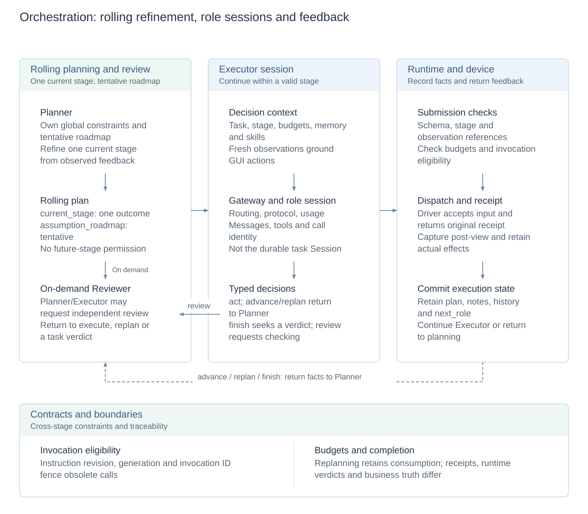
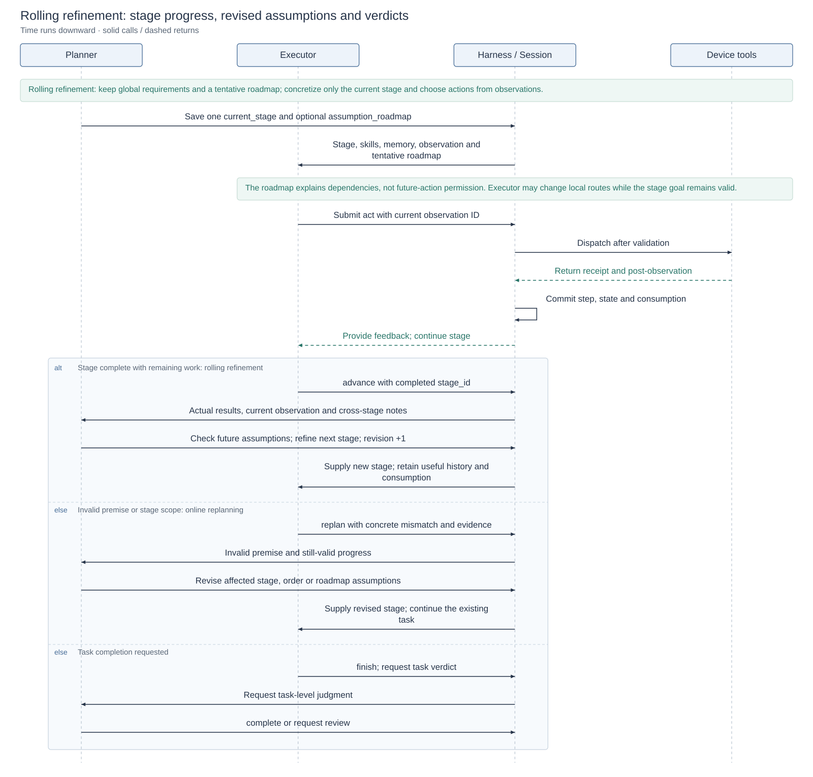

# Long-task orchestration and role collaboration

[Technical overview](reliability-design.md) · [Architecture and design index](architecture.md#module-design-documents) · [中文](task-orchestration.zh-CN.md)

This design owns stage plans, role transitions, invocation sessions and budgets. [Bidirectional HITL](hitl-design.md) owns user changes; [pause and crash recovery](crash-recovery.md) owns fault takeover.

Orchestration uses **rolling refinement**: retain global requirements and a tentative roadmap of future outcomes, but concretize only the current stage as an actionable outcome. Executor chooses local actions from each fresh observation. After a stage completes or a material premise changes, Planner uses new facts to refine the next portion of work.

## Design diagrams

<!-- design-diagram:orchestration-modules -->

Arrows show logical handoffs; timing is detailed below. Planner separates the current stage from future assumptions, Executor chooses actions within that stage, and runtime validates and records facts. Stage results or mismatches drive the next refinement; review is on demand.

[Mermaid source](diagrams/design-orchestration-modules.mmd)

<!-- /design-diagram:orchestration-modules -->

<!-- design-diagram:orchestration-round -->

Normal `advance` also returns to Planner to check future assumptions and refine the next stage. `replan` reports invalid premises and revises affected work. Executor handles local route changes; `finish` requests a task-level verdict.

[Mermaid source](diagrams/design-orchestration-round.mmd)

<!-- /design-diagram:orchestration-round -->

## Revisable stage plans

### Rolling refinement: concrete now, tentative later

Later screens, data and feasible routes often become known only through execution. Detailing every step upfront can harden unverified UI and dependency assumptions, while choosing only the immediate action can miss information needed later. ClickClick stores both planning granularities in one `Plan`:

| Level | Representation | Ownership and use |
| --- | --- | --- |
| Global requirements | Original instruction and accepted user changes | Constrain objects, order, scope and preservation throughout the task; a stage cannot override them. |
| Current stage | `current_stage` with `goal / target_app / skill_ids` | Planner concretizes one meaningful outcome. `goal` describes the result and correctness conditions; Executor owns taps, coordinates and local routes. |
| Future roadmap | Optional `assumption_roadmap` string list | Tentative future outcomes and dependencies only. Executor uses it to understand later needs, retain information and report mismatches; it does not authorize future-stage actions. |
| Current action | Executor decision from the stage, fresh observation, skills and feedback | Choose actions toward the current outcome incrementally; decide again after UI changes rather than scripting unseen screens. |

**Refinement follows new facts.** Once the current outcome is established, Executor uses `advance` to identify the completed stage. Planner checks roadmap premises against actual results, current observations and notes before choosing the next stage; it does not copy the next assumption directly into executable work. If evidence already supports the entire instruction, Planner may give a task verdict; unexecuted roadmap assumptions do not become new obligations. Sufficient ordinary feedback supports advancement without a fixed extra verification step. Explicit user checks and unresolved outcome issues still require completion.

### Choosing stage granularity

A stage targets **one small, meaningful outcome whose completion can be judged from execution feedback**. Planner selects boundaries using current observations, information dependencies, required skills and remaining budgets; Executor organizes the actual actions within those boundaries.

| Principle | Boundary and handling |
| --- | --- |
| Divide by outcome | `goal` states the result, information needed later and correctness conditions. Opening an app, searching, discovering a form and entering data normally belong inside the stage producing that result, rather than separate stages per tap or fixed action count. |
| Split at information dependencies | When facts obtained first determine the next goal or work order, collect source information as a separate stage, then refine subsequent work from actual results. Do not add a fixed pre-inspection stage before every operation. |
| Hand off when goals or skill scope change | Return to Planner when the stage goal, order or required skill scope must change. Executor handles local route changes while the goal remains valid. Navigation or app switching alone is not a fixed splitting rule. |
| Concrete now, tentative later | Concretize only one `current_stage`; retain future outcomes/dependencies in `assumption_roadmap`. Normal `advance` checks assumptions and refines the next stage; `replan` revises affected work when a premise fails. |
| Check feasibility against budgets | Consider both the current stage and required remaining work. Overly small stages add planning handoffs; overly large stages accumulate mismatches. If no evidence-supported continuation fits the budget, report the blocker and completed work rather than repeatedly assigning the same blocked goal. |

The [Planner prompt](../agent/prompts/revisable_planner.md#choose-useful-stages), stage protocol and execution feedback implement these principles together. **Models judge semantic granularity**. Runtime stores plan revisions, checks stage identity, prevents stale completion reports from advancing work and enforces budgets; it does not prove the decomposition optimal or clear progress/consumption during refinement or replanning.

### Local adaptation, stage advancement and online replanning

| Trigger | Handling | Retained work |
| --- | --- | --- |
| Goal still valid; local route needs changing | Executor continues observing/acting within the stage without calling Planner per action. | Current stage and useful execution dialogue. |
| Outcome established: `advance` | Complete the identified stage and return to Planner; check future assumptions and refine the next stage. | Completed facts, notes and consumption; the old roadmap never executes automatically. |
| Invalid premise, missing dependency or wrong stage scope: `replan` | Executor supplies a concrete mismatch and evidence; Planner revises affected goals, ordering or roadmap assumptions. | Still-valid progress rather than restarting because the plan changed. |
| Stage still valid after user changes: `continue` | Retain the stage and Executor dialogue at the user-steering planning entry. Use `execute` only when a new plan is needed. | Original stage identity and useful context. |

Thus **rolling refinement is the normal progression strategy; online replanning revises work when a mismatch appears**. Each Planner `execute` saves a new plan and increments `revision`, changing the stage ID. `advance` must identify the active `stage_id`; an old completion report cannot advance a newer plan. Planner considers both the current stage and remaining-work budgets; the roadmap, global requirements and cross-stage notes counter short-sighted stage decisions.

Stage completion differs from task completion. Executor `advance` closes the identified stage; `finish` returns the task-level judgment to Planner rather than treating an action receipt as success.

## Roles and submission protocol

| Role | Submission | Runtime handling |
| --- | --- | --- |
| Planner | `continue` / `execute` | Retain a valid stage, or persist a revised stage and invoke Executor |
| Planner | `review` / `complete` / `inconclusive` | Request independent review or submit a task-level verdict |
| Executor | `act` | Check observation references, arguments and budgets; dispatch and record feedback |
| Executor | `advance` / `replan` / `finish` | Close a stage, report a mismatch or request a task verdict |
| Executor | `review` | Request Reviewer with a concrete dispute and evidence |
| Reviewer | `execute` / `replan` / `complete` / `inconclusive` | Return to execution/planning or submit a verdict |

Default `plan_executor` uses Planner–Executor with Reviewer on demand. `plan_reviewer` routes Planner completion and Executor `finish` through final review, rather than reviewing every device action. An existing role chooses review within its own decision; no separate review-selection model is added.

Reviewer receives the task, stage, memory, observations and dispute rather than inheriting another role's full reasoning. Repeating the same review with unchanged observation, plan revision, execution count and note versions returns explicit feedback to avoid an evidence-free loop. Models own semantic judgment; runtime checks structure, references, stage identity and execution eligibility.

## Role sessions and context

A role `AgentSession` retains messages, tool results and pending calls within an invocation. Persistent task Session holds facts across roles, pauses and process recovery. These have different lifecycles.

Each decision assembles role-specific stable prompts, current task/stage, budgets, user changes, memory and applicable skills. Executor acts on current observations; Planner/Reviewer receive decision-relevant summaries and source handles. Compaction does not rewrite plans, notes or user instructions. See [memory and context](memory-and-context.md) and [skill delivery](skill-delivery.md).

## Execution round and control boundaries

1. A role receives context; the model returns tool calls or a role submission.
2. Runtime checks invocation identity, stage, observation, arguments and remaining budgets; eligible actions enter dispatch.
3. Receipts and post-observations become durable facts; step and task state advance before assembling the next context.
4. Continue, replan, review or terminate; pause, cancellation and user changes take effect at their control boundaries.

New instructions can invalidate undispatched old calls. Dispatched operations first retain their actual result: obsolete plans cannot erase facts or undo phone effects. Interruptions never replay old actions; staged transactions, late responses and unknown outcomes follow the [recovery design](crash-recovery.md).

## Budgets and main configuration

| Setting | Default | Meaning |
| --- | --- | --- |
| `CLICKCLICK_AGENT_ARCHITECTURE` | `plan_executor` | Two roles with on-demand review; optional `plan_reviewer` |
| `CLICKCLICK_DEFAULT_TASK_EXECUTOR_DECISIONS` | `200` | Cumulative ordinary-task Executor decision limit |
| `CLICKCLICK_DEFAULT_TASK_MODEL_CALLS` | `1000` | Cumulative model requests, including compaction |
| `CLICKCLICK_DEFAULT_TASK_DEVICE_ACTIONS` | Unset | Optional additional action limit |
| `CLICKCLICK_DEFAULT_TASK_SECONDS` | Unset | Optional absolute task time limit |

Explicit task/evaluation settings take precedence. Role handoffs are not device actions; compound submissions and physical subactions have separate counts. Exhaustion remains a failed attempt. An explicit extension can continue from an eligible safe budget checkpoint without clearing history or usage; only explicit extra time extends the deadline.

## Tradeoffs and implementation

Rolling refinement defers specific decisions about unseen UI and future dependencies until evidence is available. Continuous stage-local execution avoids global planning on every action. Handoffs still cost planning calls, and models choose stage granularity: overly small stages increase handoffs, while overly large stages can accumulate mismatches. Stages target one meaningful outcome, with handoffs when new information determines the next goal or a different skill scope is needed.

On-demand review avoids fixed review overhead but relies on models to recognize disputes. Runtime adds no page-keyword gate or separate semantic model to take over ordinary choices. Role prompts and model judgment maintain semantic stage scope; runtime checks structure, identity and eligibility. Runtime completion accepts a model verdict; business correctness still requires result evidence or independent scoring.

Implementation: [runtime.py](../agent/runtime.py), [orchestrator.py](../agent/revisable/orchestrator.py), [roles](../agent/revisable/roles.py), [submissions](../shared/revisable.py), [tool sessions](../agent/revisable/session.py), [budgets](../shared/task_budgets.py), [task control](../shared/task_control.py). Historical comparisons: [runtime study](runtime-study.md).

The [Planner prompt](../agent/prompts/revisable_planner.md) and [Executor prompt](../agent/prompts/revisable_executor.md) define rolling-refinement responsibilities. `Plan / Stage / PlanRuntime` define the current stage, tentative roadmap, plan revision and completed-stage identity.
