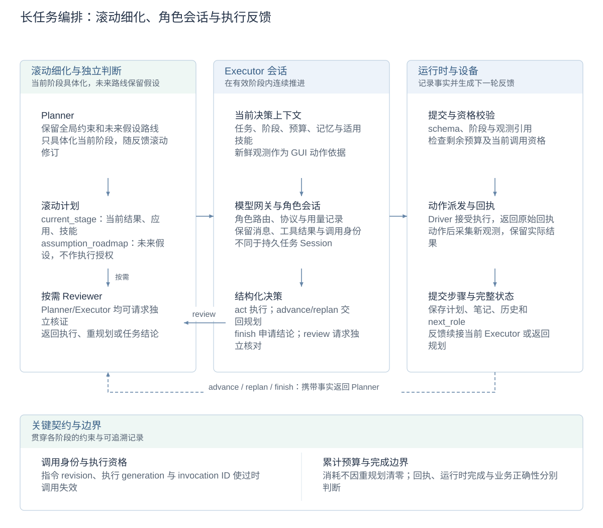
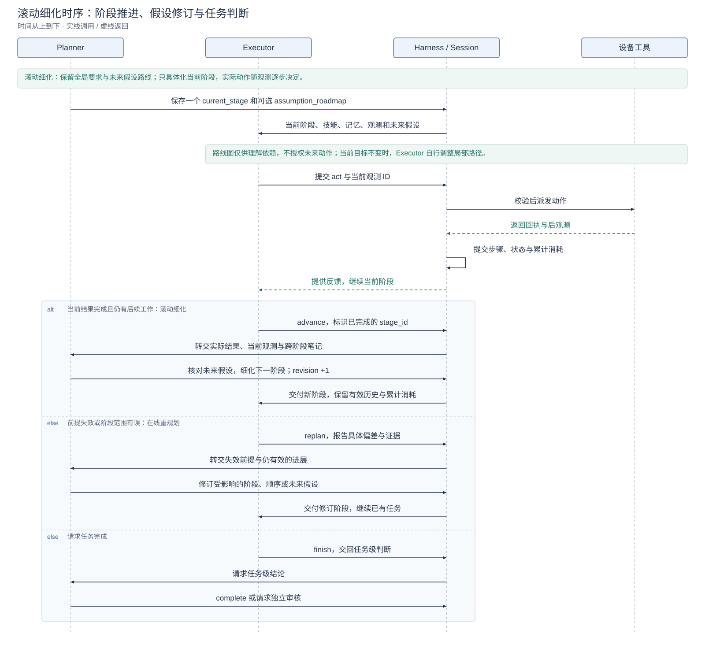

# 长任务编排与角色协作详设

[技术概览](reliability-design.zh-CN.md) · [架构与详设索引](architecture.zh-CN.md#模块设计文档) · [English](task-orchestration.md)

本文负责阶段计划、角色转换、调用会话与预算。用户变更如何进入计划见[双向 HITL](hitl-design.zh-CN.md)，故障接管见[暂停与异常恢复](crash-recovery.zh-CN.md)。

编排采用**滚动细化**：保留任务全局约束和未来结果的假设路线图，只把当前阶段具体化为一个可执行的结果目标；Executor 再依据每轮观测选择局部动作。当前阶段结束或关键前提变化后，Planner 用新增事实细化下一段工作。

## 设计图解

<!-- design-diagram:orchestration-modules -->

图示逻辑交接，具体时序见后图。Planner 区分当前阶段与未来假设，Executor 在当前阶段逐步选动作；运行时校验并保存事实，阶段结果或偏差再推动下一次细化。Reviewer 仅在需要时介入。

[Mermaid 源码](diagrams/design-orchestration-modules.zh-CN.mmd)

<!-- /design-diagram:orchestration-modules -->

<!-- design-diagram:orchestration-round -->

正常 `advance` 也会返回 Planner，核对未来假设并细化下一阶段；`replan` 报告失效前提并修订受影响工作。阶段内局部换路由 Executor 处理，`finish` 才请求任务级判断。

[Mermaid 源码](diagrams/design-orchestration-round.zh-CN.mmd)

<!-- /design-diagram:orchestration-round -->

## 可修订阶段计划

### 滚动细化：当前具体，未来保留假设

手机任务中的后续页面、数据和可行路径往往要执行后才知道。一次性细化全部步骤容易把未经验证的界面和依赖固定下来；只看眼前动作又容易遗漏后续所需信息。ClickClick 将两种计划粒度保存在同一个 `Plan` 中：

| 层次 | 表达方式 | 谁负责、如何使用 |
| --- | --- | --- |
| 全局要求 | 原始指令及已接受的用户变更 | 约束整项任务的对象、顺序、范围和保留要求；当前阶段不能覆盖这些要求。 |
| 当前阶段 | `current_stage`，含 `goal / target_app / skill_ids` | Planner 每次只具体化一个有意义的结果，`goal` 写清结果和正确条件；点击、坐标和局部路径交给 Executor。 |
| 未来路线 | 可选的 `assumption_roadmap` 字符串列表 | 仅描述暂定的未来结果和依赖。Executor 用它理解后续需求、保留必要信息和报告偏差；不能据此提前执行未来阶段。 |
| 当前动作 | Executor 依据当前阶段、最新观测、技能和反馈作出的决策 | 逐步选择达到当前结果的动作；页面变化后重新决定局部路径，不把未来屏幕预先写成脚本。 |

**细化发生在获得新事实之后。** 正常完成阶段时，Executor 用 `advance` 标识已完成的阶段；Planner 结合实际结果、当前观测和笔记重新核对路线图中的前提，再选择下一阶段，而不是直接把下一条假设复制成执行指令。若新事实已经支持整项指令完成，可直接给出任务结论，旧路线图中未执行的假设不自动成为剩余义务。阶段目标已经满足时，普通操作反馈足以支持推进便不额外增加固定核验步骤；用户明确要求的检查和未解决的结果问题仍需完成。

### 阶段粒度如何划分

阶段以**一个有意义、能根据执行反馈判断是否完成的小结果**为单位。Planner 根据当前观测、信息依赖、所需技能和剩余预算选择边界；Executor 在该边界内组织实际动作。

| 原则 | 划分依据与处理方式 |
| --- | --- |
| 按结果划分 | `goal` 写清结果、需要带到后续的信息和正确条件。打开应用、搜索、发现表单和填写等局部操作，通常包含在达成该结果的阶段内，不按点击或固定动作数拆分。 |
| 在信息依赖处切分 | 当先获取的事实会决定下一目标或工作顺序时，将来源信息获取作为独立阶段，再根据实际结果细化后续工作；不为每项操作固定增加预检查阶段。 |
| 在目标或技能范围变化时交接 | 阶段目标、顺序或所需技能范围需要改变时交回 Planner；目标不变、只需换局部路径时，由 Executor 在当前阶段处理。页面跳转或应用切换本身不作为固定拆分规则。 |
| 当前具体、未来暂定 | 只具体化一个 `current_stage`，未来结果和依赖留在 `assumption_roadmap`。正常 `advance` 后核对假设并细化下一阶段，前提失效时用 `replan` 修订受影响工作。 |
| 结合预算判断可行性 | 同时考虑当前阶段和剩余必需工作的开销。过细会增加规划交接，过粗会积累偏差；没有受证据支持且预算可容纳的后续路径时，报告阻塞与已完成工作，避免反复重派同一受阻目标。 |

这些原则通过 [Planner 提示词](../agent/prompts/revisable_planner.md#choose-useful-stages)、阶段协议和执行反馈共同落实。**粒度的语义合理性由模型判断**；运行时保存计划版本、校验阶段身份、防止旧阶段重复推进并约束预算，不自动判断拆分是否最优，也不因细化或重规划清空已有进度与消耗。

### 局部调整、阶段推进与在线重规划

| 触发 | 处理 | 保留的内容 |
| --- | --- | --- |
| 当前目标仍有效，只需换局部路径 | Executor 在同一阶段内继续观察和操作，无需每次调用 Planner。 | 当前阶段及有效执行对话。 |
| 当前结果已完成：`advance` | 完成带身份的当前阶段，交回 Planner；核对未来假设后细化下一阶段。 | 已完成事实、笔记和累计消耗；旧路线图不自动获得执行权。 |
| 前提不成立、依赖缺失或阶段范围有误：`replan` | Executor 提交具体偏差与证据，Planner 修改受影响的目标、顺序或路线假设。 | 仍有效的工作，不因为规划变化而从头执行。 |
| 用户变更后当前阶段仍适用：`continue` | 在用户变更的规划入口保留有效阶段及 Executor 对话；确需换阶段时才用 `execute` 提交新计划。 | 原阶段身份与有效上下文。 |

因此，**滚动细化是正常推进方式，在线重规划是发现偏差时的修订方式**。每次 Planner `execute` 保存新的计划版本并递增 `revision`，阶段 ID 随版本变化；`advance` 必须引用当前有效的 `stage_id`，不能用旧阶段报告推动新计划。Planner 同时考虑当前阶段和剩余工作的预算，路线图、全局要求及跨阶段笔记共同减少只顾眼前目标的问题。

阶段推进和任务完成分开：Executor 的 `advance` 结束已标识的阶段，`finish` 将任务级判断交回 Planner，不直接把一次动作回执当成任务成功。

## 角色与提交协议

| 角色 | 提交 | 运行时处理 |
| --- | --- | --- |
| Planner | `continue` / `execute` | 保持有效阶段，或保存修订阶段并交给 Executor |
| Planner | `review` / `complete` / `inconclusive` | 请求独立审核，或给出任务级结论 |
| Executor | `act` | 检查观测引用、动作参数和预算，派发后记录反馈 |
| Executor | `advance` / `replan` / `finish` | 完成阶段、报告偏差或请求任务级判断 |
| Executor | `review` | 带具体争议与证据请求 Reviewer |
| Reviewer | `execute` / `replan` / `complete` / `inconclusive` | 返回执行、返回规划或给出结论 |

默认 `plan_executor` 使用 Planner–Executor，并按需调用 Reviewer。`plan_reviewer` 将 Planner 完成与 Executor `finish` 导向最终审核；它不要求每次设备动作后都审核。审核请求由当前角色的一次决策发出，不增加专门的“是否审核”模型。

Reviewer 拿到任务、阶段、记忆、观测和争议，而不是继承另一个角色的全部推理。相同观测、计划版本、执行计数和笔记版本下重复发出同一审核会返回明确反馈，避免无新增证据的循环。模型仍负责语义判断；运行时检查提交结构、引用、阶段身份和执行资格。

## 角色会话与上下文

角色 `AgentSession` 保存一次调用内的模型消息、工具结果和待续接调用；持久任务 Session 保存跨角色、跨暂停和跨进程恢复的事实。二者不是同一个生命周期。

每次决策按角色组装稳定提示词、当前任务与阶段、预算、用户变更、记忆和可用技能。Executor 结合最新观测执行，Planner/Reviewer 使用决策所需的摘要与来源入口；历史压缩不改写计划、笔记或用户指令。详见[记忆与上下文](memory-and-context.zh-CN.md)和[技能交付](skill-delivery.zh-CN.md)。

## 一轮执行与控制边界

1. 角色得到当前上下文，模型返回工具调用或角色提交。
2. 运行时验证调用身份、阶段、观测、参数及剩余预算；有效动作进入派发通路。
3. 回执与后观测保存为执行事实，更新步骤及任务状态，再组装下一轮上下文。
4. 推进阶段、重规划、独立审核或终止；暂停、取消与用户变更在对应控制边界生效。

新指令可使未派发的旧调用失去资格。已派发操作先记录实际结果，不能因计划过时而删除事实或自动撤销手机效果。异常中断时不回放旧动作；分阶段事务、迟到响应和未知结果由[恢复详设](crash-recovery.zh-CN.md)统一定义。

## 预算与主要配置

| 配置 | 默认 | 语义 |
| --- | --- | --- |
| `CLICKCLICK_AGENT_ARCHITECTURE` | `plan_executor` | 双角色按需审核；可选 `plan_reviewer` |
| `CLICKCLICK_DEFAULT_TASK_EXECUTOR_DECISIONS` | `200` | 普通任务累计 Executor 决策上限 |
| `CLICKCLICK_DEFAULT_TASK_MODEL_CALLS` | `1000` | 累计模型请求上限，压缩也计入 |
| `CLICKCLICK_DEFAULT_TASK_DEVICE_ACTIONS` | 未设置 | 可额外指定设备动作限额 |
| `CLICKCLICK_DEFAULT_TASK_SECONDS` | 未设置 | 可额外指定绝对任务时限 |

显式任务／评测配置优先。角色交接不等于设备动作，复合动作的提交单位与物理子动作分别计数。耗尽保留失败结论；具备安全预算检查点时可明确增额后续跑，历史和消耗不清零，只有显式增加时间才延长 deadline。

## 设计取舍与实现

滚动细化把对未知页面和后续依赖的具体决策推迟到有现场证据时，减少过早规划；阶段内连续执行又避免每个动作都重做全局规划。代价是阶段交接需要规划调用，且阶段粒度由模型把握：过细会增加交接，过粗会积累偏差。按“一个有意义的结果”划分，并在新信息决定下一目标或技能范围变化时交接。

按需审核节省固定审核成本，也依赖模型识别真正的争议。运行时不通过页面关键词或另一个语义模型强制接管正常选择；阶段语义由角色提示词和模型判断维护，运行时校验结构、身份与资格。运行时完成表示接受了模型结论，业务正确性仍需结果证据或独立评分。

实现：[runtime.py](../agent/runtime.py)、[orchestrator.py](../agent/revisable/orchestrator.py)、[角色实现](../agent/revisable/roles.py)、[角色提交](../shared/revisable.py)、[工具会话](../agent/revisable/session.py)、[预算](../shared/task_budgets.py)、[任务控制](../shared/task_control.py)。历史对照见[运行时研究](runtime-study.md)。

滚动细化的具体职责见 [Planner 提示词](../agent/prompts/revisable_planner.md)与 [Executor 提示词](../agent/prompts/revisable_executor.md)；`Plan / Stage / PlanRuntime` 定义当前阶段、假设路线图、计划版本和完成阶段身份。
